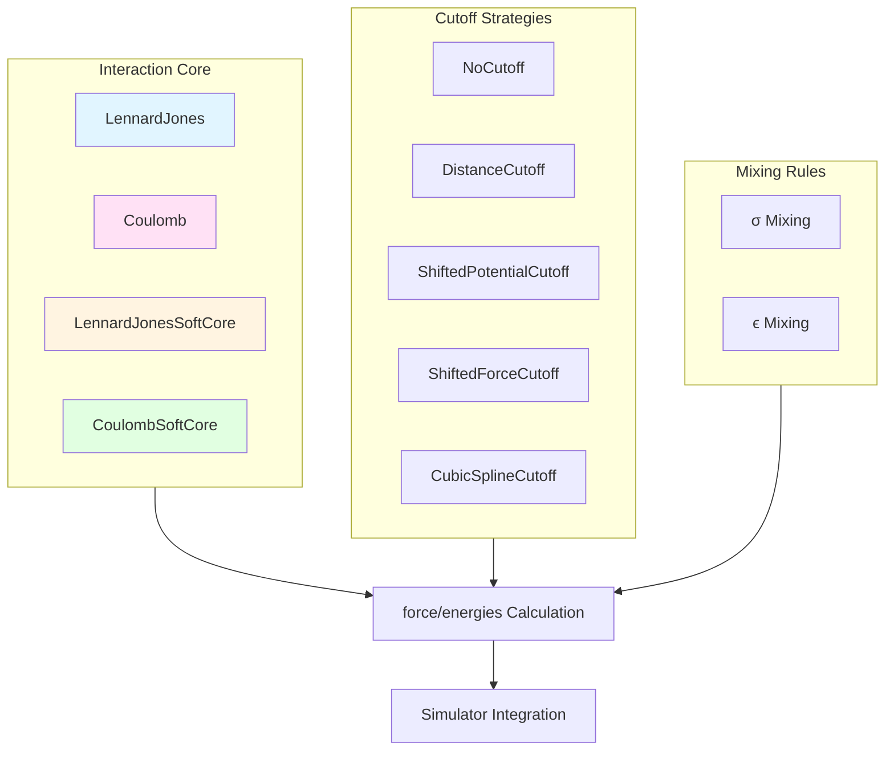

This page provides a comprehensive guide to pairwise interactions in Molly.jl, focusing on the two fundamental molecular mechanics potentials: Lennard-Jones (van der Waals) and Coulomb (electrostatic) interactions. These interactions form the backbone of non-bonded force field calculations in molecular simulations.

## Architectural Overview

Pairwise interactions in Molly.jl follow a unified interface design where each interaction type implements standardized methods for force and potential energy calculation. The architecture separates interaction definitions from cutoff strategies and mixing rules, enabling flexible composition and efficient computation.



The core interaction types leverage Julia's multiple dispatch to provide optimized implementations across different scenarios including CPU, GPU, and automatic differentiation contexts.

Sources: [force.jl](src/force.jl#L1-L100), [lennard_jones.jl](src/interactions/lennard_jones.jl#L1-L50), [coulomb.jl](src/interactions/coulomb.jl#L1-L50)

## Lennard-Jones Interactions

### Standard Lennard-Jones Potential

The Lennard-Jones 6-12 potential models van der Waals interactions between atoms, capturing both attractive (dispersion) and repulsive (Pauli exclusion) forces. This is the most widely used potential for modeling noble gases, hydrocarbons, and general molecular interactions.

**Mathematical Formulation:**

The potential energy is defined as:

$$V(r_{ij}) = 4\varepsilon_{ij} \left[\left(\frac{\sigma_{ij}}{r_{ij}}\right)^{12} - \left(\frac{\sigma_{ij}}{r_{ij}}\right)^{6}\right]$$

The force on each atom is:

$$\vec{F}_i = \frac{24\varepsilon_{ij}}{r_{ij}^2} \left[2\left(\frac{\sigma_{ij}^{6}}{r_{ij}^{6}}\right)^2 -\left(\frac{\sigma_{ij}}{r_{ij}}\right)^{6}\right] \vec{r}_{ij}$$

Where $\sigma_{ij}$ is the distance at which the potential crosses zero and $\varepsilon_{ij}$ is the well depth.

**Implementation:**

```julia
LennardJones(; cutoff=NoCutoff(), use_neighbors=false, shortcut=lj_zero_shortcut, 
             σ_mixing=lorentz_σ_mixing, ϵ_mixing=geometric_ϵ_mixing, weight_special=1)
```

The implementation uses optimized pairwise calculations that efficiently compute the six-term power once and reuse it for both the repulsive and attractive components. The default mixing rules follow the Lorentz-Berthelot combination rules, which are standard in most force fields.

Sources: [lennard_jones.jl](src/interactions/lennard_jones.jl#L12-L50), [lennard_jones.jl](src/interactions/lennard_jones.jl#L68-L85)

### Soft-Core Lennard-Jones Variants

Soft-core potentials address the singularity problem when atoms approach each other, which is critical for free energy calculations where atoms may appear or disappear during the simulation.

#### Beutler Soft-Core Potential

The Beutler soft-core modifies the effective distance calculation to prevent divergence:

$$r_{LJ} = \left(\frac{\alpha(1-\lambda)C^{(12)}}{C^{(6)}}+r^6\right)^{1/6}$$

Where $C^{(12)} = 4\epsilon\sigma^{12}$, $C^{(6)} = 4\epsilon\sigma^{6}$, and $\lambda \in [0,1]$ controls the coupling state. When $\lambda = 1$, the potential reduces to standard Lennard-Jones.

**Implementation:**
```julia
LennardJonesSoftCoreBeutler(; cutoff=NoCutoff(), α=1, λ=0, use_neighbors=false, 
                            shortcut=lj_zero_shortcut, σ_mixing=lorentz_σ_mixing, 
                            ϵ_mixing=geometric_ϵ_mixing, weight_special=1)
```

The parameter $\alpha$ determines the strength of softening, with typical values between 0.3 and 1.0 depending on the specific application.

Sources: [lennard_jones.jl](src/interactions/lennard_jones.jl#L105-L145), [lennard_jones.jl](src/interactions/lennard_jones.jl#L205-L225)

#### Gapsys Soft-Core Potential

The Gapsys formulation uses a piecewise definition with smooth transitions:

$$V(r_{ij}) = \begin{cases}
\frac{C^{(12)}}{r_{ij}^{12}} - \frac{C^{(6)}}{r_{ij}^{6}}, & \text{if } r \ge r_{LJ} \\
(\frac{78C^{(12)}}{r_{LJ}^{14}}-\frac{21C^{(6)}}{r_{LJ}^{8}})r_{ij}^2 - (\frac{168C^{(12)}}{r_{LJ}^{13}}-\frac{48C^{(6)}}{r_{LJ}^{7}})r_{ij} + \frac{91C^{(12)}}{r_{LJ}^{12}}-\frac{28C^{(6)}}{r_{LJ}^{6}}, & \text{if } r < r_{LJ}
\end{cases}$$

This formulation ensures both energy and force continuity at the crossover point $r_{LJ}$.

Sources: [lennard_jones.jl](src/interactions/lennard_jones.jl#L258-L316)

### Ashbaugh-Hatch Potential

The Ashbaugh-Hatch potential provides a modified Lennard-Jones interaction useful for tuning the attractive-repulsive balance:

$$V_{AH}(r_{ij}) = \begin{cases}
V_{LJ}(r_{ij}) +\varepsilon_{ij}(1-λ_{ij}), & r_{ij}\leq 2^{1/6}\sigma \\
λ_{ij}V_{LJ}(r_{ij}), & 2^{1/6}\sigma \leq r_{ij}
\end{cases}$$

The parameter $\lambda$ allows adjustment of the well depth without affecting the repulsive core, which is valuable for coarse-grained models where interaction strengths need modification.

Sources: [lennard_jones.jl](src/interactions/lennard_jones.jl#L388-L430), [lennard_jones.jl](src/interactions/lennard_jones.jl#L464-L496)

> [!TIP]
> The Ashbaugh-Hatch potential is particularly useful for implicit solvent models where you want to maintain realistic repulsive interactions but scale down attractive forces to account for solvent screening effects without modifying the force field parameters.

## Coulomb Interactions

### Standard Coulomb Potential

Coulomb interactions model electrostatic forces between charged atoms, essential for accurate simulation of polar molecules, ions, and biomolecular systems.

**Mathematical Formulation:**

$$V(r_{ij}) = \frac{q_i q_j}{4 \pi \varepsilon_0 r_{ij}}$$

The implementation uses a predefined Coulomb constant optimized for Molly.jl's unit system:

```julia
const coulomb_const = 138.93545764u"kJ * mol^-1 * nm"  # 1 / 4πϵ₀
```

**Implementation:**
```julia
Coulomb(; cutoff=NoCutoff(), use_neighbors=false, weight_special=1, 
        coulomb_const=coulomb_const)
```

The force calculation scales with the inverse square of distance, making efficient neighbor list calculation critical for performance in large systems.

Sources: [coulomb.jl](src/interactions/coulomb.jl#L1-L20), [coulomb.jl](src/interactions/coulomb.jl#L28-L70)

### Soft-Core Coulomb Variants

Similar to Lennard-Jones, soft-core Coulomb potentials prevent singularities when charged atoms approach each other during free energy perturbations.

#### Beutler Coulomb Soft-Core

$$V(r_{ij}) = \frac{1}{4\pi\epsilon_0} \frac{q_iq_j}{r_Q^{1/6}}$$

Where $r_Q = (\frac{\alpha(1-\lambda)C^{(12)}}{C^{(6)}})+r_{ij}^6$ uses the same soft-core formulation as Lennard-Jones but applies it to electrostatic interactions.

Sources: [coulomb.jl](src/interactions/coulomb.jl#L93-L155)

> [!TIP]
> When performing alchemical transformations with both Lennard-Jones and Coulomb interactions, it's generally recommended to use matching soft-core parameter families (e.g., both Beutler or both Gapsys) to ensure consistent thermodynamic integration paths.

### Advanced Coulomb Methods

For periodic systems with long-range electrostatics, Molly.jl provides Ewald summation and Particle Mesh Ewald (PME) methods. These are covered in detail in [Ewald and PME Electrostatic Summation](13-ewald-and-pme-electrostatic-summation).

Additionally, for systems with high ionic strength or dielectric environments, the CoulombReactionField method approximates the effects beyond the cutoff distance using a dielectric continuum model.

Sources: [ewald.jl](src/interactions/ewald.jl#L1-L50)

## Cutoff Strategies

Cutoff strategies are essential for computational efficiency in large systems by limiting interactions to nearby atoms. Molly.jl provides multiple cutoff methods that balance accuracy and performance.

| Cutoff Type | Continuity | Computational Cost | Best Use Case |
|-------------|------------|-------------------|---------------|
| **NoCutoff** | N/A | High (all pairs) | Small systems, testing |
| **DistanceCutoff** | Energy/Force discontinuous | Low | Simple liquids, where discontinuities are acceptable |
| **ShiftedPotentialCutoff** | Energy continuous | Low-Medium | General purpose when energy conservation is important |
| **ShiftedForceCutoff** | Energy/Force continuous | Medium | Dynamics requiring smooth forces |
| **CubicSplineCutoff** | Energy/Force continuous | Medium-High | Highest accuracy requirements |

### Mathematical Definitions

**DistanceCutoff** (simple truncation):
$$V_c(r) = \begin{cases} V(r), r \le r_c \\ 0, r > r_c \end{cases}$$

**ShiftedPotentialCutoff** (energy continuity):
$$V_c(r) = \begin{cases} V(r) - V(r_c), r \le r_c \\ 0, r > r_c \end{cases}$$

**ShiftedForceCutoff** (force continuity):
$$V_c(r) = \begin{cases} V(r) - (r-r_c) V'(r_c) - V(r_c), r \le r_c \\ 0, r > r_c \end{cases}$$

**CubicSplineCutoff** (smooth interpolation):
Uses a cubic Hermite spline between an activation distance ($r_a$) and cutoff distance ($r_c$):
$$t = \frac{r - r_a}{r_c - r_a}$$
$$V_c(r) = (2t^3 - 3t^2 + 1) V(r_a) + (t^3 - 2t^2 + t) (r_c - r_a) V'(r_a), \quad r_a < r \le r_c$$

Sources: [cutoffs.jl](src/cutoffs.jl#L1-L80)

> [!TIP]
> The ShiftedForceCutoff is recommended for most molecular dynamics simulations as it provides smooth forces without the computational overhead of the cubic spline while maintaining energy conservation better than distance or shifted potential cutoffs.

## Mixing Rules

Mixing rules determine how interaction parameters for different atom types are combined. Molly.jl supports multiple mixing strategies to accommodate different force field conventions.

### σ Mixing Rules

**Lorentz (arithmetic mean):**
$$\sigma_{ij} = \frac{\sigma_i + \sigma_j}{2}$$
This is the standard in AMBER, CHARMM, and most force fields.

**Geometric mean:**
$$\sigma_{ij} = \sqrt{\sigma_i \sigma_j}$$
Used in OPLS-AA and some specialized force fields.

**Waldman-Hagler:**
$$\sigma_{ij} = \frac{2^{7/6}\sigma_i\sigma_j}{\sigma_i^{1/6} + \sigma_j^{1/6}}$$
Provides better size asymmetry handling.

### ϵ Mixing Rules

**Geometric (Lorentz-Berthelot):**
$$\epsilon_{ij} = \sqrt{\epsilon_i \epsilon_j}$$
The most widely used combination rule.

**Waldman-Hagler:**
$$\epsilon_{ij} = \frac{2\sqrt{\epsilon_i \epsilon_j}\sigma_i^3\sigma_j^3}{\sigma_i^6 + \sigma_j^6}$$
Accounts for polarizability differences.

**Fender-Halsey:**
$$\epsilon_{ij} = \frac{2\epsilon_i\epsilon_j}{\epsilon_i + \epsilon_j}$$
Harmonic mean, useful for certain applications.

Sources: [interactions.jl](test/interactions.jl#L14-L20)

## Implementation Examples

### Basic Lennard-Jones Fluid

```julia
using Molly

# Define atoms with LJ parameters
n_atoms = 100
atoms = [Atom(charge=0.0, σ=0.34u"nm", ϵ=0.65u"kJ * mol^-1", mass=39.95u"g/mol") 
         for _ in 1:n_atoms]

# Set up boundary conditions
boundary = CubicBoundary(3.4u"nm")

# Initialize positions randomly
coords = [boundary * (rand(SVector{3, Float64}) .- 0.5) for _ in 1:n_atoms]

# Create Lennard-Jones interaction with cutoff
lj_interaction = LennardJones(
    cutoff=DistanceCutoff(1.2u"nm"),  # Standard 12Å cutoff
    use_neighbors=true,                # Enable neighbor list
)

# Build system
system = System(
    atoms=atoms,
    coords=coords,
    boundary=boundary,
    pairwise_interactions=(lj_interaction,),
    neighbor_finder=DistanceNeighborFinder(nb_matrix=trues(n_atoms, n_atoms), 
                                            dist_cutoff=1.2u"nm"),
)
```

### Electrostatic System with Soft-Core

```julia
# Define charged atoms with LJ parameters
atoms = [
    Atom(charge=1.0, σ=0.3u"nm", ϵ=0.2u"kJ * mol^-1", mass=12.01u"g/mol"),
    Atom(charge=-1.0, σ=0.3u"nm", ϵ=0.2u"kJ * mol^-1", mass=12.01u"g/mol"),
]

# Soft-core interactions for alchemical transformation
lj_soft = LennardJonesSoftCoreBeutler(
    cutoff=DistanceCutoff(1.0u"nm"),
    α=0.5,      # Softening parameter
    λ=0.0,      # Starting at decoupled state
    use_neighbors=true,
)

coulomb_soft = CoulombSoftCoreBeutler(
    cutoff=DistanceCutoff(1.0u"nm"),
    α=0.5,
    λ=0.0,
    use_neighbors=true,
)

system = System(
    atoms=atoms,
    coords=coords,
    boundary=CubicBoundary(2.0u"nm"),
    pairwise_interactions=(lj_soft, coulomb_soft),
)
```

### Custom Mixing Rules

```julia
# Define custom mixing function
function custom_σ_mixing(atom_i, atom_j)
    # Example: weighted average favoring larger atoms
    larger = max(atom_i.σ, atom_j.σ)
    smaller = min(atom_i.σ, atom_j.σ)
    return 0.7 * larger + 0.3 * smaller
end

# Apply to interaction
lj_custom = LennardJones(
    cutoff=ShiftedForceCutoff(1.2u"nm"),
    σ_mixing=custom_σ_mixing,  # Use custom mixing
    ϵ_mixing=geometric_ϵ_mixing,
)
```

Sources: [interactions.jl](test/interactions.jl#L1-L50)

## Performance Considerations

### Neighbor List Optimization

The `use_neighbors` flag enables neighbor list calculation, which provides O(N) complexity instead of O(N²) for large systems:

```julia
lj_interaction = LennardJones(
    cutoff=DistanceCutoff(1.2u"nm"),
    use_neighbors=true,  # Critical for systems > 500 atoms
)
```

For more details on neighbor finding algorithms and performance tuning, see [Neighbor Finding Algorithms and Cell Lists](20-neighbor-finding-algorithms-and-cell-lists).

Sources: [lennard_jones.jl](src/interactions/lennard_jones.jl#L51-L53)

### GPU Acceleration

Pairwise interactions can be accelerated on GPUs by using CUDA-compatible coordinate arrays and force calculations. The interaction definitions remain the same; the computational backend handles device execution.

For comprehensive GPU implementation details, refer to [GPU Acceleration with CUDA](21-gpu-acceleration-with-cuda).

### Cutoff Distance Selection

Choosing appropriate cutoff distances balances accuracy and performance:

| System Type | Recommended Cutoff | Notes |
|-------------|-------------------|-------|
| Pure LJ fluids | 2.5-3.0σ | Ensure tail contribution < 1% |
| Biomolecular systems | 1.0-1.2 nm | Standard in protein force fields |
| Implicit solvent | 0.8-1.0 nm | Shorter due to screening |
| Coarse-grained | 1.2-2.0 nm | Larger effective radii |

Sources: [cutoffs.jl](src/cutoffs.jl#L140-L160)

## Special Interactions and 1-4 Scaling

Many force fields apply scaling factors to non-bonded interactions between atoms separated by three bonds (1-4 interactions). Molly.jl handles this through the `weight_special` parameter:

```julia
lj_interaction = LennardJones(
    cutoff=ShiftedForceCutoff(1.2u"nm"),
    weight_special=0.5,  # Standard 1-4 scaling for AMBER
)

coulomb_interaction = Coulomb(
    cutoff=ShiftedForceCutoff(1.2u"nm"),
    weight_special=0.8333,  # 1/1.2 scaling factor
)
```

The `special` flag in force/energy calls indicates whether the pair is a 1-4 interaction, automatically applying the scaling factor.

Sources: [lennard_jones.jl](src/interactions/lennard_jones.jl#L51-L53), [coulomb.jl](src/interactions/coulomb.jl#L54-L57)

## Testing and Validation

Molly.jl includes comprehensive tests validating interaction energies and forces against analytical values and external reference implementations:

```julia
# Test verification from test suite
@testset "Lennard-Jones Forces" begin
    a1 = Atom(charge=1.0, σ=0.3u"nm", ϵ=0.2u"kJ * mol^-1")
    dr = SVector(0.1, 0.0, 0.0)u"nm"
    
    # Verify force calculation
    f = force(LennardJones(), dr, a1, a1)
    @test isapprox(f, expected_force; atol=1e-9u"kJ * mol^-1 * nm^-1")
    
    # Verify energy calculation
    pe = potential_energy(LennardJones(), dr, a1, a1)
    @test isapprox(pe, expected_energy; atol=1e-9u"kJ * mol^-1")
end
```

Sources: [interactions.jl](test/interactions.jl#L29-L48)

## Best Practices

1. **Always use cutoffs for production simulations** - Full calculations are prohibitively expensive for systems > 1000 atoms
2. **Match cutoff types across interactions** - Using different cutoff strategies for LJ and Coulomb can cause energy conservation issues
3. **Consider soft-core for alchemical calculations** - Prevents numerical instabilities when atoms appear/disappear
4. **Validate mixing rules with your force field** - Different force fields may require specific combinations
5. **Profile performance** - Use Julia's profiling tools to identify whether pairwise interactions are your bottleneck before optimization

## Next Steps

- For specialized bonded interactions, see [Specific Interactions: Bonds, Angles, and Torsions](11-specific-interactions-bonds-angles-and-torsions)
- To implement custom pairwise potentials, refer to [Custom Interaction Implementation](12-custom-interaction-implementation)
- For long-range electrostatic handling in periodic systems, explore [Ewald and PME Electrostatic Summation](13-ewald-and-pme-electrostatic-summation)
- Learn about computational optimization in [Neighbor Finding Algorithms and Cell Lists](20-neighbor-finding-algorithms-and-cell-lists)
