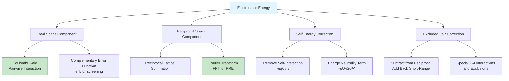

Accurate computation of long-range electrostatic interactions is critical for realistic molecular dynamics simulations of ionic solutions, proteins, and other charged systems. Molly.jl provides two complementary approaches based on the Ewald summation framework: the classical O(N²) Ewald method and the more efficient O(N log N) Particle Mesh Ewald (PME) method. Both methods decompose the electrostatic energy into real-space and reciprocal-space components, enabling control over accuracy through parameter selection while ensuring proper handling of periodic boundary conditions.

Sources: [ewald.jl](/src/interactions/ewald.jl#L1-L982), [coulomb.jl](/src/interactions/coulomb.jl#L495-L600)

## Long-Range Electrostatics Architecture

Ewald and PME methods address the fundamental challenge of calculating electrostatic interactions in periodic systems, where Coulomb interactions decay slowly (as 1/r) and require summation over an infinite number of periodic images. The core insight is to decompose the slowly convergent sum into rapidly convergent components that can be computed efficiently.



The total electrostatic energy in Molly's implementation follows the standard Ewald decomposition:

```
E_total = E_real + E_reciprocal + E_self + E_correction
```

The real-space term computes screened Coulomb interactions within a cutoff radius using the complementary error function `erfc(αr)`, where α is the Ewald splitting parameter that controls the division of labor between real and reciprocal space. The reciprocal-space term handles the long-range contributions through Fourier space, with PME accelerating this computation using Fast Fourier Transforms on a regular mesh.

Sources: [ewald.jl](/src/interactions/ewald.jl#L157-L188), [coulomb.jl](/src/interactions/coulomb.jl#L495-L550)

## Classical Ewald Summation

The `Ewald` struct provides a reference implementation of the classical Ewald summation algorithm, useful for validation and small systems where the O(N²) complexity is acceptable. The method is particularly valuable for understanding the mathematical foundations and as a benchmark for the more complex PME implementation.

```julia
Ewald(dist_cutoff; error_tol=0.0005, eligible=nothing, special=nothing)
```

The Ewald splitting parameter α is automatically computed from the cutoff distance and error tolerance:

```
α = (1/r_cut) × √(-ln(2ε))
```

where `r_cut` is the real-space cutoff and `ε` is the error tolerance. Larger α values shift more work to reciprocal space, while smaller values increase real-space computation. The reciprocal space grid size is determined by the error function to ensure the desired accuracy.

Sources: [ewald.jl](/src/interactions/ewald.jl#L157-L188), [ewald.jl](/src/interactions/ewald.jl#L213-L219)

### Real-Space Computation

The real-space component uses `CoulombEwald`, which computes the screened Coulomb potential:

```
E_real = Σ_(i<j) q_i q_j erfc(αr_ij) / (4πε₀ r_ij)
```

For pairs beyond the cutoff distance, the interaction is considered zero due to the exponential decay of the complementary error function. The force calculation includes the derivative of the screening function:

```
F_ij = -∇_i E_real = (q_i q_j / (4πε₀ r_ij²)) × 
       [erfc(αr_ij)/r_ij + 2α/√π exp(-α²r_ij²)] × r_ij_vector
```

This requires the `CoulombEwald` interaction to be included in the simulation's pairwise interactions alongside the `Ewald` calculator.

Sources: [coulomb.jl](/src/interactions/coulomb.jl#L495-L550), [coulomb.jl](/src/interactions/coulomb.jl#L568-L595)

### Reciprocal-Space Computation

The reciprocal-space contribution is computed by summing over all k-vectors in the reciprocal lattice:

```
E_reciprocal = (2π/V) Σ_k≠0 (1/k²) exp(-k²/4α²) |Σ_j q_j exp(ik·r_j)|²
```

Molly implements this using a direct summation over a finite set of k-vectors determined by the error tolerance. The algorithm iterates through kx, ky, kz indices up to computed maximum values `nrx, nry, nrz`, computing the structure factor using pre-computed complex exponentials `eir` array. This optimization stores `exp(im k·r)` values for each atom and k-component, avoiding redundant trigonometric calculations.

Sources: [ewald.jl](/src/interactions/ewald.jl#L256-L336), [ewald.jl](/src/interactions/ewald.jl#L279-L335)

### Excluded Interactions

Pairs excluded from the short-range neighbor list (such as 1-2 bonded pairs, 1-3 angles, and optionally 1-4 dihedrals) require special handling. These interactions are subtracted from the reciprocal-space sum and added back using the full (unscreened) Coulomb interaction:

```
E_excluded = Σ_(excluded pairs) -q_i q_j erfc(αr_ij) / (4πε₀ r_ij) + q_i q_j / (4πε₀ r_ij)
           = Σ_(excluded pairs) q_i q_j erf(αr_ij) / (4πε₀ r_ij)
```

The `find_excluded_pairs` function identifies these pairs based on the `eligible` and `special` matrices, storing them as integer tuples for efficient computation.

Sources: [ewald.jl](/src/interactions/ewald.jl#L48-L63), [ewald.jl](/src/interactions/ewald.jl#L105-L116)

### Self-Energy and Charge Corrections

Two analytical corrections complete the Ewald sum:

**Self-energy correction** (removes interaction of each charge with itself in reciprocal space):

```
E_self = -α/√π Σ_i q_i²
```

**Charge neutrality correction** (ensures proper handling when total charge ≠ 0):

```
E_charge = -π/(2α²V) (Σ_i q_i)²
```

These are computed exactly and included in the final energy. The virial contribution from the charge correction is proportional to the identity matrix.

Sources: [ewald.jl](/src/interactions/ewald.jl#L337-L344)

## Particle Mesh Ewald (PME)

The `PME` struct implements the efficient O(N log N) smooth particle mesh Ewald algorithm, which is the method of choice for production simulations of large systems. PME replaces the direct reciprocal-space summation with a three-step process: charge spreading onto a regular mesh, Fourier transform-based convolution, and force interpolation back to atomic positions.

```julia
PME(dist_cutoff, atoms, boundary; 
    error_tol=0.0005, 
    order=5, 
    ϵr=1.0, 
    fixed_charges=true, 
    eligible=nothing, 
    special=nothing,
    grad_safe=false, 
    n_threads=Threads.nthreads())
```

The implementation is based on the smooth PME algorithm from Essmann et al. (1995) and includes optimizations from the OpenMM implementation. Key features include automatic mesh size determination, B-spline interpolation of specified order, and support for GPU acceleration.

Sources: [ewald.jl](/src/interactions/ewald.jl#L352-L381), [ewald.jl](/src/interactions/ewald.jl#L410-L511)

### PME Workflow

The PME computation follows a systematic pipeline that transforms atomic charges to grid-based potentials and back:

```mermaid
flowchart LR
    A[Atomic Coordinates & Charges] --> B[Grid Placement]
    B --> C[B-Spline Evaluation]
    C --> D[Charge Spreading]
    D --> E[Forward FFT]
    E --> F[Reciprocal Convolution]
    F --> G[Inverse FFT]
    G --> H[Force Interpolation]
    
    subgraph "Setup"
        B --> B1[Compute Grid Indices]
        B --> B2[Grid Fractions]
        C --> C1[BSplines_θ<br/>B-Spline Values]
        C --> C2[BSplines_dθ<br/>Derivatives]
    end
    
    subgraph "Reciprocal Space"
        F --> F1[Apply Green's Function<br/>exp -k²/4α² / k²]
        F --> F2[B-Spline Moduli<br/>|θk|² correction]
    end
    
    H --> I[Forces on Atoms]
    F --> J[Reciprocal Energy]
    
    style A fill:#fff3e0
    style E fill:#e1f5fe
    style G fill:#e1f5fe
    style I fill:#c8e6c9
    style J fill:#c8e6c9
```

This workflow is executed by `ewald_pe_forces!` for the `PME` type, which orchestrates the sequence of operations and combines results with excluded interactions and correction terms.

Sources: [ewald.jl](/src/interactions/ewald.jl#L941-L981)

### Grid Placement and B-Splines

Atomic positions are mapped onto the mesh using fractional coordinates within the unit cell. For each atom, the integer grid indices `grid_indices` and fractional offsets `grid_fractions` are computed:

```julia
t_d = Σ_α coords[i][α] × reciprocal_box[α][d]
t_d = frac(t_d) × mesh_dims[d]
grid_indices[d, i] = floor(t_d) % mesh_dims[d]
grid_fractions[d, i] = t_d - floor(t_d)
```

B-splines of the specified order (default 5) are evaluated at these fractional positions using a recursive recurrence relation. Both the spline values `bsplines_θ` and their derivatives `bsplines_dθ` are computed, enabling accurate interpolation. Higher-order splines provide better accuracy at the cost of increased computation and memory.

Sources: [ewald.jl](/src/interactions/ewald.jl#L557-L589), [ewald.jl](/src/interactions/ewald.jl#L591-L649)

### Charge Spreading

Atomic charges are distributed onto the mesh grid using B-spline interpolation. Each atom contributes to a local region of `order³` grid points (typically 125 for order=5):

```julia
charge_grid[z_index, y_index, x_index] += 
    q_i × θ_x × θ_y × θ_z
```

where `θ_x, θ_y, θ_z` are the B-spline values for the respective grid indices. This operation is implemented with multi-threading for CPU execution and parallel kernels for GPU execution. A buffer array is used for multi-threaded CPU execution to avoid write conflicts.

Sources: [ewald.jl](/src/interactions/ewald.jl#L660-L728)

### Reciprocal Convolution with FFT

After charge spreading, the grid is transformed to reciprocal space using FFT, then convolved with the analytical Green's function:

```
Ĝ(k) = 4π/(Vε_r) × exp(-k²/4α²) / (k² × |θ(k)|²)
```

where `|θ(k)|²` are the B-spline moduli pre-computed during PME initialization. These moduli correct for the spreading of charges onto the grid. The convolution multiplies the FFT'd charge grid with `Ĝ(k)`:

```
charge_grid(k) ← charge_grid(k) × Ĝ(k)
```

An inverse FFT brings the result back to real space, yielding the potential at each grid point from which forces are interpolated.

Sources: [ewald.jl](/src/interactions/ewald.jl#L730-L785), [ewald.jl](/src/interactions/ewald.jl#L427-L473)

### Force Interpolation

Forces on atoms are computed by taking the gradient of the grid potential using the pre-computed B-spline derivatives:

```
F_i = -q_i × Σ_{local grid} [∂θ/∂x × θ_y × θ_z × V_grid 
                            + θ_x × ∂θ/∂y × θ_z × V_grid
                            + θ_x × θ_y × ∂θ/∂z × V_grid]
```

The interpolation sums over the same local grid region used in charge spreading, accessing the potential values `V_grid` computed from the inverse FFT. The gradient includes coordinate transformation factors from the box vectors to properly account for non-orthogonal unit cells.

Sources: [ewald.jl](/src/interactions/ewald.jl#L869-L935)

## Performance Considerations and Optimization

### Parameter Selection Guide

Choosing appropriate parameters involves balancing accuracy, memory usage, and computational cost:

| Parameter | Effect | Recommended Range |
|-----------|--------|-------------------|
| `dist_cutoff` | Real-space cutoff radius | 0.9-1.2 nm (9-12 Å) |
| `error_tol` | Target error per interaction | 10⁻³ - 10⁻⁵ |
| `order` (PME) | B-spline interpolation order | 4-8 (default 5) |
| `mesh_dims` | Grid size in each dimension | Auto-computed from parameters |

> [!TIP]
> The mesh dimensions are computed automatically as `s = max(6, ceil(2αL/(3ε^0.2)))`, where L is the box side length. Larger meshes improve accuracy but increase memory and FFT cost. The default `order=5` provides an excellent balance for most applications.

Sources: [ewald.jl](/src/interactions/ewald.jl#L552-L555)

### Computational Complexity

The algorithms exhibit distinct scaling characteristics:

**Classical Ewald**: O(N²) due to direct reciprocal-space summation and real-space pair calculations. Suitable for N < 1,000 atoms or validation studies.

**PME**: O(N log N) dominated by the FFT operations. The constant factors include:
- Charge spreading: O(N × order³)
- FFT: O(mesh³ × log(mesh³))
- Force interpolation: O(N × order³)

For typical protein systems (N ~ 10,000-100,000 atoms), PME provides 10-100× speedup over classical Ewald.

Sources: [ewald.jl](/src/interactions/ewald.jl#L174-L176)

### Memory Usage

PME requires substantial memory for grid storage and FFT buffers:

```julia
# Main allocations
charge_grid::Complex{T}  # mesh_dims[3] × mesh_dims[2] × mesh_dims[1]
bsplines_θ::T           # order × n_atoms × 3
grid_indices::Int        # 3 × n_atoms
```

For a 128×128×128 mesh with 50,000 atoms and order=5, approximately 200 MB of GPU memory is required. Multi-threaded CPU execution uses per-thread buffers to avoid synchronization overhead.

Sources: [ewald.jl](/src/interactions/ewald.jl#L382-L408), [ewald.jl](/src/interactions/ewald.jl#L475-L490)

### GPU Acceleration

Both Ewald and PME support GPU execution through kernel-based implementations. PME provides the most significant performance gains on GPU due to:
- Highly parallel charge spreading and force interpolation
- Optimized FFT libraries (cuFFT for CUDA)
- Coalesced memory access patterns for grid operations

The implementation uses `@kernel` macros from KernelAbstractions.jl, supporting both CUDA and AMDGPU backends through abstract GPU arrays.

Sources: [ewald.jl](/src/interactions/ewald.jl#L118-L142), [ewald.jl](/src/interactions/ewald.jl#L710-L728)

## Integration with Molly Simulation Framework

### AtomsCalculators.jl Interface

Both `Ewald` and `PME` implement the AtomsCalculators.jl interface, making them compatible with Molly's general simulation machinery. The interface provides methods for computing potential energy, forces, or both:

```julia
AtomsCalculators.potential_energy(sys, inter::AbstractEwald)
AtomsCalculators.forces!(fs, sys, inter::AbstractEwald)
AtomsCalculators.energy_forces!(fs, sys, inter::AbstractEwald)
```

These methods internally call `ewald_pe_forces!`, which dispatches to the appropriate implementation based on the interaction type (`Ewald` or `PME`).

Sources: [ewald.jl](/src/interactions/ewald.jl#L10-L46)

### Virial and Pressure Calculation

Both implementations support virial computation required for pressure calculations in NPT simulations. The virial tensor includes contributions from:

- Real-space forces (handled by `CoulombEwald`)
- Reciprocal-space stress tensor using the analytical expression
- Charge neutrality correction (isotropic component)

The virial computation is enabled by passing `needs_vir=true` and providing a buffer for accumulation.

Sources: [ewald.jl](/src/interactions/ewald.jl#L317-L344), [ewald.jl](/src/interactions/ewald.jl#L758-L783)

### Automatic Differentiation Support

PME includes a `grad_safe` mode for use with Enzyme.jl automatic differentiation. When `grad_safe=true`:

- FFT operations use gradient-safe wrappers
- Multi-threading is disabled (Enzyme limitation)
- Partial charge sums are recomputed rather than cached

This enables computation of energy and force gradients with respect to system parameters, useful for force field optimization and enhanced sampling methods.

Sources: [ewald.jl](/src/interactions/ewald.jl#L938-L939), [ewald.jl](/src/interactions/ewald.jl#L944)

## Usage Examples

### Basic PME Setup

```julia
using Molly

# Define system with charged atoms
atoms = [Atom(index=i, charge=rand(-1:1)) for i in 1:1000]
coords = place_atoms(1000, 5.0nm, boundary=CubicBoundary(5.0nm))
boundary = CubicBoundary(5.0nm)

# Create PME calculator
pme = PME(
    1.0nm,              # dist_cutoff
    atoms,              # atoms for initial charge info
    boundary;           # boundary conditions
    error_tol=1e-4,     # error tolerance
    order=5             # B-spline order
)

# Create short-range component (required)
coulomb_ewald = CoulombEwald(
    dist_cutoff=1.0nm,
    error_tol=1e-4
)

# Use in simulation
interactions = (
    (atoms, coulomb_ewald),
    pme  # Long-range calculator
)
```

Sources: [ewald.jl](/src/interactions/ewald.jl#L352-L511), [coulomb.jl](/src/interactions/coulomb.jl#L495-L550)

### PME with GPU Acceleration

```julia
using Molly, CUDA

# Transfer to GPU
atoms_gpu = CuArray(atoms)
coords_gpu = CuArray(coords)

# Create PME with GPU backend
pme_gpu = PME(1.0nm, atoms_gpu, boundary)

# Force calculation (automatically uses GPU)
fs_gpu = zero_forces(System(atoms_gpu, coords_gpu, boundary))
forces!(fs_gpu, System(atoms_gpu, coords_gpu, boundary), pme_gpu)
```

The GPU path automatically uses appropriate kernels and cuFFT operations for maximum performance.

Sources: [ewald.jl](/src/interactions/ewald.jl#L410-L511)

### Custom Accuracy Control

```julia
# High-accuracy simulation for benchmarking
high_acc_pme = PME(
    1.2nm, 
    atoms, 
    boundary; 
    error_tol=1e-6,  # Very strict tolerance
    order=8          # Higher-order B-splines
)

# Faster simulation with acceptable accuracy
fast_pme = PME(
    0.9nm,
    atoms,
    boundary;
    error_tol=1e-3,  # More relaxed tolerance
    order=4          # Lower-order B-splines
)
```

The mesh dimensions will be automatically adjusted to meet the specified error tolerance.

Sources: [ewald.jl](/src/interactions/ewald.jl#L552-L555)

### Ewald for Validation

```julia
# Classical Ewald for small system validation
ewald = Ewald(1.0nm; error_tol=1e-5, eligible=nothing, special=nothing)

# Compare with PME for convergence testing
energy_ewald = potential_energy(sys, ewald)
energy_pme = potential_energy(sys, pme)
```

The classical Ewald implementation serves as a reference for verifying PME correctness on small systems where both methods are tractable.

Sources: [ewald.jl](/src/interactions/ewald.jl#L157-L188)

## Comparison of Electrostatic Methods

| Feature | Ewald | PME | CoulombReactionField |
|---------|-------|-----|----------------------|
| **Complexity** | O(N²) | O(N log N) | O(N) |
| **Accuracy** | Exact (for given α, cutoff) | Controlled by mesh, order | Approximate |
| **GPU Support** | No | Yes | Yes |
| **Memory Usage** | Low | High (mesh storage) | Low |
| **Setup Cost** | Minimal | Significant (FFT plans) | Minimal |
| **Typical Use Case** | Validation, small systems | Production MD | Implicit solvent, coarse-grained |

Sources: [ewald.jl](/src/interactions/ewald.jl#L174-L176), [coulomb.jl](/src/interactions/coulomb.jl#L378-L393)

> [!TIP]
> For most production simulations of biomolecular systems, PME with default parameters (1.0 nm cutoff, 10⁻⁴ error tolerance, order 5) provides an excellent balance of accuracy and performance. Only consider classical Ewald for systems with fewer than ~500 atoms or for validation purposes.

## Troubleshooting and Common Issues

### "kmax for Ewald summation is 0" Error

This error occurs when the computed reciprocal space grid size is zero, typically due to an overly large α parameter or very small box dimensions. Solutions:
- Increase `error_tol` to relax accuracy requirements
- Decrease `dist_cutoff` to reduce α
- Verify box dimensions are reasonable (> 1 nm)

Sources: [ewald.jl](/src/interactions/ewald.jl#L239-L241)

### Out of Memory Errors

PME requires substantial memory for grid storage. Mitigation strategies:
- Reduce `order` parameter (5 → 4 saves ~30% memory)
- Increase `error_tol` (reduces required mesh size)
- Use smaller `dist_cutoff` (affects mesh size indirectly)

Sources: [ewald.jl](/src/interactions/ewald.jl#L475-490)

### Energy Drift in NVE Simulations

Small energy drift can indicate convergence issues:
- Verify `error_tol` is sufficiently small (≤ 10⁻⁴ recommended)
- Check that `CoulombEwald` and `Ewald`/`PME` use matching parameters
- Ensure excluded pairs are correctly specified

Sources: [ewald.jl](/src/interactions/ewald.jl#L236-L237)

### Performance Bottlenecks

Common performance issues and solutions:
- **CPU**: Increase `n_threads` parameter for parallel execution
- **GPU**: Ensure proper CuFFT installation; check GPU memory usage
- **Small systems**: Classical Ewald may be faster than PME due to FFT overhead

Sources: [ewald.jl](/src/interactions/ewald.jl#L632-L638), [ewald.jl](/src/interactions/ewald.jl#L814-L826)

## Advanced Topics

### Dielectric Boundary Conditions

The `ϵr` parameter in PME allows specification of an effective dielectric constant for the simulation medium. Setting `ϵr > 1` scales the Coulomb interactions by 1/ϵr, useful for implicit solvent models or simulating systems with background dielectric. For vacuum simulations (explicit solvent), use `ϵr=1.0` (default).

Sources: [ewald.jl](/src/interactions/ewald.jl#L384-L407)

### Non-orthogonal Boxes

PME supports arbitrary triclinic unit cells through proper coordinate transformation in the reciprocal box calculation. The `invert_box_vectors` function computes the reciprocal basis, and all grid operations use these transformed coordinates. Forces are correctly mapped back to the Cartesian frame.

Sources: [ewald.jl](/src/interactions/ewald.jl#L953-L967)

### Force Field Integration

Ewald/PME methods integrate seamlessly with Molly's force field system. The interaction calculators are typically added to the simulation's interaction tuple alongside bonded interactions:

```julia
simulator = VelocityVerlet(
    dt=0.001ps,
    coupling=AndersenThermostat(300K, 0.1ps)
)

sim = Simulation(
    system=sys,
    interactions=(pairwise_interactions, pme),
    simulator=simulator,
    # ... other parameters
)
```

The energy and forces from all interactions are summed during simulation.

Sources: [src/interactions/ewald.jl](/src/interactions/ewald.jl#L1-L982)

## Summary

Molly.jl provides robust implementations of both classical Ewald summation and the more efficient Particle Mesh Ewald method for handling long-range electrostatic interactions in periodic molecular dynamics simulations. The key architectural principles include:

- **Modular decomposition** separating real-space and reciprocal-space calculations
- **Flexible interface** through AtomsCalculators.jl enabling integration with Molly's simulation infrastructure
- **Automatic parameter selection** for accuracy control through error tolerance specification
- **Performance optimization** through multi-threading and GPU acceleration for PME
- **Comprehensive validation** through the classical Ewald reference implementation

For production simulations of systems with more than ~1,000 atoms, PME is strongly recommended due to its superior scaling characteristics. The default parameters (1.0 nm cutoff, 10⁻⁴ error tolerance, order 5) provide excellent accuracy for most biomolecular applications. Classical Ewald remains valuable for validation studies, small systems, and educational purposes.

Sources: [ewald.jl](/src/interactions/ewald.jl#L1-L982), [coulomb.jl](/src/interactions/coulomb.jl#L495-L600)

## Further Reading

- [Pairwise Interactions: Lennard-Jones and Coulomb](10-pairwise-interactions-lennard-jones-and-coulomb) - Covers the short-range electrostatic components that complement Ewald/PME
- [Boundary Conditions and Periodic Systems](8-boundary-conditions-and-periodic-systems) - Details on periodic boundary condition implementation in Molly
- [Performance Optimization](21-gpu-acceleration-with-cuda) - GPU acceleration techniques applicable to PME
- [Automatic Differentiation with Enzyme](24-automatic-differentiation-with-enzyme) - Using PME with gradient-based optimization
