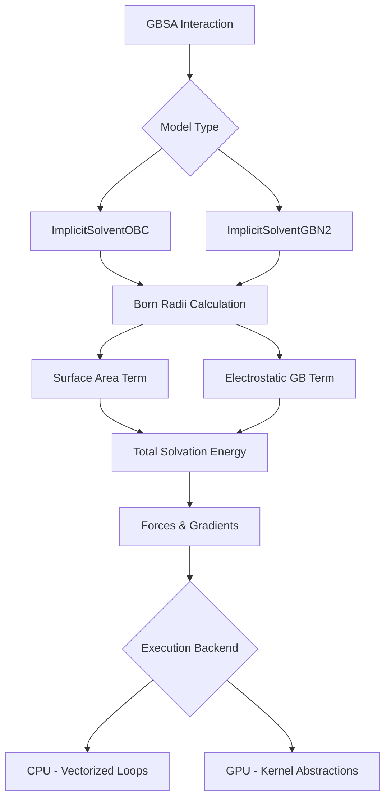
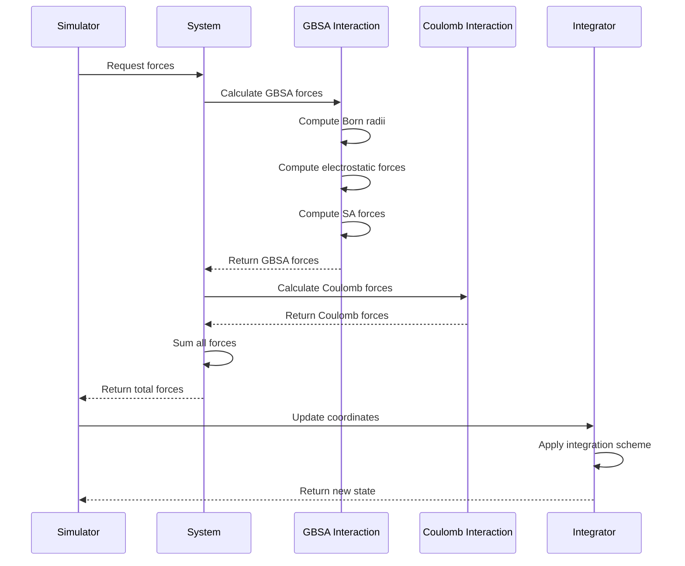

Implicit solvent models provide a computationally efficient alternative to explicit water simulations by representing solvent effects through analytical terms. Molly.jl implements two Generalized Born (GB) models augmented with Solvent Accessible Surface Area (SA) corrections: the Onufriev-Bashford-Case (OBC) model and the more advanced GBn2 model. Both models approximate the electrostatic contribution of solvation while incorporating nonpolar hydrophobic effects through surface area terms. These implementations, derived from OpenMM source code, support both CPU and GPU execution paths for maximum flexibility in performance-critical applications.

## Theoretical Foundation and Architecture

GBSA methods decompose solvation free energy into electrostatic (GB) and nonpolar (SA) components: ΔG_solv = ΔG_GB + ΔG_SA. The electrostatic term approximates the Poisson-Boltzmann equation using pairwise atomic interactions, while the SA term accounts for hydrophobic effects proportional to the solvent-accessible surface area. Molly.jl's implementation follows this framework with a clear separation of concerns between physical model definition and computational strategy.



The computational flow follows a systematic pattern: atomic radii assignment from bond topology → Born radii computation via pairwise integration → surface area overlap calculation → electrostatic energy evaluation → force computation via chain rule differentiation. This pipeline is implemented through specialized methods for CPU and GPU backends, with the GPU path using KernelAbstractions for parallel execution.

## Model Comparison and Selection

Molly.jl provides two distinct GBSA implementations with different trade-offs between accuracy and computational cost. Understanding these differences enables informed selection based on simulation requirements.

| **Feature** | **ImplicitSolventOBC** | **ImplicitSolventGBN2** |
|------------|------------------------|------------------------|
| **Parameter Set** | GBOBCI (default) or GBOBCII (use_OBC2=true) | GBn2 with nucleic acid extensions |
| **Radius Scheme** | mbondi2 radii | mbondi3 radii (specialized for ARG, carboxylates) |
| **Screening Factors** | Element-specific (0.72-0.96) | Element-specific with nucleic acid variants |
| **Neck Correction** | None | Integrated correction via lookup tables |
| **Parameter Tables** | None required | d0, m0 lookup tables (21×21 interpolation) |
| **Accuracy** | Good for proteins | Higher accuracy, especially for nucleic acids |
| **Performance** | ~1.0× baseline | ~1.2-1.5× OBC (due to lookup tables) |
| **Use Cases** | General protein simulations | Mixed protein/nucleic acid systems |

> [!TIP]
> The GBN2 model's superior accuracy for nucleic acids stems from specialized parameter sets and neck correction terms that account for overlapping van der Waals volumes in densely packed systems. Use GBN2 when nucleic acids are present or when higher accuracy is critical to your study.

## Atomic Parameter Assignment

Both models require atomic radii assignment based on molecular topology, which is computed during interaction construction. The `mbondi2_radii` and `mbondi3_radii` functions handle this assignment with bond topology analysis:

```julia
function mbondi2_radii(atoms_data, bonds; use_mbondi3=false,
                        element_to_radius=mbondi2_element_to_radius)
    bonded_to_N = atoms_bonded_to_N(atoms_data, bonds)
    return map(atoms_data, bonded_to_N) do at_data, at_bonded_to_N
        if use_mbondi3 && at_data.res_name == "ARG" &&
                (startswith(at_data.atom_name, "HH") || startswith(at_data.atom_name, "HE"))
            radius = element_to_radius["H_ARG"]  # 0.117 nm for ARG hydrogens
        elseif use_mbondi3 && is_carboxylate_O(at_data)
            radius = element_to_radius["O_CAR"]  # 0.14 nm for carboxylate oxygens
        elseif at_data.element in ("H", "D")
            radius = at_bonded_to_N ? element_to_radius["H_N"] : element_to_radius["H"]
        else
            radius = dict_get(element_to_radius, at_data.element, element_to_radius["-"])
        end
        return radius
    end
end
```

Sources: [implicit_solvent.jl](src/interactions/implicit_solvent.jl#L266-L282)

The radius assignment follows mbondi conventions: hydrogen radii depend on bonding environment (H_N = 0.13 nm for H bonded to N, H = 0.12 nm otherwise), while heavy atom radii are element-specific. The mbondi3 scheme introduces specialized radii for arginine sidechain hydrogens (H_ARG) and carboxylate oxygens (O_CAR) for improved accuracy.

## Born Radii Calculation Core

Born radii computation is the most computationally intensive component, requiring pairwise atomic interaction evaluation. The OBC model implements the analytical expression:

```mermaid
flowchart TD
    A[For each atom i] --> B[Initialize I_i = 0]
    B --> C[For each atom j]
    C --> D{Distance r_ij > cutoff?}
    D -->|Yes| E[Skip interaction]
    D -->|No| F[Compute U = r_ij + scaled_radius_j]
    F --> G{offset_radius_i < U?}
    G -->|No| E
    G -->|Yes| H[Compute D_ij = |r_ij - scaled_radius_j|]
    H --> I[Compute L = max(offset_radius_i, D_ij)]
    I --> J[Add integral term to I_i]
    J --> K{offset_radius_i < scaled_radius_j - r_ij?}
    K -->|Yes| L[Add buried atom correction]
    K -->|No| M[Next j]
    L --> M
    M --> N[Next j check]
    N -->|Continue| C
    N -->|Done| O[Compute B_i = fψ, α, β, γ]
    O --> P[Next i]
```

The pairwise integral calculation implements the analytical expression from Onufriev et al.:

```julia
function born_radii_loop_OBC(coord_i, coord_j, ori, srj, dist_cutoff, boundary)
    I = zero(coord_i[1] / unit(dist_cutoff)^2)
    r = norm(vector(coord_i, coord_j, boundary))
    if iszero_value(r) || (!iszero_value(dist_cutoff) && r > dist_cutoff)
        return I
    end
    U = r + srj
    if ori < U
        D_ij = abs(r - srj)
        L = max(ori, D_ij)
        I += (1/L - 1/U + (r - (srj^2)/r)*(1/(U^2) - 1/(L^2))/4 + log(L/U)/(2*r)) / 2
        if ori < (srj - r)
            I += 2 * (1/ori - 1/L)
        end
    end
    return I
end
```

Sources: [implicit_solvent.jl](src/interactions/implicit_solvent.jl#L623-L639)

The integral I is transformed into a Born radius through a smoothing function that prevents numerical instability when atoms are closely packed:

```julia
function born_radii_sum(or, offset, I, α, β, γ)
    radius = or + offset
    ψ = I * or
    ψ2 = ψ^2
    tanh_sum = tanh(α * ψ - β * ψ2 + γ * ψ2 * ψ)
    B = inv(inv(or) - tanh_sum / radius)
    grad_term = or * (α - 2 * β * ψ + 3 * γ * ψ2)
    B_grad = (1 - tanh_sum^2) * grad_term / radius
    return B, B_grad
end
```

Sources: [implicit_solvent.jl](src/interactions/implicit_solvent.jl#L644-L653)

This smoothing uses a hyperbolic tangent function with model-specific parameters: OBC uses (α=0.8, β=0.0, γ=2.909125) for parameter set I or (α=1.0, β=0.8, γ=4.85) for parameter set II. The function returns both the Born radius B and its gradient B_grad with respect to the integral I, enabling force computation via the chain rule.

## GBN2 Model Enhancements

The GBn2 model extends the OBC framework with two critical improvements: atom-type-specific screening parameters and a neck correction term for overlapping van der Waals volumes. These enhancements improve accuracy, particularly for densely packed systems like nucleic acids.

Atom-specific α, β, γ parameters replace the global values used in OBC:

```julia
αs_cpu = map(atoms_data) do at_data
    if at_data.res_name in nucleic_acid_residues
        α = dict_get(atom_params_nucleic, at_data.element * "_α", atom_params_nucleic["-_α"])
    else
        α = dict_get(atom_params, at_data.element * "_α", atom_params["-_α"])
    end
    return T(α)
end
```

Sources: [implicit_solvent.jl](src/interactions/implicit_solvent.jl#L508-L515)

The neck correction accounts for the volume between closely spaced atoms where the dielectric continuum approximation breaks down. This correction uses pre-computed lookup tables for d0 (critical distance) and m0 (integral magnitude) parameters:

```julia
if r < (radius_i + radius_j + neck_cut)
    if dimension(C) == u"𝐋"
        r_d0_strip = 10 * ustrip(u"nm", r - d0) # The integral uses Å
    else
        r_d0_strip = 10 * (r - d0)
    end
    denom = 1 + r_d0_strip^2 + 3 * r_d0_strip^6 / 10
    I += neck_scale * m0 / denom
    numer = 2 * r_d0_strip + 9 * r_d0_strip^5 / 5
    I_grad -= 10 * neck_scale * m0 * numer / (denom^2 * unit(dist_cutoff))
end
```

Sources: [implicit_solvent.jl](src/interactions/implicit_solvent.jl#L711-L721)

The lookup table interpolation uses bilinear interpolation on a 21×21 grid spanning radii from 0.1 to 2.1 nm:

```julia
function lookup_table(full_table::AbstractArray{T}, radii) where T
    n_atoms = length(radii)
    table_positions = [(r - 0.1u"nm") * 200 for r in radii]
    index_1, index_2 = zeros(Int, n_atoms), zeros(Int, n_atoms)
    weight_1, weight_2 = zeros(n_atoms), zeros(n_atoms)
    for (i, p) in enumerate(table_positions)
        if p <= 0.0u"nm"
            weight_1[i] = 1.0
        elseif p >= 20.0u"nm"
            index_1[i] = 20
            weight_1[i] = 1.0
        else
            ps = ustrip(u"nm", p)
            index_1[i] = Int(floor(ps))
            index_2[i] = index_1[i] + 1
            weight_1[i] = index_2[i] - ps
            weight_2[i] = 1.0 - weight_1[i]
        end
    end
    # ... bilinear interpolation
end
```

Sources: [implicit_solvent.jl](src/interactions/implicit_solvent.jl#L290-L320)

> [!TIP]
> The lookup table mechanism enables efficient pairwise parameter evaluation without sacrificing accuracy. The 21-point grid provides sufficient resolution for smooth interpolation while keeping memory requirements minimal (441 entries per table).

## Electrostatic Energy and Force Computation

The GB electrostatic energy follows the generalized Born expression:

E_GB = Σ_i Σ_j (q_i q_j / f_GB) × (1/ε_solute - 1/ε_solvent)

where f_GB = √(r_ij² + B_i B_j exp(-r_ij² / (4 B_i B_j))) represents the effective distance in the continuum dielectric.

The force computation requires careful application of the chain rule to account for both explicit distance dependence and implicit dependence through Born radii:

```julia
function gb_force_loop_1(coord_i, coord_j, i, j, charge_i, charge_j, Bi, Bj, dist_cutoff,
                            factor_solute, factor_solvent, kappa, boundary)
    if j < i
        zero_force = zero(factor_solute ./ coord_i .^ 2)
        return zero_force[1], zero_force[1], zero_force, zero_force
    end
    dr = vector(coord_i, coord_j, boundary)
    r2 = sum(abs2, dr)
    if !iszero_value(dist_cutoff) && r2 > dist_cutoff^2
        zero_force = zero(factor_solute ./ coord_i .^ 2)
        return zero_force[1], zero_force[1], zero_force, zero_force
    end
    alpha2_ij = Bi * Bj
    D = r2 / (4 * alpha2_ij)
    exp_term = exp(-D)
    denominator2 = r2 + alpha2_ij * exp_term
    denominator = sqrt(denominator2)
    if iszero_value(kappa)
        pre_factor = factor_solute + factor_solvent
    else
        pre_factor = factor_solute + exp(-kappa * denominator) * factor_solvent +
                        kappa * denominator * exp(-kappa * denominator) * factor_solvent
    end
    Gpol = (pre_factor * charge_i * charge_j) / denominator
    dGpol_dr = -Gpol * (1 - exp_term/4) / denominator2
    dGpol_dalpha2_ij = -Gpol * exp_term * (1 + D) / (2 * denominator2)
    change_born_force_i = dGpol_dalpha2_ij * Bj
    if i != j
        change_born_force_j = dGpol_dalpha2_ij * Bi
        fdr = dr * dGpol_dr
        change_fs_i =  fdr
        change_fs_j = -fdr
        return change_born_force_i, change_born_force_j, change_fs_i, change_fs_j
    else
        zero_force = zero(factor_solute ./ coord_i .^ 2)
        return change_born_force_i, zero_force[1], zero_force, zero_force
    end
end
```

Sources: [implicit_solvent.jl](src/interactions/implicit_solvent.jl#L837-L874)

The two-stage force calculation separates direct distance forces from forces propagated through Born radii changes. The first loop computes direct pairwise forces and accumulates Born radius force contributions, while the second loop propagates these contributions through the Born radius gradients:

```julia
function forces_gbsa!(fs, sys, inter, Bs, B_grads, I_grads, born_forces, atom_charges)
    # Stage 1: Direct forces + Born radius accumulation
    @inbounds for i in eachindex(sys)
        for j in eachindex(sys)
            bi, bj, fi, fj = gb_force_loop_1(...)
            born_forces[i] += bi
            born_forces[j] += bj
            fs[i] = fs[i] .+ fi
            fs[j] = fs[j] .+ fj
        end
    end

    # Stage 2: Propagate through Born radius gradients
    born_forces_2 = born_forces .* (Bs .^ 2) .* B_grads
    @inbounds for i in eachindex(sys)
        for j in eachindex(sys)
            f = gb_force_loop_2(coords[i], coords[j], born_forces_2[i], I_grads[i, j],
                                inter.oris[i], inter.srjs[j], inter.dist_cutoff, boundary)
            fs[i] = fs[i] .- f
            fs[j] = fs[j] .+ f
        end
    end

    return fs
end
```

Sources: [implicit_solvent.jl](src/interactions/implicit_solvent.jl#L898-L925)

## GPU Acceleration Architecture

The GPU implementation maintains algorithmic equivalence with the CPU path while exploiting massive parallelism through KernelAbstractions. Both born radii and force computations use specialized kernels:

```julia
@kernel function gbsa_born_kernel!(Is, I_grads, @Const(coords),
                                   @Const(offset_radii),
                                   @Const(scaled_offset_radii),
                                   dist_cutoff, offset, neck_scale, neck_cut,
                                   @Const(d0s), @Const(m0s), boundary,
                                   ::Val{C}) where C
    n_atoms = length(coords)
    n_inters = n_atoms ^ 2
    inter_i = @index(Global, Linear)

    @inbounds if inter_i <= n_inters
        i = cld(inter_i, n_atoms)
        j = (inter_i - 1) % n_atoms + 1
        if i != j
            # ... compute I and I_grad using pairwise integral
            Atomix.@atomic Is[i] += ustrip(unit(dist_cutoff)^-1, I)
            I_grads[i, j] += ustrip(unit(dist_cutoff)^-2, I_grad)
        end
    end
end
```

Sources: [implicit_solvent.jl](src/interactions/implicit_solvent.jl#L786-L835)

The GPU thread count can be tuned via the `MOLLY_GPUNTHREADS_IMPLICIT` environment variable (default: 512 threads), enabling optimization for different hardware architectures:

```julia
function gpu_threads_gbsa(n_inters)
    n_threads_gpu = parse(Int, get(ENV, "MOLLY_GPUNTHREADS_IMPLICIT", "512"))
    return n_threads_gpu
end
```

Sources: [implicit_solvent.jl](src/interactions/implicit_solvent.jl#L761-L764)

## Configuration and Usage

Constructing an implicit solvent interaction requires atomic coordinates, atom data (including element and residue information), and bond topology:

```julia
# OBC model construction
inter_obc = ImplicitSolventOBC(
    atoms,           # Array of Atom objects
    atoms_data,      # Array of AtomData objects with element/residue info
    bonds;           # HarmonicBond list for topology analysis
    solvent_dielectric=78.5,
    solute_dielectric=1.0,
    kappa=0.0u"nm^-1",              # Debye-Hückel screening (0 = no salt)
    offset=obc_offset,              # Default: 0.009 nm
    dist_cutoff=0.0u"nm",           # Distance cutoff (0 = no cutoff)
    use_ACE=true,                   # Use ACE approximation
    use_OBC2=false                  # Use parameter set II if true
)

# GBN2 model construction
inter_gbn2 = ImplicitSolventGBN2(
    atoms, atoms_data, bonds;
    solvent_dielectric=78.5,
    solute_dielectric=1.0,
    kappa=0.0u"nm^-1",
    offset=gbn2_offset,             # Default: 0.0195141 nm
    neck_scale=gbn2_neck_scale,    # Default: 0.826836
    neck_cut=gbn2_neck_cut,        # Default: 0.68 nm
    use_ACE=true
)
```

Sources: [implicit_solvent.jl](src/interactions/implicit_solvent.jl#L360-L432), [implicit_solvent.jl](src/interactions/implicit_solvent.jl#L470-L583)

The implicit solvent interaction must be used alongside a Coulomb interaction to account for vacuum electrostatics:

```julia
# Combine with Coulomb for complete electrostatic treatment
inter_coulomb = CoulombInteraction(
    cutoff=1.0u"nm",
    nl_only=false,
    force_units=ustrip(1.0u"kJ * mol^-1 * nm^-1")
)

sys = System(
    atoms=atoms,
    atoms_data=atoms_data,
    coords=coords,
    boundary=CubicBoundary(box_size),
    pairwise_interactors=(inter_coulomb,),
    general_inters=(inter_obc,)  # Add implicit solvent
)
```

## Performance Considerations

GBSA calculations scale as O(N²) due to the pairwise nature of Born radii computation. Several optimization strategies are available:

| **Optimization** | **Description** | **Expected Speedup** |
|------------------|-----------------|----------------------|
| **Distance Cutoff** | Limit pairwise interactions to dist_cutoff | 2-5× (system-dependent) |
| **GPU Execution** | Parallelize pairwise loops | 10-50× (hardware-dependent) |
| **Neighbor Lists** | Reduce unnecessary pair evaluations | Not currently implemented |
| **Precomputed Radii** | Skip topology analysis on reuse | Negligible (one-time cost) |

The GPU implementation provides substantial speedup for large systems but incurs transfer overhead for small systems. A practical heuristic suggests using GPU acceleration for systems with >1000 atoms when GBSA is the dominant computational cost.

> [!TIP]
> When using distance cutoffs with GBSA, ensure the cutoff value is sufficiently large to include all atoms that contribute significantly to the Born radius integral. A conservative choice is 2-3× the maximum atomic radius plus the offset parameter.

## Parameter Reference

### Dielectric Constants
- **Solvent dielectric (ε_solvent)**: 78.5 (default, consistent with AMBER)
- **Solute dielectric (ε_solute)**: 1.0 (vacuum interior)
- **Effective dielectric**: ε_eff = 1/ε_solute - 1/ε_solvent ≈ 0.987

### Physical Constants
- **Coulomb constant**: 1389.35458 kJ·nm·mol⁻¹ (implicitly used)
- **Probe radius (r_probe)**: 0.14 nm (water probe for surface area)
- **SA factor**: 28.3919551 kJ·mol⁻¹·nm⁻² (surface tension equivalent)

### Model-Specific Parameters

| **Parameter** | **OBC Set I** | **OBC Set II** | **GBN2** |
|---------------|---------------|----------------|----------|
| **Offset** | 0.009 nm | 0.009 nm | 0.0195141 nm |
| **α** | 0.8 | 1.0 | atom-specific |
| **β** | 0.0 | 0.8 | atom-specific |
| **γ** | 2.909125 | 4.85 | atom-specific |
| **Neck scale** | N/A | N/A | 0.826836 |
| **Neck cut** | N/A | N/A | 0.68 nm |

### Element-Specific Radii (mbondi2/mbondi3)
- **C**: 0.17 nm
- **N**: 0.155 nm
- **O**: 0.15 nm
- **S**: 0.18 nm
- **P**: 0.185 nm
- **H (general)**: 0.12 nm
- **H_N (bonded to N)**: 0.13 nm
- **H_ARG (ARG sidechain)**: 0.117 nm
- **O_CAR (carboxylate)**: 0.14 nm

Sources: [implicit_solvent.jl](src/interactions/implicit_solvent.jl#L27-L41)

## Integration with Simulation Pipeline

GBSA interactions integrate seamlessly with Molly.jl's simulation framework through the AtomsCalculators.jl interface. The calculator pattern enables automatic force and energy evaluation during integration steps:



The GBSA interaction automatically handles unit conversions and maintains consistency with other force terms in the system. Current implementations do not support virial calculation for pressure control, so barostats should be used with caution in implicit solvent simulations.

## Advanced Topics: Custom GBSA Models

The abstract type hierarchy enables implementation of custom GBSA models by subtyping `AbstractGBSA` and implementing the required interface:

```julia
# Custom GBSA model template
struct MyCustomGBSA{T, D, ...} <: AbstractGBSA
    # Model-specific fields
    offset_radii::Vector{T}
    scaled_offset_radii::Vector{T}
    # ... additional fields
end

function born_radii_and_grad(inter::MyCustomGBSA, coords, boundary)
    # Implement custom Born radii calculation
    return Bs, B_grads, I_grads
end
```

Custom implementations must return three components from `born_radii_and_grad`: Born radii (Bs), gradients of Born radii (B_grads), and gradients of the pairwise integrals (I_grads). These quantities feed into the existing force computation infrastructure.

## Testing and Validation

The repository includes OpenMM comparison tests for validating GBSA implementations. These tests compare energies and forces against reference OpenMM calculations for various protein systems:

```bash
# Run OpenMM comparison for implicit solvent
julia test/openmm_implicit_solvent.py
```

The test suite covers both OBC and GBN2 models with different parameter sets, ensuring numerical accuracy across the full range of functionality. Reference data is provided for systems including 6MRR protein with various force field components.

## Next Steps

For complete electrostatic treatment, explore [Pairwise Interactions: Lennard-Jones and Coulomb](10-pairwise-interactions-lennard-jones-and-coulomb) for the vacuum Coulomb interaction that complements GBSA. For periodic boundary conditions relevant to cutoff-based GBSA, see [Boundary Conditions and Periodic Systems](8-boundary-conditions-and-periodic-systems). Advanced integration techniques for stochastic dynamics are covered in [Integration Methods: Verlet, Velocity Verlet, and Langevin](15-integration-methods-verlet-velocity-verlet-and-langevin).