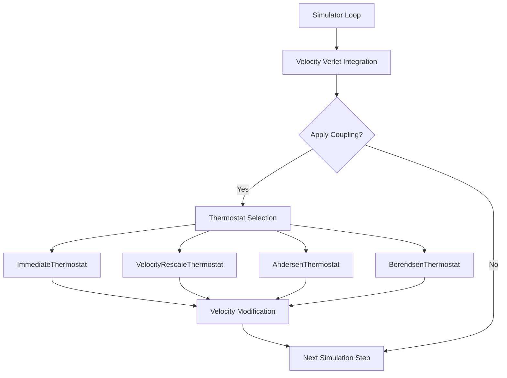
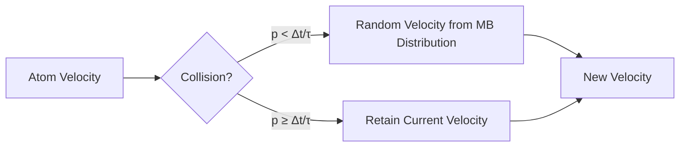

Temperature control is fundamental to molecular dynamics simulations, enabling exploration of thermodynamic ensembles and ensuring realistic sampling of conformational space. This page documents Molly.jl's thermostat implementations: Andersen, Berendsen, and stochastic velocity rescaling methods, each offering distinct approaches to maintaining target temperature through velocity manipulation.

Sources: [src/coupling.jl](/src/coupling.jl#L1-L200), [src/energy.jl](/src/energy.jl#L100-L150)

## Thermostat Architecture in Molly.jl

The thermostat system in Molly.jl follows a modular coupling architecture where temperature control is implemented as a separate concern from the integration scheme. Thermostats operate through the `apply_coupling!` function, which modifies system velocities during each simulation step while preserving the underlying physics of the integrator.



The core coupling interface accepts single thermostats or tuples of multiple couplers, applied sequentially to enable complex simulation setups combining temperature and pressure control. Each thermostat returns a boolean flag indicating whether force recalculation is necessary—velocity-based thermostats consistently return `false` since they preserve coordinate-dependent forces.

Sources: [src/coupling.jl](/src/coupling.jl#L12-L30), [src/simulators.jl](/src/simulators.jl#L110-L150)

## ImmediateThermostat

The ImmediateThermostat provides the simplest temperature control mechanism by instantaneously rescaling all velocities to match the target temperature. The velocity scaling factor follows directly from the equipartition theorem:

```math
\lambda = \sqrt{\frac{T_0}{T}}
```

where `T₀` is the target temperature and `T` is the current instantaneous temperature calculated from kinetic energy.

This approach offers computational efficiency with a single rescaling operation per step. However, the abrupt velocity changes can introduce simulation artifacts by disrupting natural phase space flow, potentially biasing dynamic properties and transport coefficients. The immediate rescaling eliminates thermal fluctuations entirely, creating an artificial constraint that may affect realistic sampling.

**Implementation**: The thermostat computes the current temperature from the kinetic energy tensor, then applies uniform scaling to all velocity components.

Sources: [src/coupling.jl](/src/coupling.jl#L45-L70), [src/energy.jl](/src/energy.jl#L100-L125)

## VelocityRescaleThermostat

The VelocityRescaleThermostat implements the stochastic velocity rescaling method from Bussi et al. 2007, combining the deterministic coupling of Berendsen's thermostat with proper statistical mechanics. This approach enables correct sampling of the canonical ensemble while maintaining efficient temperature control.

The scaling factor incorporates both deterministic and stochastic components:

```math
\lambda^2 = c + (1-c) \cdot \frac{\bar K}{N_f K} \cdot (R^2 + S) + 2 \cdot \sqrt{c(1-c) \frac{\bar K}{N_f K}} \cdot R
```

where `c = exp(-Δt/τ)` controls coupling strength, `K` is current kinetic energy, `K̄ = N_f k_B T₀/2` is target kinetic energy, `R ∼ N(0,1)`, and `S ∼ χ²_{N_f-1}`.

**Key Parameters**:
- `temperature`: Target temperature `T₀`
- `coupling_const`: Coupling time constant `τ` (typically 0.1 ps)
- `n_steps`: Frequency of thermostat application (default: 1)

The implementation draws random variates from normal and chi-squared distributions, constructs the scaling factor, and applies uniform velocity rescaling. This preserves constraints and center-of-mass motion while introducing proper stochastic fluctuations for ensemble correctness.

**Advantages**: Correct ensemble sampling, efficient temperature control, widely used in production simulations.

**Trade-offs**: Requires careful coupling constant selection, more complex than simple rescaling.

Sources: [src/coupling.jl](/src/coupling.jl#L72-L140), [test/coupling.jl](/test/coupling.jl#L31-L60)

## AndersenThermostat

The Andersen thermostat implements collision-based temperature control through stochastic velocity reassignment. Each atom has probability `Δt/τ` per timestep to receive a new velocity drawn from the Maxwell-Boltzmann distribution at the target temperature.

This method mimics physical collisions with an external heat bath, providing rigorous canonical ensemble sampling. The stochastic nature ensures correct statistics while the collision frequency parameter `τ` controls coupling strength.

**Implementation Details**:
- CPU implementation: Loop through atoms, apply probability test, generate random velocity
- GPU implementation: Vectorized operations using Boolean masks for parallel velocity reassignment



**Parameters**:
- `temperature`: Target temperature for Maxwell-Boltzmann distribution
- `coupling_const`: Mean collision time constant `τ`

**Advantages**: Physically intuitive, rigorous ensemble properties, excellent for equilibrium sampling.

**Considerations**: Discontinuous velocity changes affect dynamics, collision frequency requires tuning, may slow dynamic property convergence.

Sources: [src/coupling.jl](/src/coupling.jl#L142-L185), [test/coupling.jl](/test/coupling.jl#L62-L90)

## BerendsenThermostat

The Berendsen thermostat provides weak coupling to a temperature bath through exponential relaxation. The velocity scaling factor follows:

```math
\lambda^2 = 1 + \frac{\Delta t}{\tau} \left( \frac{T_0}{T} - 1 \right)
```

This deterministic approach smoothly scales velocities toward the target temperature over the coupling time constant `τ`. The weak coupling preserves natural dynamics while providing effective temperature control, making it popular for equilibration and production simulations.

**Warning**: The Berendsen thermostat does **not** properly sample the canonical ensemble and may produce incorrect thermodynamic properties. It should be used with caution, particularly for free energy calculations or when ensemble accuracy is critical.

**Parameters**:
- `temperature`: Target temperature
- `coupling_const`: Coupling time constant `τ` (typically 0.1-1.0 ps)

**Use Cases**: Equilibration phases, when ensemble accuracy is secondary to efficiency, systems with strong temperature control requirements.

**Limitations**: Incorrect ensemble sampling, may create artificial correlations, not recommended for quantitative thermodynamics.

Sources: [src/coupling.jl](/src/coupling.jl#L187-L210), [test/coupling.jl](/test/coupling.jl#L92-L120)

## Thermostat Comparison

| **Thermostat** | **Type** | **Ensemble** | **Dynamics** | **Use Case** |
|----------------|-----------|--------------|--------------|--------------|
| **Immediate** | Deterministic | Canonical (artifact) | Disrupted | Debugging, initial tests |
| **VelocityRescale** | Stochastic | Canonical (correct) | Preserved | Production MD, equilibrium |
| **Andersen** | Stochastic | Canonical (correct) | Affected | Equilibrium sampling, systems needing rigorous statistics |
| **Berendsen** | Deterministic | Incorrect | Preserved | Equilibration, production when ensemble accuracy secondary |

> [!TIP]
> For production simulations requiring correct ensemble sampling, prefer **VelocityRescaleThermostat** over Berendsen. VelocityRescale provides Berendsen-like efficiency with proper statistical mechanics, avoiding ensemble artifacts that can affect free energy calculations and thermodynamic property accuracy.

> [!TIP]
> The coupling constant `τ` parameter represents relaxation timescale for temperature control. Smaller values (0.1 ps) provide tighter temperature control but may suppress natural fluctuations. Larger values (1.0 ps) allow more natural dynamics but respond slower to temperature deviations. Typical values range from 0.1-1.0 ps depending on system size and desired sampling characteristics.

## Practical Implementation

### Basic Setup

All thermostats integrate with Molly's simulator system through the `coupling` parameter:

```julia
using Molly

# System setup
sys = System(
    atoms=atoms,
    coords=coords,
    boundary=boundary,
    pairwise_inters=(LennardJones(cutoff=DistanceCutoff(1.0u"nm")),),
    loggers=(temperature=TemperatureLogger(10),)
)

# Choose thermostat
coupling = (VelocityRescaleThermostat(300.0u"K", 0.1u"ps"),)

# Simulator with thermostat
simulator = VelocityVerlet(
    dt=0.001u"ps",
    coupling=coupling,
)

# Run simulation
random_velocities!(sys, 300.0u"K")
simulate!(sys, simulator, 40_000)
```

### Temperature Monitoring

Temperature is tracked automatically using the `TemperatureLogger`:

```julia
sys.loggers = (
    temperature=TemperatureLogger(10),  # Log every 10 steps
)
```

The logger records instantaneous temperature throughout the simulation, enabling analysis of thermostat performance and system equilibration.

Sources: [test/coupling.jl](/test/coupling.jl#L1-L30), [src/loggers.jl](/src/loggers.jl#L100-L125)

## Performance Considerations

### Computational Overhead

- **ImmediateThermostat**: Minimal overhead, single rescaling operation
- **VelocityRescaleThermostat**: Moderate, requires random number generation and kinetic energy calculation
- **AndersenThermostat**: Higher, probability testing per atom, Maxwell-Boltzmann sampling
- **BerendsenThermostat**: Low, deterministic scaling with temperature calculation

### GPU Optimization

VelocityRescaleThermostat and AndersenThermostat include optimized GPU implementations. The GPU-optimized AndersenThermostat uses vectorized Boolean masks to identify atoms requiring velocity updates, avoiding serial loops and enabling parallel execution.

Sources: [src/coupling.jl](/src/coupling.jl#L100-L140), [src/coupling.jl](/src/coupling.jl#L165-L185)

## Thermostat Selection Guidelines

Choose your thermostat based on simulation goals:

1. **Equilibration**: Berendsen for fast convergence (switch to correct ensemble later)
2. **Production MD**: VelocityRescale for correct sampling with good dynamics
3. **Equilibrium Properties**: Andersen for rigorous canonical statistics
4. **Debugging**: Immediate for simplest temperature control

**Remember**: Thermostat choice impacts both thermodynamic and dynamic properties. Consider what quantities you plan to analyze before selecting a method.

Sources: [src/coupling.jl](/src/coupling.jl#L1-L210), [test/coupling.jl](/test/coupling.jl#L1-L120)

## Integration with Other Couplers

Molly.jl supports multiple simultaneous couplers through tuple composition:

```julia
coupling = (
    VelocityRescaleThermostat(300.0u"K", 0.1u"ps"),
    BerendsenBarostat(1.0u"bar", 0.1u"ps"; max_scale_frac=0.01),
)
```

This enables isothermal-isobaric (NPT) ensemble simulations with independent temperature and pressure control. The couplers apply sequentially during each timestep, with the thermostat typically applied first for physical consistency.

For advanced ensemble control, explore [Barostats and Pressure Control](17-barostats-and-pressure-control) which extends the coupling system to pressure and volume degrees of freedom.
