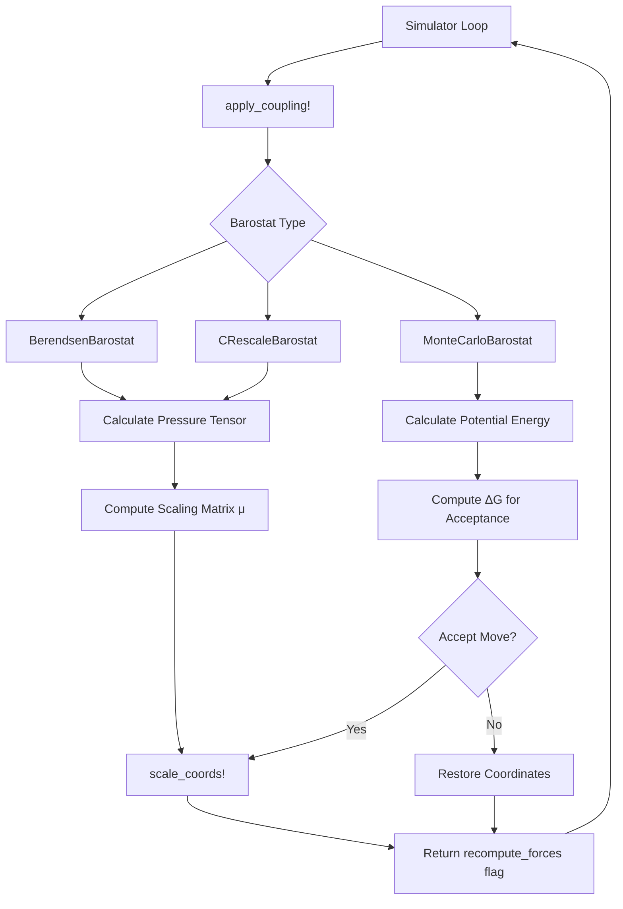

Barostats are essential components for molecular dynamics simulations that maintain constant pressure conditions (NPT ensemble) by dynamically adjusting the simulation box dimensions. This page covers the architecture, implementation details, and practical usage of pressure control methods in Molly.jl.

## Understanding Pressure Control in Molecular Dynamics

Pressure control in molecular dynamics requires calculating the instantaneous pressure tensor from the system and applying corrections to bring it toward the target pressure. The pressure tensor consists of kinetic and virial contributions, and barostats use this information to scale atomic coordinates and the simulation box dimensions appropriately. The barostat architecture in Molly.jl is designed to integrate seamlessly with the simulation loop through a unified coupling interface.

The fundamental challenge in pressure control is maintaining thermodynamic ensemble correctness while ensuring numerical stability. Different barostat algorithms address this challenge through distinct mathematical approaches: deterministic relaxation, stochastic rescaling, and Monte Carlo trial moves. All three implementations in Molly.jl support multiple coupling types to handle different experimental conditions.

## Barostat Architecture Overview

The barostat system in Molly.jl follows a modular design where each barostat implements a common interface through the `apply_coupling!` function. This design allows barostats to be combined with thermostats and used interchangeably with different integrators. The architecture centers on three key components: the barostat types that define control parameters, the pressure calculation system that computes the instantaneous pressure tensor, and the coordinate scaling machinery that applies box transformations.

The pressure tensor calculation requires the virial contribution from forces, which is managed through the `needs_virial_schedule` function. This function determines when virial computation is necessary based on the barostat's `n_steps` parameter, optimizing computational efficiency. Barostats that modify coordinates return `true` from `apply_coupling!` to trigger force recalculation in the main simulation loop.

Sources: [src/coupling.jl](src/coupling.jl#L1-L36), [src/coupling.jl](src/coupling.jl#L987-L999), [src/simulators.jl](src/simulators.jl#L148-L150)

## BerendsenBarostat

The Berendsen barostat implements a deterministic relaxation approach that gradually scales the simulation box to match the target pressure. This method provides smooth coupling to the target pressure but does not generate correct isobaric ensemble statistics, making it suitable primarily for equilibration phases rather than production runs. The scaling matrix μ is computed from the pressure difference between the instantaneous and target pressures, scaled by the coupling constant.

### Mathematical Formulation

The scaling factor for the box matrix follows the equation:

$$\mu_{ij} = \delta_{ij} - \frac{\Delta t}{3 \tau_p} \kappa_{ij} (P_{0ij} - P_{ij}(t))$$

where τₚ is the coupling constant, κ is the compressibility tensor, P₀ is the target pressure tensor, and P(t) is the instantaneous pressure tensor. The fractional change in box dimensions is limited by the `max_scale_frac` parameter to prevent numerical instabilities.

### Implementation Details

The `BerendsenBarostat` struct stores target pressure, coupling constant, coupling type, compressibility, maximum scaling fraction, and step interval parameters. The constructor accepts different pressure and compressibility specifications based on the coupling type: scalar for isotropic, 2-vector for semi-isotropic (xy, z), and 6-vector for anisotropic (x, y, z, xy/yx, xz/zx, yz/zy).

The implementation converts pressure and compressibility values to internal SMatrix representations with consistent units. For semi-isotropic coupling, the x and y dimensions are coupled together while z remains independent. For anisotropic coupling, all three dimensions can scale independently, and shear components allow triclinic box deformations.

Sources: [src/coupling.jl](src/coupling.jl#L218-L286), [src/coupling.jl](src/coupling.jl#L364-L435)

## CRescaleBarostat

The CRescale barostat extends the Berendsen approach by adding a stochastic term to the scaling calculation, enabling proper sampling of isobaric ensembles. This method combines the gentle relaxation characteristics of Berendsen with correct statistical mechanics, making it suitable for both equilibration and production simulations. The stochastic term follows a Wiener process that introduces thermal fluctuations appropriate for the target temperature.

### Mathematical Formulation

The scaling matrix is computed as:

$$\mu = \exp\left[ \frac{-\kappa_T \cdot \Delta t}{\tau_P} \cdot (P(t) - P_0) + \sqrt{\frac{2 \cdot k_B T \cdot \kappa_T \cdot dt}{V(t) \cdot \tau_P}} \cdot dW \right]$$

where dW represents a Wiener process increment. This formulation ensures that the stochastic term scales correctly with system size and compressibility, providing physically meaningful fluctuations.

### Implementation Details

The `CRescaleBarostat` implementation uses the same parameter structure as `BerendsenBarostat` but adds random number generation to the scaling calculation. For isotropic coupling, a single normal random variable provides the stochastic term shared across all dimensions. For semi-isotropic coupling, separate random variables are used for the xy plane and z-axis. Anisotropic coupling uses independent random variables for each diagonal element and each shear component.

The implementation clamps the final scaling factors to prevent excessive box deformations, similar to the Berendsen approach. The barostat also scales velocities when applying box transformations to maintain thermodynamic consistency.

Sources: [src/coupling.jl](src/coupling.jl#L437-L576), [src/coupling.jl](src/coupling.jl#L580-L681)

## MonteCarloBarostat

The Monte Carlo barostat implements a rigorous statistical mechanical approach using Metropolis-Hastings acceptance criteria. This method periodically attempts trial box scaling moves, accepting or rejecting them based on the change in Gibbs free energy. The MC barostat provides exact isobaric ensemble sampling and automatically adapts the trial move size to maintain optimal acceptance rates.

### Mathematical Formulation

The acceptance criterion is based on the change in Gibbs free energy:

$$\Delta G = \Delta E + \Delta W - N k_B T \ln\left( \frac{V + \Delta V}{V} \right)$$

where ΔE is the change in potential energy, ΔW is the work done by pressure during scaling, N is the number of molecules, and V is the system volume. The work term ΔW depends on the coupling type and pressure tensor components:

For isotropic scaling: $$\Delta W = (V + \Delta V) \cdot \text{tr}(P) \cdot \ln\left(\frac{V + \Delta V}{V}\right) / 3$$

For semi-isotropic and anisotropic scaling, the work term incorporates weighted sums of diagonal pressure components based on the fractional scaling applied to each dimension.

### Implementation Details

The `MonteCarloBarostat` is a mutable struct that tracks acceptance statistics for adaptive scale factor adjustment. The constructor requires pressure, temperature, and boundary parameters, with optional control over step frequency, iterations per step, initial scale factor, and adaptive tuning parameters.

The implementation stores and restores coordinates and boundary information during trial moves, enabling proper rejection handling. For systems with defined topology, molecules are moved as units to preserve internal bonding. The barostat adapts the `volume_scale` parameter every 10 attempted moves to maintain approximately 50% acceptance rate: decreasing scale when acceptance is low and increasing it when acceptance is high, bounded by `max_volume_frac`.

Sources: [src/coupling.jl](src/coupling.jl#L683-L820), [src/coupling.jl](src/coupling.jl#L822-L985)

## Coupling Types and Configuration

All three barostats support three coupling types that determine how pressure is applied to different spatial dimensions:

### Isotropic Coupling

Isotropic coupling applies uniform pressure scaling to all spatial dimensions, maintaining the cubic or orthorhombic box shape. This is appropriate for isotropic systems like simple liquids and gases. The pressure parameter is a single scalar value.

### Semiisotropic Coupling

Semiisotropic coupling allows different pressures in the xy plane and z direction, suitable for membrane systems where in-plane and normal pressures differ. The pressure parameter is a 2-element vector `[P_xy, P_z]`.

### Anisotropic Coupling

Anisotropic coupling supports independent control of all six pressure tensor components, enabling triclinic box deformations and shear stress applications. The pressure parameter is a 6-element vector `[P_x, P_y, P_z, P_xy, P_xz, P_yz]`.

> [!TIP]
> The compressibility parameter must match the coupling type structure—use scalar for isotropic, 2-vector for semi-isotropic, or 6-vector for anisotropic coupling.

Sources: [src/coupling.jl](src/coupling.jl#L254-L360), [src/coupling.jl](src/coupling.jl#L470-L576)

## Barostat Comparison

| Feature | BerendsenBarostat | CRescaleBarostat | MonteCarloBarostat |
|---------|-------------------|------------------|---------------------|
| **Ensemble correctness** | Does not sample correct isobaric ensemble | Correct isobaric ensemble sampling | Exact isobaric ensemble sampling |
| **Stochastic** | Deterministic | Stochastic (Wiener process) | Stochastic (Metropolis criterion) |
| **Acceptance rate** | N/A (always applies) | N/A (always applies) | Adaptive (~50% optimal) |
| **Computational cost** | Low | Low | Higher (requires trial energy evaluations) |
| **Use case** | Equilibration, rapid relaxation | Production simulations | Production, rigorous statistical sampling |
| **Shear support** | Full tensor support | Full tensor support | Linear scaling only (no shear) |
| **Temperature dependence** | None | Requires temperature | Requires temperature |
| **Trial moves** | None | None | Yes (optional neighbor update) |

> [!TIP]
> For production simulations requiring correct ensemble sampling, prefer `CRescaleBarostat` for better performance or `MonteCarloBarostat` for maximum statistical rigor.

Sources: [src/coupling.jl](src/coupling.jl#L218-L238), [src/coupling.jl](src/coupling.jl#L437-L460), [src/coupling.jl](src/coupling.jl#L683-L728)

## Integration with Simulators

Barostats integrate into the simulation loop through the `coupling` parameter supported by integrators like `VelocityVerlet`, `Verlet`, and `Langevin`. The simulator queries the barostat's virial requirements via `needs_virial_schedule` and calls `apply_coupling!` at each step or according to the barostat's `n_steps` interval.

The return value from `apply_coupling!` indicates whether the coordinate modification requires force recalculation, which the simulator handles by updating the neighbor list and recomputing forces as needed. This architecture ensures that barostats work seamlessly with constraints, thermostats, and other simulation components.

Sources: [src/simulators.jl](src/simulators.jl#L121-L140), [src/simulators.jl](src/simulators.jl#L148-L150), [src/simulators.jl](src/simulators.jl#L186-L190)

## Practical Usage Guidelines

When selecting and configuring barostats for molecular dynamics simulations, consider the following practical recommendations:

**For Equilibration:** Use `BerendsenBarostat` with moderate coupling constants (typically 0.5-2 ps) to gently relax the system toward target pressure. Start with `max_scale_frac=0.1` to prevent instabilities during initial relaxation phases. The deterministic nature provides smooth relaxation without statistical fluctuations that might obscure system stabilization.

**For Production:** Use `CRescaleBarostat` for most production simulations where correct ensemble sampling is needed but computational efficiency is also important. Configure coupling constants similar to Berendsen (0.5-2 ps) and use standard compressibility values (4.6e-5 bar⁻¹ for water). The stochastic term provides proper fluctuations while maintaining reasonable acceptance rates.

**For Rigorous Sampling:** Use `MonteCarloBarostat` when exact ensemble statistics are critical, such as in free energy calculations or highly anisotropic systems. Set `n_steps` between 10-100 to balance statistical quality and computational cost. Enable `trial_find_neighbors=true` for large volume changes to ensure accurate energy evaluations, though this increases computational overhead.

**Parameter Selection:** For aqueous systems, use compressibility values around 4.6e-5 bar⁻¹. Coupling constants should be at least 10 times the simulation timestep for stability—typical values range from 0.5 ps for fast equilibration to 5 ps for gentle coupling. Monitor box dimensions and pressure fluctuations during initial runs to verify proper barostat behavior.

**Troubleshooting:** If simulation crashes with box inversion or unrealistic volumes, reduce `max_scale_frac` or increase the coupling constant. Low acceptance rates in `MonteCarloBarostat` indicate inappropriate volume scaling—the adaptive mechanism will automatically adjust, but initial values matter for efficiency. High frequency pressure oscillations may indicate coupling constants that are too short.

Sources: [src/coupling.jl](src/coupling.jl#L218-L246), [src/coupling.jl](src/coupling.jl#L437-L468), [src/coupling.jl](src/coupling.jl#L683-L742)

## Pressure Calculation and Virial

All barostats depend on accurate pressure tensor calculation, which requires the virial contribution from interatomic forces. The pressure function computes the instantaneous pressure tensor from kinetic energy and virial contributions, returning a 3×3 matrix that barostats use to compute scaling corrections.

The `needs_virial` function indicates whether a barostat requires virial computation and at what frequency. The `needs_virial_schedule` function returns a tuple of (needs_virial, n_steps) that simulators use to schedule virial calculations efficiently. This optimization avoids computing the expensive virial tensor on every step when barostats operate on larger intervals.
