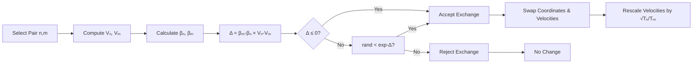
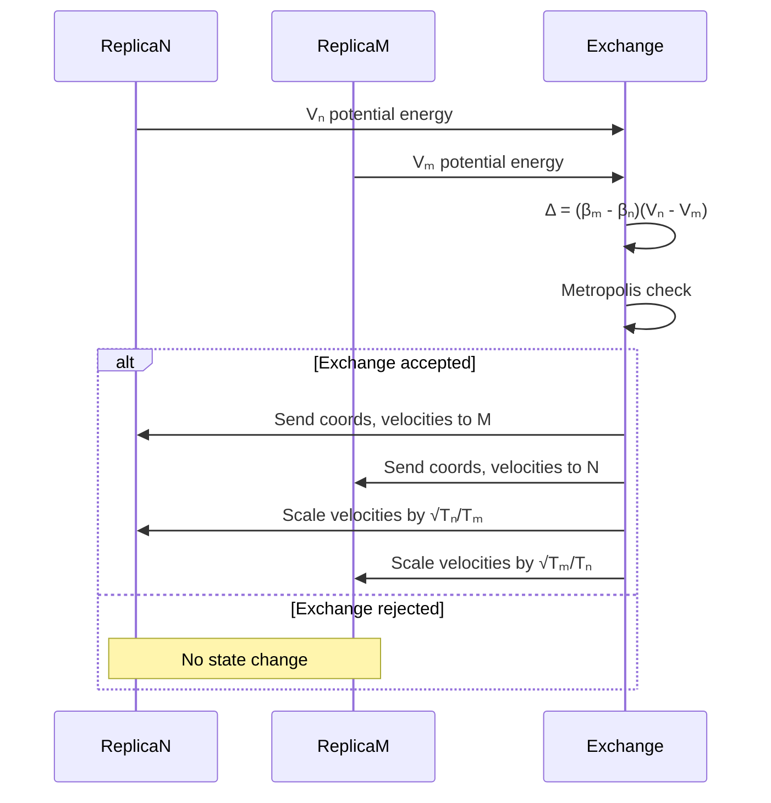
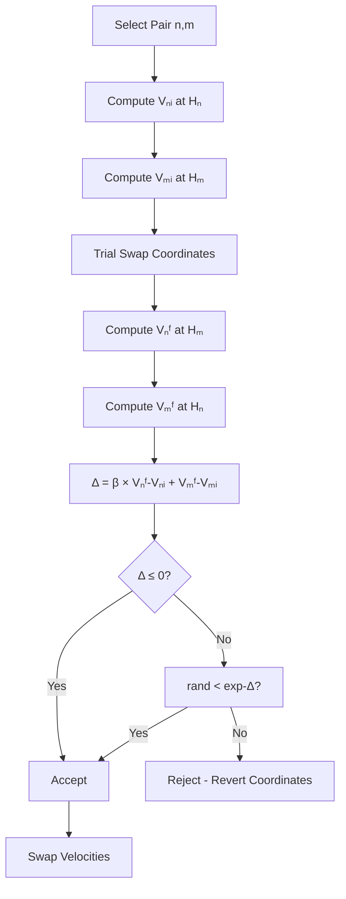
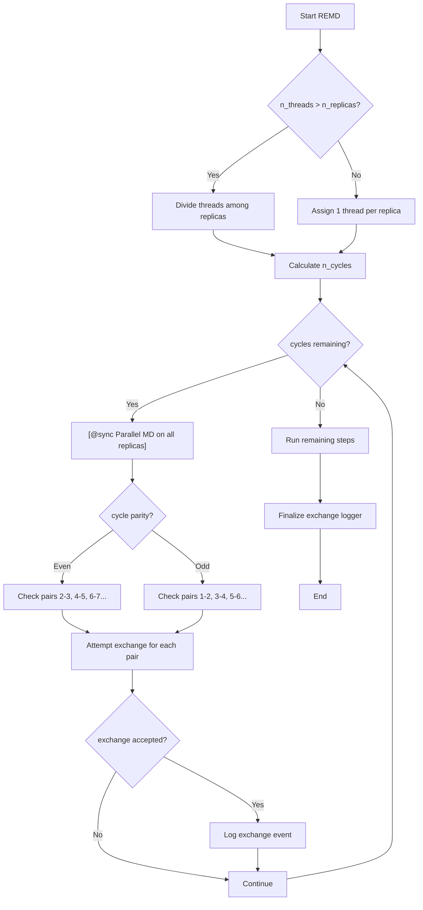

Replica Exchange Molecular Dynamics (REMD) is a powerful enhanced sampling technique that overcomes energy barriers by running multiple replicas of a system at different thermodynamic states and periodically attempting exchanges between them. Molly.jl implements two primary REMD variants: **Temperature Replica Exchange (T-REMD)** and **Hamiltonian Replica Exchange (H-REMD)**, both designed for advanced simulations requiring extensive conformational sampling [src/simulators.jl#L750-L797](src/simulators.jl#L750-L797).

## REMD Architecture in Molly.jl

The REMD implementation in Molly.jl follows a modular architecture that separates replica management, exchange logic, and simulation execution. The core components are the `ReplicaSystem` data structure that holds all replicas, and specialized REMD simulators that control the exchange dynamics.

```mermaid
flowchart TD
    A[ReplicaSystem] --> B[Multiple System Replicas]
    A --> C[Exchange Logger]
    A --> D[Replica Metadata]
    
    E[TemperatureREMD] --> F[Parallel MD Execution]
    E --> G[Exchange Attempts]
    E --> H[Velocity Rescaling]
    
    I[HamiltonianREMD] --> F
    I --> J[Exchange Attempts]
    I --> K[Coordinate Swapping]
    
    F --> L[Threads.@spawn per Replica]
    G --> M[Metropolis Criterion]
    J --> M
    
    M --> N[Accepted Exchange]
    N --> O[Coordinate/Velocity Swap]
```

The architecture leverages Julia's multithreading capabilities to run replicas concurrently, with exchange attempts coordinated through a master process that evaluates acceptance criteria based on detailed balance principles [src/simulators.jl#L984-L987](src/simulators.jl#L984-L987).

## ReplicaSystem Structure

The `ReplicaSystem` serves as a container for managing multiple simulation replicas, each potentially with different temperatures, Hamiltonians, or other parameters. This structure is essential for REMD simulations where replicas must be independently simulated yet periodically exchange configurations [src/types.jl#L937-L947](src/types.jl#L937-L947).

| Property | Type | Description |
|---------|------|-------------|
| `atoms` | `A` | Shared atom data across all replicas |
| `n_replicas` | `Int` | Number of replicas in the system |
| `replicas` | `R` | Array of individual `System` objects |
| `exchange_logger` | `EL` | Logger for tracking replica exchanges |
| `force_units`, `energy_units` | Units | Physical unit specifications |
| `k` | `K` | Boltzmann constant |

The `ReplicaSystem` constructor provides flexible configuration options, allowing either uniform parameters across all replicas or replica-specific settings for boundaries, interactions, and constraints [src/types.jl#L949-L1056](src/types.jl#L949-L1056).

> [!TIP]
> When using `ReplicaSystem` with `CellListMapNeighborFinder`, ensure consistent thread allocation by passing `nbatches=(min(n, 8), n)` where `n` is threads per replica. This prevents threading conflicts during neighbor list updates across concurrent replicas.

## Temperature Replica Exchange (T-REMD)

TemperatureREMD implements parallel tempering, where each replica runs at a different temperature. This enables systems to escape local energy minima by allowing conformations to diffuse across temperature space, with higher-temperature replicas facilitating barrier crossing [src/simulators.jl#L750-L797](src/simulators.jl#L750-L797).

### TemperatureREMD Configuration

```julia
TemperatureREMD(;
    dt::DT,                    # Time step
    temperatures::TP,          # Temperature for each replica
    simulators::ST,            # Individual simulators per replica
    exchange_time::ET          # Time between exchange attempts
)
```

The constructor validates that the number of simulators matches the number of temperatures, and that the exchange time exceeds the simulation time step [src/simulators.jl#L774-L797](src/simulators.jl#L774-L797).

### Exchange Algorithm

T-REMD exchanges follow the Metropolis criterion based on potential energy differences between replicas at adjacent temperatures. The acceptance probability for exchanging replicas at temperatures Tₙ and Tₘ is [src/simulators.jl#L828-L855](src/simulators.jl#L828-L855):



The exchange quantity Δ = (βₘ - βₙ)(Vₙ - Vₘ) ensures detailed balance. Upon acceptance, both coordinates and velocities are swapped, with velocities rescaled to maintain the appropriate kinetic energy for each temperature [src/simulators.jl#L846-L851](src/simulators.jl#L846-L851).



## Hamiltonian Replica Exchange (H-REMD)

HamiltonianREMD facilitates exchange between replicas with different Hamiltonians (interaction parameters) at a single temperature. This is particularly useful for sampling along alchemical pathways or varying force field parameters [src/simulators.jl#L858-L896](src/simulators.jl#L858-L896).

### HamiltonianREMD Configuration

```julia
HamiltonianREMD(;
    dt::DT,                    # Time step
    temperature::T,            # Single temperature for all replicas
    simulators::ST,            # Individual simulators with different Hamiltonians
    exchange_time::ET          # Time between exchange attempts
)
```

Unlike T-REMD, H-REMD maintains all replicas at the same temperature but varies the interaction potential between them. The exchange criterion compares potential energies across Hamiltonian states rather than temperature states [src/simulators.jl#L880-L896](src/simulators.jl#L880-L896).

### Exchange Algorithm

H-REMD exchanges evaluate energy differences when configurations are evaluated under different Hamiltonians. The acceptance probability uses the quantity [src/simulators.jl#L919-L950](src/simulators.jl#L919-L950):



H-REMD performs a temporary coordinate swap to evaluate energies under swapped Hamiltonians, then either accepts the exchange or reverts the coordinate state. Only velocities are permanently swapped upon acceptance since temperatures are identical [src/simulators.jl#L934-L947](src/simulators.jl#L934-L947).

## REMD Execution Cycle

The `simulate_remd!` function orchestrates the complete REMD simulation through cycles of parallel MD integration followed by exchange attempts [src/simulators.jl#L953-L1014](src/simulators.jl#L953-L1014).



The cycle-based approach divides the total simulation into exchange cycles, with each cycle containing equal MD steps before exchange attempts. The alternating pair checking strategy (even/odd pairs) ensures all adjacent replicas have exchange opportunities while preventing simultaneous swaps that could interfere [src/simulators.jl#L978-L999](src/simulators.jl#L978-L999).

## T-REMD vs H-REMD Comparison

| Feature | TemperatureREMD | HamiltonianREMD |
|---------|----------------|-----------------|
| **Variable Parameter** | Temperature across replicas | Interaction potential across replicas |
| **Temperature Distribution** | Multiple temperatures | Single temperature |
| **Exchange Criterion** | Δ = (βₘ - βₙ)(Vₙ - Vₘ) | Δ = β(Vₙᶠ - Vₙᵢ + Vₘᶠ - Vₘᵢ) |
| **Velocity Handling** | Swap + rescale by √T ratio | Simple swap |
| **Best For** | Protein folding, barrier crossing | Alchemical transformations, parameter optimization |
| **Reference** | Sugita and Okamoto 1999 | Generalized ensemble methods |

> [!TIP]
> REMD is not currently compatible with interactions that depend on step number. Ensure all interactions are time-independent when constructing REMD simulations to avoid undefined behavior during parallel execution.

## Practical Implementation

### Setting Up a T-REMD Simulation

```julia
using Molly

# Define temperature ladder
temperatures = [300.0u"K", 350.0u"K", 400.0u"K", 450.0u"K", 500.0u"K"]

# Create individual simulators for each temperature
simulators = [Langevin(dt=0.002u"ps", temperature=T, friction=1.0u"ps^-1") 
              for T in temperatures]

# Configure the REMD simulator
remd_sim = TemperatureREMD(;
    dt=0.002u"ps",
    temperatures=temperatures,
    simulators=simulators,
    exchange_time=1.0u"ps"  # Exchange attempt every 1 ps
)

# Create replica system
n_replicas = length(temperatures)
replica_coords = [copy(initial_coords) for _ in 1:n_replicas]
replica_system = ReplicaSystem(;
    atoms=atoms,
    replica_coords=replica_coords,
    n_replicas=n_replicas,
    boundary=boundary,
    replica_velocities=[zero(initial_coords) * u"ps^-1" for _ in 1:n_replicas],
    pairwise_inters=pairwise_inters,
    specific_inter_lists=specific_inter_lists,
    neighbor_finder=neighbor_finder
)

# Run simulation
simulate!(replica_system, remd_sim, 100_000; assign_velocities=true, n_threads=8)
```

### Setting Up an H-REMD Simulation

```julia
# Define lambda values for alchemical transformation
lambdas = [0.0, 0.25, 0.5, 0.75, 1.0]

# Create systems with different Hamiltonians (e.g., scaled interactions)
replica_pairwise_inters = [
    (lennard_jones=LennardJones(σ=0.34u"nm", ϵ=0.5u"kJ * mol^-1" * (1.0 - λ))) 
    for λ in lambdas
]

# Configure H-REMD at constant temperature
hremd_sim = HamiltonianREMD(;
    dt=0.002u"ps",
    temperature=300.0u"K",
    simulators=[Langevin(dt=0.002u"ps", temperature=300.0u"K", friction=1.0u"ps^-1") 
                for _ in lambdas],
    exchange_time=1.0u"ps"
)

# Create replica system with different Hamiltonians
replica_system = ReplicaSystem(;
    atoms=atoms,
    replica_coords=[copy(initial_coords) for _ in 1:length(lambdas)],
    n_replicas=length(lambdas),
    boundary=boundary,
    replica_pairwise_inters=replica_pairwise_inters,
    neighbor_finder=neighbor_finder
)

simulate!(replica_system, hremd_sim, 100_000; assign_velocities=true, n_threads=8)
```

## Performance Considerations

The REMD implementation in Molly.jl employs several optimization strategies to maximize computational efficiency:

1. **Thread Allocation**: When threads exceed replicas, they're evenly divided (`equal_parts` function) to maximize parallel utilization without oversubscription [src/simulators.jl#L971-L976](src/simulators.jl#L971-L976)

2. **Synchronized Execution**: The `@sync` block ensures all replicas complete their MD segments before exchange attempts, maintaining synchronization for proper exchange evaluation [src/simulators.jl#L984-L987](src/simulators.jl#L984-L987)

3. **Efficient Exchange Checking**: Alternating pair checking prevents race conditions while ensuring all adjacent replica pairs are evaluated systematically [src/simulators.jl#L989-L999](src/simulators.jl#L989-L999)

4. **Neighbor List Reuse**: Each replica maintains independent neighbor lists, rebuilt locally without coordination overhead during MD phases [src/simulators.jl#L989-L990](src/simulators.jl#L989-L990)

## Analysis and Logging

The `ReplicaSystem` includes an `exchange_logger` field that tracks exchange attempts, successes, and acceptance rates throughout the simulation [src/types.jl#L1053-L1056](src/types.jl#L1053-L1056). This data is crucial for:

- Evaluating exchange efficiency (target acceptance ~20-30%)
- Identifying problematic temperature/Hamiltonian spacings
- Computing replica transition matrices
- Analyzing sampling quality and convergence

Exchange events are logged with indices of swapped replicas, acceptance quantity Δ, and the simulation step number, enabling post-simulation analysis of replica diffusion through the ladder [src/simulators.jl#L995-L998](src/simulators.jl#L995-L998).

## Next Steps

For complementary enhanced sampling techniques, explore [Multistate Bennett Acceptance Ratio (MBAR)](28-multistate-bennett-acceptance-ratio-mbar) for analyzing replica data, or [Umbrella Sampling and Restraints](29-umbrella-sampling-and-restraints) for targeted sampling along reaction coordinates. To understand the underlying integration methods used within each replica, review [Integration Methods: Verlet, Velocity Verlet, and Langevin](15-integration-methods-verlet-velocity-verlet-and-langevin).
