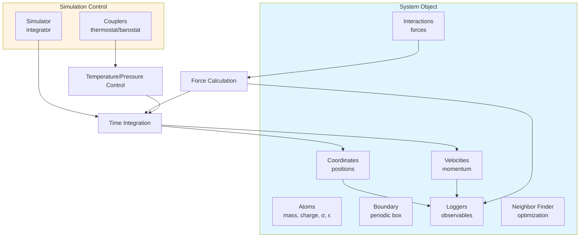
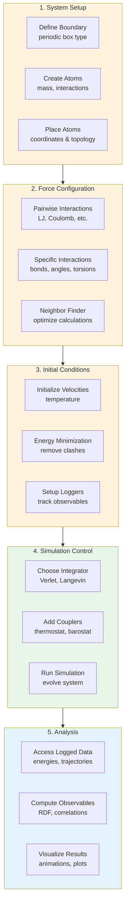

Welcome to Molly.jl, a pure Julia package for molecular dynamics simulation. This guide will get you running your first MD simulation in minutes. Molly enables simulation of physical systems ranging from noble gases to biological macromolecules, with built-in support for GPU acceleration, automatic differentiation, and a wide range of force fields.


## System Architecture

Understanding Molly's core architecture helps you structure your simulations effectively. The system follows a modular design where each component handles a specific aspect of the simulation.



The **System** object encapsulates your complete molecular system state, while the **Simulation** components control how that state evolves through time. This separation makes it easy to experiment with different integrators and coupling schemes while keeping the underlying physics consistent.

## Installation

Get started with Molly in just a few commands. Molly requires **Julia 1.10 or later** for the latest features and best performance.

Install from the Julia REPL:
```julia
using Pkg
Pkg.add("Molly")
```

For GPU acceleration, install the appropriate backend (e.g., CUDA for NVIDIA GPUs):
```julia
Pkg.add("CUDA")
```

Verify your installation with a simple import:
```julia
using Molly
```

Sources: [Project.toml](Project.toml#L1-L30), [README.md](README.md#L40-L45)

## Your First Simulation: Lennard-Jones Fluid

Let's simulate a simple Lennard-Jones fluid—100 argon-like atoms interacting through van der Waals forces. This example demonstrates the complete workflow from system setup to simulation execution.


### Complete Simulation Code

```julia
using Molly

# System parameters
n_atoms = 100
boundary = CubicBoundary(2.0u"nm")        # Periodic cubic box
temp = 298.0u"K"                          # Temperature
atom_mass = 10.0u"g/mol"                  # Atom mass

# Create atoms with Lennard-Jones parameters
atoms = [Atom(
    mass=atom_mass, 
    σ=0.3u"nm",      # Distance parameter
    ϵ=0.2u"kJ * mol^-1"  # Energy well depth
) for i in 1:n_atoms]

# Place atoms randomly, avoiding overlap
coords = place_atoms(n_atoms, boundary; min_dist=0.3u"nm")

# Initialize velocities from Maxwell-Boltzmann distribution
velocities = [random_velocity(atom_mass, temp) for i in 1:n_atoms]

# Define pairwise interactions
pairwise_inters = (LennardJones(use_neighbors=true),)

# Create neighbor finder for efficiency
neighbor_finder = DistanceNeighborFinder(
    eligible=trues(n_atoms, n_atoms),
    n_steps=10,
    dist_cutoff=2.0u"nm",
)

# Configure integrator with temperature control
simulator = VelocityVerlet(
    dt=0.002u"ps",                             # 2 femtosecond timestep
    coupling=AndersenThermostat(temp, 1.0u"ps"),  # Thermostat
)

# Set up loggers to track properties
loggers = (
    temp=TemperatureLogger(100),              # Log every 100 steps
    coords=CoordinatesLogger(100),            # Track positions
    energy=TotalEnergyLogger(100),            # Track energy
)

# Assemble complete system
sys = System(
    atoms=atoms,
    coords=coords,
    boundary=boundary,
    velocities=velocities,
    pairwise_inters=pairwise_inters,
    neighbor_finder=neighbor_finder,
    loggers=loggers,
)

# Run simulation for 10,000 steps (20 ps)
simulate!(sys, simulator, 10_000)

# Access logged results
println("Final temperature: ", last(values(sys.loggers.temp)))
println("Final energy: ", last(values(sys.loggers.energy)))
```

Sources: [README.md](README.md#L47-L72), [test/simulation.jl](test/simulation.jl#L17-L56)

### Key Components Explained

| Component | Purpose | Example Values |
|-----------|---------|----------------|
| **Atoms** | Define particle properties | `mass`, `σ`, `ϵ`, `charge` |
| **Coordinates** | 3D positions with units | `SVector(0.5, 0.3, 0.7)u"nm"` |
| **Boundary** | Simulation box type | `CubicBoundary`, `RectangularBoundary` |
| **Interactions** | Force calculation rules | `LennardJones`, `Coulomb`, bond/angle potentials |
| **Simulator** | Integration algorithm | `VelocityVerlet`, `Langevin` |
| **Couplers** | Temperature/pressure control | `AndersenThermostat`, `BerendsenBarostat` |
| **Loggers** | Data collection | `TemperatureLogger`, `CoordinatesLogger` |

Sources: [src/types.jl](src/types.jl#L1-L80), [src/simulators.jl](src/simulators.jl#L1-L50), [src/coupling.jl](src/coupling.jl#L1-L70)

## Advanced Example: Protein Simulation on GPU

Scale up to realistic molecular systems using Molly's GPU acceleration. This simulates a protein with explicit water using particle mesh Ewald electrostatics.

```julia
using Molly, CUDA

# Access included force field data
data_dir = joinpath(dirname(pathof(Molly)), "..", "data")

# Load force field from OpenMM XML files
ff = MolecularForceField(
    Float32,  # Use single precision for GPU
    joinpath(data_dir, "force_fields", "ff99SBildn.xml"),
    joinpath(data_dir, "force_fields", "tip3p_standard.xml"),
    joinpath(data_dir, "force_fields", "his.xml"),
)

# Load protein structure from PDB file
sys = System(
    joinpath(data_dir, "6mrr_equil.pdb"),
    ff;
    nonbonded_method=:pme,        # Particle mesh Ewald
    loggers=(
        energy=TotalEnergyLogger(10),
        writer=TrajectoryWriter(10, "traj_6mrr.dcd"),
    ),
    array_type=CuArray,            # Use GPU arrays
)

# Energy minimization
minimizer = SteepestDescentMinimizer()
simulate!(sys, minimizer)

# Set temperature and initialize velocities
temp = Float32(298.0)u"K"
random_velocities!(sys, temp)

# Configure Langevin dynamics with pressure control
simulator = Langevin(
    dt=Float32(0.001)u"ps",
    temperature=temp,
    friction=Float32(1.0)u"ps^-1",
    coupling=MonteCarloBarostat(Float32(1.0)u"bar", temp, sys.boundary),
)

# Run production simulation
simulate!(sys, simulator, 5_000)
```

This 5 picosecond simulation demonstrates Molly's capability to handle complex biomolecular systems with realistic force fields. The output trajectory file can be visualized in PyMOL or other MD viewers.

Sources: [README.md](README.md#L74-L107), [src/setup.jl](src/setup.jl#L1-L60), [src/interactions/ewald.jl](src/interactions/ewald.jl)

> [!TIP]
> **Performance Tip**: Use `Float32` instead of `Float64` on GPUs for 2-3x speedup with minimal accuracy loss. Set `array_type=CuArray` when using CUDA for automatic GPU acceleration.

## Simulation Workflow Overview

Molly simulations follow a consistent pattern that adapts to your specific scientific questions.



Sources: [test/basic.jl](test/basic.jl#L100-L180), [test/simulation.jl](test/simulation.jl#L1-L80)

## Available Features

Molly provides a comprehensive toolkit for molecular simulation:

### Interactions
| Type | Description |
|------|-------------|
| **Non-bonded** | Lennard-Jones, Coulomb, electrostatics, PME, soft sphere, Mie, Buckingham |
| **Bonded** | Harmonic/Morse bonds, bond angles, torsion angles, position restraints, FENE bonds |
| **Implicit Solvent** | GBSA methods for continuum solvent |

### Integrators & Couplers
| Component | Options |
|-----------|---------|
| **Integrators** | Verlet, Velocity Verlet, Störmer-Verlet, Langevin, Overdamped Langevin, Nosé-Hoover |
| **Thermostats** | Andersen, Berendsen, Velocity Rescaling, Immediate Rescaling |
| **Barostats** | C-rescale, Monte Carlo, Berendsen |

### Analysis & Output
- **Loggers**: Temperature, coordinates, velocities, energy, pressure, forces, time correlations
- **Trajectory Writing**: DCD, XTC, PDB, XYZ formats via Chemfiles.jl
- **Analysis**: RDF, energy conservation, structure analysis

Sources: [README.md](README.md#L1-L38), [src/interactions/](src/interactions/), [src/loggers.jl](src/loggers.jl#L1-L80)

> [!TIP]
> **Differentiable Simulations**: Molly uniquely supports automatic differentiation through Enzyme.jl, enabling gradient-based force field optimization and inverse problems—perfect for machine learning applications in molecular science.

## Next Steps

You've completed your first simulations! Continue your journey with these resources:

- **Installation and Setup** - Configure your environment for production use, including optional dependencies for visualization and advanced features [Installation and Setup](3-installation-and-setup)
- **Lennard-Jones Fluid Simulation** - Deep dive into fluid dynamics with detailed parameter studies and analysis techniques [Lennard-Jones Fluid Simulation](4-lennard-jones-fluid-simulation)
- **Protein Simulation Setup** - Learn to prepare and simulate biomolecules with realistic force fields and solvent models [Protein Simulation Setup](5-protein-simulation-setup)
- **System Object and Data Structures** - Understand Molly's core architecture for building complex simulations [System Object and Data Structures](6-system-object-and-data-structures)
- **Unitful Integration and Physical Units** - Master Molly's unit system for correct physical simulations [Unitful Integration and Physical Units](9-unitful-integration-and-physical-units)

For examples of advanced applications like simulated annealing and multi-physics simulations, explore the [examples gallery](https://juliamolsim.github.io/Molly.jl/stable/examples/).

Join the community on [JuliaMolSim Zulip](https://juliamolsim.zulipchat.com/join/j5sqhiajbma5hw55hy6wtzv7) or [Julia Slack](https://join.slack.com/t/julialang/shared_invite/zt-26arhonkh-WYNI2rI2X85jcbkn6pRAjA) for support and discussions.
