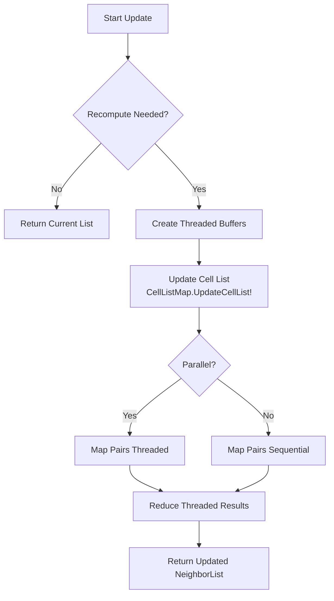
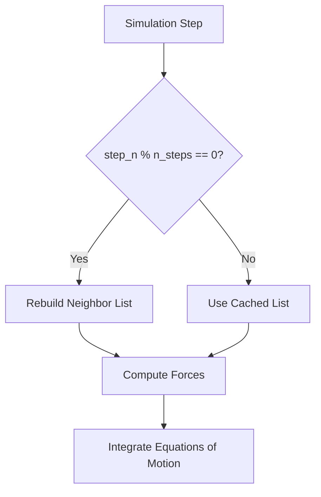

This page explores the neighbor finding algorithms and cell list implementations in Molly.jl, which are essential for efficient molecular dynamics simulations. These algorithms significantly reduce computational complexity by limiting pairwise interactions to atoms within a cutoff distance, transforming O(N²) calculations to approximately O(N) for large systems.

Sources: [src/neighbors.jl](src/neighbors.jl#L1-L10)

## Architecture Overview

The neighbor finding system provides multiple algorithms optimized for different hardware and simulation scenarios. All neighbor finders follow a consistent interface but vary in their internal implementation strategies.

```mermaid
graph TD
    A[System] --> B[find_neighbors]
    B --> C{Neighbor Finder Type}
    C --> D[GPUNeighborFinder<br/>NVIDIA GPU]
    C --> E[DistanceNeighborFinder<br/>Non-NVIDIA GPU]
    C --> F[CellListMapNeighborFinder<br/>CPU Recommended]
    C --> G[TreeNeighborFinder<br/>Alternative CPU]
    C --> H[NoNeighborFinder<br/>No neighbors]
    
    D --> I[Eastman & Pande 2010<br/>In-kernel calculation]
    E --> J[Pairwise distance<br/>Multithreaded GPU]
    F --> K[Cell list algorithm<br/>CellListMap.jl]
    G --> L[BallTree search<br/>NearestNeighbors.jl]
    H --> M[Empty neighbor list]
    
    I --> N[NeighborList]
    J --> N
    K --> N
    L --> N
    M --> N
    
    N --> O[Pairwise Interactions<br/>LennardJones, Coulomb, etc.]
```



This architecture enables hardware-specific optimizations while maintaining a unified user interface. The neighbor list is computed periodically (controlled by `n_steps`) to balance accuracy and performance.

Sources: [src/neighbors.jl](src/neighbors.jl#L1-L25), [src/neighbors.jl](src/neighbors.jl#L40-L70)

## Neighbor List Data Structure

The `NeighborList` type stores pairs of atoms that are within the cutoff distance. Each entry contains three pieces of information: atom indices and whether the pair represents a special interaction.

```julia
# Internal representation (Tuple{Int32, Int32, Bool}[])
# Stores (atom_i, atom_j, is_special) for each neighbor pair
```

The neighbor finder maintains state across simulation steps, only recomputing the neighbor list periodically. This optimization is crucial for performance, as neighbor list construction is typically the most expensive operation in MD simulations.

Sources: [src/neighbors.jl](src/neighbors.jl#L60-L90), [src/neighbors.jl](src/neighbors.jl#L200-L250)

## Algorithm Comparison

Molly.jl provides multiple neighbor finding algorithms, each optimized for specific scenarios:

| Algorithm | Recommended For | Hardware | Boundary Support | Complexity |
|-----------|----------------|----------|------------------|------------|
| **CellListMapNeighborFinder** | CPU simulations | CPU | Cubic, Rectangular | O(N) typical |
| **GPUNeighborFinder** | NVIDIA GPU | NVIDIA GPU | All types | O(N) via kernels |
| **DistanceNeighborFinder** | Non-NVIDIA GPU | GPU (non-NVIDIA) | All types | O(N²) naive, O(N) with cutoff |
| **TreeNeighborFinder** | Alternative CPU | CPU | Cubic, Rectangular only | O(N log N) |
| **NoNeighborFinder** | Small systems | Any | All types | N/A |

The cell list algorithm is particularly efficient for dense, uniformly distributed systems, while tree-based methods can be advantageous for highly inhomogeneous systems.

Sources: [src/neighbors.jl](src/neighbors.jl#L70-L120), [src/neighbors.jl](src/neighbors.jl#L200-L250), [src/neighbors.jl](src/neighbors.jl#L260-L320)

## Cell List Map Algorithm (CPU Recommended)

`CellListMapNeighborFinder` is the default choice for CPU simulations and implements a sophisticated cell list approach using the CellListMap.jl package.

### Spatial Partitioning Strategy

The algorithm divides the simulation box into cubic cells with side lengths greater than the cutoff distance. Each cell contains only nearby atoms, allowing the algorithm to check only atoms in adjacent cells rather than all atom pairs.

```julia
# Initialization
neighbor_finder = CellListMapNeighborFinder(
    eligible=trues(n_atoms, n_atoms),  # Which atom pairs to check
    dist_cutoff=1.0u"nm",               # Cutoff distance
    special=falses(n_atoms, n_atoms),  # Special interactions
    n_steps=10,                         # Update every 10 steps
    x0=initial_coords,                  # Optional initial coordinates
    unit_cell=boundary,                 # Optional unit cell
)
```

### Periodic Boundary Integration

The cell list algorithm integrates seamlessly with periodic boundary conditions. For cubic and rectangular boundaries, the cell structure naturally accommodates periodic wrapping. The algorithm uses the `vector()` function to compute minimum image displacements across cell boundaries.

Sources: [src/neighbors.jl](src/neighbors.jl#L260-L320), [src/spatial.jl](src/spatial.jl#L400-L450)

### Multithreaded Updates

The neighbor list update process supports parallel execution across multiple threads. The implementation uses `@maybe_threads` to conditionally enable threading based on the number of available threads.



> [!TIP]
> The multithreaded cell list update uses per-thread buffers to avoid lock contention. Each thread collects neighbor pairs independently, then results are combined in a final reduction step. This design minimizes synchronization overhead and maximizes scalability on multi-core systems.

Sources: [src/neighbors.jl](src/neighbors.jl#L320-L380)

## GPU-Based Neighbor Finding

### GPUNeighborFinder (NVIDIA GPU)

For NVIDIA GPUs, `GPUNeighborFinder` implements the Eastman and Pande 2010 algorithm, which avoids explicit neighbor list construction by integrating neighbor finding directly into the force/energy calculation kernels.

```julia
# GPUNeighborFinder initialization
neighbor_finder = GPUNeighborFinder(
    eligible=eligible_array,  # GPU array of eligible pairs
    dist_cutoff=1.0u"nm",
    special=special_array,    # GPU array for special pairs
    n_steps_reorder=25,        # Steps between atom reordering
)
```

This approach leverages GPU memory bandwidth and parallelism more efficiently than constructing explicit neighbor lists. Atoms are periodically reordered based on spatial locality to improve cache coherence.

Sources: [src/neighbors.jl](src/neighbors.jl#L40-L60), [src/kernels.jl](src/kernels.jl#L60-L100)

### DistanceNeighborFinder (Non-NVIDIA GPU)

For non-NVIDIA GPUs, `DistanceNeighborFinder` computes pairwise distances using a GPU kernel and constructs an explicit neighbor list.


The implementation uses CUDA-like kernel abstractions through KernelAbstractions.jl, making it portable across different GPU backends.

Sources: [src/neighbors.jl](src/neighbors.jl#L80-L130), [src/kernels.jl](src/kernels.jl#L20-L50)

## Tree-Based Neighbor Finding

`TreeNeighborFinder` uses a BallTree data structure from NearestNeighbors.jl for efficient spatial queries. This approach can be advantageous for systems with highly non-uniform density distributions.

```julia
neighbor_finder = TreeNeighborFinder(
    eligible=trues(n_atoms, n_atoms),
    dist_cutoff=1.0u"nm",
    special=falses(n_atoms, n_atoms),
    n_steps=10,
)
```

The tree is rebuilt periodically and queried to find all atoms within the cutoff distance for each atom. This method cannot be used with infinite boundaries or TriclinicBoundary due to implementation constraints.

Sources: [src/neighbors.jl](src/neighbors.jl#L200-L260)

## Eligibility and Special Interactions

The neighbor finding system supports fine-grained control over which atom pairs are checked for interactions.

### Eligibility Matrix

The `eligible` bit array specifies which atom pairs should be considered for neighbor detection. This is commonly used to exclude bonded interactions from non-bonded force calculations.

```julia
# Exclude bonded atoms from neighbor list
eligible = trues(n_atoms, n_atoms)
for (i, j) in bond_pairs
    eligible[i, j] = false
    eligible[j, i] = false
end
```

### Special Interactions

The `special` bit array flags interactions that require modified treatment, such as 1-4 interactions that use scaled interaction parameters.

Sources: [src/neighbors.jl](src/neighbors.jl#L10-L15), [src/neighbors.jl](src/neighbors.jl#L260-L280)

## Integration with Cutoff Strategies

Neighbor finding algorithms work in concert with cutoff strategies to ensure accurate and efficient force calculations.

### Cutoff Update Frequency

The `n_steps` parameter controls how frequently the neighbor list is rebuilt. A common strategy is to update the neighbor list when atoms have moved approximately 10% of the skin distance beyond the cutoff radius.



### Cutoff Compatibility

Different cutoff types from the cutoff system integrate seamlessly with neighbor finding:

- **DistanceCutoff**: Simple cutoff at specified distance
- **ShiftedPotentialCutoff**: Ensures potential continuity at cutoff
- **ShiftedForceCutoff**: Ensures force continuity at cutoff
- **CubicSplineCutoff**: Smooth transition with cubic spline interpolation

The neighbor finder's cutoff distance must be at least as large as the interaction cutoff distance to avoid missing interactions.

Sources: [src/cutoffs.jl](src/cutoffs.jl#L1-L50), [src/cutoffs.jl](src/cutoffs.jl#L50-L100)

## Performance Considerations

### Algorithm Selection Guidelines

Choose your neighbor finder based on your system characteristics and hardware:

```julia
# Large uniform system on CPU
neighbor_finder = CellListMapNeighborFinder(
    eligible=trues(n_atoms, n_atoms),
    dist_cutoff=1.2u"nm",
    n_steps=10,
)

# NVIDIA GPU simulation
neighbor_finder = GPUNeighborFinder(
    eligible=eligible_gpu,
    dist_cutoff=1.2u"nm",
    special=special_gpu,
)

# Highly inhomogeneous system
neighbor_finder = TreeNeighborFinder(
    eligible=trues(n_atoms, n_atoms),
    dist_cutoff=1.2u"nm",
)
```

> [!TIP]
> When tuning neighbor list performance, adjust `n_steps` to find the optimal balance between list rebuild frequency and force calculation accuracy. Monitor energy conservation to ensure your chosen update frequency is sufficient for your system's dynamics.

### Memory Management

GPU-based neighbor finders require careful memory management. The `eligible`, `special`, and intermediate arrays must all reside on the GPU. CPU-based implementations automatically handle device transfers when systems contain GPU arrays.

Sources: [src/neighbors.jl](src/neighbors.jl#L260-L320), [src/neighbors.jl](src/neighbors.jl#L380-L420)

## Boundary Condition Support

Different neighbor finders have varying support for boundary condition types:

| Neighbor Finder | CubicBoundary | RectangularBoundary | TriclinicBoundary | Infinite |
|-----------------|---------------|---------------------|-------------------|----------|
| CellListMapNeighborFinder | ✓ | ✓ | ✓ | ✗ |
| GPUNeighborFinder | ✓ | ✓ | ✓ | ✓ |
| DistanceNeighborFinder | ✓ | ✓ | ✓ | ✓ |
| TreeNeighborFinder | ✓ | ✓ | ✗ | ✗ |

The minimum image convention is automatically applied when computing neighbor distances across periodic boundaries, using the `vector()` function from the spatial module.

Sources: [src/spatial.jl](src/spatial.jl#L400-L450), [src/neighbors.jl](src/neighbors.jl#L200-L260)

## Usage Examples

### Basic CPU Simulation

```julia
using Molly

n_atoms = 1000
coords = place_atoms(n_atoms, CubicBoundary(10.0u"nm"))

# Setup neighbor finder
neighbor_finder = CellListMapNeighborFinder(
    eligible=trues(n_atoms, n_atoms),
    dist_cutoff=1.0u"nm",
    special=falses(n_atoms, n_atoms),
    n_steps=10,
)

# Create system
sys = System(
    atoms=[Atom(mass=12.0u"g/mol", σ=0.34u"nm", ϵ=0.236u"kJ * mol^-1") 
           for _ in 1:n_atoms],
    coords=coords,
    boundary=CubicBoundary(10.0u"nm"),
    neighbor_finder=neighbor_finder,
    pairwise_inters=(LennardJones(use_neighbors=true),),
)

# Simulate
simulator = Langevin(dt=0.002u"ps", temperature=300.0u"K", friction=1.0u"ps^-1")
simulate!(sys, simulator, 10_000)
```

Sources: [docs/src/examples.md](docs/src/examples.md#L200-L350)

### GPU Simulation with Custom Eligibility

```julia
using CUDA, Molly

# Setup polymer system with excluded bonded pairs
n_polymers = 10
n_monomers = 50
n_atoms = n_polymers * n_monomers

# Create eligibility matrix excluding bonded atoms
eligible = CUDA.ones(Bool, n_atoms, n_atoms)
for pol_i in 1:n_polymers
    for mon_i in 1:(n_monomers-1)
        i = (pol_i - 1) * n_monomers + mon_i
        j = i + 1
        eligible[i, j] = false
        eligible[j, i] = false
    end
end

neighbor_finder = GPUNeighborFinder(
    eligible=eligible,
    dist_cutoff=1.2u"nm",
    special=CUDA.zeros(Bool, n_atoms, n_atoms),
)
```

Sources: [docs/src/examples.md](docs/src/examples.md#L200-L350)

## Advanced Features

### Dynamic Neighbor Finder Switching

The neighbor finder can be changed during simulations to adapt to different phases:

```julia
# Switch from cell list to tree-based for phase transitions
if system_density > threshold_density
    sys.neighbor_finder = CellListMapNeighborFinder(...)
else
    sys.neighbor_finder = TreeNeighborFinder(...)
end
```

### Force Recomputation

Use the `force_recompute` parameter to manually trigger neighbor list rebuilding:

```julia
neighbors = find_neighbors(
    sys, 
    sys.neighbor_finder, 
    current_neighbors=sys.neighbors, 
    step_n=step_n, 
    force_recompute=true  # Force rebuild
)
```

Sources: [src/neighbors.jl](src/neighbors.jl#L90-L120), [src/neighbors.jl](src/neighbors.jl#L320-L380)

## Troubleshooting

### Missing Interactions

If atoms are missing interactions, verify that:
- The cutoff distance is sufficiently larger than the interaction cutoff
- The eligibility matrix correctly includes the relevant atom pairs
- The `n_steps` parameter is small enough for your system's dynamics

### Performance Issues

For poor neighbor list performance:
- Reduce `n_steps` if energy conservation degrades
- Consider switching algorithms based on system homogeneity
- Profile memory transfer costs for GPU implementations
- Check that `number_of_batches` in CellListMapNeighborFinder is optimized

### Boundary Condition Errors

TriclinicBoundary requires special handling:
- Use CellListMapNeighborFinder, GPUNeighborFinder, or DistanceNeighborFinder
- TreeNeighborFinder does not support triclinic boxes
- Ensure cell dimensions are compatible with boundary vectors

Sources: [src/neighbors.jl](src/neighbors.jl#L200-L260), [src/neighbors.jl](src/neighbors.jl#L260-L320)

## Next Steps

Having explored neighbor finding algorithms, you may want to:

- Learn about [GPU Acceleration with CUDA](21-gpu-acceleration-with-cuda) for parallel force calculations
- Understand [Cutoff Strategies and Force Calculation](23-cutoff-strategies-and-force-calculation) for optimizing interaction computations
- Explore [Multithreading and Parallel Execution](22-multithreading-and-parallel-execution) for maximizing CPU performance

The neighbor finding system is a critical component that enables efficient molecular dynamics simulations. By understanding these algorithms, you can optimize your simulations for your specific hardware and system characteristics.