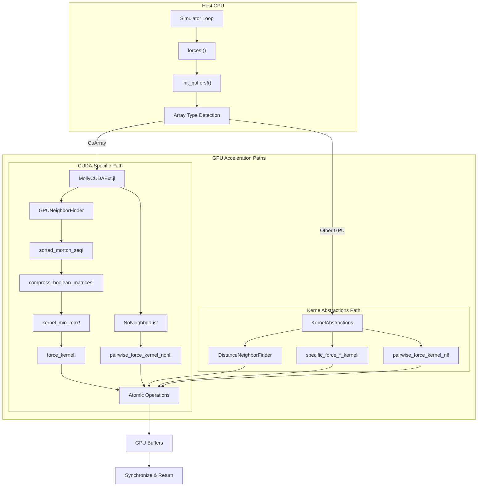

Molly.jl provides comprehensive CUDA GPU acceleration for molecular dynamics simulations through an extension-based architecture that leverages both CUDA-specific optimizations and portable KernelAbstractions kernels. The GPU implementation delivers significant performance improvements for large-scale systems by exploiting massive parallelism in force calculations and neighbor finding operations.

## Architecture Overview

The GPU acceleration system follows a hybrid design pattern combining CUDA-specific optimizations with portable GPU kernels. The architecture splits computational work into three primary layers: pairwise interactions requiring specialized neighbor finding algorithms, specific interactions for bonded terms, and general interactions through AtomsCalculators.jl integration.



The extension system uses Julia's conditional loading mechanism where CUDA functionality is only compiled when the CUDA package is imported. This approach maintains portability while allowing deep integration with CUDA-specific features like warp-level primitives and shared memory optimization.
Sources: [Project.toml](Project.toml#L64-L66), [MollyCUDAExt.jl](ext/MollyCUDAExt.jl#L1-L16)

## CUDA Extension System

The MollyCUDAExt module activates automatically when CUDA is loaded, providing specialized implementations for key computational kernels. This extension defines the `uses_gpu_neighbor_finder` function to indicate CUDA array compatibility with the GPUNeighborFinder algorithm.

The extension leverages warp-level programming through CUDA's shuffle operations (`shfl_sync`) for efficient data exchange between threads within a warp. Critical infrastructure includes the `shfl_recurse` function that handles generic types including Quantity and SVector containers, enabling seamless unit-aware computations on GPU.
Sources: [MollyCUDAExt.jl](ext/MollyCUDAExt.jl#L19-L30), [MollyCUDAExt.jl](ext/MollyCUDAExt.jl#L32-L36)

### Warp-Level Optimization Pattern

Molly implements an advanced warp reduction pattern where each thread in a 32-thread warp computes forces for multiple atom pairs using diagonal shuffle operations. For WARPSIZE×WARPSIZE tiles, the force calculation ordering follows a specific pattern:

```
    × | i j k l m n o p
    --------------------
    a | 1 2 3 4 5 6 7 8
    b | 8 1 2 3 4 5 6 7
    c | 7 8 1 2 3 4 5 6
    d | 6 7 8 1 2 3 4 5
    e | 5 6 7 8 1 2 3 4
    f | 4 5 6 7 8 1 2 3
    g | 3 4 5 6 7 8 1 2
    h | 2 3 4 5 6 7 8 1
```

This pattern maximizes data reuse by shuffling atom properties between threads after each iteration, minimizing global memory accesses. The implementation uses `CUDA.shfl_sync` with `0xFFFFFFFF` mask to ensure all participating threads exchange data correctly.
Sources: [MollyCUDAExt.jl](ext/MollyCUDAExt.jl#L407-L438)

## GPU Neighbor Finding

Molly provides two distinct GPU neighbor finding approaches optimized for different scenarios:

### GPUNeighborFinder: Morton Code Ordering

The `GPUNeighborFinder` implements the Eastman-Pande algorithm that avoids explicit neighbor list construction by using spatial sorting with Morton codes. This approach is recommended for NVIDIA GPUs and provides excellent performance for dense systems with uniform particle distributions.

The algorithm proceeds through several stages:

1. **Morton Code Sorting**: Atoms are sorted along the z-axis using Morton codes with configurable bit depth (default 4 bits). The `sorted_morton_seq!` function performs this spatial reordering every `n_steps_reorder` steps (default 25).

2. **Boolean Matrix Compression**: The `compress_boolean_matrices!` kernel compresses eligibility and special interaction bitmasks into compact 32-bit representations, one per warp lane. This reduces memory bandwidth requirements significantly.

3. **Box Bounding Calculation**: The `kernel_min_max!` and `kernel_min_max_triclinic!` kernels compute minimum and maximum coordinates for each 32-atom block using parallel reduction in shared memory. For triclinic systems, coordinates are transformed to fractional space using the inverse basis matrix H⁻¹ before bounding box calculation.

4. **Block-Level Distance Filtering**: The `force_kernel!` performs box-to-box distance checks before detailed force calculations, quickly excluding blocks of atoms that cannot be within the cutoff radius.
Sources: [neighbors.jl](src/neighbors.jl#L52-L88), [MollyCUDAExt.jl](ext/MollyCUDAExt.jl#L54-L88)

### DistanceNeighborFinder: Portable Alternative

For non-NVIDIA GPUs, the `DistanceNeighborFinder` provides a straightforward distance-based neighbor search using KernelAbstractions. This implementation is less optimized than the CUDA-specific version but maintains portability across GPU backends.

The finder performs explicit pairwise distance calculations and stores neighbor tuples `(i, j, special)` in a list structure. The recomputation interval is controlled by the `n_steps` parameter, allowing tunable tradeoffs between neighbor finding frequency and list staleness.
Sources: [neighbors.jl](src/neighbors.jl#L90-L142)

## Force Computation on GPU

### Pairwise Forces with NoNeighborList

For systems using `NoNeighborList` with CUDA arrays, Molly implements a full pairwise force computation kernel that leverages the warp-level shuffle pattern. The `pairwise_force_kernel_nonl!` kernel organizes computation into a 2D grid of blocks where each block processes a WARPSIZE×WARPSIZE tile of atoms.

Thread configuration is controlled by the `MOLLY_GPUNTHREADS_PAIRWISE` environment variable (default 512 threads). The kernel automatically adjusts thread counts to be multiples of 32 for optimal warp alignment and limits blocks to cover the atom count efficiently.
Sources: [MollyCUDAExt.jl](ext/MollyCUDAExt.jl#L38-L55)

### Pairwise Forces with GPUNeighborFinder

The `force_kernel!` implements the core force computation with spatial optimization. This kernel divides into four mutually exclusive execution paths based on block position:

| Block Type | Condition | Optimization Strategy |
|------------|-----------|----------------------|
| Standard tile | j < n_blocks && i < j | Diagonal shuffle with maximum data reuse |
| Partial row | j == n_blocks && i < n_blocks | Direct computation with remainder handling |
| Diagonal | i == j && i < n_blocks | Upper-triangular computation with symmetry |
| Remainder corner | i == n_blocks && j == n_blocks | Sequential processing of final atoms |

For standard tiles, the kernel uses warp shuffling to rotate atom properties between threads, enabling each thread to compute interactions with all atoms in the j-block while only loading its local atom data once. After processing, results are written atomically to the force matrix using `CUDA.atomic_add!` to handle concurrent writes safely.
Sources: [MollyCUDAExt.jl](ext/MollyCUDAExt.jl#L439-L718)

> [!TIP]
> The force kernel uses shared memory accumulators (`force_smem`, `opposites_sum`) to reduce atomic operation contention. Each thread accumulates forces for its assigned atom pairs in shared memory first, then performs a single atomic add per force component after all pairwise interactions are complete. This dramatically reduces atomic operation serialization compared to naive per-pair atomic adds.

### Specific Interactions on GPU

Specific interactions (bonds, angles, torsions, position restraints) use KernelAbstractions kernels that map cleanly to GPU execution. The system dispatches to specialized kernels based on interaction atom count:

- `specific_force_1_atoms_kernel!`: Position restraints and external potentials
- `specific_force_2_atoms_kernel!`: Bonds and dihedrals  
- `specific_force_3_atoms_kernel!`: Angles and Urey-Bradley terms
- `specific_force_4_atoms_kernel!`: Proper and improper torsions

Each kernel uses a one-dimensional thread mapping where each thread processes one specific interaction. The implementation leverages `Atomix.@atomic` for thread-safe force accumulation when multiple interactions affect the same atom.
Sources: [kernels.jl](src/kernels.jl#L42-L118)

### Virial Computation

GPU virial calculation follows a different convention than the CPU path to align with LAMMPS documentation standards. Rather than computing virial per interaction, the GPU computes virial contributions per atom pair with a 0.5 prefactor to account for double counting. This approach simplifies kernel structure while maintaining mathematical correctness.

For CUDA paths, virial rows are accumulated in separate buffers (`virial_row_1`, `virial_row_2`, `virial_row_3`) before being summed and transferred to the host. This separation reduces register pressure during force computation.
Sources: [MollyCUDAExt.jl](ext/MollyCUDAExt.jl#L444-L451), [MollyCUDAExt.jl](ext/MollyCUDAExt.jl#L56-L58)

## GPU Buffers and Memory Management

GPU simulations require specialized buffer structures to hold intermediate computation results. The `BuffersGPU` struct manages all GPU-allocated arrays:

```mermaid
classDef buffer fill:#f0f7ff,stroke:#3b82f6
classDef matrix fill:#fef3c7,stroke:#f59e0b

classDef atomData fill:#ecfdf5,stroke:#10b981

subgraph Buffers["BuffersGPU Structure"]
    direction TB
    Forces["Forces Matrix<br/>fs_mat::Matrix"]:::matrix
    PE["Potential Energy<br/>pe_vec_nounits::Vector"]:::buffer
    Virial["Virial Rows<br/>virial_row_1/2/3::Matrix"]:::buffer
    
    AtomBox["Box Bounds<br/>box_mins/maxs::Matrix"]:::atomData
    MortonSeq["Morton Sequence<br/>morton_seq::Vector"]:::atomData
    Compressed["Compressed Masks<br/>compressed_eligible/special<br/>::Array{UInt32,3}"]:::atomData
end
```

The buffer initialization in `init_buffers!` handles both CPU and GPU paths, detecting the array type from the system coordinates. For GPU systems, it allocates all intermediate arrays on the device and manages the `neighbor_finder.initialized` flag for tracking neighbor list state.
Sources: [force.jl](src/force.jl#L152-L180)

## Configuration and Tuning

### Environment Variables

Molly provides several environment variables for fine-tuning GPU performance:

| Variable | Default | Purpose |
|----------|---------|---------|
| `MOLLY_GPUNTHREADS_PAIRWISE` | 512 | Thread count for pairwise force kernels |
| `MOLLY_GPUNTHREADS_SPECIFIC` | 32 | Thread count for specific interaction kernels |
| `MOLLY_GPUNTHREADS_DISTANCENF` | 512 | Thread count for distance neighbor finder |

These variables should be set before importing Molly to affect kernel launch configuration. Optimal values depend on GPU architecture and system size—larger systems benefit from higher thread counts that better saturate the device.
Sources: [kernels.jl](src/kernels.jl#L19-L28), [neighbors.jl](src/neighbors.jl#L139-L142)

### GPUNeighborFinder Parameters

The GPUNeighborFinder constructor accepts several tunable parameters:

- `eligible::AbstractGPUArray`: Boolean matrix indicating which atom pairs should be considered
- `dist_cutoff::Quantity`: Maximum distance for interaction consideration
- `special::AbstractGPUArray`: Boolean matrix for special interaction flags (1-4 scaling, exclusions)
- `n_steps_reorder::Int`: Frequency of Morton code reordering (default 25)
- `initialized::Bool`: Internal flag tracking first-time initialization

The `dist_cutoff` should be set to the maximum interaction range plus a small safety margin. The `n_steps_reorder` parameter controls the tradeoff between neighbor finding accuracy and computational cost—smaller values provide more accurate filtering at higher computational overhead.
Sources: [neighbors.jl](src/neighbors.jl#L52-L74)

## Performance Considerations

### Memory Coalescing and Access Patterns

The GPU kernels are designed to maximize memory coalescing by organizing data access patterns to be contiguous when possible. The Morton code sorting groups spatially proximate atoms, improving cache locality during force computation. However, the diagonal shuffle pattern in pairwise force computation introduces some irregular access patterns that are mitigated by shared memory buffering.

> [!TIP]
> When using GPUNeighborFinder, the compressed boolean matrices use 32-bit packed representations stored in dimensions (32, n_blocks, n_blocks). This layout ensures that threads within a warp access contiguous memory when reading eligibility masks, achieving optimal memory coalescing for these critical lookups.

### Atomic Operation Contention

Atomic operations on GPU can become a performance bottleneck when many threads attempt concurrent updates to the same memory locations. Molly addresses this through:

1. Shared memory accumulation before atomic writes
2. Separate virial row buffers to reduce write conflicts
3. Diagonal shuffle patterns that distribute force calculations across threads

For systems with very high interaction density (e.g., small cutoff radius in dense liquids), consider using alternative neighbor finders or increasing the number of blocks to distribute atomic operations across more memory locations.
Sources: [MollyCUDAExt.jl](ext/MollyCUDAExt.jl#L537-L568)

### Unit Handling on GPU

Molly's unit integration with Unitful.jl works seamlessly on GPU through the `ustrip` function that removes units before GPU computation and re-applies them after results return to CPU. The `force_units` and `energy_units` fields from the System object provide type information for unit validation while actual GPU computations use stripped numeric values.

The `shfl_recurse` function enables generic type support including Quantity types by recursively applying shuffle operations to wrapped values. This design allows unit-aware force calculations without performance penalties on GPU.
Sources: [MollyCUDAExt.jl](ext/MollyCUDAExt.jl#L32-L36), [force.jl](src/force.jl#L252-L298)

## Usage Examples

### Basic GPU Simulation Setup

```julia
using Molly, CUDA

# Define system with GPU arrays
n_atoms = 1000
coords = [rand(SVector{3, Float64}) .* 10 for _ in 1:n_atoms] |> CuArray
atoms = [Atom(mass=10.0u"u", charge=0.0u"e") for _ in 1:n_atoms] |> CuArray

# Create GPU neighbor finder
eligible = trues(n_atoms, n_atoms) |> CuArray
neighbor_finder = GPUNeighborFinder(
    eligible=eligible,
    dist_cutoff=1.0u"nm",
    n_steps_reorder=25
)

# Initialize system with GPU arrays
sys = System(
    atoms=atoms,
    coords=coords,
    boundary=CubicBoundary(10.0u"nm"),
    pairwise_inters=(LennardJones(
        sigma=0.34u"nm", 
        epsilon=0.65u"kJ * mol^-1"
    ),),
    neighbor_finder=neighbor_finder,
    loggers=(coords=StructureLogger(100),)
)

# Run simulation on GPU
simulator = Langevin(
    dt=0.002u"ps",
    temperature=300.0u"K",
    friction=1.0u"ps^-1"
)
simulate!(sys, simulator, 1000)
```

This example demonstrates the minimal setup for GPU-accelerated simulation. The key requirements are using `CuArray` wrappers for coordinate and atom arrays, and constructing a `GPUNeighborFinder` with GPU-allocated boolean matrices.
Sources: [neighbors.jl](src/neighbors.jl#L52-L88), [force.jl](src/force.jl#L277-L286)

### Customizing GPU Performance

```julia
# Set environment variables before importing Molly
ENV["MOLLY_GPUNTHREADS_PAIRWISE"] = "1024"
ENV["MOLLY_GPUNTHREADS_SPECIFIC"] = "64"

using Molly, CUDA

# For very large systems, increase reorder frequency
neighbor_finder = GPUNeighborFinder(
    eligible=eligible,
    dist_cutoff=1.2u"nm",
    n_steps_reorder=50  # Less frequent reordering for large systems
)

# For mixed-precision on compatible GPUs
coords = [rand(SVector{3, Float32}) .* 10 for _ in 1:n_atoms] |> CuArray
```

> [!TIP]
> For systems with >100,000 atoms, increase `MOLLY_GPUNTHREADS_PAIRWISE` to 1024 or 2048 to better utilize GPU streaming multiprocessors. The `n_steps_reorder` parameter can often be increased for large systems since particles move less relative to each other per step.

## Integration with AtomsCalculators.jl

General interactions through AtomsCalculators.jl inherit GPU acceleration automatically when the system uses GPU arrays. The `forces!` function passes GPU buffers to calculator implementations, allowing custom calculators to leverage GPU resources through KernelAbstractions.

Calculator implementations should check for GPU buffers and use appropriate backend selection:

```julia
using KernelAbstractions

function AtomsCalculators.forces!(fs, sys, calc::MyCalculator;
                                  neighbors=nothing, step_n=0,
                                  n_threads=1, buffers=nothing,
                                  needs_vir=false)
    backend = get_backend(sys.coords)
    kernel! = my_calculator_kernel!(backend)
    kernel!(fs, sys.coords, calc.parameters; ndrange=length(sys.coords))
    return fs, sys
end
```

This pattern ensures calculators work seamlessly on both CPU and GPU backends without code duplication.
Sources: [force.jl](src/force.jl#L335-L339), [kernels.jl](src/kernels.jl#L1-L18)

## Troubleshooting Common Issues

### CUDA Out of Memory Errors

GPU memory limitations typically manifest when allocating large buffers or simulating very large systems. Strategies to address this:

1. Reduce `n_steps_reorder` to decrease buffer sizes
2. Use `DistanceNeighborFinder` instead of `GPUNeighborFinder` for memory-constrained scenarios
3. Batch simulations across multiple GPU devices
4. Increase simulation timestep to reduce required buffer sizes for trajectory logging

### Incorrect Force Results

GPU implementations should produce identical results to CPU within numerical precision. Common causes of discrepancies:

1. Missing `CuArray` wrapper for atom or coordinate arrays
2. Incorrect neighbor finder configuration (cutoff distance mismatch)
3. Special interaction flags not properly transferred to GPU
4. Unit conversion issues when mixing CPU and GPU arrays

To verify GPU correctness, run small test systems comparing CPU and GPU force outputs using the [`forces_virial`](24-automatic-differentiation-with-enzyme) function.
Sources: [force.jl](src/force.jl#L267-L275)

### Performance Degradation

If GPU simulation is slower than expected, consider:

1. Checking GPU utilization with NVIDIA tools (nvidia-smi)
2. Verifying CUDA arrays are used throughout (not accidentally converting to CPU)
3. Adjusting thread counts via environment variables
4. Profiling with CUDA.NVTX to identify kernel bottlenecks
5. For small systems (<1000 atoms), CPU may be faster due to GPU overhead

## Best Practices

1. **Always use CuArray wrappers** for coordinates, atoms, and boolean matrices in GPU simulations. Mixed CPU/GPU arrays cause excessive data transfer overhead.

2. **Tune reorder frequency** based on system dynamics. Fast-moving systems (high temperature, small timestep) require more frequent reordering than slow-moving systems.

3. **Profile before optimizing** different thread configurations. The default values work well for many systems, but optimal settings depend on GPU architecture and problem characteristics.

4. **Batch small simulations** rather than running many independent GPU simulations sequentially. The GPU launch overhead amortizes better with longer simulations.

5. **Monitor GPU memory usage** especially when using [`StructureLogger`](8-boundary-conditions-and-periodic-systems) or other trajectory loggers. Store data on GPU and transfer in batches to host.

## Next Steps

For deeper exploration of performance optimization, see [Neighbor Finding Algorithms and Cell Lists](20-neighbor-finding-algorithms-and-cell-lists) for CPU-side algorithms and [Multithreading and Parallel Execution](22-multithreading-and-parallel-execution) for CPU parallelization strategies. The [Integration Methods](15-integration-methods-verlet-velocity-velvert-and-langevin) page discusses how GPU acceleration integrates with different integrators, particularly [`Langevin`](16-thermostats-andersen-berendsen-and-velocity-rescaling) dynamics which benefits significantly from GPU acceleration.