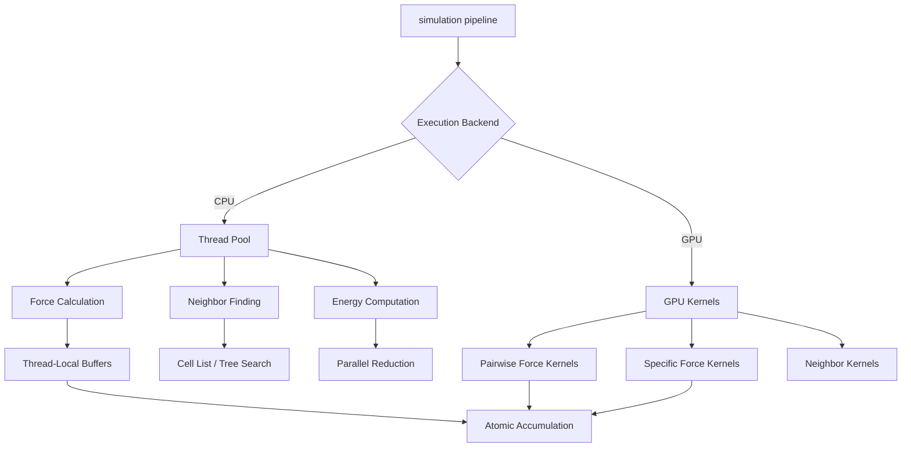

Molly.jl provides sophisticated parallelization capabilities that span both CPU multithreading and GPU acceleration, enabling efficient molecular dynamics simulations for systems ranging from small proteins to large biomolecular assemblies. The parallel execution model integrates seamlessly with the simulation pipeline, from force calculations to neighbor finding and energy computations.

## Parallel Execution Architecture

The parallelization architecture in Molly.jl is designed around two primary execution models: CPU multithreading using Julia's native threading capabilities and GPU acceleration through KernelAbstractions.jl. These models are not mutually exclusive—GPU acceleration automatically handles device-side parallelism, while CPU multithreading manages host-side parallelization of tasks that don't execute on the GPU.



## CPU Multithreading

CPU multithreading in Molly.jl leverages Julia's `Threads.@threads` macro to distribute computational work across available processor cores. The multithreading strategy is based on **loop chunking**, where large computational loops are divided among threads using a static scheduling pattern that ensures each thread processes every nth element.

### Thread Configuration

All simulation functions accept an `n_threads` parameter that controls parallelization:

Sources: [src/simulators.jl](src/simulators.jl#L72-L77)

```julia
simulate!(system, simulator, n_steps; n_threads=Threads.nthreads(), ...)
```

By default, the system uses `Threads.nthreads()`, which returns the number of threads available to the Julia process. Users can explicitly set a lower value for debugging or resource management purposes. When `n_threads=1`, all operations execute serially, which can be useful for reproducibility or debugging threading-related issues.

### Force Calculation Parallelization

Force calculations dominate computational cost in molecular dynamics simulations. Molly.jl implements two parallelization strategies for force computation:

1. **Thread-local buffer allocation**: Each thread maintains its own force and virial buffers to eliminate write conflicts
2. **Chunked iteration**: The atom index space is interleaved across threads

Sources: [src/force.jl](src/force.jl#L288-L336)

```julia
function pairwise_forces_loop!(fs_nounits, fs_chunks, vir_nounits, vir_chunks, 
                               atoms, coords, velocities, boundary, neighbors, 
                               force_units, n_atoms, pairwise_inters_nonl, 
                               pairwise_inters_nl, ::Val{n_threads}, 
                               ::Val{needs_vir}, step_n=0) where {n_threads, needs_vir}
    # Initialize thread-local buffers
    @inbounds for chunk_i in 1:n_threads
        fill!(fs_chunks[chunk_i], zero(FT))
    end
    
    # Distribute work across threads using interleaved scheduling
    Threads.@threads for chunk_i in 1:n_threads
        for i in chunk_i:n_threads:n_atoms
            for j in (i + 1):n_atoms
                # Force calculation logic
            end
        end
    end
    
    # Reduce thread-local buffers
    @inbounds for chunk_i in 2:n_threads
        fs_nounits .+= fs_chunks[chunk_i]
    end
end
```

The interleaved scheduling pattern (`for i in chunk_i:n_threads:n_atoms`) provides **automatic load balancing** for regular force calculations where each pairwise interaction has similar computational cost. For neighbor-list-based calculations with irregular work distribution, this pattern still provides reasonable load balancing because each neighbor pair is processed independently.

### Buffer Management

Thread-local buffers are allocated during system initialization and stored in the `BuffersCPU` structure:

Sources: [src/force.jl](src/force.jl#L132-L143)

```julia
struct BuffersCPU{F, A, V, VN, VC, KT, PT}
    fs_nounits::F
    fs_chunks::A          # Array of force buffers, one per thread
    virial::V
    vir_nounits::VN
    vir_chunks::VC        # Array of virial buffers, one per thread
    kin_tensor::KT
    pres_tensor::PT
end

function init_buffers!(sys::System{D}, n_threads) where D
    n_copies = (n_threads == 1 ? 0 : n_threads)
    fs_chunks  = [similar(fs_nounits) for _ in 1:n_copies]
    vir_chunks = [similar(vir_nounits) for _ in 1:n_copies]
    return BuffersCPU(fs_nounits, fs_chunks, vir, vir_nounits, vir_chunks, kin, pres)
end
```

> [!TIP]
> When `n_threads=1`, the buffer chunks array is empty, and the single-threaded path writes directly to the main buffer. This optimization avoids unnecessary memory allocation and copying when threading is disabled.

### Neighbor Finding Parallelism

Neighbor finding implements parallelization strategies tailored to different algorithms:

**CellListMapNeighborFinder**: Uses CellListMap.jl's parallel cell list construction, which automatically distributes the spatial partitioning and neighbor search across threads. The cell list algorithm divides the simulation volume into cells smaller than the cutoff distance, then only checks atoms within adjacent cells.

Sources: [src/neighbors.jl](src/neighbors.jl#L248-L311)

```julia
function find_neighbors(sys::System{D, AT},
                        nf::CellListMapNeighborFinder,
                        current_neighbors=nothing,
                        step_n::Integer=0,
                        force_recompute::Bool=false;
                        n_threads::Integer=Threads.nthreads()) where {D, AT}
    # Update cell list in parallel
    box = CellListMap.Box(clm_box_arg(sys.boundary), nf.dist_cutoff; lcell=1)
    parallel = n_threads > 1
    cl = UpdateCellList!(from_device(sys.coords), box, cl, aux; parallel=parallel)
    
    # Map pairwise interactions across threads
    map_pairwise!(
        (x, y, i, j, d2, pairs) -> push_pair!(pairs, i, j, nf.eligible, nf.special),
        neighbors,
        box,
        cl;
        reduce=reduce_pairs,
        output_threaded=neighbors_threaded,
        parallel=parallel,
    )
end
```

**DistanceNeighborFinder**: Implements straightforward parallel distance checking using the same interleaved scheduling pattern as force calculations.

Sources: [src/neighbors.jl](src/neighbors.jl#L86-L120)

```julia
function find_neighbors(sys::System,
                        nf::DistanceNeighborFinder,
                        current_neighbors=nothing,
                        step_n::Integer=0,
                        force_recompute::Bool=false;
                        n_threads::Integer=Threads.nthreads())
    nl_threads = [Tuple{Int32, Int32, Bool}[] for i in 1:n_threads]
    
    @maybe_threads (n_threads > 1) for chunk_i in 1:n_threads
        for i in chunk_i:n_threads:length(sys)
            ci = sys.coords[i]
            nbi = @view nf.eligible[:, i]
            speci = @view nf.special[:, i]
            for j in 1:(i - 1)
                r2 = sum(abs2, vector(ci, sys.coords[j], sys.boundary))
                if r2 <= sqdist_cutoff && nbi[j]
                    push!(nl_threads[chunk_i], (Int32(i), Int32(j), speci[j]))
                end
            end
        end
    end
    
    # Combine thread-local neighbor lists
    neighbors_list = Tuple{Int32, Int32, Bool}[]
    for nl in nl_threads
        append!(neighbors_list, nl)
    end
    return NeighborList(length(neighbors_list), neighbors_list)
end
```

The `@maybe_threads` macro (defined in Molly.jl) compiles to `Threads.@threads` when `n_threads > 1` and to a regular loop otherwise, providing a zero-cost abstraction for conditional threading.

### Simulation Loop Parallelism

All major simulators integrate multithreading throughout their execution loops:

Sources: [src/simulators.jl](src/simulators.jl#L112-L168)

```julia
@inline function simulate!(sys,
                           sim::VelocityVerlet,
                           n_steps::Integer;
                           n_threads::Integer=Threads.nthreads(),
                           run_loggers=true,
                           rng=Random.default_rng())
    # Initialization with threading support
    neighbors = find_neighbors(sys, sys.neighbor_finder; n_threads=n_threads)
    buffers = init_buffers!(sys, n_threads)
    forces!(forces_t, sys, neighbors, buffers, Val(needs_vir), 0; n_threads=n_threads)
    
    for step_n in 1:n_steps
        # Force calculation uses threading
        forces!(forces_t_dt, sys, neighbors, buffers, Val(needs_vir), step_n; n_threads=n_threads)
        
        # Constraint application uses threading
        using_constraints && apply_position_constraints!(sys, cons_coord_storage, 
                                                       cons_vel_storage, sim.dt; n_threads=n_threads)
        
        # Neighbor finding uses threading
        neighbors = find_neighbors(sys, sys.neighbor_finder, neighbors, step_n, 
                                   recompute_forces; n_threads=n_threads)
        
        # Logger execution uses threading
        apply_loggers!(sys, buffers, neighbors, step_n, run_loggers; n_threads=n_threads, 
                      current_forces=forces_t)
    end
end
```

> [!TIP]
> Constraint application and logger execution both support multithreading. For constraints with complex topology, the thread-local buffer approach ensures thread safety while maintaining performance.

## GPU Acceleration

GPU acceleration in Molly.jl uses KernelAbstractions.jl for cross-platform GPU compatibility. This abstraction layer enables the same code to run on NVIDIA GPUs (via CUDA), AMD GPUs (via ROCm), Intel GPUs (via oneAPI), and Apple GPUs (via Metal), though performance characteristics vary across platforms.

### Kernel Structure

GPU kernels are organized around two fundamental operations:

1. **Pairwise kernels**: Process non-bonded interactions between atom pairs
2. **Specific kernels**: Process bonded interactions (bonds, angles, torsions, etc.) with specific atom counts

Sources: [src/kernels.jl](src/kernels.jl#L38-L68)

```julia
@kernel inbounds=true function pairwise_force_kernel_nl!(forces, virial, @Const(coords),
                                           @Const(velocities), @Const(atoms),
                                           boundary, inters, @Const(neighbors), step_n,
                                           ::Val{needs_vir}, ::Val{D},
                                           ::Val{F}) where {needs_vir, D, F}
    inter_i = @index(Global, Linear)

    if inter_i <= length(neighbors)
        i, j, special = neighbors[inter_i]
        dr = vector(coords[i], coords[j], boundary)
        f = sum_pairwise_forces(inters, atoms[i], atoms[j], Val(F), special, coords[i], coords[j],
                                boundary, velocities[i], velocities[j], step_n)
        
        for dim in 1:D
            fval = ustrip(f[dim])
            Atomix.@atomic forces[dim, i] += -fval
            Atomix.@atomic forces[dim, j] +=  fval
            if needs_vir
                @inbounds for alpha in 1:D
                    Atomix.@atomic virial[dim, alpha] += ustrip(dr[alpha]) * fval
                end
            end
        end
    end
end
```

The `@index(Global, Linear)` macro provides the global thread index used to identify which neighbor pair each thread processes. KernelAbstractions automatically handles thread launch configuration and index space partitioning.

### Thread-Safe Accumulation

GPU kernels use atomic operations through Atomix.jl to ensure thread-safe accumulation of forces and virials:

Sources: [src/kernels.jl](src/kernels.jl#L57-L65)

```julia
Atomix.@atomic forces[dim, i] += -fval
Atomix.@atomic forces[dim, j] +=  fval
```

Atomic operations are necessary because multiple threads may simultaneously attempt to update the same atom's force when processing different neighbor pairs. While atomic operations introduce some performance overhead compared to thread-local accumulation, they enable simpler kernel structure and avoid the need for complex reduction steps.

### GPU Buffer Management

GPU buffers are managed through the `BuffersGPU` structure, which contains all necessary device memory:

Sources: [src/force.jl](src/force.jl#L147-L188)

```julia
struct BuffersGPU{F, P, V, VN, VR, KT, PT, C, M, R}
    fs_mat::F                 # Force matrix (D × N)
    pe_vec_nounits::P         # Potential energy vector
    virial::V                 # Host-side virial
    virial_nounits::VN        # Device-side virial for kernels
    virial_row_1::VR          # Row buffers for virial reduction
    virial_row_2::VR
    virial_row_3::VR
    kin_tensor::KT
    pres_tensor::PT
    box_mins::C               # GPUNeighborFinder auxiliary
    box_maxs::C
    morton_seq::M             # Morton sequence for sorting
    morton_seq_buffer_1::M
    morton_seq_buffer_2::M
    compressed_eligible::R
    compressed_special::R
end
```

GPU buffers are allocated once during initialization and reused throughout the simulation, minimizing memory allocation overhead. The `KernelAbstractions.zeros` function allocates device memory initialized to zero.

### Specific Interaction Kernels

Specific interactions (bonds, angles, torsions, position restraints) use specialized kernels that handle 1-4 atoms per interaction:

Sources: [src/kernels.jl](src/kernels.jl#L101-L135)

```julia
@kernel inbounds=true function specific_force_2_atoms_kernel!(forces, virial, @Const(coords),
                                                @Const(velocities),
                                                @Const(atoms), boundary,
                                                step_n, @Const(is), @Const(js),
                                                @Const(inters), ::Val{needs_vir}, ::Val{D},
                                                ::Val{F}) where {needs_vir, D, F}
    inter_i = @index(Global, Linear)
    if inter_i <= length(is)
        i, j = is[inter_i], js[inter_i]
        fs = force_gpu(inters[inter_i], coords[i], coords[j], boundary, atoms[i], atoms[j], F,
                       velocities[i], velocities[j], step_n)
        
        for dim in 1:D
            f1val = ustrip(fs.f1[dim])
            f2val = ustrip(fs.f2[dim])
            Atomix.@atomic forces[dim, i] += f1val
            Atomix.@atomic forces[dim, j] += f2val
            if needs_vir
                r_ji = vector(coords[j], coords[i], boundary)
                @inbounds for alpha in 1:D
                    Atomix.@atomic virial[alpha, dim] += ustrip(r_ji[alpha]) * ustrip(fs.f1[dim])
                end
            end
        end
    end
end
```

The kernel structure is uniform across specific interaction types, with the number of atoms (1-4) determining the loop structure and force component access.

### Thread Configuration

GPU kernels use environment variables to configure thread block sizes, allowing performance tuning without code changes:

Sources: [src/kernels.jl](src/kernels.jl#L30-L36)

```julia
function gpu_threads_pairwise(n_neighbors)
    n_threads_gpu = parse(Int, get(ENV, "MOLLY_GPUNTHREADS_PAIRWISE", "512"))
    return n_threads_gpu
end

function gpu_threads_specific(n_inters)
    n_threads_gpu = parse(Int, get(ENV, "MOLLY_GPUNTHREADS_SPECIFIC", "32"))
    return n_threads_gpu
end
```

The default values (512 for pairwise, 32 for specific) are chosen based on typical GPU architecture constraints, but optimal values may vary depending on specific GPU hardware and system size. Users can experiment with these environment variables to maximize performance for their particular setup.

## Performance Characteristics

### CPU Multithreading Performance

CPU multithreading performance depends on several factors:

| Factor | Impact on Performance | Notes |
|--------|----------------------|-------|
| **Number of threads** | Generally scales linearly until physical core count | Hyperthreading provides modest gains (10-30%) |
| **System size** | Larger systems scale better | Overhead becomes less significant relative to total work |
| **Interaction type** | Non-bonded interactions scale better | Specific interactions have less parallelism per atom |
| **Memory bandwidth** | Can bottleneck at high core counts | Force calculations are memory-bound on modern CPUs |
| **Cache locality** | Interleaved pattern reduces false sharing | Thread-local buffers eliminate true sharing |

The interleaved scheduling pattern (`for i in chunk_i:n_threads:n_atoms`) provides good cache behavior because each thread accesses memory with a stride equal to the number of threads, which typically maps well to cache line size and prefetching behavior.

### GPU Acceleration Performance

GPU performance characteristics differ substantially from CPU:

| Factor | Impact on Performance | Notes |
|--------|----------------------|-------|
| **System size** | Requires thousands of atoms for good utilization | Small systems suffer from kernel launch overhead |
| **Neighbor list size** | Larger neighbor lists provide more parallelism | Dense systems scale better than sparse systems |
| **Atomic operations** | Performance penalty but unavoidable with direct accumulation | Alternative approaches use per-atom accumulation |
| **Memory transfer** | PCIe bandwidth can limit performance | Keep data on GPU between simulation steps |
| **Warp divergence** | Reduces efficiency | Conditional branching based on neighbor type |

<CgxTip>
For optimal GPU performance, ensure your system has sufficient atoms (typically >10,000) to fully utilize GPU parallelism. Small systems may perform better on CPU due to kernel launch and memory transfer overhead.
</cgp_tip>

### Hybrid CPU-GPU Execution

In hybrid execution scenarios where some components use CPU and others use GPU:

1. **Neighbor finding** typically runs on GPU when using GPUNeighborFinder or DistanceNeighborFinder
2. **Force calculations** automatically use GPU when system data is on GPU
3. **Constraint application** runs on CPU but uses multithreading
4. **Logger execution** runs on CPU but can use multithreading for parallel reduction

The decision to use CPU or GPU for a given component is determined by the data location. GPU neighbor finders require GPU-resident data, while CPU neighbor finders work with CPU-resident data. Molly.jl handles this automatically based on the system configuration.

## Threading in Different Simulation Components

### Energy Minimization

Energy minimization with SteepestDescentMinimizer supports multithreading for both force calculations and constraint application:

Sources: [src/simulators.jl](src/simulators.jl#L43-L91)

```julia
@inline function simulate!(sys,
                           sim::SteepestDescentMinimizer;
                           n_threads::Integer=Threads.nthreads(),
                           run_loggers=false,
                           rng=Random.default_rng())
    neighbors = find_neighbors(sys, sys.neighbor_finder; n_threads=n_threads)
    buffers = init_buffers!(sys, n_threads)
    E = potential_energy(sys, neighbors, buffers; n_threads=n_threads)
    
    for step_n in 1:sim.max_steps
        forces!(F, sys, neighbors, buffers, Val(needs_vir), step_n; n_threads=n_threads)
        # ... minimization logic ...
        neighbors = find_neighbors(sys, sys.neighbor_finder, neighbors, step_n;
                                    n_threads=n_threads)
        E_trial = potential_energy(sys, neighbors, buffers, step_n; n_threads=n_threads)
    end
end
```

### Langevin Dynamics

Langevin dynamics integration maintains consistent threading across all operations:

Sources: [src/simulators.jl](src/simulators.jl#L327-L375)

```julia
@inline function simulate!(sys,
                           sim::Langevin,
                           n_steps::Integer;
                           n_threads::Integer=Threads.nthreads(),
                           run_loggers=true,
                           rng=Random.default_rng())
    neighbors = find_neighbors(sys, sys.neighbor_finder; n_threads=n_threads)
    buffers = init_buffers!(sys, n_threads)
    forces!(forces_t, sys, neighbors, buffers, Val(needs_vir), 0; n_threads=n_threads)
    
    for step_n in 1:n_steps
        forces!(forces_t_dt, sys, neighbors, buffers, Val(needs_vir), step_n; n_threads=n_threads)
        # ... Langevin integration logic ...
        neighbors = find_neighbors(sys, sys.neighbor_finder, neighbors, step_n, recompute_forces;
                                   n_threads=n_threads)
    end
end
```

The stochastic components of Langevin dynamics (random forces) are generated in parallel using the provided random number generator, with proper seed handling to ensure reproducibility when needed.

### Replica Exchange Molecular Dynamics

Temperature REMD simulates multiple replicas in parallel, with each replica's simulation running independently:

Sources: [src/simulators.jl](src/simulators.jl#L669-L720)

```julia
function simulate!(sys::ReplicaSystem,
                   sim::TemperatureREMD,
                   n_steps_each::Integer;
                   n_threads::Integer=Threads.nthreads(),
                   assign_velocities=true,
                   rng=Random.default_rng())
    # Initialize replicas
    for (ri, sys_r) in enumerate(sys.systems)
        sys_r.coords .= sys_r.coords
        if assign_velocities
            assign_velocities!(sys_r, sim.temperatures[ri]; rng=rng)
        end
    end
    
    for step_n in 1:n_steps_each
        # Simulate all replicas (could be parallelized across replicas)
        for ri in eachindex(sys.systems)
            simulate!(sys.systems[ri], sim.simulators[ri], 1; n_threads=n_threads, rng=rng)
        end
        
        # Attempt replica exchanges
        if step_n % exchange_steps == 0
            remd_exchange!(sys, sim.temperatures, sim.simulators)
        end
    end
end
```

While the current implementation runs replicas sequentially, each replica's simulation uses multithreading internally. Future improvements could distribute replicas across different thread pools or processes for additional parallelism.

## Practical Considerations for Advanced Users

### Thread Pool Configuration

Julia's threading behavior is controlled at startup with the `-t` flag:

```bash
julia -t 8 script.jl  # Use 8 threads
```

For GPU workloads, the CPU thread count still affects data transfer and non-GPU operations. A common configuration for hybrid CPU-GPU workloads is to reserve one thread per physical core for GPU data transfer while using remaining cores for CPU computations.

### Memory Allocation Patterns

Thread-local buffer allocation occurs once during initialization, minimizing per-step allocation overhead. However, for very large systems with many threads, memory consumption can become significant:

Sources: [src/force.jl](src/force.jl#L132-L143)

```julia
function init_buffers!(sys::System{D}, n_threads) where D
    n_copies = (n_threads == 1 ? 0 : n_threads)
    fs_chunks  = [similar(fs_nounits) for _ in 1:n_copies]
    vir_chunks = [similar(vir_nounits) for _ in 1:n_copies]
    return BuffersCPU(fs_nounits, fs_chunks, vir, vir_nounits, vir_chunks, kin, pres)
end
```

Memory usage scales as `O(n_threads * n_atoms)` for force buffers. Users with memory constraints should balance thread count against system size.

### Debugging Threading Issues

When debugging threading-related problems:

1. **Set `n_threads=1`**: This eliminates threading as a source of nondeterminism
2. **Check buffer initialization**: Ensure thread-local buffers are properly zeroed
3. **Verify thread safety**: Look for data races in custom interaction functions
4. **Profile per-thread work**: Use tools like ThreadPinning.jl to analyze thread behavior

Reproducibility requires careful handling of random number generation in stochastic simulations. The `rng` parameter allows passing a deterministic RNG that produces consistent random numbers regardless of thread count.

## Next Steps

For comprehensive performance optimization, explore these related topics:

- **[GPU Acceleration with CUDA](21-gpu-acceleration-with-cuda)**: Deep dive into CUDA-specific optimizations and GPU memory management
- **[Neighbor Finding Algorithms and Cell Lists](20-neighbor-finding-algorithms-and-cell-lists)**: Advanced neighbor list algorithms and their parallel implementations
- **[Cutoff Strategies and Force Calculation](23-cutoff-strategies-and-force-calculation)**: Optimizing force calculation with spatial decomposition and cutoff methods
- **[Differentiable Simulation](24-automatic-differentiation-with-enzyme)**: Compatibility considerations for automatic differentiation with parallel execution

Understanding Molly.jl's parallel execution architecture enables informed decisions about system configuration and performance tuning for your specific molecular dynamics applications.