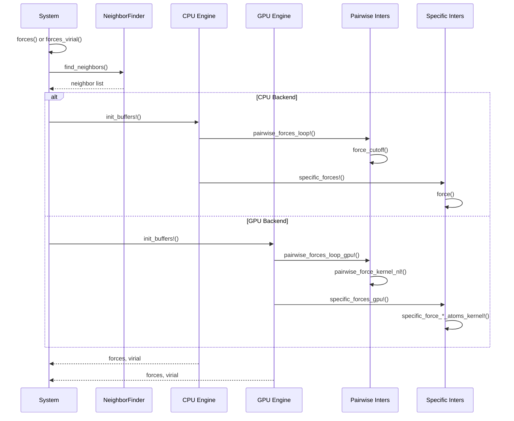

This page provides an in-depth exploration of Molly.jl's sophisticated cutoff strategies and force calculation architecture. These mechanisms are fundamental to achieving computational efficiency in molecular dynamics simulations while maintaining physical accuracy. We examine the mathematical foundations, implementation patterns, and practical considerations for selecting appropriate cutoff strategies and optimizing force calculations across different hardware platforms.

## Cutoff Strategy Architecture

Molly.jl implements a hierarchical type system for cutoff strategies that enables flexible and performant truncation of long-range interactions. The core abstraction is parameterized by complexity level, enabling efficient dispatch through Julia's type system.

### Type Hierarchy and Dispatch

The cutoff architecture centers on the abstract type `AbstractCutoff{P}`, where the type parameter `P` encodes the computational complexity level [cutoffs.jl#L10-L21](/src/cutoffs.jl#L10-L21):

- **P=0**: No cutoff modification (e.g., `NoCutoff`)
- **P=1**: Single-distance cutoff operations (e.g., `DistanceCutoff`, `ShiftedPotentialCutoff`, `ShiftedForceCutoff`)
- **P=2**: Two-distance cutoff operations with activation regions (e.g., `CubicSplineCutoff`)

The dispatch strategy uses this parameter to select appropriate computation paths. The `pe_cutoff` and `force_cutoff` functions demonstrate this pattern through multiple dispatch on `AbstractCutoff{P}` types [cutoffs.jl#L13-L34](/src/cutoffs.jl#L13-L34).

### Available Cutoff Strategies

Molly.jl provides five distinct cutoff strategies, each optimized for different scenarios:

```mermaid
flowchart TD
    A[AbstractCutoff{P}] --> B[P=0: NoCutoff]
    A --> C[P=1: Simple Cutoffs]
    A --> D[P=2: Advanced Cutoffs]
    C --> C1[DistanceCutoff]
    C --> C2[ShiftedPotentialCutoff]
    C --> C3[ShiftedForceCutoff]
    D --> D1[CubicSplineCutoff]
    
    B --> B1[No modification<br/>Full potential calculation]
    C1 --> C1a[Hard cutoff<br/>V=0, F=0 beyond rc]
    C2 --> C2a[Continuous potential<br/>Shifts V to Vrc=0]
    C3 --> C3a[Continuous force<br/>Shifts F to Frc=0]
    D1 --> D1a[Smooth spline<br/>Two-region interpolation]
```

| Strategy | Complexity | Continuity | Energy Conservation | Computational Cost | Best Use Case |
|----------|-----------|------------|-------------------|-------------------|--------------|
| **NoCutoff** | O(N²) | N/A | Excellent (exact) | Highest | Small systems, validation |
| **DistanceCutoff** | O(N) | None | Poor | Low | Prototyping, very large systems |
| **ShiftedPotential** | O(N) | V continuous | Good | Low | Most MD simulations |
| **ShiftedForce** | O(N) | V, F continuous | Very Good | Medium | Energy-sensitive applications |
| **CubicSpline** | O(N) | V, F, ∇F continuous | Excellent | Medium-High | High-precision simulations |

### Mathematical Foundations

Each cutoff strategy implements specific mathematical transformations. For a potential V(r) and force F(r):

#### DistanceCutoff
Implements a hard cutoff with no continuity guarantees:

```
V_c(r) = V(r) if r ≤ r_c, 0 otherwise
F_c(r) = F(r) if r ≤ r_c, 0 otherwise
```

This introduces discontinuities that can cause energy drift but provides maximum computational efficiency [cutoffs.jl#L47-L62](/src/cutoffs.jl#L47-L62).

#### ShiftedPotentialCutoff
Ensures potential energy continuity at the cutoff by subtracting the cutoff value:

```
V_c(r) = V(r) - V(r_c) if r ≤ r_c, 0 otherwise
F_c(r) = F(r) if r ≤ r_c, 0 otherwise
```

The implementation computes `pe_r - pe_cut` where `pe_cut` is evaluated at the cutoff distance [cutoffs.jl#L70-L87](/src/cutoffs.jl#L70-L87).

#### ShiftedForceCutoff
Ensures both potential and force continuity by shifting both quantities:

```
V_c(r) = V(r) - (r - r_c)V'(r_c) - V(r_c) if r ≤ r_c, 0 otherwise
F_c(r) = F(r) - F(r_c) if r ≤ r_c, 0 otherwise
```

The force implementation subtracts the cutoff force value: `f_r - f_cut` [cutoffs.jl#L95-L113](/src/cutoffs.jl#L95-L113).

#### CubicSplineCutoff
Uses a cubic Hermite spline to smoothly interpolate between the true potential and zero over an activation region [r_a, r_c]:

```
t = (r - r_a) / (r_c - r_a)
V_c(r) = V(r) if r ≤ r_a, spline(t, V(r_a), V'(r_a)) if r_a < r ≤ r_c, 0 if r > r_c
F_c(r) = F(r) if r ≤ r_a, spline'(t, V(r_a), V'(r_a)) if r_a < r ≤ r_c, 0 if r > r_c
```

The implementation uses sophisticated spline coefficients computed at the activation distance [cutoffs.jl#L115-L155](/src/cutoffs.jl#L115-L155).

> [!TIP]
> When selecting a cutoff strategy, the ShiftedForceCutoff often provides the best compromise between energy conservation and computational efficiency for production MD simulations. The CubicSplineCutoff offers superior smoothness but requires careful tuning of the activation distance to avoid artifacts.

## Force Calculation Architecture

Molly.jl's force calculation system implements a highly optimized, multi-platform architecture that scales from small serial computations to massive GPU-accelerated simulations.

### Computational Flow

The force calculation follows a systematic flow through the system:



### CPU Force Calculation

The CPU implementation uses a sophisticated buffering and threading strategy [force.jl#L90-L150](/src/force.jl#L90-L150):

1. **Buffer Initialization**: Creates thread-local buffers (`BuffersCPU`) to accumulate forces and virial contributions without contention
2. **Pairwise Forces**: Separates interactions into neighbor-list based (`use_neighbors=true`) and all-pairs (`use_neighbors=false`) categories
3. **Threaded Execution**: Uses `Threads.@threads` with chunked iteration patterns to maximize cache locality
4. **Force Accumulation**: Thread-safe reduction combines results from all threads

The pairwise force loop demonstrates the optimization strategy:

```julia
@inbounds if length(pairwise_inters_nonl) > 0
    for i in 1:n_atoms
        for j in (i + 1):n_atoms
            dr = vector(coords[i], coords[j], boundary)
            f = force(pairwise_inters_nonl[1], dr, atoms[i], atoms[j], ...)
            # Accumulate forces with cutoff application
        end
    end
end
```
[force.jl#L256-L273](/src/force.jl#L256-L273)

### GPU Force Calculation

GPU acceleration leverages KernelAbstractions for hardware-agnostic GPU programming [force.jl#L400-L450](/src/force.jl#L400-L450):

1. **Buffer Initialization**: Creates GPU-optimized buffers (`BuffersGPU`) including specialized virial row buffers
2. **Kernel Dispatch**: Launches specialized kernels for pairwise and specific interactions
3. **Atomic Operations**: Uses `Atomix.@atomic` for thread-safe force accumulation
4. **Memory Coalescing**: Optimizes memory access patterns for maximum bandwidth

The GPU pairwise kernel demonstrates the atomic accumulation pattern:

```julia
@kernel inbounds=true function pairwise_force_kernel_nl!(...)
    inter_i = @index(Global, Linear)
    if inter_i <= length(neighbors)
        i, j, special = neighbors[inter_i]
        # ... force calculation ...
        for dim in 1:D
            fval = ustrip(f[dim])
            Atomix.@atomic forces[dim, i] += -fval
            Atomix.@atomic forces[dim, j] +=  fval
        end
    end
end
```
[kernels.jl#L44-L65](/src/kernels.jl#L44-L65)

### Virial Calculation

The system supports simultaneous force and virial calculation for thermodynamic property computation:

```julia
function forces_virial(sys; n_threads::Integer=Threads.nthreads())
    buffers = init_buffers!(sys, n_threads)
    fs = zero_forces(sys)
    forces!(fs, sys, neighbors, buffers, Val(true), step_n; n_threads=n_threads)
    return fs, buffers.virial
end
```
[force.jl#L245-L252](/src/force.jl#L245-L252)

The virial is computed using the outer product of distance vectors and forces:

```julia
v = dr * transpose(f)
vir_nounits .+= ustrip.(v)
```
[force.jl#L271-L273](/src/force.jl#L271-L273)

## Integration with Interaction Types

Cutoff strategies integrate seamlessly with Molly.jl's interaction type system through the `pairwise_force` and `pairwise_pe` protocol.

### Lennard-Jones Integration

The `LennardJones` interaction demonstrates the cutoff integration pattern [lennard_jones.jl#L87-L110](/src/interactions/lennard_jones.jl#L87-L110):

```julia
@inline function force(inter::LennardJones, dr, atom_i, atom_j, 
                       force_units=u"kJ * mol^-1 * nm^-1", 
                       special=false, args...)
    if inter.shortcut(atom_i, atom_j)
        return ustrip.(zero(dr)) * force_units
    end
    σ = inter.σ_mixing(atom_i, atom_j)
    ϵ = inter.ϵ_mixing(atom_i, atom_j)
    
    cutoff = inter.cutoff
    r = norm(dr)
    σ2 = σ^2
    params = (σ2, ϵ)
    
    f = force_cutoff(cutoff, inter, r, params)  # Apply cutoff
    fdr = (f / r) * dr
    if special
        return fdr * inter.weight_special
    else
        return fdr
    end
end
```

The protocol requires implementing `pairwise_force` and `pairwise_pe` methods that the cutoff system can call at arbitrary distances:

```julia
function pairwise_force(::LennardJones, r, (σ2, ϵ))
    six_term = (σ2 / r^2) ^ 3
    return (24ϵ / r) * (2 * six_term ^ 2 - six_term)
end

function pairwise_pe(::LennardJones, r, (σ2, ϵ))
    six_term = (σ2 / r^2) ^ 3
    return 4ϵ * (six_term ^ 2 - six_term)
end
```
[lennard_jones.jl#L112-L119](/src/interactions/lennard_jones.jl#L112-L119)

### Coulomb Interaction

The Coulomb interaction follows the same pattern but handles charge parameters:

```julia
function pairwise_force(::Coulomb, r, (ke, qi, qj))
    return (ke * qi * qj) / r^2
end

function pairwise_pe(::Coulomb, r, (ke, qi, qj))
    return (ke * qi * qj) * inv(r)
end
```
[coulomb.jl#L57-L64](/src/interactions/coulomb.jl#L57-L64)

### Long-Range Electrostatics

For electrostatic interactions requiring long-range treatment, Molly.jl provides Ewald and PME methods through the `AbstractEwald` type system [ewald.jl#L1-L150](/src/interactions/ewald.jl#L1-L150). These methods handle excluded pairs and reciprocal space contributions separately from the real-space cutoff operations.

> [!TIP]
> When implementing custom interactions, ensure that `pairwise_force` and `pairwise_pe` are efficient and thread-safe, as these are called potentially millions of times per simulation step. Avoid allocations in these methods and prefer mathematical operations on scalar parameters.

## Performance Optimization Strategies

### Neighbor List Management

Efficient neighbor finding is critical for O(N) scaling. Molly.jl provides multiple strategies [neighbors.jl#L40-L420](/src/neighbors.jl#L40-L420):

| Finder | Backend | Algorithm | Best For |
|--------|---------|-----------|----------|
| **NoNeighborFinder** | CPU/GPU | None | Very small systems |
| **DistanceNeighborFinder** | CPU/GPU | All-pairs distance check | Non-NVIDIA GPUs |
| **GPUNeighborFinder** | NVIDIA GPU | Eastman & Pande 2010 | Large NVIDIA systems |
| **TreeNeighborFinder** | CPU | Spatial tree search | Highly non-uniform systems |

The neighbor list is updated periodically based on the `n_steps` parameter, with automatic detection of when recomputation is needed:

```julia
if !force_recompute && !iszero(step_n % nf.n_steps)
    return current_neighbors
end
```
[neighbors.jl#L85-L88](/src/neighbors.jl#L85-L88)

### GPU-Specific Optimizations

GPU implementations include several hardware-specific optimizations:

1. **Kernel Thread Tuning**: Environment variables control thread counts:
   - `MOLLY_GPUNTHREADS_DISTANCENF`: Neighbor finder threads (default: 512)
   - `MOLLY_GPUNTHREADS_PAIRWISE`: Pairwise force threads (default: 512)
   - `MOLLY_GPUNTHREADS_SPECIFIC`: Specific interaction threads (default: 32)

2. **Block-wise Morton Ordering**: The GPUNeighborFinder uses Morton codes for spatial locality [kernels.jl#L45-L55](/src/kernels.jl#L45-L55)

3. **Compressed Eligibility Matrices**: Bit compression reduces memory bandwidth [force.jl#L100-L120](/src/force.jl#L100-L120)

### Multi-threading Strategy

The CPU implementation uses a chunked iteration strategy to minimize false sharing:

```julia
@maybe_threads (n_threads > 1) for chunk_i in 1:n_threads
    for i in chunk_i:n_threads:length(sys)
        # Process atoms belonging to this thread
    end
end
```
[neighbors.jl#L98-L108](/src/neighbors.jl#L98-L108)

Each thread accumulates forces in its own buffer, with a final reduction step combining results.

## Practical Usage Examples

### Basic Cutoff Configuration

Configure a Lennard-Jones interaction with a shifted force cutoff:

```julia
sys = System(
    atoms=atoms,
    coords=coords,
    boundary=CubicBoundary(3.0u"nm"),
    pairwise_inters=(
        LennardJones(
            cutoff=ShiftedForceCutoff(1.0u"nm"),
            use_neighbors=true
        ),
    ),
    neighbor_finder=DistanceNeighborFinder(
        eligible=eligible,
        dist_cutoff=1.2u"nm",  # Slightly larger than cutoff
        special=special,
        n_steps=10
    )
)
```
[test/coupling.jl#L20-L25](/test/coupling.jl#L20-L25)

### Advanced Smooth Cutoff

For high-precision simulations requiring smooth force transitions:

```julia
interaction = LennardJones(
    cutoff=CubicSplineCutoff(
        dist_activation=0.8u"nm",  # Start smoothing
        dist_cutoff=1.0u"nm"      # Complete cutoff
    ),
    use_neighbors=true
)
```
[cutoffs.jl#L115-L155](/src/cutoffs.jl#L115-L155)

### Force-Virial Calculation

Calculate forces and virial in a single pass for thermodynamic properties:

```julia
forces, virial = forces_virial(sys)
# virial contains the pressure tensor for computing pressure
```
[force.jl#L245-L252](/src/force.jl#L245-L252)

## Debugging and Validation

### Cutoff Continuity Verification

Verify cutoff continuity by checking potential and force at the cutoff distance:

```julia
using Molly

cutoff = ShiftedForceCutoff(1.0u"nm")
inter = LennardJones()
params = (0.25u"nm"^2, 0.2u"kJ * mol^-1")

# Check continuity at cutoff
r_cut = cutoff.dist_cutoff
pe_before = pe_cutoff(cutoff, inter, r_cut - 1e-12u"nm", params)
pe_after = pe_cutoff(cutoff, inter, r_cut + 1e-12u"nm", params)
f_before = force_cutoff(cutoff, inter, r_cut - 1e-12u"nm", params)
f_after = force_cutoff(cutoff, inter, r_cut + 1e-12u"nm", params)

@assert isapprox(pe_before, pe_after) "Potential discontinuity detected"
@assert isapprox(f_before, f_after) "Force discontinuity detected"
```
[cutoffs.jl#L95-L113](/src/cutoffs.jl#L95-L113)

### Energy Conservation Testing

Monitor energy drift to validate cutoff choices:

```julia
sys = System(
    # ... system setup ...
    pairwise_inters=(LennardJones(cutoff=ShiftedForceCutoff(1.0u"nm")),),
    loggers=(energy=TotalEnergyLogger(10),)
)

simulate!(sys, simulator, 10000)
energies = values(sys.loggers.energy)

# Energy should be conserved (modulo small fluctuations)
@assert std(energies) / mean(energies) < 0.01 "Excessive energy drift"
```
[test/energy_conservation.jl](/test/energy_conservation.jl)

## Troubleshooting Guide

### Common Issues

**Problem**: Energy drift in production simulations

**Solution**: Switch from `DistanceCutoff` to `ShiftedForceCutoff` or `CubicSplineCutoff` to ensure force continuity [cutoffs.jl#L95-L113](/src/cutoffs.jl#L95-L113).

**Problem**: Performance degradation with neighbor lists

**Solution**: Increase the `n_steps` parameter in the neighbor finder or ensure the neighbor list cutoff distance is slightly larger than the interaction cutoff to account for atomic motion between rebuilds [neighbors.jl#L85-L88](/src/neighbors.jl#L85-L88).

**Problem**: Incorrect forces on GPU

**Solution**: Verify that interaction parameters don't include distance-dependent terms in the parameter tuple passed to `pairwise_force`. The cutoff system calls these methods at specific distances for shift calculations [force.jl#L67-L71](/src/force.jl#L67-L71).

**Problem**: Poor scaling on multi-core systems

**Solution**: Ensure thread-local buffers are properly initialized and that the number of threads matches the buffer size. Check that force calculations avoid false sharing by using appropriate chunk sizes [force.jl#L300-L320](/src/force.jl#L300-L320).

## Summary

Molly.jl's cutoff strategies and force calculation system provide a sophisticated, multi-platform foundation for efficient molecular dynamics simulations. The type-parameterized cutoff system enables compile-time optimizations while maintaining runtime flexibility. The separation of CPU and GPU execution paths, combined with sophisticated buffering strategies and kernel optimization, enables excellent performance across diverse hardware platforms.

Key takeaways for advanced developers:

1. **Select cutoffs based on accuracy requirements**: Use `ShiftedForceCutoff` for most applications, `CubicSplineCutoff` for high-precision work
2. **Profile neighbor list settings**: Tune `n_steps` and `dist_cutoff` based on system dynamics and hardware
3. **Leverage platform-specific optimizations**: Use `GPUNeighborFinder` on NVIDIA GPUs, `DistanceNeighborFinder` elsewhere
4. **Validate cutoff continuity**: Test energy conservation and force continuity before production runs
5. **Custom interactions follow the protocol**: Implement efficient `pairwise_force` and `pairwise_pe` methods for cutoff compatibility

For related topics, see [Neighbor Finding Algorithms and Cell Lists](20-neighbor-finding-algorithms-and-cell-lists) for deeper coverage of spatial partitioning strategies, or [GPU Acceleration with CUDA](21-gpu-acceleration-with-cuda) for GPU-specific optimization techniques. The [Pairwise Interactions: Lennard-Jones and Coulomb](10-pairwise-interactions-lennard-jones-and-coulomb) page provides more details on interaction-specific implementations.