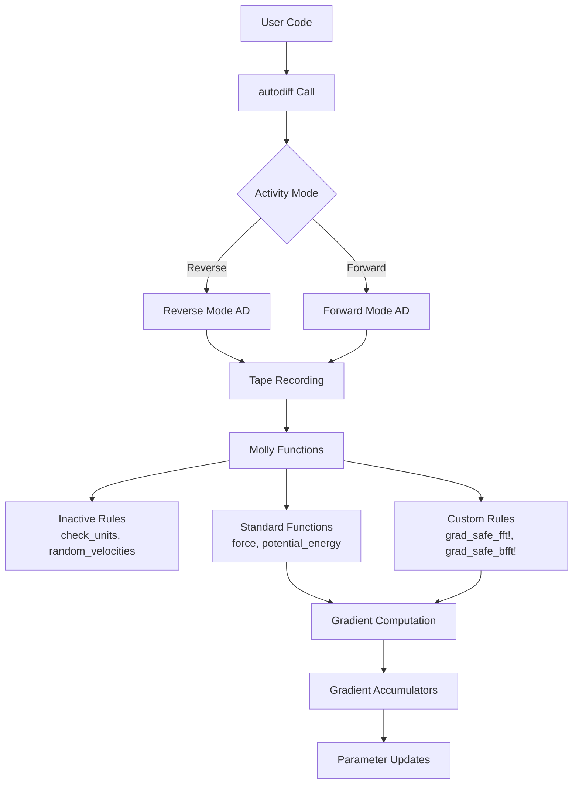

Molly.jl leverages Enzyme.jl's source-to-source automatic differentiation (AD) capabilities to enable exact gradient computation through molecular dynamics simulations. This integration allows developers to optimize force field parameters, train neural network potentials, and perform sensitivity analysis across complex interactions including PME electrostatics, implicit solvation models, and stochastic dynamics. The architecture supports both reverse-mode and forward-mode AD on CPU and GPU platforms, with performance typically within an order of magnitude of primal execution.
Sources: [docs/src/differentiable.md](/docs/src/differentiable.md#L1-L21), [ext/MollyEnzymeExt.jl](/ext/MollyEnzymeExt.jl#L1-L10)

## Enzyme Integration Architecture

The Enzyme extension provides the foundation for differentiable simulation by defining custom AD rules and marking Molly functions as appropriate activity targets. The integration follows a layered approach where core Molly functions are annotated with Enzyme rules to ensure correct gradient propagation through simulation steps.

### Activity Marking Strategy

Enzyme requires precise specification of which function arguments require gradient computation (Active), which should be treated as constants (Const), and which need both primal and dual values (Duplicated for mutable arrays). Molly's extension marks utility and validation functions as inactive to prevent unnecessary gradient tracking:

```julia
EnzymeRules.inactive(::typeof(Molly.check_units), args...) = nothing
EnzymeRules.inactive(::typeof(Molly.n_infinite_dims), args...) = nothing
EnzymeRules.inactive(::typeof(random_coord), args...) = nothing
EnzymeRules.inactive(::typeof(find_neighbors), args...) = nothing
```

Sources: [ext/MollyEnzymeExt.jl](/ext/MollyEnzymeExt.jl#L10-L22)

### Custom Forward and Reverse Rules

For computationally intensive operations like PME electrostatics that involve FFT transforms, Molly defines custom augmented primal and reverse rules to work around Enzyme limitations with FFTW plans:

```julia
function EnzymeRules.augmented_primal(config, ::Const{typeof(Molly.grad_safe_fft!)}, t,
                                      charge_grid, fft_plan)
    fft_plan.val * charge_grid.val
    return EnzymeRules.AugmentedReturn(nothing, nothing, nothing)
end

function EnzymeRules.reverse(config, ::Const{typeof(Molly.grad_safe_fft!)}, dret, tape,
                             charge_grid, fft_plan)
    charge_grid.dval .= bfft(charge_grid.dval)
    return (nothing, nothing)
end
```

The grad_safe pattern wraps FFT operations to make them differentiable while maintaining performance by treating FFT plans as inactive constants.

Sources: [ext/MollyEnzymeExt.jl](/ext/MollyEnzymeExt.jl#L24-L44)

### AD Architecture Flow



Sources: [ext/MollyEnzymeExt.jl](/ext/MollyEnzymeExt.jl#L1-L59), [src/force.jl](/src/force.jl#L1-L100)

## AD Activity Configuration

Properly configuring Enzyme activity annotations is critical for performance and correctness. The choice between Reverse and Forward mode depends on the number of parameters being optimized and available memory.

### Activity Annotation Patterns

| Activity Type | Use Case | Memory Cost | When to Use |
|--------------|----------|-------------|-------------|
| `Active` | Scalar or array parameters requiring gradients | Low per element | Few parameters, reverse mode |
| `Const` | Constants not requiring gradients | None | Fixed values, simulator configs |
| `Duplicated` | Mutable arrays needing gradient accumulation | 2× array size | State variables (coords, velocities) |

Sources: [test/gradients.jl](/test/gradients.jl#L35-L45), [test/gradients.jl](/test/gradients.jl#L280-L295)

### Reverse Mode Example

For optimizing a small number of parameters (like σ in Lennard-Jones), reverse mode is most efficient:

```julia
grad_enzyme = autodiff(
    set_runtime_activity(Reverse), loss, Active, Active(σtrue),
    Duplicated(coords, zero(coords)), 
    Duplicated(velocities, zero(velocities)),
    Const(boundary), Const(pairwise_inters), Const(neighbor_finder),
    Const(simulator), Const(n_steps), Const(n_atoms),
    Const(atom_mass), Const(dist_true),
)[1][1]
```

Sources: [docs/src/differentiable.md](/docs/src/differentiable.md#L76-L85)

### Forward Mode Example

Forward mode has constant memory cost with respect to simulation steps, making it suitable for scenarios with many simulation steps but few parameters:

```julia
grad_enzyme = autodiff(
    set_runtime_activity(Forward), loss, Duplicated,
    Duplicated(σ, one(T)), Const(r0), 
    Duplicated(copy(coords), zero(coords)),
    Duplicated(copy(velocities), zero(velocities)),
    const_args...,
)[1]
```

Sources: [test/gradients.jl](/test/gradients.jl#L280-L290)

## Pairwise Interaction Gradients

Pairwise interactions like Lennard-Jones and Coulomb are the foundation of molecular force fields. Computing gradients through these interactions enables optimization of atomic properties to achieve desired structural outcomes.

### Loss Function Design for LJ Fluid Optimization

This example optimizes the σ parameter in Lennard-Jones potentials to achieve a target minimum separation distance between atoms:

```julia
function mean_min_separation(coords, boundary)
    min_seps = Float64[]
    for i in eachindex(coords)
        min_sq_sep = 100.0
        for j in eachindex(coords)
            if i != j
                sq_dist = sum(abs2, vector(coords[i], coords[j], boundary))
                min_sq_sep = min(sq_dist, min_sq_sep)
            end
        end
        push!(min_seps, sqrt(min_sq_sep))
    end
    return mean(min_seps)
end

function loss(σ, coords, velocities, boundary, pairwise_inters,
              neighbor_finder, simulator, n_steps, n_atoms, atom_mass, dist_true)
    atoms = [Atom(i, 1, atom_mass, 0.0, σ, 0.2) for i in 1:n_atoms]

    sys = System(
        atoms=atoms,
        coords=coords,
        boundary=boundary,
        velocities=velocities,
        pairwise_inters=pairwise_inters,
        neighbor_finder=neighbor_finder,
        force_units=NoUnits,
        energy_units=NoUnits,
    )

    simulate!(sys, simulator, n_steps)
    mms_end = mean_min_separation(sys.coords, boundary)
    loss_val = abs(mms_end - dist_true)

    return loss_val
end
```

The loss function wraps the simulation and computes the absolute deviation from the target minimum separation. The `NoUnits` setting is required as units are not currently supported in differentiable simulations.

Sources: [docs/src/differentiable.md](/docs/src/differentiable.md#L26-L75), [docs/src/differentiable.md](/docs/src/differentiable.md#L1-L21)

### Training Loop Pattern

The training loop repeatedly samples initial conditions, computes gradients, and updates parameters:

```julia
function train()
    σlearn = 0.60 / scale_σ_to_dist
    n_epochs = 15

    for epoch_n in 1:n_epochs
        print("Epoch ", epoch_n, "  |  ")
        coords = place_atoms(n_atoms, boundary; min_dist=0.6)
        velocities = [random_velocity(atom_mass, temp) for i in 1:n_atoms]
        grad = autodiff(
            set_runtime_activity(Reverse), loss, Active, Active(σlearn),
            Duplicated(coords, zero(coords)), 
            Duplicated(velocities, zero(velocities)),
            const_args...,
        )[1][1]
        println("Grad ", round(grad; digits=3))
        σlearn -= grad * 1e-2
    end
end
```

Note that coordinates and velocities are re-sampled each epoch to average over stochastic variations, improving gradient quality.

Sources: [docs/src/differentiable.md](/docs/src/differentiable.md#L87-L110)

> [!TIP]
> Resample stochastic variables (coordinates, velocities, RNG state) across gradient calculations to average over noise and improve gradient quality. This is particularly important for small systems where individual configurations may not represent ensemble averages.

### Gradient Verification

Always verify AD gradients against finite differences, especially for custom interactions:

```julia
function force_direct(dist)
    c1 = SVector(1.0, 1.0, 1.0)
    c2 = SVector(dist + 1.0, 1.0, 1.0)
    vec = vector(c1, c2, boundary)
    F = force(inter, vec, a1, a2, NoUnits)
    return F[1]
end

function force_grad(dist)
    grads = autodiff(Reverse, pe, Active, Active(dist))
    return -grads[1][1]
end

@test all(force_direct.(dists) .≈ force_grad.(dists))
```

Sources: [test/gradients.jl](/test/gradients.jl#L4-L35)

## Specific Interaction Gradients

Specific interactions (bonds, angles, torsions) connect defined subsets of atoms and form the topology of molecular systems. Gradients through these interactions enable optimization of conformational properties like bond angles and dihedral preferences.

### Bond Angle Optimization Example

This example optimizes a harmonic bond angle equilibrium value to achieve a target distance between terminal atoms in a triatomic molecule:

```julia
function loss(θ, coords, velocities, atoms, bonds, boundary, simulator, n_steps,
              n_atoms, atom_mass, dist_true)
    angles = InteractionList3Atoms(
        [1, 4], [2, 5], [3, 6],
        [HarmonicAngle(10.0, θ), HarmonicAngle(10.0, θ)],
    )

    sys = System(
        atoms=atoms,
        coords=coords,
        boundary=boundary,
        velocities=velocities,
        specific_inter_lists=(bonds, angles),
        force_units=NoUnits,
        energy_units=NoUnits,
    )

    simulate!(sys, simulator, n_steps)

    d1 = norm(vector(sys.coords[1], sys.coords[3], boundary))
    d2 = norm(vector(sys.coords[4], sys.coords[6], boundary))
    dist_end = 0.5 * (d1 + d2)
    loss_val = abs(dist_end - dist_true)

    return loss_val
end
```

The training converges to approximately 90.7°, close to the theoretical value of 91.2° derived from trigonometry.

Sources: [docs/src/differentiable.md](/docs/src/differentiable.md#L170-L210)

> [!TIP]
> When optimizing specific interaction parameters, ensure the loss function is sensitive to the parameter changes. Bond angle optimization through terminal distance is effective because small angle changes produce measurable distance variations.

### Multi-Parameter Optimization

For neural network potentials with many parameters, Flux model gradients are extracted using `Flux.fmap`:

```julia
d_model = Flux.fmap(model) do x
    x isa Array ? zero(x) : x
end
autodiff(
    set_runtime_activity(Reverse), loss, Active, 
    Duplicated(model, d_model),
    Duplicated(copy(coords), zero(coords)), 
    Duplicated(copy(velocities), zero(velocities)),
    Const(atoms), Const(boundary), Const(simulator), 
    Const(n_steps), Const(dist_true),
)
opt, model = Optimisers.update!(opt, model, d_model)
```

This pattern enables training arbitrarily complex neural network potentials, though practical success depends on careful loss function design and hyperparameter tuning.

Sources: [docs/src/differentiable.md](/docs/src/differentiable.md#L292-L350)

## Complex Interaction Types

Molly supports gradients through sophisticated interactions including long-range electrostatics (PME), implicit solvent models (OBC2, GBN2), and custom neural network potentials.

### PME Electrostatic Gradients

PME combines real-space Coulomb summation with reciprocal-space FFT-based calculations. Making PME differentiable requires custom rules for FFT operations:

```julia
@testset "Differentiable PME" begin
    sys = System(pdb_file, ff; units=false, array_type=AT, 
                 nonbonded_method=:pme, grad_safe=true)
    pme = sys.general_inters[1]
    Fs = zero(sys.coords)
    d_sys = zero(sys)
    d_pme = zero(pme)

    pe = Molly.ewald_pe_forces!(Fs, nothing, sys, pme, Val(false))
    Fs_ad = zero(sys.coords)

    pe_ad = autodiff(
        ReverseWithPrimal,
        Molly.ewald_pe_forces!,
        Active,
        Const(Fs_ad),
        Const(nothing),
        Duplicated(sys, d_sys),
        Duplicated(pme, d_pme),
        Const(Val(false)),
    )[2]

    @test pe_ad ≈ pe atol=1e-7
    @test Fs_ad ≈ Fs atol=1e-10
    @test -d_sys.coords ≈ Fs atol=1e-10
end
```

The `grad_safe=true` flag activates gradient-safe implementations of PME operations. Gradients are verified against finite differences for both coordinates and atomic charges.

Sources: [test/gradients.jl](/test/gradients.jl#L37-L95), [src/interactions/ewald.jl](/src/interactions/ewald.jl#L1-L50)

### Neural Network Potentials

Custom interaction types can integrate Flux neural networks into force calculations:

```julia
struct NNBonds{T}
    model::T
end

function AtomsCalculators.forces!(fs, sys, inter::NNBonds; kwargs...)
    vec_ij = vector(sys.coords[1], sys.coords[3], sys.boundary)
    dist = norm(vec_ij)
    f = inter.model([dist])[1] * normalize(vec_ij)
    fs .+= [f, zero(f), -f]
    return fs
end
```

This pattern enables learning potentials directly from simulation trajectories or structural targets, though training stability requires careful initialization and regularization.

Sources: [docs/src/differentiable.md](/docs/src/differentiable.md#L292-L330)

## Simulation Gradient Strategies

Different types of simulators present different challenges for gradient computation. Stochastic simulators (Langevin, Andersen thermostat) require special handling to ensure gradient quality.

### Stochastic Dynamics Considerations

Exploding gradients are a common problem when using Velocity Verlet in the NVE ensemble. Thermostats help stabilize gradient flow:

```julia
simulator = VelocityVerlet(
    dt=0.02,
    coupling=BerendsenThermostat(temp, 0.5),
)
```

Alternatively, Langevin dynamics naturally introduces damping that mitigates gradient explosion:

```julia
simulator = Langevin(dt=0.001, temperature=300.0, friction=1.0)
```

Sources: [docs/src/differentiable.md](/docs/src/differentiable.md#L453-L458), [src/simulators.jl](/src/simulators.jl#L1-L100)

### Intermediate Value Access

To compute loss functions that depend on intermediate simulation states, split the simulation into chunks:

```julia
function loss_with_trajectory(params, coords, velocities, ...)
    chunk_steps = 100
    n_chunks = div(n_steps, chunk_steps)
    total_loss = 0.0
    
    for chunk in 1:n_chunks
        sys = System(...)  # Reconstruct with current state
        simulate!(sys, simulator, chunk_steps)
        
        # Access intermediate state
        rmsd_chunk = compute_rmsd(sys.coords, reference)
        total_loss += rmsd_chunk
        
        # Carry forward state
        coords = sys.coords
        velocities = sys.velocities
    end
    
    return total_loss / n_chunks
end
```

This pattern enables computing trajectory-based metrics (RMSD, radius of gyration) while maintaining differentiability.

Sources: [docs/src/differentiable.md](/docs/src/differentiable.md#L145-L166)

## Performance and Memory Considerations

The computational cost of differentiable simulation depends on the AD mode, hardware platform, and simulation size. Understanding these trade-offs is essential for practical applications.

### Memory Requirements by Mode

| AD Mode | Memory Scaling | Step Cost | Parameter Count Suitability |
|---------|---------------|-----------|---------------------------|
| Reverse | O(n_steps) | 2-5× primal | Few parameters (<100) |
| Forward | O(1) | 1-10× primal | Many parameters |
| Reversible | O(1) | 10-20× primal | Very long simulations |

GPU memory consumption is particularly high for reverse mode due to storing all intermediate activations. Gradient checkpointing (e.g., with Checkpointing.jl) is essential for large GPU simulations.

Sources: [docs/src/differentiable.md](/docs/src/differentiable.md#L1-L21)

### Platform-Specific Considerations

| Platform | Status | Notes |
|----------|--------|-------|
| CPU (single thread) | Stable | Recommended for development |
| CPU (multithreaded) | Stable | Use `n_threads` parameter |
| GPU (CUDA) | Experimental | Memory-intensive, requires checkpointing |
| Forward mode | Experimental | Constant memory, variable speed |

Sources: [docs/src/differentiable.md](/docs/src/differentiable.md#L4-L6), [test/gradients.jl](/test/gradients.jl#L75-L95)

## Molecular Loss Function Design

The choice of loss function determines which aspects of molecular behavior are optimized. Effective loss functions should be physically meaningful, differentiable, and sensitive to parameter changes.

### Structural Loss Functions

| Loss Type | Description | Sensitivity |
|-----------|-------------|-------------|
| Terminal distance | Distance between specific atoms | High for small systems |
| RMSD | Root-mean-square deviation to reference | High for macromolecules |
| dRMSD | Distance matrix RMSD | Captures global topology |
| Radius of gyration | Compactness measure | Medium |
| Inter-residue distances | Contact map matching | High for proteins |

Sources: [docs/src/differentiable.md](/docs/src/differentiable.md#L434-L452)

### Property-Based Loss Functions

Loss functions can target thermodynamic or dynamic properties:

```julia
function temperature_loss(params, ...)
    sys = run_simulation(params, ...)
    temp = temperature(sys)
    return abs(temp - target_temp)
end

function flexibility_loss(params, ...)
    sys = run_simulation(params, ...)
    coords_trajectory = collect_trajectory(sys)
    variance = std([norm(c) for c in coords_trajectory])
    return abs(variance - target_variance)
end
```

Sources: [docs/src/differentiable.md](/docs/src/differentiable.md#L434-L452)

## Verification and Validation

Robust gradient verification is essential before using differentiable simulation for production optimization.

### Finite Difference Verification

Compare AD gradients against central finite differences:

```julia
coord_grad = central_fdm(5, 1)(coord_fdm, c)
charge_grad = central_fdm(5, 1)(charge_fdm, charge(at))

@test d_sys.coords[1][1] ≈ coord_grad atol=1e-6
@test charge(d_sys.atoms[1]) ≈ charge_grad atol=1e-6
```

Use at least 5th order finite differences with small step sizes for accurate comparison.

Sources: [test/gradients.jl](/docs/src/differentiable.md#L85-L95)

### Gradient Consistency Checks

For stochastic simulations, verify gradient consistency across multiple random seeds:

```julia
grads = []
for seed in 1:10
    rng = Xoshiro(seed)
    grad = compute_grad(rng, ...)
    push!(grads, grad)
end
@test std(grads) < tolerance  # Low variance across seeds
```

Sources: [docs/src/differentiable.md](/docs/src/differentiable.md#L453-L458)

## Next Steps

For force field parameter optimization workflows, see [Gradient-Based Force Field Optimization](25-gradient-based-force-field-optimization). For understanding how gradients propagate through stochastic dynamics, explore [Differentiable Stochastic Simulations](26-differentiable-stochastic-simulations). For detailed performance optimization strategies, refer to [Performance Considerations for AD](27-performance-considerations-for-ad).

To understand the underlying interaction types that can be differentiated, review [Pairwise Interactions: Lennard-Jones and Coulomb](10-pairwise-interactions-lennard-jones-and-coulomb) and [Specific Interactions: Bonds, Angles, and Torsions](11-specific-interactions-bonds-angles-and-torsions). For the simulation algorithms being differentiated, see [Integration Methods: Verlet, Velocity Verlet, and Langevin](15-integration-methods-verlet-velocity-verlet-and-langevin).