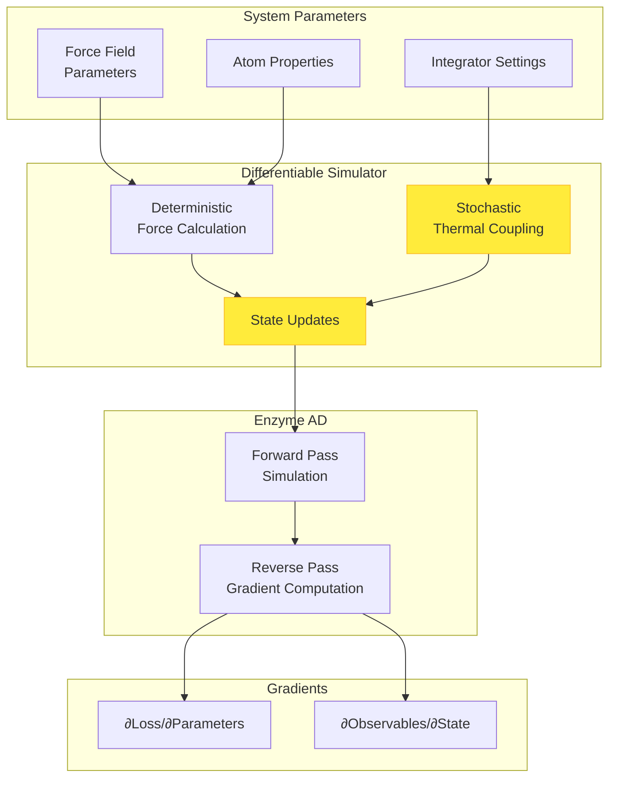

Differentiable stochastic simulations combine automatic differentiation with molecular dynamics that incorporate thermal fluctuations and random forces. This capability enables gradient-based optimization of force field parameters while correctly sampling canonical ensembles, making it essential for machine learning applications in molecular simulation, force field parameterization, and enhanced sampling methods.

Sources: [MollyEnzymeExt.jl](ext/MollyEnzymeExt.jl#L1-L59), [gradients.jl](test/gradients.jl#L1-L200)

## Stochastic Integrators in Molly

Molly provides several stochastic integrators that are compatible with automatic differentiation through Enzyme. These simulators introduce randomness through controlled thermal fluctuations while maintaining differentiability for deterministic components of the dynamics.

### Langevin Dynamics

The **Langevin** integrator implements a leapfrog scheme based on the Langevin Middle Integrator from OpenMM, suitable for simulating systems at constant temperature with explicit friction and stochastic terms. The integrator combines deterministic force-driven motion with stochastic thermal fluctuations.

The Langevin integrator structure includes:
- `dt`: Time step for integration
- `temperature`: Target equilibrium temperature
- `friction`: Friction coefficient controlling coupling to heat bath
- `coupling`: Additional coupling methods (optional)
- `vel_scale` and `noise_scale`: Precomputed scaling factors for efficiency

Sources: [simulators.jl](src/simulators.jl#L350-L400)

The integration follows a BAOO (B-A-O-O) splitting scheme where B represents velocity updates from forces, A represents position updates, and O represents stochastic velocity updates. The stochastic velocity update applies:
```julia
random_velocities!(noise, sys, sim.temperature; rng=rng)
sys.velocities .= sys.velocities .* sim.vel_scale .+ noise .* sim.noise_scale
```

This formulation ensures correct sampling of the canonical ensemble while maintaining differentiability through the force computation path.

Sources: [simulators.jl](src/simulators.jl#L430-L440)

### Langevin Splitting Schemes

The **LangevinSplitting** simulator provides a general framework for different splitting schemes using A, B, and O operations. This flexibility allows exploration of various integration schemes with different sampling properties and accuracy characteristics.

Available splitting strings include characters representing:
- **A**: Position update step
- **B**: Velocity update from forces
- **O**: Stochastic thermal fluctuation-dissipation step

For example, "BAOA" corresponds to the standard Langevin scheme, while "BAB" corresponds to Velocity Verlet without stochasticity.

Sources: [simulators.jl](src/simulators.jl#L420-L460)

The implementation uses per-operation time steps:
```julia
effective_dts = [sim.dt / count(c, sim.splitting) for c in sim.splitting]
```

This ensures each operation type receives proportional time allocation based on its frequency in the splitting string.

### Overdamped Langevin Dynamics

The **OverdampedLangevin** simulator implements the Euler-Maruyama method for overdamped Langevin dynamics, where inertial effects are negligible and velocity is not explicitly tracked. This is useful for simulating very viscous environments or Brownian motion.

The position update combines deterministic drift from forces and stochastic diffusion:
```julia
random_velocities!(noise, sys, sim.temperature; rng=rng)
sys.coords .+= (accels_t ./ sim.friction) .* sim.dt .+ noise_prefac .* noise
```

where `noise_prefac = sqrt((2 / sim.friction) * sim.dt)` scales the random displacement appropriately.

Sources: [simulators.jl](src/simulators.jl#L610-L640)

## Stochastic Thermostats

Molly provides several thermostats that introduce stochasticity into simulations, making them compatible with differentiable simulation workflows when used with deterministic integrators.

### Velocity Rescaling Thermostat

The **VelocityRescaleThermostat** implements the stochastic velocity rescaling method from Bussi et al. (2007), which combines deterministic rescaling like the Berendsen thermostat with a stochastic term to ensure correct canonical ensemble sampling.

The scaling factor λ² is computed as:
```math
\lambda^2 = c + (1-c) \cdot \frac{\bar K}{N_f K} \cdot (R^2 + S) + 2 \cdot \sqrt{c(1-c) \frac{\bar K}{N_f K}} \cdot R
```

where `c = exp(-Δt/τ)`, R ~ 𝒩(0,1), and S ~ χ²_{Nf-1}.

Sources: [coupling.jl](src/coupling.jl#L70-L140)

This thermostat introduces controlled randomness through the random variables R and S, enabling correct thermal sampling while maintaining differentiability through the kinetic energy computation path.

### Andersen Thermostat

The **AndersenThermostat** provides stochastic temperature control by randomly selecting atoms each timestep and resetting their velocities from the Maxwell-Boltzmann distribution with probability `dt / coupling_const`.

The implementation handles both CPU and GPU execution:
```julia
function apply_coupling!(sys::System, buffers, thermostat::AndersenThermostat, sim,
                         neighbors=nothing, step_n::Integer=0;
                         n_threads::Integer=Threads.nthreads(),
                         rng=Random.default_rng())
    for i in eachindex(sys)
        if rand(rng) < (sim.dt / thermostat.coupling_const)
            sys.velocities[i] = random_velocity(mass(sys.atoms[i]), thermostat.temperature, sys.k;
                                                dims=AtomsBase.n_dimensions(sys), rng=rng)
        end
    end
    return false
end
```

Sources: [coupling.jl](src/coupling.jl#L150-L180)

On GPU, the selection is vectorized for efficiency by computing masks for atoms to be rescaled.

## Enzyme Integration for Stochastic Simulations

The differentiability of stochastic simulations in Molly is enabled through careful integration with Enzyme's automatic differentiation framework. The key challenge is handling random number generation, which has zero gradient but must not break the differentiation chain.

### Inactive Operations

Random number generation functions are marked as inactive for Enzyme, meaning they are treated as constants in the reverse-pass gradient computation:

```julia
EnzymeRules.inactive(::typeof(random_coord), args...) = nothing
EnzymeRules.inactive(::typeof(random_velocity), args...) = nothing
EnzymeRules.inactive(::typeof(random_velocities), args...) = nothing
EnzymeRules.inactive(::typeof(random_velocities!), args...) = nothing
```

Sources: [MollyEnzymeExt.jl](ext/MollyEnzymeExt.jl#L15-L20)

This marking ensures that gradients are computed with respect to system parameters (such as force field coefficients, atom properties, or integrator parameters) while treating the random thermal fluctuations as having zero gradient, which is physically correct.

### Reproducibility with Random Number Generators

The `simulate!` function accepts an `rng` parameter to enable reproducible stochastic simulations:

```julia
function simulate!(sys, simulator, n_steps; n_threads=Threads.nthreads(), 
                   run_loggers=true, rng=Random.default_rng())
```

Setting a specific random number generator with a fixed seed ensures that the same stochastic trajectory is reproduced across runs, which is essential for verifying gradient computations and debugging differentiable simulation workflows.

Sources: [simulators.jl](src/simulators.jl#L80-L100)

## Architectural Overview

The integration of stochastic dynamics with automatic differentiation follows a modular architecture that separates deterministic and stochastic components:



The stochastic thermal coupling (thermostats and random forces) is treated as inactive in the reverse pass, while the deterministic force computation path through the potential energy function remains fully differentiable.

## Comparison of Stochastic Simulators

| Simulator | Stochasticity | Use Case | AD Compatibility | Constraints |
|-----------|--------------|----------|------------------|-------------|
| Langevin | Friction + noise | General MD at constant T | ✓ Full | Position constraints |
| LangevinSplitting | Configurable splitting | Research in integration schemes | ✓ Full | Not compatible with constraints |
| OverdampedLangevin | Brownian motion | High viscosity systems | ✓ Full | Not compatible with constraints |
| AndersenThermostat | Random velocity reset | Canonical ensemble sampling | ✓ Full | None |
| VelocityRescaleThermostat | Stochastic rescaling | Correct ensemble sampling | ✓ Full | None |

Sources: [simulators.jl](src/simulators.jl#L300-L650), [coupling.jl](src/coupling.jl#L70-L200)

## Practical Implementation

### Setting Up a Differentiable Stochastic Simulation

A typical workflow involves wrapping the simulation in a loss function that returns a scalar quantity to optimize. Here's the pattern for Langevin dynamics:

```julia
function loss(parameters, coords, velocities, boundary, 
              pairwise_inters, neighbor_finder, simulator, 
              n_steps, n_threads, n_atoms, atom_mass, rng)
    # Create system with parameters
    atoms = [Atom(..., σ=parameters.σ, ...) for i in 1:n_atoms]
    
    sys = System(
        atoms=atoms,
        coords=coords,
        boundary=boundary,
        velocities=velocities,
        pairwise_inters=pairwise_inters,
        neighbor_finder=neighbor_finder,
        force_units=NoUnits,
        energy_units=NoUnits,
    )
    
    # Run stochastic simulation with reproducible RNG
    simulate!(sys, simulator, n_steps; n_threads=n_threads, rng=rng)
    
    # Compute loss from final state
    loss_val = compute_loss(sys.coords, sys.velocities)
    return loss_val
end
```

The key for differentiability is:
1. Use `NoUnits` to avoid unit-related AD issues
2. Pass a fixed `rng` for reproducibility
3. Mark constant arguments with `Const` for Enzyme

Sources: [gradients.jl](test/gradients.jl#L100-L200)

### Gradient Computation

Gradients are computed using Enzyme with appropriate activity annotations:

```julia
using Enzyme

const_args = [
    Const(boundary), Const(pairwise_inters), Const(neighbor_finder),
    Const(simulator), Const(n_steps), Const(n_threads),
    Const(n_atoms), Const(atom_mass), Const(rng),
]

grad = autodiff(
    set_runtime_activity(Reverse), loss, Active,
    Active(parameters),                          # Differentiable input
    Duplicated(coords, zero(coords)),            # State duplication
    Duplicated(velocities, zero(velocities)),
    const_args...,
)[1][1]
```

The stochastic elements (thermal noise, random velocity selections) have zero gradient by construction, while gradients flow correctly through the deterministic force computation and integration steps.

Sources: [gradients.jl](test/gradients.jl#L200-L300)

## Validation and Testing

Comprehensive test suites verify that gradients computed through differentiable stochastic simulations match finite difference approximations:

```julia
@testset "Differentiable simulation" begin
    # Test various configurations
    runs = [
        ("CPU"             , Array, false, false, false, false, false, 1e-4, 1e-4),
        ("CPU forward"     , Array, false, true , false, false, false, 0.5 , 0.1 ),
        ("CPU f32"         , Array, false, false, true , false, false, 0.01, 5e-4),
    ]
    
    for (name, AT, parallel, forward, f32, obc2, gbn2, tol_σ, tol_r0) in runs
        # Run simulation and compute gradients
        grad_enzyme = autodiff(...)
        grad_fd = central_fdm(6, 1)(...)
        
        # Verify agreement within tolerance
        @test isapprox(grad_enzyme, grad_fd; rtol=tol)
    end
end
```

Tests cover both reverse-mode and forward-mode differentiation, single and double precision, CPU and GPU execution, and various interaction types including implicit solvation models.

Sources: [gradients.jl](test/gradients.jl#L60-L120)

## Performance Considerations

Differentiable stochastic simulations typically run within an order of magnitude of the primal simulation cost. Key performance factors include:

1. **Memory overhead**: Reverse-mode AD requires storing intermediate states, which can be significant for long simulations. Gradient checkpointing (e.g., with Checkpointing.jl) is recommended for large systems on GPU.

2. **Thread safety**: Multithreaded force computation works correctly with Enzyme when using `n_threads` parameter consistently in both forward and reverse passes.

3. **Precision trade-offs**: Forward-mode AD with Float32 can be faster but may have reduced accuracy for small gradients. Reverse-mode with Float64 provides highest accuracy at higher memory cost.

> [!TIP]
> Always validate gradients against finite differences when implementing custom differentiable interactions or modifying existing ones. The mathematical correctness of stochastic simulation gradients is subtle and easy to break inadvertently.

Sources: [differentiable.md](docs/src/differentiable.md#L1-L50), [gradients.jl](test/gradients.jl#L1-L60)

## Applications

Differentiable stochastic simulations enable several advanced applications:

- **Force field optimization**: Gradients of simulation observables with respect to force field parameters allow systematic parameter fitting to experimental data or quantum mechanical calculations.

- **Enhanced sampling**: Gradient information can guide the development of bias potentials that accelerate exploration of configuration space.

- **Neural network potentials**: Stochastic dynamics provides physically realistic training data for machine learning potentials while gradients enable end-to-end training of neural network force fields.

- **Sensitivity analysis**: Understanding how simulation outcomes depend on system parameters through gradient information provides insights for experimental design and interpretation.
