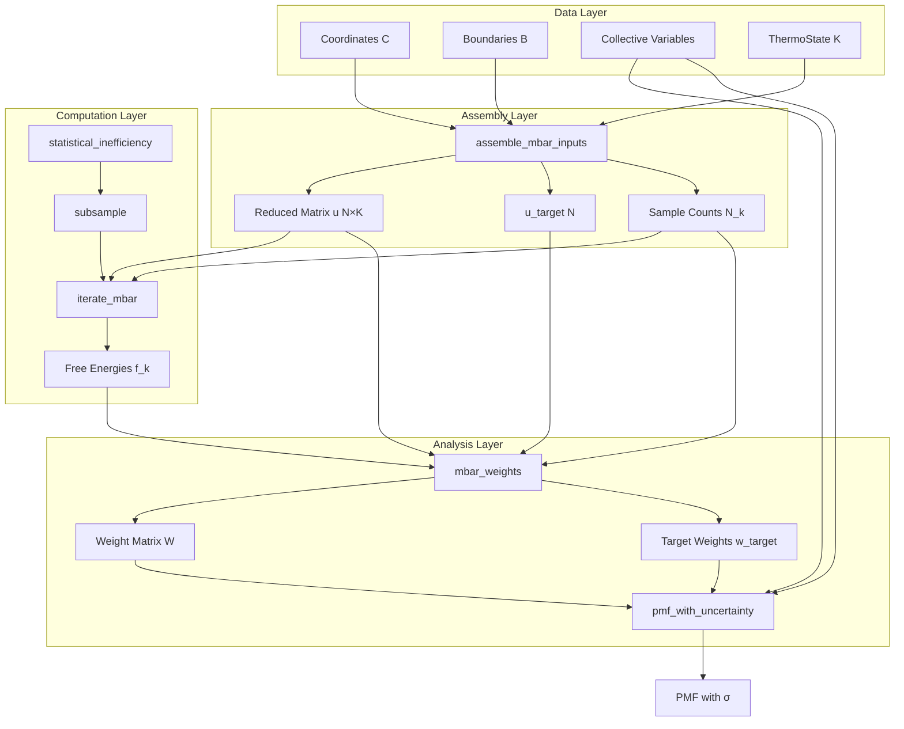

The Multistate Bennett Acceptance Ratio (MBAR) implementation in Molly.jl provides a statistically rigorous framework for calculating free energy differences between multiple thermodynamic states. Building upon the Bennett Acceptance Ratio (BAR) method, MBAR generalizes to K states simultaneously, providing optimal free energy estimates with associated uncertainties through maximum likelihood estimation. This documentation guides advanced developers through the implementation architecture, API design patterns, and practical workflow for production-grade free energy calculations.

Sources: [docs/src/free_energy.md](docs/src/free_energy.md#L1-L50), [src/free_energy/mbar.jl](src/free_energy/mbar.jl#L1-L50)

## Theoretical Foundation and Statistical Mechanics

MBAR estimates free energies by solving a set of self-consistent equations that maximize the likelihood of observing the sampled configurations across all thermodynamic states. Given K states with sample counts N_k each, the reduced potential u[n,k] = β_k * U_k(x_n) represents frame n evaluated at state k's Hamiltonian, where β_k = 1/k_BT_k includes both temperature and pressure-volume contributions:

```math
u[n,k] = \beta_k \left( U_k(\mathbf{x}_n) + p_k V_n \right)
```

The free energy difference f_k = β_k F_k satisfies the self-consistent condition:

```math
\exp(-f_k) = \sum_{n=1}^{N} \frac{N_k \exp(-u[n,k])}{\sum_{j=1}^{K} N_j \exp(-u[n,j])}
```

This formulation ensures that each state's free energy estimate incorporates information from all sampled states, providing optimal variance reduction compared to pairwise methods. The implementation uses log-sum-exp stable computation to handle numerical overflow/underflow, with safeguards for edge cases where frames have identical configurations across states.

Sources: [docs/src/free_energy.md](docs/src/free_energy.md#L1-L30), [src/free_energy/mbar.jl](src/free_energy/mbar.jl#L120-L150)

## Architecture Overview

The MBAR subsystem follows a modular three-layer architecture that separates data preparation, statistical computation, and analysis. The foundation rests on the `ThermoState` struct that encapsulates thermodynamic parameters with their corresponding system configurations. The data assembly layer constructs the reduced potential matrix through energy evaluation across all state-frame combinations. The solver layer implements the self-consistent iteration algorithm, while the analysis layer provides reweighting capabilities and PMF estimation with uncertainty quantification.



This architecture enables both granular control (accessing intermediate matrices) and convenience interfaces (single-call PMF computation). The use of `ThermoState` abstraction allows heterogeneous thermodynamic conditions (different temperatures, pressures, Hamiltonians) within a single MBAR analysis.

Sources: [src/free_energy/mbar.jl](src/free_energy/mbar.jl#L30-L60), [src/free_energy/mbar.jl](src/free_energy/mbar.jl#L70-L120)

## Thermodynamic State Management

The `ThermoState` struct serves as the fundamental unit for MBAR calculations, bundling together thermodynamic parameters with system configurations:

```julia
struct ThermoState{B,P,S}
    name::String    # Label for identification
    β::B           # Inverse temperature [1/energy]
    p::P           # Pressure or nothing
    system::S      # Molly System for energy evaluation
end
```

Two constructors are provided: a low-level version requiring explicit parameters, and a high-level version that performs unit consistency checking against the system's energy units. This design enforces dimensional correctness at construction time, preventing subtle errors where β and energy units don't match. The pressure field can be `nothing` for NVT ensembles, in which case pV work terms are omitted from reduced potentials. The system field stores the full Molly System with force fields, allowing arbitrary Hamiltonians across thermodynamic states (e.g., alchemical perturbations with different interaction sets).

The constructor validates that β has dimensions of 1/energy and that pressure has appropriate units, throwing descriptive errors if dimensionality is incorrect. This early validation prevents downstream numerical issues where incorrect unit scaling would produce meaningless results.

Sources: [src/free_energy/mbar.jl](src/free_energy/mbar.jl#L30-L60), [src/free_energy/mbar.jl](src/free_energy/mbar.jl#L62-L95)

## Energy Evaluation and Matrix Assembly

The `assemble_mbar_inputs` function constructs the core data structures for MBAR analysis. Given subsampled coordinates `C[k]`, boundaries `B[k]`, and thermodynamic states for each window k, it evaluates all N samples at all K states to produce the reduced potential matrix u of size N×K:

```julia
mbar_gen = assemble_mbar_inputs(C, B, states;
    target_state=target_state,
    energy_units=energy_units
)

# Returns MBARInput containing:
# u         - N×K reduced potentials
# u_target  - Reduced potentials at target state
# N         - Sample counts per window N_k
# win_of    - Window index for each frame
# shifts    - Per-frame shifts (if requested)
```

The assembly process follows a multi-threaded strategy that parallelizes over states (columns) to avoid redundant system copies. Each thread maintains a private System instance, initializing GPU buffers only once when `AT <: AbstractGPUArray`. For each frame n and state k, the function computes the potential energy U_k(x_n), removes molecular scaling factors, converts to unitless values, and applies β scaling:

```julia
Uk   = _energy(sys, buffers, all_coords[n], all_boundaries[n])
Uk_u = energy_remove_mol(Uk)
red  = βk * Float64(ustrip(Uk_u))
if pk !== nothing
    pV_u = energy_remove_mol(pk * all_volumes[n])
    red += βk * Float64(ustrip(pV_u))
end
u[n,k] = red
```

The `shift` keyword argument, when `true`, subtracts per-frame row minima to improve numerical stability in subsequent log-sum-exp operations. This is particularly useful when energy spans between states are large. The function also computes `u_target` when a target state is provided, representing the reduced potential of each frame evaluated at the unbiased Hamiltonian.

Sources: [src/free_energy/mbar.jl](src/free_energy/mbar.jl#L97-L200), [src/free_energy/mbar.jl](src/free_energy/mbar.jl#L202-L230)

## Statistical Decorrelation and Subsampling

Before assembling MBAR inputs, trajectory frames must be statistically independent. The `statistical_inefficiency` function implements the initial positive sequence (IPS) method to estimate the integrated autocorrelation time τ_int:

```julia
ineff = statistical_inefficiency(potential_energy_series; maxlag=n_frames-1)

# Returns StatisticalInefficiency with:
# inefficiency   - τ_int + 1
# stride         - ceil(τ_int + 1)
# input_length   - Original N
# effective_size - floor(N / stride)
# lag            - Truncation lag L
```

The algorithm computes the normalized autocorrelation function C[τ] for τ = 1:L_max, then uses the IPS criterion to select the truncation lag L where pairs C[2k-1] + C[2k] remain positive. The integrated autocorrelation time includes a finite-sample taper (1 - τ/N) to reduce bias:

```julia
g = max(1.0, 1 + 2 * Σ_{τ=1}^{L} (1 - τ/N) * C[τ])
stride = max(1, ceil(Int, g))
```

Once the stride is determined, `subsample` extracts independent samples:

```julia
sub_coords = Molly.subsample(coords, ineff.stride; first=FIRST_IDX)
sub_bounds = Molly.subsample(bounds, ineff.stride; first=FIRST_IDX)
sub_CV     = Molly.subsample(CV_values, ineff.stride; first=FIRST_IDX)
```

The `first` parameter allows discarding initial equilibration frames (e.g., FIRST_IDX = 12,500 to remove the first 12.5 ns). This two-stage approach—first discarding equilibration, then subsampling for statistical independence—ensures that MBAR operates on stationary, uncorrelated samples, satisfying the underlying statistical assumptions.

Sources: [src/free_energy/stats.jl](src/free_energy/stats.jl#L8-L60), [src/free_energy/stats.jl](src/free_energy/stats.jl#L62-L109), [docs/src/free_energy.md](docs/src/free_energy.md#L400-L450)

## Self-Consistent Iteration Solver

The `iterate_mbar` function implements the MBAR self-consistent equations following Shirts and Chodera (2008). Starting from an initial guess f^(0) = -mean(u[n,k]) for each state k (computed over frames generated from that state), it iteratively updates:

```julia
F_k, logN = iterate_mbar(u, win_of, N_counts; rtol=1e-8, max_iter=10_000)

# Returns:
# F_k   - Relative free energies (gauge-fixed to F[1] = 0)
# logN  - log(N_counts) for reuse
```

Each iteration computes logD[n] = log(Σ_k N_k exp(f_k - u[n,k])) for all frames using a log-sum-exp stable algorithm, then updates:

```julia
f_new[k] = -log( Σ_n exp(-u[n,k] - logD[n]) )
```

The algorithm converges when the relative change in free energies falls below `rtol` or when `max_iter` is reached. The gauge is fixed at each iteration by subtracting f_new[1] from all f_new[k], ensuring numerical stability. Convergence is monitored using relative differences:

```julia
rel = max_k |f_new[k] - f_old[k]| / max(|f_old[k]|, 1.0)
while rel > rtol && iter < max_iter
    f_old = f_new
    f_new = mbar_iteration(u, f_old, logN)
    rel = max(|f_new .- f_old| ./ max.(|f_old|, 1.0))
    iter += 1
end
```

The iteration function uses per-state thread parallelism for the log-sum-exp operations, ensuring scalability to large K values. Initial tests suggest typical convergence within 100-1000 iterations for well-behaved systems with reasonable overlap between thermodynamic states.

Sources: [src/free_energy/mbar.jl](src/free_energy/mbar.jl](src/free_energy/mbar.jl#L232-L280), [src/free_energy/mbar.jl](src/free_energy/mbar.jl#L282-L340)

## Reweighting and Weight Computation

After solving for free energies, `mbar_weights` computes the weight matrix W[n,k] that reweights samples from their generating state to any target state. The weights satisfy the normalization condition Σ_k N_k W[n,k] = 1 for each frame:

```julia
W, w_target, logD = mbar_weights(u, u_target, F_k, N_counts, logN;
    shifts=shifts, check=true)

# Returns:
# W        - N×K sampled-state weights
# w_target - N target-state weights
# logD     - Per-frame log normalizers
```

The sampled-state weights are computed as:

```julia
W[n,k] = exp(f_k - u[n,k] - logD[n])
```

where logD[n] comes from the free energy solution. The target-state weights use the same logD[n] but evaluate against the target Hamiltonian:

```julia
w_target[n] ∝ exp(-(u_target[n] - shifts[n]) - logD[n])
```

The `shifts` argument, when provided, accounts for per-frame energy subtractions made during matrix assembly. The `check` keyword enables validation of the normalization condition, throwing an error if Σ_k N_k W[n,k] deviates significantly from 1 for any frame. This check is computationally expensive but valuable for debugging numerical issues.

Underflow warnings are issued when any weight falls below exp(-744) ≈ 0 (the log of nextfloat(0.0)), while overflow errors are thrown when weights exceed exp(709) ≈ 1.8×10³⁰⁸. These safeguards prevent silent numerical failures that would otherwise propagate through downstream PMF calculations.

Sources: [src/free_energy/mbar.jl](src/free_energy/mbar.jl#L342-L400), [src/free_energy/mbar.jl](src/free_energy/mbar.jl#L402-L480)

## Potential of Mean Force with Uncertainty Quantification

The `pmf_with_uncertainty` function estimates 1D free energy profiles along a collective variable using the large-sample asymptotic variance expressions from Shirts and Chodera (2008). Two interfaces are provided: a low-level version requiring pre-assembled matrices, and a high-level convenience interface:

```julia
# Low-level interface
pmf = pmf_with_uncertainty(u, u_target, F_k, N_counts, logN, CV;
    shifts=shifts, nbins=nbins, edges=edges, kBT=kBT, zero=:min)

# High-level interface (one-shot)
pmf = pmf_with_uncertainty(C, B, states, target_state, CV;
    shift=false, energy_units=energy_units)
```

The function returns a `PMF` struct containing:

```julia
struct PMF{C, W, E, F, FE, SF, SFE, P, VP}
    centers        # Bin centers
    widths         # Bin widths
    edges          # Bin edges
    F              # PMF in kBT units
    F_energy       # PMF in energy units (if kBT provided)
    sigma_F        # PMF standard deviation (kBT)
    sigma_F_energy # PMF standard deviation (energy units)
    p              # Probability density
    var_p          # Variance of probability density
end
```

The binning strategy automatically determines edge positions using the Freedman-Diaconis rule when not specified:

```julia
iqr = quantile(R_flat, 0.75) - quantile(R_flat, 0.25)
h = 2 * iqr / cbrt(N)
nbins = ceil((rmax - rmin) / h)
```

Probability densities are estimated using target-state weights: p[i] = Σ_n w_target[n] * A[n,i], where A[n,i] indicates whether frame n falls in bin i. The PMF is computed as F[i] = -log(p[i] * Δr_i) and zeroed according to the `zero` parameter (either `:min` to set the minimum to zero, or `:last` to set the final bin to zero).

Uncertainty estimation follows Eq. D8 of Shirts and Chodera (2008), using the covariance matrix of the weight matrix:

```julia
G = W * W'  # K×K covariance
H = G⁻¹ - N_aug⁻¹  # Hessian of negative log-likelihood
Σ = pinv(H)  # Covariance of free energies
var_p[i] = p[i]² * (Σ[A,A] + Σ[a,a] - 2Σ[A,a])
sigma_F[i] = sqrt(var_p[i]) / p[i]
```

where indices A and a refer to the augmented weight vectors for the bin-specific indicator function and the target state, respectively. The pseudo-inverse (`pinv`) handles rank-deficient cases that can occur when bins have insufficient sampling.

> [!TIP]
> The uncertainty estimates are asymptotic and assume sufficient sampling across all bins. Bins with low effective sample size (ESS) will have inflated uncertainties—monitor `ess_per_bin(edges, CV, w_target)` to identify undersampled regions where the PMF may be unreliable.

Sources: [src/free_energy/mbar.jl](src/free_energy/mbar.jl#L580-L650), [src/free_energy/mbar.jl](src/free_energy/mbar.jl#L652-L841), [docs/src/free_energy.md](docs/src/free_energy.md#L580-L636)

## Complete Workflow: Umbrella Sampling to PMF

A complete MBAR workflow for calculating a potential of mean force along a dihedral angle demonstrates the integration of all components. The tutorial workflow uses umbrella sampling with harmonic restraints applied to a dipeptide's central torsion:

```julia
# Step 1: Define custom restraint interaction
struct DihedralRestraint{A, K}
    ϕ0::A  # Reference angle
    Δϕ::A  # Flat-bottom width
    k::K   # Force constant
end

# Step 2: Run pulling simulations (steered MD)
for w in 1:N_WIN
    rest_θ = FT(eq_θ - (w-1) * uconvert(u"rad", dR))
    dRest = DihedralRestraint(rest_θ*u"rad", ΔR, K_bias)
    # Configure system with restraint and simulate
    simulate!(sys_w, vverlet, N_STEPS)
end

# Step 3: Run umbrella sampling simulations (parallelizable)
Threads.@threads for trj_n in 1:N_TRJ
    # Load initial structure from pulling simulation
    sys = System("./pull_$(trj_n).pdb", ff; array_type=AT)
    # Add restraint and simulate
    simulate!(sys, vverlet, N_STEPS)
end

# Step 4: Assemble MBAR inputs
TRJ_SYSTEMS = [EnsembleSystem(sys, traj_path) for sys in sys_list]
mbar_gen = assemble_mbar_inputs(C, B, states;
    target_state=target_state, energy_units=energy_units)

# Step 5: Solve MBAR equations
F_k, logN = iterate_mbar(mbar_gen.u, mbar_gen.win_of, mbar_gen.N)

# Step 6: Compute PMF with uncertainties
pmf = pmf_with_uncertainty(mbar_gen.u, mbar_gen.u_target,
                          F_k, mbar_gen.N, logN, CV;
                          shifts=mbar_gen.shifts, kBT=kBT)
```

Key practical considerations: (1) Use sufficient overlap between umbrella windows (the tutorial uses 6° spacing with 3° flat-bottom width), (2) Discard equilibration frames (12.5 ns for this system), (3) Subsample based on statistical inefficiency, (4) Validate that all thermodynamic states produce finite energies for all frames, and (5) Use GPU acceleration for large systems to make the O(N×K) energy evaluations tractable.

Sources: [docs/src/free_energy.md](docs/src/free_energy.md#L50-L200), [docs/src/free_energy.md](docs/src/free_energy.md#L250-L400), [docs/src/free_energy.md](docs/src/free_energy.md#L450-L580)

## Performance Characteristics and Optimization

The computational complexity of MBAR is dominated by the energy evaluation matrix construction, requiring O(N×K) potential energy calculations. The implementation achieves performance through several strategies:

| Component | Complexity | Parallelization | Typical Scaling |
|-----------|------------|-----------------|-----------------|
| Energy evaluation (u matrix) | O(N×K) | Threaded over K states | Linear with N, K |
| Log-sum-exp per iteration | O(N×K) | Threaded over K states | Linear with N, K |
| Statistical inefficiency | O(N) | Single-threaded | Negligible |
| PMF uncertainty | O(N×nbins) | Threaded over bins | Linear with N, nbins |

GPU acceleration provides substantial speedups for energy evaluation when using CUDA arrays. The implementation automatically initializes GPU buffers per thread, avoiding memory transfer overhead. For systems with >1000 atoms and >100 states, GPU acceleration can reduce assembly time from hours to minutes.

Memory requirements are dominated by storing the u matrix (8 bytes × N × K for Float64). Large simulations (N = 50,000 frames, K = 60 states) require ~24 GB of RAM. The `shift=true` option can improve numerical stability but adds O(N) storage for shifts. For memory-constrained environments, consider streaming calculations or using Float32 precision when numerical stability permits.

> [!TIP]
> Monitor the statistical inefficiency values across windows—if τ_int varies widely, consider using per-window striding rather than a global stride. The current implementation uses a single stride applied uniformly, but per-window striding can improve efficiency when sampling quality differs between windows.

Sources: [src/free_energy/mbar.jl](src/free_energy/mbar.jl#L130-L170), [src/free_energy/mbar.jl](src/free_energy/mbar.jl#L200-L220)

## Numerical Stability and Edge Cases

The implementation includes multiple safeguards for numerical robustness:

**Underflow Protection**: Constants `LOG_PREVFLOAT0 ≈ -744` and `LOG_FLOATMAX ≈ 709` define the safe exponent range. Weights falling below exp(LOG_PREVFLOAT0) trigger warnings, while weights above exp(LOG_FLOATMAX) cause errors. The `shift=true` option in `assemble_mbar_inputs` can mitigate overflow by centering energies per-frame.

**Zero Probability Bins**: Bins with p[i] = 0 result in infinite PMF values. The function warns about such bins but continues, allowing users to adjust bin edges or window coverage. The PMF calculation uses masked operations to handle zero probabilities gracefully.

**Rank-Deficient Covariance**: The pseudo-inverse (`pinv`) in uncertainty estimation handles cases where the weight covariance matrix is singular, which can occur when bins have insufficient effective sample size. Users should verify that `ess_per_bin` is >10 for reliable uncertainty estimates.

**Inconsistent Hamiltonians**: The assembly process requires that all systems use identical atom indexing and boundary conditions. Changing force field parameters or atom ordering between states will produce incorrect free energy differences. The high-level interface that takes Systems as input provides some validation, but users must ensure consistency.

**Temperature/Pressure Unit Mismatches**: The `ThermoState` constructor performs dimensional validation, ensuring β has units of 1/energy and pressure is appropriate. Disabling this validation (when `energy_units isa NoUnits`) requires user responsibility for unit consistency.

Sources: [src/free_energy/mbar.jl](src/free_energy/mbar.jl#L1-L5), [src/free_energy/mbar.jl](src/free_energy/mbar.jl#L450-L480), [src/free_energy/mbar.jl](src/free_energy/mbar.jl#L750-L800)

## API Reference Summary

The MBAR subsystem provides three levels of API abstraction:

**High-Level (One-Shot)**:
```julia
pmf = pmf_with_uncertainty(C, B, states, target_state, CV; shift=false)
```

**Mid-Level (Modular)**:
```julia
mbar_gen = assemble_mbar_inputs(C, B, states; target_state=target_state)
F_k, logN = iterate_mbar(mbar_gen.u, mbar_gen.win_of, mbar_gen.N)
pmf = pmf_with_uncertainty(mbar_gen.u, mbar_gen.u_target, F_k, 
                          mbar_gen.N, logN, CV)
```

**Low-Level (Granular Control)**:
```julia
ineff = statistical_inefficiency(series)
coords = subsample(coords, ineff.stride)
u = assemble_mbar_inputs(coords, bounds, states)
f = mbar_init(u, win_of)
f = iterate_mbar(u, win_of, N_counts; rtol=1e-8)
W, w, logD = mbar_weights(u, u_target, f, N_counts, logN)
```

For most applications, the mid-level API provides the right balance of flexibility and simplicity. Use the high-level API for quick exploratory analysis, and the low-level API when implementing custom analysis workflows or debugging numerical issues.
