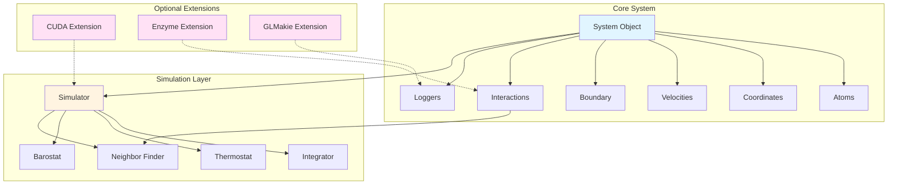

Molly.jl is a pure Julia molecular dynamics simulation package designed for both computational efficiency and extensibility. This page guides you through installing Molly, configuring optional extensions for GPU acceleration and visualization, and verifying your setup to ensure everything is ready for molecular dynamics simulations.

## Prerequisites

Before installing Molly, you need to have Julia installed on your system. **Julia 1.10 or later is required** to access the latest features and compatibility improvements of Molly [Project.toml#L87](Project.toml#L87-L87). The package is designed to work with the current stable Julia release for optimal performance. Molly has been tested and is actively developed on Julia versions 1.10 and above, taking advantage of language improvements in recent Julia releases.

Sources: [Project.toml](Project.toml#L87), [README.md](README.md#L63)

## Basic Installation

Installing Molly is straightforward through Julia's built-in package manager. Enter the Julia REPL (Read-Eval-Print Loop) and press `]` to enter package mode, then execute the installation command:

```julia
] add Molly
```

This command downloads and installs Molly along with its core dependencies. The installation process automatically resolves and installs all required packages from the Julia General registry. The core installation includes essential computational libraries such as:

- **StaticArrays.jl** for efficient array operations
- **Unitful.jl** and **UnitfulAtomic.jl** for physical unit handling
- **CellListMap.jl** for optimized neighbor searching
- **AtomsBase.jl** and **AtomsCalculators.jl** for interoperability
- **FFTW.jl** for Fast Fourier Transform operations
- **Graphs.jl** for topology management


Sources: [Project.toml](Project.toml#L9-L38), [README.md](README.md#L63-L67)

## Optional Extensions and GPU Support

Molly provides optional extensions that enable advanced capabilities such as GPU acceleration, automatic differentiation, visualization, and additional analysis tools. These extensions are not installed by default to keep the base installation lightweight, but can be added based on your specific needs.

### GPU Acceleration

For running simulations on GPU hardware, Molly supports multiple GPU backends through the KernelAbstractions.jl interface. To enable GPU support, install the appropriate package for your hardware:

| Hardware | Required Package | Array Type | Performance Notes |
|----------|------------------|------------|-------------------|
| NVIDIA GPU | `CUDA` | `CuArray` | Best performance, warp-optimized kernels |
| AMD GPU | `AMDGPU` | `ROCArray` | Functional via KernelAbstractions |
| Intel GPU | `oneAPI` | `oneArray` | Functional via KernelAbstractions |
| Apple Silicon | `Metal` | `MtlArray` | Requires Float32 precision only |

To install CUDA support for NVIDIA GPUs:
```julia
] add Molly CUDA
```

The MollyCUDAExt extension provides specialized CUDA kernels that use warp-level features for optimal performance [ext/MollyCUDAExt.jl#L1-L15](ext/MollyCUDAExt.jl#L1-L15). For Apple Silicon devices, Metal support requires using `Float32` precision due to hardware limitations [docs/src/documentation.md#L126-L127](docs/src/documentation.md#L126-L127).

Sources: [Project.toml](Project.toml#L41-L48), [ext/MollyCUDAExt.jl](ext/MollyCUDAExt.jl#L1-L15), [docs/src/documentation.md](docs/src/documentation.md#L126-L127)

### Visualization and Analysis

For creating animations and visualizing simulation trajectories, install GLMakie for GPU-accelerated rendering:

```julia
] add Molly GLMakie Colors
```

The MollyGLMakieExt extension enables the `visualize` function for saving trajectory animations in various video formats [Project.toml#L49-L49](Project.toml#L49-L49).

For additional analysis capabilities, you can install:

- **Enzyme.jl**: For automatic differentiation through simulations (`add Molly Enzyme`)
- **KernelDensity.jl**: For kernel density estimation functions (`add Molly KernelDensity`)
- **PythonCall.jl**: For interfacing with Python libraries like ASE (`add Molly PythonCall`)

Sources: [Project.toml](Project.toml#L49-L56), [docs/src/documentation.md](docs/src/documentation.md#L170-L173)

## Architecture Overview

Molly follows a **modular architecture** that allows you to use components as defined by the package or define your own versions. The system is built around several core abstractions:



The central **System object** contains all simulation state, while the **Simulator** controls the time evolution. Interactions can be pairwise (non-bonded) or specific (bonds, angles, torsions). The extension system provides optional functionality without affecting core performance.

Sources: [docs/src/documentation.md](docs/src/documentation.md#L8-L15), [Project.toml](Project.toml#L41-L56)

## Verification and Testing

After installation, verify that Molly is working correctly by running a simple simulation in the Julia REPL:

```julia
using Molly

# Create a simple Lennard-Jones fluid simulation
n_atoms = 100
boundary = CubicBoundary(2.0u"nm")
temp = 298.0u"K"
atom_mass = 10.0u"g/mol"

atoms = [Atom(mass=atom_mass, σ=0.3u"nm", ϵ=0.2u"kJ * mol^-1") for i in 1:n_atoms]
coords = place_atoms(n_atoms, boundary; min_dist=0.3u"nm")
velocities = [random_velocity(atom_mass, temp) for i in 1:n_atoms]

sys = System(
    atoms=atoms,
    coords=coords,
    boundary=boundary,
    velocities=velocities,
    pairwise_inters=(LennardJones(),),
    loggers=(temp=TemperatureLogger(10),),
)

simulator = VelocityVerlet(
    dt=0.002u"ps",
    coupling=AndersenThermostat(temp, 1.0u"ps"),
)

simulate!(sys, simulator, 1_000)
println("Simulation completed successfully!")
println("Final temperature: ", temperature(sys))
```

If you have GPU support installed, verify it works with this additional test:

```julia
using Molly, CUDA
n_atoms = 100
atom_mass = 10.0f0u"g/mol"
boundary = CubicBoundary(2.0f0u"nm")
atoms = CuArray([Atom(mass=atom_mass, σ=0.3f0u"nm", ϵ=0.2f0u"kJ * mol^-1") for i in 1:n_atoms])
coords = CuArray(place_atoms(n_atoms, boundary; min_dist=0.3u"nm"))
velocities = CuArray([random_velocity(atom_mass, temp) for i in 1:n_atoms])

sys = System(
    atoms=atoms,
    coords=coords,
    boundary=boundary,
    velocities=velocities,
    pairwise_inters=(LennardJones(),),
)

simulate!(deepcopy(sys), VelocityVerlet(dt=0.002f0u"ps"), 20)  # Compilation
simulate!(sys, VelocityVerlet(dt=0.002f0u"ps"), 100)       # Run
println("GPU simulation completed!")
```

Sources: [README.md](README.md#L69-L95), [docs/src/documentation.md](docs/src/documentation.md#L139-L165)

## Configuration Options

Molly provides several environment variables for fine-tuning performance, particularly for GPU operations:

| Environment Variable | Purpose | Default | When to Adjust |
|---------------------|---------|---------|----------------|
| `MOLLY_GPUNTHREADS_PAIRWISE` | GPU threads for pairwise interactions | Auto-configured | GPU memory errors |
| `MOLLY_GPUNTHREADS_SPECIFIC` | GPU threads for specific interactions | Auto-configured | GPU memory errors |
| `MOLLY_GPUNTHREADS_DISTANCENF` | GPU threads for distance-based neighbor finding | Auto-configured | GPU memory errors |
| `MOLLY_GPUNTHREADS_IMPLICIT` | GPU threads for implicit solvent calculations | Auto-configured | GPU memory errors |
| `JULIA_NUM_THREADS` | CPU threads for parallel execution | Available cores | Thread contention issues |

> [!TIP]
> Only adjust GPU thread environment variables if you encounter out-of-memory errors on smaller GPUs. The default configuration is optimized for most use cases.

CPU threading can be controlled by passing `n_threads` to the `simulate!` function. Setting `n_threads=1` disables parallelization, while values greater than the number of available threads may sometimes improve performance [docs/src/documentation.md](docs/src/documentation.md#L112-L117).

Sources: [docs/src/documentation.md](docs/src/documentation.md#L197-L202), [docs/src/documentation.md](docs/src/documentation.md#L112-L117)

## Project Structure Overview

Understanding Molly's directory structure helps you locate data files, examples, and extensions:

```
Molly.jl/
├── src/              # Core implementation files
├── ext/              # Optional extensions (CUDA, Enzyme, GLMakie, etc.)
├── data/             # Force fields, test data, example structures
│   ├── force_fields/ # OpenMM force field XML files
│   └── 5XER/         # Example protein data
├── docs/src/         # Documentation and examples
├── exercises/        # Tutorial notebooks
├── benchmark/        # Performance benchmarks
└── test/             # Test suite
```

The `data/` directory contains force field files (ff99SBildn, TIP3P water) and example structures that are referenced in the documentation. These files are useful for testing your installation and learning the package workflows.

Sources: [README.md](README.md#L10-L40)

## Common Troubleshooting

### Installation Issues

If you encounter problems during installation, try the following steps:

1. **Update Julia and packages**: Ensure you're using Julia 1.10 or later and update your package registry:
   ```julia
   ] up
   ```

2. **Clean environment**: If dependency conflicts occur, create a fresh environment:
   ```julia
   ] activate --temp
   ] add Molly
   ```

3. **Precompilation issues**: Force recompilation of problematic packages:
   ```julia
   ] build Molly
   ```

### GPU Setup Issues

For GPU-related problems:

- Verify CUDA is properly installed on your system with `using CUDA; CUDA.versioninfo()`
- Check that your GPU driver is up to date
- Ensure you're using compatible CUDA versions (4.2 or 5.x as specified in Project.toml)
- For Apple Silicon, confirm you're using Float32 precision in all calculations

### Performance Issues

If simulations run slowly:

- Verify threading is enabled by checking `Threads.nthreads()`
- Start Julia with appropriate thread count: `julia --threads auto`
- For GPU simulations, ensure arrays are moved to GPU before simulation
- Consider using `Float32` for better GPU performance when numerical precision permits

> [!TIP]
> Always run a brief "warmup" simulation (e.g., 20-50 steps) before benchmarking. This allows Julia's JIT compiler to optimize the code and gives accurate performance measurements.

Sources: [Project.toml](Project.toml#L62-L66), [docs/src/documentation.md](docs/src/documentation.md#L194-L195)

## Next Steps

After successfully installing and verifying Molly, you're ready to begin exploring molecular dynamics simulations. The recommended learning path is:

1. **[Quick Start](2-quick-start)** - Learn basic simulation workflow with simple examples
2. **[Lennard-Jones Fluid Simulation](4-lennard-jones-fluid-simulation)** - Walk through a complete simulation from setup to analysis
3. **[Protein Simulation Setup](5-protein-simulation-setup)** - Learn to work with biomolecular systems
4. **[System Object and Data Structures](6-system-object-and-data-structures)** - Understand Molly's core architecture in depth

For more comprehensive examples and advanced use cases, explore the **[Examples](docs/src/examples.md#L1-L100)** documentation, which includes tutorials on simulated annealing, solar system simulations, and various molecular dynamics scenarios.
