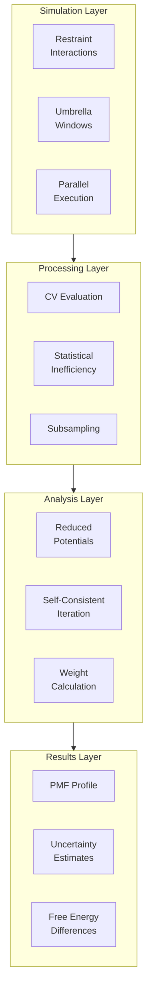

The Potential of Mean Force (PMF) represents the free energy profile along a reaction coordinate, providing quantitative insight into thermodynamic processes such as ligand binding, conformational transitions, and molecular recognition. Molly.jl implements PMF calculations through a robust MBAR (Multistate Bennett Acceptance Ratio) framework that integrates seamlessly with existing simulation infrastructure.

## Theoretical Foundation

PMF calculations in Molly.jl build upon the MBAR formalism [Shirts & Chodera, 2008](https://doi.org/10.1063/1.2978177), which generalizes the Bennett Acceptance Ratio to multiple thermodynamic states. The method evaluates all configurations from all states against all Hamiltonians, achieving optimal statistical efficiency through maximum likelihood estimation.

The PMF along a collective variable (CV) ξ is obtained from the probability distribution:

```
F(ξ) = -kBT ln p(ξ)
```

where the probability density at the target unbiased state is computed by reweighting samples from K biased umbrella windows using MBAR weights [src/free_energy/mbar.jl](src/free_energy/mbar.jl#L575-L630).

## Architectural Overview

The PMF calculation pipeline integrates three conceptual layers: simulation setup, trajectory processing, and statistical analysis.



## Core Data Structures

The MBAR framework centers on three primary abstractions that encapsulate thermodynamic information, reduced potential matrices, and PMF results.

### ThermoState

The `ThermoState` struct represents a complete thermodynamic state including temperature, pressure, and the system Hamiltonian:

```julia
struct ThermoState{B,P,S}
    name::String
    β::B         # 1 / (energy unit)
    p::P         # pressure (Quantity) or nothing
    system::S    # how to evaluate U_i on given coords+boundary
end
```

Each umbrella window requires a distinct `ThermoState` encoding its bias potential, while the target state uses the unbiased Hamiltonian [src/free_energy/mbar.jl](src/free_energy/mbar.jl#L12-L45). The constructor validates dimensional consistency between the inverse temperature β and the system's energy units, catching unit mismatches early.

### MBARInput

The `MBARInput` struct encapsulates all data required for MBAR computation in a pre-assembled format:

```julia
struct MBARInput{U, UT, N, W, S}
    u::U               # N×K reduced potentials
    u_target::UT       # Reduced potential at target state
    N::N               # Sample counts per window
    win_of::W          # Window index for each frame
    shifts::S          # Per-frame energy shifts
end
```

This structure decouples data assembly from statistical computation, enabling efficient workflow design [src/free_energy/mbar.jl](src/free_energy/mbar.jl#L56-L68).

### PMF Result

The `PMF` struct provides comprehensive output including probability densities, free energies, and statistical uncertainties:

```julia
struct PMF{C, W, E, F, FE, SF, SFE, P, VP}
    centers::C           # Bin centers
    widths::W            # Bin widths
    edges::E             # Bin edges
    F::F                 # PMF in kBT
    F_energy::FE         # PMF in energy units
    sigma_F::SF          # PMF uncertainty in kBT
    sigma_F_energy::SFE  # PMF uncertainty in energy units
    p::P                 # Probability density
    var_p::VP            # Variance of probability density
end
```

All uncertainties are computed from the asymptotic variance following Eq. D8 of Shirts & Chodera 2008 [src/free_energy/mbar.jl](src/free_energy/mbar.jl#L572-L590).

## Restraint Interactions for Umbrella Sampling

Umbrella sampling requires bias potentials that restrain the system along the reaction coordinate. Molly provides a flexible framework for custom restraints through the specific interaction interface.

### Flat-Bottom Dihedral Restraint

The tutorial demonstrates a sophisticated flat-bottom dihedral restraint ideal for torsional PMFs [docs/src/free_energy.md](docs/src/free_energy.md#L44-L93):

```math
\varphi^{\prime} = (\varphi - \varphi^0) \mod 2\pi
```

```math
V\left( \varphi^{\prime} \right) = \begin{cases}
    \frac{1}{2} \cdot k \cdot \left( \varphi^{\prime} - \Delta\varphi \right)^2 & \text{for } |\varphi^{\prime}| \ge \Delta\varphi \\
    0 & \text{for } |\varphi^{\prime}| < \Delta\varphi
\end{cases}
```

The flat-bottom region allows conformational flexibility while preventing crossing the 2π boundary, a critical stability feature for torsional sampling. The restraint implements both `potential_energy` and `force` methods, returning a `SpecificForce4Atoms` for the four atoms defining the dihedral.

For simpler position-based restraints along Cartesian coordinates, Molly provides `HarmonicPositionRestraint`:

```math
V(\boldsymbol{x}) = \frac{1}{2} k |\boldsymbol{x} - \boldsymbol{x}_0|^2
```

This standard harmonic well is useful for pulling simulations and distance-based PMFs [src/interactions/harmonic_position_restraint.jl](src/interactions/harmonic_position_restraint.jl#L7-L33).

> [!TIP]
> When defining custom restraints, always implement both potential energy and force functions. Analytical forces improve simulation stability compared to numerical differentiation, especially when combined with automatic differentiation in gradient-based workflows.

## PMF Calculation Workflow

The complete PMF calculation follows a structured pipeline from simulation design to final analysis.

### Phase 1: Simulation Setup

The workflow begins with a pulling simulation that systematically moves the system across the reaction coordinate range, generating initial configurations for each umbrella window [docs/src/free_energy.md](docs/src/free_energy.md#L127-L183):


Key parameters include:
- `N_WIN`: Number of umbrella windows (e.g., 60 for 360° torsion)
- `dR`: CV increment per window (e.g., 6° for torsion)
- `ΔR`: Flat-bottom width for stability (e.g., 3°)
- `K_bias`: Force constant (e.g., 250 kJ/mol)

The final configuration from each pulling simulation seeds the corresponding umbrella window, ensuring continuity and reducing equilibration requirements.

### Phase 2: Umbrella Sampling

Independent umbrella simulations are run in parallel, each maintaining a fixed bias potential at its window center [docs/src/free_energy.md](docs/src/free_energy.md#L195-L275):

```julia
for w in 1:N_WIN
    rest_θ = FT(eq_θ - (w-1) * uconvert(u"rad", dR))
    dRest = DihedralRestraint(rest_θ*u"rad", uconvert(u"rad", ΔR), K_bias)
    
    rest_inter = InteractionList4Atoms(
        Molly.to_device([i], AT), Molly.to_device([j], AT),
        Molly.to_device([k], AT), Molly.to_device([l], AT),
        Molly.to_device([dRest], AT),
    )
    
    sys_w = System(old_sys; 
                   specific_inter_lists=(sils..., rest_inter,),
                   loggers=(TrajectoryWriter(save_steps, "umbrella_$(w).dcd"),))
    
    simulate!(sys_w, vverlet, N_STEPS)
end
```

Simulation parameters must match those used in pulling: identical force fields, integrators, thermostats, barostats, and timesteps. This Hamiltonian consistency is critical for valid MBAR reweighting.

### Phase 3: Trajectory Processing

Trajectory processing reads frames, evaluates CVs, computes statistical inefficiency, and subsamples to remove correlations [docs/src/free_energy.md](docs/src/free_energy.md#L399-L455):

```julia
for nt in 1:N_TRJ
    u, c, b, cv = [], [], [], []
    
    for n in FIRST_IDX:n_frames
        current_sys = read_frame!(trjsys, n)
        pe = potential_energy(current_sys)
        coords = Molly.from_device(current_sys.coords)
        boundary = current_sys.boundary
        
        ϕ = _dihedral_geom(coords[i], coords[j], coords[k], coords[l], boundary)
        
        push!(u, pe); push!(c, coords); push!(b, boundary); push!(cv, ϕ*u"rad")
    end
    
    ineff = statistical_inefficiency(u; maxlag=n_frames-1)
    
    C[nt] = subsample(c, ineff.stride; first=1)
    B[nt] = subsample(b, ineff.stride; first=1)
    CV[nt] = subsample(cv, ineff.stride; first=1)
end
```

The `statistical_inefficiency` function [src/analysis.jl](src/analysis.jl#L1-L155) computes the autocorrelation time, ensuring that independent samples feed into MBAR. Skipping an initial equilibration period (e.g., 12.5 ns for a 50 ns simulation) removes transient artifacts.

### Phase 4: MBAR Assembly

The `assemble_mbar_inputs` function constructs the reduced potential matrix by evaluating every configuration against every thermodynamic state [src/free_energy/mbar.jl](src/free_energy/mbar.jl#L70-L197):

```julia
mbar_gen = assemble_mbar_inputs(
    C, B, states;
    target_state=target_state,
    shift=false
)
```

This generates:
- `u`: N×K matrix of reduced potentials u[n,k] = β_k U_k(x_n) + β_k p_k V_n
- `u_target`: Reduced potentials at the unbiased target state
- `N_counts`: Number of samples per window
- `win_of`: Window index for each frame
- `shifts`: Per-frame row minima for numerical stability (optional)

The computation is parallelized over both frames and states using `Threads.@threads`, with GPU support through `AbstractGPUArray` detection.

> [!TIP]
> Enable the `shift=true` option when reduced potentials span many orders of magnitude. Per-frame row minimum subtraction prevents underflow in the exponential calculations without affecting free energy differences.

### Phase 5: Free Energy Calculation

The `iterate_mbar` function solves the self-consistent MBAR equations using the stable log-sum-exp formulation [src/free_energy/mbar.jl](src/free_energy/mbar.jl#L286-L339):

```julia
F_k, logN = iterate_mbar(u, win_of, N_counts; rtol=1e-8, max_iter=10_000)
```

The iteration proceeds:
1. Initialize f_k^(0) = -⟨u[n,k]⟩_n from state k
2. Compute log D_n = log(∑_k N_k exp(f_k - u[n,k]))
3. Update f_k^(t+1) = -log(∑_n exp(f_k^(t) - u[n,k] - log D_n))
4. Check convergence: max|f^(t+1) - f^(t)| / max|f^(t)| < rtol
5. Gauge-fix: f_1 = 0

Gauge fixing removes the indeterminacy since only free energy differences are physically meaningful.

### Phase 6: Weight and PMF Computation

The `pmf_with_uncertainty` function computes probability densities and uncertainties using the asymptotic variance formalism [src/free_energy/mbar.jl](src/free_energy/mbar.jl#L572-L759):

```julia
pmf = pmf_with_uncertainty(
    u, u_target, F_k, N_counts, logN, CV;
    nbins=50, edges=nothing,
    zero=:min, kBT=1.0/βi
)
```

The algorithm:
1. Bins CV values using automatic bandwidth selection (Freedman-Diaconis rule)
2. Computes MBAR weights for sampled states and target state
3. For each bin i with indicator function A_i(ξ):
   - Calculates p_i = ∑_n W_na(n) A_i(ξ_n)
   - Computes variance using the pseudoinverse of (G^(-1) - N_aug)
   - Obtains σ_F = √(var_p) / p
4. Converts to free energy: F_i = -ln(p_i/Δr)
5. Sets reference (minimum or last bin) to zero

The `PMF` struct provides direct access to centers, edges, probabilities, free energies, and uncertainties in both dimensionless and dimensional units.

## API Reference

### Thermodynamic State Management

**`ThermoState(system, β, p; name=nothing)`** - Creates a thermodynamic state wrapper with dimensional validation [src/free_energy/mbar.jl](src/free_energy/mbar.jl#L28-L56).

- **Parameters**: `system::System` (Hamiltonian evaluator), `β` (inverse temperature), `p` (pressure), `name::String` (optional label)
- **Returns**: `ThermoState{β_type, p_type, System}`

### Data Assembly

**`assemble_mbar_inputs(coords_k, boundaries_k, states; target_state, shift)`** - Constructs the reduced potential matrix from trajectories [src/free_energy/mbar.jl](src/free_energy/mbar.jl#L70-L197).

- **Parameters**:
  - `coords_k::Vector{<:Vector}` - Subsampled coordinates per window
  - `boundaries_k::Vector{<:Vector}` - Subsampled boundaries per window
  - `states::Vector{ThermoState}` - Thermodynamic states per window
  - `target_state::Union{Nothing,ThermoState}` - Optional unbiased state
  - `shift::Bool=false` - Subtract row minima for stability
- **Returns**: `MBARInput` containing all MBAR inputs

### MBAR Solvers

**`iterate_mbar(u, win_of, N_counts; rtol, max_iter)`** - Solves self-consistent MBAR equations [src/free_energy/mbar.jl](src/free_energy/mbar.jl#L319-L339).

- **Parameters**:
  - `u::AbstractMatrix` - N×K reduced potentials
  - `win_of::AbstractVector` - Window index per frame
  - `N_counts::AbstractVector` - Sample counts per window
  - `rtol::Float64=1e-8` - Convergence tolerance
  - `max_iter::Int=10_000` - Maximum iterations
- **Returns**: `(f::Vector{Float64}, logN::Vector{Float64})` - Relative free energies and log sample counts

**`mbar_weights(u, u_target, f, N_counts, logN; shifts, check)`** - Computes MBAR weights for reweighting [src/free_energy/mbar.jl](src/free_energy/mbar.jl#L467-L549).

- **Parameters**:
  - `u::AbstractMatrix` - N×K reduced potentials
  - `u_target::AbstractVector` - Reduced potentials at target state
  - `f::AbstractVector` - Free energies from `iterate_mbar`
  - `N_counts::AbstractVector`, `logN::AbstractVector` - Sample information
  - `shifts::Union{Nothing,AbstractVector}=nothing` - Per-frame shifts
  - `check::Bool=true` - Normalization validation
- **Returns**: `(W::Matrix, w_target::Vector, logD::Vector)` - Sampled weights, target weights, log normalizers

### PMF Estimation

**`pmf_with_uncertainty(u, u_target, f, N_counts, logN, R_k; ...)`** - Calculates 1D PMF with uncertainties [src/free_energy/mbar.jl](src/free_energy/mbar.jl#L572-L759).

- **Parameters**:
  - `u`, `u_target`, `f`, `N_counts`, `logN` - Standard MBAR inputs
  - `R_k::Vector{<:AbstractVector}` - CV values per window (flattened to length N)
  - `shifts=nothing` - Per-frame energy shifts
  - `nbins=nothing`, `edges=nothing` - Binning specification
  - `rmin=nothing`, `rmax=nothing` - CV range for binning
  - `zero::Symbol=:min` - PMF reference (`:min` or `:last`)
  - `kBT=nothing` - Energy unit conversion factor
- **Returns**: `PMF` struct with complete results

**`pmf_with_uncertainty(coords_k, boundaries_k, states, target_state, CV; shift)`** - High-level wrapper combining assembly, MBAR, and PMF calculation [src/free_energy/mbar.jl](src/free_energy/mbar.jl#L807-L841).

- **Parameters**: Trajectory data and CV values directly, same semantics as `assemble_mbar_inputs` plus `CV::AbstractVector`
- **Returns**: `PMF` struct

## Practical Considerations

### Window Spacing and Overlap

Umbrella windows should provide adequate overlap in configuration space to enable MBAR reweighting. A rule of thumb is that the potential energy difference between adjacent windows at the overlap region should be < 2 kBT [docs/src/free_energy.md](docs/src/free_energy.md#L108-L127).

| Parameter | Recommendation | Rationale |
|-----------|---------------|-----------|
| Window spacing | 3-6° for torsions, 0.1-0.2 Å for distances | Balances computational cost with overlap quality |
| Force constant | 100-500 kJ/mol | Strong enough to restrain, weak enough for overlap |
| Flat-bottom width | 3-5° or 0.5 Å | Provides flexibility while preventing boundary crossing |

### Equilibration and Sampling

Discarding initial frames and applying statistical inefficiency subsampling are essential for valid uncertainty estimates. The tutorial discards 25% of the trajectory (12.5 ns from 50 ns) before analysis [docs/src/free_energy.md](docs/src/free_energy.md#L399-L420).

For typical biomolecular systems:
- Equilibration time: 5-20% of total simulation time
- Statistical inefficiency: τ ≈ 10-100 time steps for CVs
- Total samples: 100-500 independent samples per window after subsampling

### Numerical Stability

When reduced potentials span wide ranges (> 100 kBT), numerical underflow can occur in exponential calculations. Enable `shift=true` in `assemble_mbar_inputs` to subtract per-frame minima [src/free_energy/mbar.jl](src/free_energy/mbar.jl#L189-L195).

The implementation also protects against overflow/underflow:
```julia
const LOG_PREVFLOAT0 = log(nextfloat(0.0))      # ≈ -744
const LOG_FLOATMAX   = log(floatmax(Float64))   # ≈ 709
```
Warnings are issued when computed quantities approach these limits [src/free_energy/mbar.jl](src/free_energy/mbar.jl#L388-L398).

### Performance Optimization

The MBAR implementation leverages multithreading for embarrassingly parallel operations:

```julia
Threads.@threads for k in 1:K
    # Evaluate state k on all N frames
end
```

For GPU systems, reduced potential evaluation uses GPU arrays directly. The `init_buffers!` call prevents repeated allocations during energy calculations [src/free_energy/mbar.jl](src/free_energy/mbar.jl#L127-L132).

Typical performance characteristics:
- CPU: ~10⁴ energy evaluations per second
- GPU: ~10⁵ energy evaluations per second
- Memory: O(N×K) for reduced potential matrix (float64)

## Integration with Molly Ecosystem

PMF calculations integrate seamlessly with other Molly components:

- **Units**: Full Unitful.jl support through `ThermoState` validation [src/free_energy/mbar.jl](src/free_energy/mbar.jl#L28-L56)
- **GPU**: CUDA acceleration via `AbstractGPUArray` dispatch [src/free_energy/mbar.jl](src/free_energy/mbar.jl#L133-L137)
- **Analysis**: Statistical inefficiency from `statistical_inefficiency` [src/analysis.jl](src/analysis.jl#L1-L155)
- **Visualization**: PMF data ready for plotting via GLMakie integration

For complex systems requiring enhanced sampling beyond umbrella sampling, consider [Replica Exchange Molecular Dynamics](19-replica-exchange-molecular-dynamics) as a complementary technique. Differentiable simulations [Automatic Differentiation with Enzyme](24-automatic-differentiation-with-enzyme) can optimize umbrella window placement and force constants automatically.