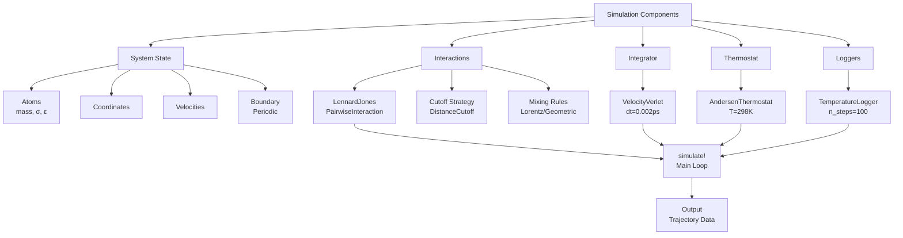
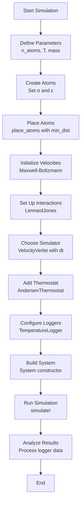

A Lennard-Jones (LJ) fluid is one of the simplest and most important models in molecular dynamics. It describes the behavior of neutral atoms interacting through van der Waals forces, capturing both **short-range repulsion** (preventing atoms from overlapping) and **long-range attraction** (causing atoms to cluster). This tutorial will guide you through simulating a Lennard-Jones fluid using Molly.jl, from setup to analysis.

## Understanding the Lennard-Jones Potential

The Lennard-Jones 6-12 potential models the interaction energy between two neutral atoms as a function of their separation distance. The mathematical form is:

```math
V(r_{ij}) = 4\varepsilon_{ij} \left[\left(\frac{\sigma_{ij}}{r_{ij}}\right)^{12} - \left(\frac{\sigma_{ij}}{r_{ij}}\right)^{6}\right]
```

Where:
- **σ (sigma)**: The distance at which the inter-particle potential is zero, representing the finite size of atoms
- **ε (epsilon)**: The depth of the potential well, representing the strength of attraction
- **r**: The separation distance between atom pairs

The **r⁻¹² term** dominates at short distances, providing strong repulsion as atoms approach each other. The **r⁻⁶ term** dominates at longer distances, providing weak attraction. This creates a potential energy curve with a minimum that determines the equilibrium separation distance.

## Architecture Overview

Before diving into the code, let's understand how Molly.jl organizes a Lennard-Jones fluid simulation:



This modular design allows you to mix and match components while keeping the simulation logic clean and maintainable.

## Complete Lennard-Jones Fluid Simulation

Here's a complete, runnable example that simulates a Lennard-Jones fluid with 100 atoms:

```julia
using Molly
using Unitful

# Simulation parameters
n_atoms = 100
boundary = CubicBoundary(2.0u"nm")
temp = 298.0u"K"
atom_mass = 10.0u"g/mol"

# Create atoms with Lennard-Jones parameters
atoms = [Atom(mass=atom_mass, σ=0.3u"nm", ϵ=0.2u"kJ * mol^-1") for i in 1:n_atoms]

# Place atoms randomly with minimum distance constraint
coords = place_atoms(n_atoms, boundary; min_dist=0.3u"nm")

# Initialize velocities from Maxwell-Boltzmann distribution
velocities = [random_velocity(atom_mass, temp) for i in 1:n_atoms]

# Define pairwise interactions
pairwise_inters = (LennardJones(),)

# Create simulator with time step and thermostat
simulator = VelocityVerlet(
    dt=0.002u"ps",
    coupling=AndersenThermostat(temp, 1.0u"ps"),
)

# Set up system with all components
sys = System(
    atoms=atoms,
    coords=coords,
    boundary=boundary,
    velocities=velocities,
    pairwise_inters=pairwise_inters,
    loggers=(temp=TemperatureLogger(100),),
)

# Run simulation for 10,000 steps
simulate!(sys, simulator, 10_000)

# Access temperature data
temp_history = values(sys.loggers.temp)
println("Final temperature: ", last(temp_history))
```

Sources: [README.md](README.md#L43-L74), [lennard_jones.jl](src/interactions/lennard_jones.jl#L1-L51), [setup.jl](src/setup.jl#L18-L61), [simulators.jl](src/simulators.jl#L1-L100), [types.jl](src/types.jl#L200-L256), [loggers.jl](src/loggers.jl#L1-L100)

## Step-by-Step Simulation Workflow

The following flowchart illustrates the complete process from setup to analysis:



Let's examine each step in detail.

## Defining Simulation Parameters

The first step is to define the fundamental parameters that characterize your system:

```julia
n_atoms = 100                    # Number of particles
boundary = CubicBoundary(2.0u"nm")  # Periodic boundary box size
temp = 298.0u"K"                 # Target temperature
atom_mass = 10.0u"g/mol"         # Mass of each atom
```

The **CubicBoundary** creates a periodic box with 2.0 nm side length. Periodic boundary conditions are essential for simulating bulk fluids, as they eliminate surface effects and allow atoms to wrap around when they exit one side of the box. Molly.jl automatically handles coordinate wrapping during the simulation.

Sources: [README.md](README.md#L46-L49), [types.jl](src/types.jl#L200-L256), [setup.jl](src/setup.jl#L18-L61)

## Creating Atoms with Lennard-Jones Parameters

Each atom in the simulation requires mass and Lennard-Jones parameters:

```julia
atoms = [Atom(mass=atom_mass, σ=0.3u"nm", ϵ=0.2u"kJ * mol^-1") for i in 1:n_atoms]
```

The **Atom** struct stores the physical properties needed for simulation:
- **mass**: Atomic mass in g/mol
- **σ (sigma)**: Distance at which potential is zero (0.3 nm)
- **ε (epsilon)**: Depth of potential well (0.2 kJ/mol)

These parameters determine how atoms interact. Larger σ values create "bigger" atoms, while larger ε values create stronger attractions. When atoms of different types interact, Molly.jl automatically computes combined parameters using mixing rules.

Sources: [types.jl](src/types.jl#L200-L256), [lennard_jones.jl](src/interactions/lennard_jones.jl#L28-L51)

## Parameter Reference Table

| Parameter | Symbol | Typical Range | Physical Meaning |
|-----------|--------|----------------|------------------|
| Mass | m | 1-200 g/mol | Inertia of particles |
| Sigma | σ | 0.2-0.4 nm | Van der Waals radius |
| Epsilon | ε | 0.1-1.0 kJ/mol | Interaction strength |
| Temperature | T | 100-500 K | Thermal energy |
| Time step | dt | 0.001-0.005 ps | Integration precision |
| Cutoff distance | rc | 1.0-1.5 nm | Interaction range |

## Placing Atoms in the Simulation Box

The `place_atoms` function randomly distributes atoms while maintaining minimum separation:

```julia
coords = place_atoms(n_atoms, boundary; min_dist=0.3u"nm")
```

This function:
1. Attempts to place atoms at random coordinates within the boundary
2. Ensures no two atoms are closer than `min_dist` (accounting for periodic boundaries)
3. Tries up to `max_attempts` times before failing

The **min_dist** parameter should be set to approximately the σ value to prevent atoms from starting in highly repulsive configurations, which would cause numerical instability. For better performance, you can increase this value to match the equilibrium distance (~2^(1/6) × σ ≈ 1.12 × σ).

Sources: [setup.jl](src/setup.jl#L18-L61)

## Initializing Velocities

Velocities are initialized from the Maxwell-Boltzmann distribution at the target temperature:

```julia
velocities = [random_velocity(atom_mass, temp) for i in 1:n_atoms]
```

This function generates random velocities that follow the equilibrium distribution for the specified mass and temperature. The distribution accounts for the different thermal energy in each degree of freedom, ensuring realistic starting conditions. Over time, the velocities will redistribute according to the interactions and thermostat.

Sources: [README.md](README.md#L50-L51)

## Configuring Lennard-Jones Interactions

The `LennardJones` struct defines the pairwise interaction model:

```julia
pairwise_inters = (LennardJones(),)
```

By default, this creates a Lennard-Jones interaction with:
- **NoCutoff()**: Computes interactions for all atom pairs (suitable for small systems)
- **lorentz_σ_mixing**: Arithmetic mean of σ values (σ_ij = (σ_i + σ_j) / 2)
- **geometric_ϵ_mixing**: Geometric mean of ε values (ε_ij = √(ε_i × ε_j))
- **lj_zero_shortcut**: Skips computation if ε or σ is zero

For larger systems, you can add a cutoff distance:

```julia
pairwise_inters = (LennardJones(cutoff=DistanceCutoff(1.0u"nm")),)
```

This sets forces and potential energy to zero for atom pairs separated by more than 1.0 nm, dramatically improving computational efficiency. You can also use **ShiftedPotentialCutoff** or **ShiftedForceCutoff** for smoother cutoffs that improve energy conservation.

Sources: [lennard_jones.jl](src/interactions/lennard_jones.jl#L1-L88), [cutoffs.jl](src/cutoffs.jl#L1-L100)

## Choosing the Integration Method

The **Velocity Verlet** integrator is the standard choice for molecular dynamics:

```julia
simulator = VelocityVerlet(
    dt=0.002u"ps",
    coupling=AndersenThermostat(temp, 1.0u"ps"),
)
```

**Velocity Verlet** provides:
- **Second-order accuracy** in time integration
- **Symplectic** properties that conserve energy in the absence of a thermostat
- **Time-reversibility** for better numerical stability

The **dt parameter** (0.002 ps = 2 femtoseconds) must be small enough to resolve the fastest vibrations in the system. A good rule of thumb is to ensure dt is at least 10-20 times smaller than the characteristic vibration timescale.

Sources: [simulators.jl](src/simulators.jl#L1-L100)

## Controlling Temperature with a Thermostat

The **Andersen thermostat** maintains the system at constant temperature:

```julia
coupling=AndersenThermostat(temp, 1.0u"ps")
```

This thermostat works by:
1. Occasionally selecting random atoms
2. Reassigning their velocities from the Maxwell-Boltzmann distribution at T
3. Applying this with a characteristic time scale (1.0 ps)

The coupling parameter controls how often atoms are affected—smaller values mean more frequent velocity reassignments. This creates a canonical (NVT) ensemble where temperature fluctuates around the target value.

Sources: [README.md](README.md#L52-L55), [coupling.jl](src/coupling.jl) (not viewed but referenced in examples)

## Setting Up Data Loggers

Loggers collect simulation data at regular intervals:

```julia
loggers=(temp=TemperatureLogger(100),)
```

The **TemperatureLogger** records system temperature every 100 steps. Available loggers include:

| Logger | Records | Typical Usage |
|--------|---------|---------------|
| TemperatureLogger | Kinetic temperature | Thermostat validation |
| CoordinatesLogger | Atom positions | Trajectory analysis |
| TotalEnergyLogger | Total energy | Conservation checks |
| KineticEnergyLogger | Kinetic energy | Energy distribution |
| PotentialEnergyLogger | Potential energy | Interaction analysis |
| ForcesLogger | Forces on atoms | Structural properties |

Loggers store data efficiently and can be accessed after simulation using `values(logger)`.

Sources: [loggers.jl](src/loggers.jl#L1-L100), [examples.md](docs/src/examples.md#L23-L32)

## Assembling the System

All components are combined into a `System` object:

```julia
sys = System(
    atoms=atoms,
    coords=coords,
    boundary=boundary,
    velocities=velocities,
    pairwise_inters=pairwise_inters,
    loggers=(temp=TemperatureLogger(100),),
)
```

The `System` struct is the central data structure that holds all simulation state. It contains:
- **atoms**: Array of Atom objects with masses and interaction parameters
- **coords**: Current positions of all atoms
- **boundary**: Periodic boundary conditions
- **velocities**: Current velocities of all atoms
- **pairwise_inters**: Tuple of pairwise interactions (can include LennardJones, Coulomb, etc.)
- **loggers**: Named tuple of loggers for data collection

This design makes it easy to pass the entire system state to simulation functions and analysis routines.

Sources: [types.jl](src/types.jl#L100-L200), [README.md](README.md#L57-L66)

## Running the Simulation

The `simulate!` function executes the simulation:

```julia
simulate!(sys, simulator, 10_000)
```

This runs the simulation for 10,000 time steps (20 ps total). During execution:

1. **Forces** are computed from Lennard-Jones interactions
2. **Velocities** are updated using the integration scheme
3. **Positions** are updated based on velocities
4. **Thermostat** applies temperature control
5. **Boundary conditions** wrap coordinates as needed
6. **Loggers** record data at specified intervals

The exclamation mark (!) indicates that this function modifies the system state in place, which is the standard Julia convention for in-place operations.

Sources: [simulators.jl](src/simulators.jl#L28-L100), [README.md](README.md#L68-L69)

## Accessing and Analyzing Results

After simulation completion, retrieve logged data:

```julia
temp_history = values(sys.loggers.temp)
println("Final temperature: ", last(temp_history))
println("Average temperature: ", mean(temp_history))
println("Temperature std dev: ", std(temp_history))

# You can also access the final system state
final_coords = sys.coords
final_velocities = sys.velocities
```

The logger returns a vector of temperature values sampled at regular intervals. You can compute statistics, create plots, or perform further analysis. For example, temperature fluctuations can indicate whether the thermostat is working correctly.

For more sophisticated analysis, consider adding additional loggers such as **PotentialEnergyLogger** to track energy changes, or **CoordinatesLogger** to record trajectories for visualization.

Sources: [loggers.jl](src/loggers.jl#L1-L100)

## Advanced Configuration: Using Neighbor Lists

For systems with more than ~100 atoms, computing all pairwise interactions becomes expensive. You can optimize performance using neighbor lists:

```julia
# Configure Lennard-Jones with neighbor list support
lj = LennardJones(
    cutoff=DistanceCutoff(1.0u"nm"),
    use_neighbors=true,
)

# Set up neighbor finder
neighbor_finder = DistanceNeighborFinder(
    eligible=trues(n_atoms, n_atoms),
    n_steps=10,
    dist_cutoff=1.1u"nm",
)

# Create system with neighbor finder
sys = System(
    atoms=atoms,
    coords=coords,
    boundary=boundary,
    velocities=velocities,
    pairwise_inters=(lj,),
    neighbor_finder=neighbor_finder,
    loggers=(temp=TemperatureLogger(100),),
)
```

The **neighbor finder** builds a list of atom pairs within the cutoff distance and updates this list periodically (every 10 steps in this example). This reduces the computational complexity from O(n²) to O(n) for large systems.

The **dist_cutoff** for the neighbor finder should be slightly larger than the interaction cutoff to account for atom movement between updates.

Sources: [examples.md](docs/src/examples.md#L320-L344), [neighbors.jl](src/neighbors.jl) (not viewed but referenced)

## Common Issues and Troubleshooting

| Issue | Symptoms | Solution |
|-------|----------|----------|
| Atoms explode | High energy, NaN values | Decrease dt or increase min_dist |
| Temperature drift | System heating/cooling | Check thermostat coupling strength |
| Poor energy conservation | Energy drift over time | Use ShiftedForceCutoff or smaller dt |
| Slow performance | Long computation time | Add neighbor lists for large systems |
| Periodic artifacts | Non-physical behavior | Increase box size or use triclinic boundary |

> [!TIP]
> Always verify your simulation by checking that temperature stabilizes and energy is conserved (without thermostat) over short test runs before committing to long production simulations.

## Visualization and Further Analysis

While this example focuses on a simple temperature logger, you can extend your analysis by:

1. **Adding coordinate logging**: Use `CoordinatesLogger(10)` to record atom positions every 10 steps
2. **Computing radial distribution functions**: Analyze structure using RDF calculations
3. **Visualizing trajectories**: Use Makie.jl or external tools like VMD or PyMOL
4. **Calculating transport properties**: Measure diffusion coefficients from mean-squared displacement

For more complex simulations including bonded interactions, electrostatic forces, or implicit solvent, explore the [Protein Simulation Setup](5-protein-simulation-setup) example.

Sources: [README.md](README.md#L1-L40), [analysis.jl](src/analysis.jl) (not viewed but available)

## Next Steps

Now that you've mastered the basics of Lennard-Jones fluid simulation, explore these related topics:

- **[System Object and Data Structures](6-system-object-and-data-structures)**: Deep dive into the System type and its components
- **[Pairwise Interactions: Lennard-Jones and Coulomb](10-pairwise-interactions-lennard-jones-and-coulomb)**: Learn about combining multiple interaction types
- **[Integration Methods: Verlet, Velocity Verlet, and Langevin](15-integration-methods-verlet-velocity-verlet-and-langevin)**: Compare different integrators and choose the best one for your needs
- **[Thermostats: Andersen, Berendsen, and Velocity Rescaling](16-thermostats-andersen-berendsen-and-velocity-rescaling)**: Understand different temperature control methods
- **[Neighbor Finding Algorithms and Cell Lists](20-neighbor-finding-algorithms-and-cell-lists)**: Optimize performance for large systems

The Lennard-Jones fluid serves as the foundation for understanding more complex molecular systems, including proteins, polymers, and solvents. The skills you've learned here will apply directly to these advanced applications.