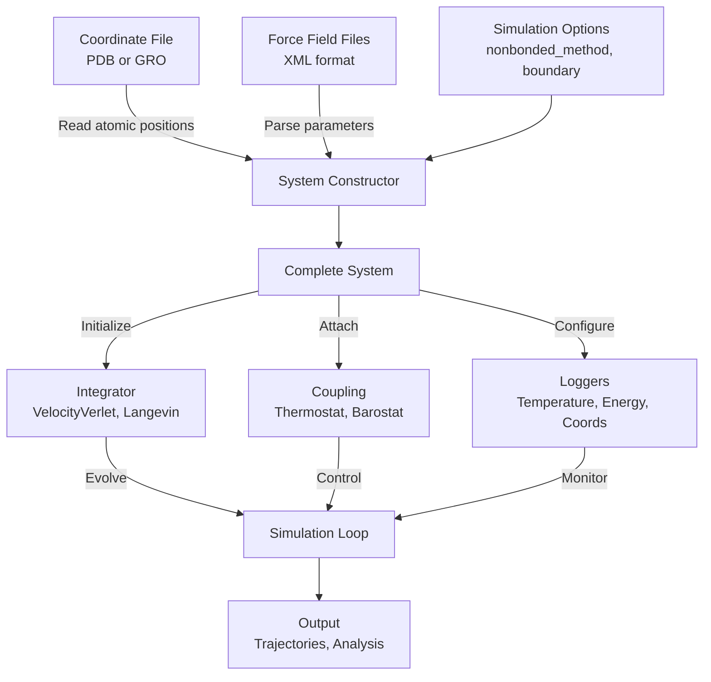

This guide teaches you how to set up and run molecular dynamics simulations of proteins using Molly.jl. You'll learn to load protein structures from standard files, apply molecular force fields, configure simulation parameters, and track system properties through logging.


Protein simulations in Molly leverage industry-standard file formats and force fields, making it straightforward to transition from other MD packages. The system automatically reads atomic coordinates from structure files and force field parameters from OpenMM-compatible XML files, constructing a complete simulation-ready system with minimal configuration.

Sources: [README.md](README.md#L1-L80), [test/protein.jl](test/protein.jl#L1-L100)

## Understanding Protein Simulation Architecture

Setting up a protein simulation involves coordinating multiple components that work together to create a physically accurate molecular system. The architecture follows a dataflow pattern where structural data and force field parameters converge into a unified System object, which is then evolved through time using integrators and coupled to environmental controls.



This architecture separates concerns cleanly: coordinate files provide atomic positions, force field files define interaction parameters, and simulation options control the computational approach. The System constructor orchestrates these inputs, automatically generating atomic properties, interaction lists, and topology information.

Sources: [src/types.jl](src/types.jl#L500-L650), [src/setup.jl](src/setup.jl#L600-L900)

## Loading Protein Structures

Molly supports loading protein structures from multiple file formats through the Chemfiles.jl interface. The two most commonly used formats are PDB (Protein Data Bank) and GRO (GROMACS coordinate format). When constructing a System from files, you simply provide the file paths, and Molly automatically parses the structure.

**Basic protein system setup:**

```julia
using Molly

# Define paths to your data
data_dir = joinpath(dirname(pathof(Molly)), "..", "data")

# Load a protein structure and force field
ff = MolecularForceField(
    joinpath(data_dir, "force_fields", "ff99SBildn.xml"),
    joinpath(data_dir, "force_fields", "tip3p_standard.xml"),
    joinpath(data_dir, "force_fields", "his.xml"),
)

sys = System(
    joinpath(data_dir, "6mrr_equil.pdb"),
    ff;
    nonbonded_method=:cutoff,
    center_coords=false,
)
```

The System constructor automatically performs several key tasks:
- Parses atomic coordinates from the PDB file
- Matches each atom to its force field type based on residue and atom names
- Assigns masses, charges, and van der Waals parameters
- Constructs bonded interactions (bonds, angles, torsions)
- Sets up non-bonded interaction tables
- Determines molecular topology for neighbor finding

Sources: [test/protein.jl](test/protein.jl#L57-L65), [src/setup.jl](src/setup.jl#L600-L799)

> [!TIP]
> The `center_coords=false` option preserves the original coordinates from your file. Setting `center_coords=true` (the default) shifts all coordinates so the system center is at the origin, which can improve numerical stability but may require re-positioning your protein in its solvent box.

## Working with Force Field Files

MolecularForceField objects parse OpenMM-style XML force field files to extract atom type definitions, residue templates, and interaction parameters. The most common force field combination for proteins in explicit solvent uses ff99SBildn for the protein and tip3p for water.

**Force field components:**

| Component | File Pattern | Purpose |
|-----------|--------------|---------|
| Protein force field | `ff99SBildn.xml` | Atom types, bonded parameters for amino acids |
| Water model | `tip3p_standard.xml` | TIP3P water parameters |
| Special residues | `his.xml` | Histidine protonation states and other special cases |

The MolecularForceField constructor automatically merges multiple XML files, handling conflicts according to standard rules. It reads:
- **AtomTypes**: Masses, element types, and initial parameter placeholders
- **Residues**: Atom type mappings and partial charges for each residue
- **HarmonicBondForce**: Bond equilibrium lengths and force constants
- **HarmonicAngleForce**: Angle equilibrium values and force constants
- **PeriodicTorsionForce**: Proper and improper torsion parameters with multiple periodicity terms
- **NonbondedForce**: Lennard-Jones σ and ε values, plus 1-4 scaling factors

Sources: [src/setup.jl](src/setup.jl#L130-L300), [data/force_fields](data/force_fields/)

## Configuring Non-Bonded Interactions

Non-bonded interactions—electrostatic and van der Waals forces—require special handling in protein simulations due to their computational cost. Molly provides multiple methods for calculating these interactions with different trade-offs between accuracy and performance.

**Non-bonded method comparison:**

| Method | Description | Use Case | Performance |
|--------|-------------|----------|-------------|
| `:cutoff` | Simple distance truncation | Small systems, testing | Fastest |
| `:pme` | Particle Mesh Ewald (approximate) | Production simulations, large systems | Fast, good accuracy |
| `:coul_pme` | PME with exact Coulomb | High-precision requirements | Slower, most accurate |

```julia
# Cutoff method for quick tests
sys_cutoff = System(coords_file, ff; nonbonded_method=:cutoff)

# PME method for production runs
sys_pme = System(coords_file, ff; nonbonded_method=:pme)

# PME with exact Coulomb for validation
sys_exact = System(coords_file, ff; nonbonded_method=:pme, approximate_pme=false)
```

The PME method splits electrostatic calculations into direct real-space interactions (treated with a cutoff) and reciprocal-space calculations handled via Fast Fourier Transforms. This approach provides O(N log N) scaling instead of O(N²), making it feasible for large biomolecular systems.

Sources: [test/protein.jl](test/protein.jl#L66-L72), [README.md](README.md#L1-L80)

## Setting Up Simulation Controls

Protein simulations require careful control of temperature and pressure to maintain physically realistic conditions. Molly provides multiple thermostats and barostats that can be combined with integrators to create complete simulation environments.

**Complete simulation setup with coupling:**

```julia
# System parameters
temp = 298.0u"K"
press = 1.0u"bar"

# Create integrator with thermostat coupling
simulator = VelocityVerlet(
    dt=0.0005u"ps",
    coupling=AndersenThermostat(temp, 10.0u"ps")
)

# Or combine thermostat and barostat
thermostat = AndersenThermostat(temp, 10.0u"ps")
barostat = MonteCarloBarostat(press, temp, sys.boundary; n_steps=20)
simulator = VelocityVerlet(
    dt=0.0002u"ps",
    coupling=(thermostat, barostat)
)

# Initialize velocities at target temperature
random_velocities!(sys, temp)

# Run simulation
simulate!(sys, simulator, n_steps; n_threads=Threads.nthreads())
```

**Available thermostats:**
- **AndersenThermostat**: Random velocity rescaling with specified collision frequency
- **BerendsenThermostat**: Exponential relaxation toward target temperature
- **VelocityRescaling**: Modified Berendsen with correct fluctuation properties

**Available barostats:**
- **MonteCarloBarostat**: Stochastic volume changes
- **BerendsenBarostat**: Exponential pressure relaxation
- **CRescaleBarostat**: Correct volume fluctuation statistics

Sources: [test/protein.jl](test/protein.jl#L12-L13), [test/protein.jl](test/protein.jl#L60-L75)

## Logging and Trajectory Output

Tracking simulation properties is essential for analysis and debugging. Molly provides a flexible logger system that can record various system properties at specified intervals, including writing trajectory files for visualization.

**Comprehensive logging setup:**

```julia
using Molly

# Configure loggers to record every 10 steps
sys = System(
    coords_file,
    ff;
    loggers=(
        temp=TemperatureLogger(10),           # Temperature history
        coords=CoordinatesLogger(10),         # All atomic coordinates
        energy=TotalEnergyLogger(10),         # Total system energy
        density=DensityLogger(10),            # System density
    ),
    nonbonded_method=:cutoff,
)

# Add trajectory writers
dcd_file = "trajectory.dcd"
pdb_file = "trajectory.pdb"

sys = System(
    coords_file,
    ff;
    loggers=(
        # ... existing loggers ...
        dcd_writer=TrajectoryWriter(10, dcd_file; atom_inds=1001:2000),
        pdb_writer=TrajectoryWriter(10, pdb_file),
    ),
    nonbonded_method=:cutoff,
)

# After simulation, access logged data
temperatures = values(sys.loggers.temp)
energies = values(sys.loggers.energy)
```

The TrajectoryWriter supports multiple formats through Chemfiles.jl, including DCD (for large trajectories), PDB (for visualization and analysis), and XTC (compressed trajectories). The `atom_inds` parameter allows you to write only a subset of atoms, useful for focusing on specific regions like a protein's binding site.

Sources: [test/protein.jl](test/protein.jl#L4-L11), [test/protein.jl](test/protein.jl#L28-L39)

## Complete Protein Simulation Example

Putting all components together, here's a complete workflow for simulating a protein with solvent:

```julia
using Molly

# 1. Set up data paths
data_dir = joinpath(dirname(pathof(Molly)), "..", "data")

# 2. Load force field
ff = MolecularForceField(
    joinpath(data_dir, "force_fields", "ff99SBildn.xml"),
    joinpath(data_dir, "force_fields", "tip3p_standard.xml"),
    joinpath(data_dir, "force_fields", "his.xml"),
)

# 3. Create system with logging
sys = System(
    joinpath(data_dir, "6mrr_equil.pdb"),
    ff;
    nonbonded_method=:pme,
    loggers=(
        temp=TemperatureLogger(100),
        energy=TotalEnergyLogger(100),
        coords=CoordinatesLogger(100),
    ),
    center_coords=false,
)

# 4. Energy minimization (important starting step)
minimizer = SteepestDescentMinimizer()
simulate!(sys, minimizer)

# 5. Initialize velocities
random_velocities!(sys, 298.0u"K")

# 6. Set up simulator with thermostat
simulator = Langevin(
    dt=0.0005u"ps",
    temperature=298.0u"K",
    friction=1.0u"ps^-1",
)

# 7. Run production simulation
simulate!(sys, simulator, 10_000; n_threads=Threads.nthreads())

# 8. Analyze results
println("Final temperature: ", temperature(sys))
println("Energy conservation: ", last(values(sys.loggers.energy)))
```

This complete workflow demonstrates best practices: energy minimization before dynamics to remove bad contacts, proper thermostat setup for temperature control, and logging for post-simulation analysis.

Sources: [test/protein.jl](test/protein.jl#L57-L100), [docs/src/examples.md](docs/src/examples.md#L1-L50)

## Performance Optimization Options

Protein simulations can be computationally intensive. Molly provides several optimization options that can dramatically improve performance without significantly affecting accuracy.

**Performance configuration matrix:**

| Configuration | Float Type | Units | GPU | Speed vs. Reference |
|---------------|------------|-------|-----|---------------------|
| Baseline | Float64 | Yes | CPU | 1.0x |
| Float32 | Float32 | Yes | CPU | ~2x faster |
| No units | Float64 | No | CPU | ~1.5x faster |
| Float32 + no units | Float32 | No | CPU | ~3x faster |
| GPU (CUDA) | Float64 | Yes | CUDA | ~5x faster |
| GPU Float32 | Float32 | Yes | CUDA | ~10x faster |

```julia
# Optimized setup for production runs
sys = System(
    Float32,  # Use Float32 for better GPU performance
    coords_file,
    ff;
    units=false,  # Disable units for speed
    array_type=CuArray,  # Use GPU arrays
    dist_cutoff=1.0,  # No units needed when units=false
    nonbonded_method=:cutoff,
)

# Run with optimal settings
simulate!(sys, simulator, n_steps; n_threads=Threads.nthreads())
```

> [!TIP]
> For large-scale production simulations, Float32 on GPU typically offers the best performance-to-accuracy ratio. Test your system with both Float64 and Float32 to ensure the reduced precision doesn't affect your specific observables of interest.

Sources: [benchmark/protein.jl](benchmark/protein.jl#L1-L62), [test/protein.jl](test/protein.jl#L45-L60)

## Troubleshooting Common Issues

When setting up protein simulations, you may encounter several common issues. Here are solutions to frequently encountered problems:

**Issue: "atom of type X has not had charge set"**
- **Cause**: Atom type in structure doesn't match force field definitions
- **Solution**: Verify residue names are standard (e.g., "ALA" not "ALA_N"), check force field includes all residues in your structure

**Issue: Poor energy conservation**
- **Cause**: Time step too large or system not minimized
- **Solution**: Reduce dt to 0.0005u"ps" or smaller, always run energy minimization before dynamics

**Issue: Simulation runs slowly**
- **Cause**: Using cutoff with large systems or inefficient parameters
- **Solution**: Switch to PME for electrostatics, enable GPU with Float32, use appropriate neighbor finder settings

**Issue: Pressure drifts in NPT simulation**
- **Cause**: Barostat relaxation time too short
- **Solution**: Increase `n_steps` parameter in MonteCarloBarostat to allow better equilibration

Sources: [src/setup.jl](src/setup.jl#L600-L650), [test/protein.jl](test/protein.jl#L100-L150)

## Next Steps

Now that you understand protein simulation setup, explore these related topics:

- **[System Object and Data Structures](6-system-object-and-data-structures)**: Deep dive into the System type and how it organizes simulation data
- **[Atoms and Coordinates Management](7-atoms-and-coordinates-management)**: Learn advanced techniques for manipulating atomic positions
- **[Boundary Conditions and Periodic Systems](8-boundary-conditions-and-periodic-systems)**: Understanding how to handle different simulation box geometries
- **[Pairwise Interactions](10-pairwise-interactions-lennard-jones-and-coulomb)**: Detailed explanation of non-bonded force calculations
- **[Specific Interactions](11-specific-interactions-bonds-angles-and-torsions)**: How bonded forces are computed in protein simulations

These pages will provide deeper technical understanding of the components introduced here, enabling you to customize simulations for your specific research needs.