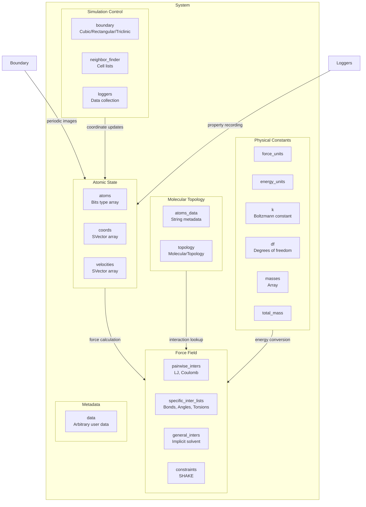

The System object serves as Molly.jl's central state container, aggregating all components required for molecular dynamics simulations into a single cohesive structure. This architectural design ensures that simulation state, physical properties, and computational settings remain synchronized throughout the simulation lifecycle. The System type implements the AtomsBase.jl `AbstractSystem` interface, providing compatibility with the broader Julia ecosystem while maintaining Molly.jl-specific optimizations for performance-critical operations.

## System Architecture Overview

The System struct follows a parameterized design that statically encodes dimensional information and type parameters for performance optimization. All computational-critical data types are captured as type parameters, enabling compiler optimizations and eliminating runtime type checks. The architecture distinguishes between **dynamic state** (coordinates, velocities) that evolve during simulation and **static topology** (atoms, interactions, boundaries) that typically remains constant throughout simulation, except in specific scenarios like free energy calculations or replica exchange.



## Core System Fields

The System struct contains 21 fields organized into logical groups that map to simulation requirements. Understanding these fields is essential for both using and extending Molly.jl effectively.

**Atomic State Fields**: The `atoms` field holds an array of Atom instances, which are carefully designed as bits types for GPU compatibility. Each Atom encapsulates its physical properties: `index`, `atom_type`, `mass`, `charge`, `σ` (Lennard-Jones size parameter), and `ϵ` (Lennard-Jones energy parameter). The `coords` and `velocities` fields store the dynamic state as arrays of static vectors (typically `SVector{3}`), with velocities defaulting to zero-initialized values if not explicitly provided.

Sources: [src/types.jl](src/types.jl#L200-L270), [src/types.jl](src/types.jl#L420-L440)

**Boundary Conditions**: The `boundary` field defines the simulation domain using one of three concrete boundary types: `CubicBoundary`, `RectangularBoundary`, or `TriclinicBoundary`. Each boundary type implements the `AbstractBoundary{D, T, C}` interface parameterized by dimension, float type, and coordinate type, enabling compile-time optimization of boundary condition calculations including coordinate wrapping and minimum image convention.

Sources: [src/types.jl](src/types.jl#L425-L440), [src/spatial.jl](src/spatial.jl#L10-L80)

> [!TIP]
> The System constructor performs extensive validation to ensure GPU arrays and CPU arrays are consistently used across all fields. If atoms are GPU arrays, coordinates and velocities must also be GPU arrays, preventing expensive data transfers during simulation loops.

## Atom and AtomData Separation

Molly.jl employs a **two-tier architecture** for atom information to balance computational efficiency with metadata richness. The Atom struct stores only numeric, bits-type fields essential for force calculations, while AtomData contains string-based metadata required for analysis but not simulation dynamics.

### Atom Structure

The Atom struct uses Julia's `@kwdef` macro for convenient construction with keyword arguments:

| Field | Type | Purpose |
|-------|------|---------|
| `index` | `Int` | Atom index in the system array |
| `atom_type` | `T` | Integer type identifier for force field lookups |
| `mass` | `M` | Atomic mass (default: `1.0u"g/mol"`) |
| `charge` | `C` | Partial charge for electrostatics |
| `σ` | `S` | Lennard-Jones finite distance (default: `0.0u"nm"`) |
| `ϵ` | `E` | Lennard-Jones well depth (default: `0.0u"kJ * mol^-1"`) |

The type parameters `T, M, C, S, E` allow flexible field types while maintaining compile-time type stability for GPU execution.

Sources: [src/types.jl](src/types.jl#L220-L250)

### AtomData Structure

AtomData stores non-numeric information that would prevent GPU compatibility if embedded in Atom:

```julia
@kwdef struct AtomData
    atom_type::String = "?"
    atom_name::String = "?"
    res_number::Int = 1
    res_name::String = "???"
    chain_id::String = "A"
    element::String = "?"
    hetero_atom::Bool = false
end
```

This separation enables efficient force calculation kernels that operate on arrays of bits-type Atoms while preserving rich metadata for trajectory analysis, structure output, and post-processing.

Sources: [src/types.jl](src/types.jl#L330-L345)

## Interaction Organization

Molly.jl categorizes interactions into three distinct groups based on computational characteristics, each with optimized data structures for efficient evaluation.

### Pairwise Interactions

The `pairwise_inters` field contains a tuple or named tuple of `PairwiseInteraction` subtypes, which are actually aliases for `NBodyInteraction{2}`. These interactions operate on most atom pairs and typically require neighbor lists for efficient computation. Common examples include Lennard-Jones potentials, Coulomb electrostatics, and Buckingham potentials. The System constructor validates that all pairwise interactions are subtypes of `PairwiseInteraction` and issues warnings if a neighbor finder is not used with interactions that require neighbor lists.

Sources: [src/types.jl](src/types.jl#L15-L30), [src/types.jl](src/types.jl#L560-L570)

### Specific Interactions

The `specific_inter_lists` field organizes interactions between predetermined atom groups into type-parameterized structures:

| Interaction Type | Number of Atoms | Fields | Typical Use |
|------------------|-----------------|--------|-------------|
| `InteractionList1Atoms` | 1 | `is`, `inters`, `types` | Position restraints |
| `InteractionList2Atoms` | 2 | `is`, `js`, `inters`, `types` | Bonds, non-bonded exclusions |
| `InteractionList3Atoms` | 3 | `is`, `js`, `ks`, `inters`, `types` | Bond angles |
| `InteractionList4Atoms` | 4 | `is`, `js`, `ks`, `ls`, `inters`, `types` | Torsions, improper angles |

These structures store integer atom indices (`is`, `js`, `ks`, `ls`) and corresponding interaction parameters (`inters`), enabling vectorized computation of specific interaction energies and forces. The `types` field stores string identifiers for interaction type identification in differentiable simulations and parameter injection.

Sources: [src/types.jl](src/types.jl#L40-L100)

### General Interactions

The `general_inters` field contains interactions that involve all atoms collectively, such as implicit solvent models (GBSA). These interactions implement the AtomsCalculators.jl interface and can compute energy contributions based on the full system state rather than individual atom pairs or clusters.

Sources: [src/types.jl](src/types.jl#L415-L420)

## Topology and Molecular Connectivity

The `topology` field stores a `MolecularTopology` object containing three critical data structures:

1. **`atom_molecule_inds`**: A `Vector{Int32}` mapping each atom to its molecule index
2. **`molecule_atom_counts`**: A `Vector{Int32}` storing the number of atoms in each molecule
3. **`bonded_atoms`**: A `Vector{Tuple{Int32, Int32}}` listing bonded atom pairs

This topology information enables molecular analysis, molecule-based calculations, and constraint algorithms like SHAKE that require knowledge of molecular connectivity. The MolecularTopology constructor can be initialized from bond lists using graph connectivity algorithms to automatically identify molecules and their compositions.

Sources: [src/types.jl](src/types.jl#L350-L380)

> [!TIP]
> Topology information is optional but highly recommended for simulations with constraints or when performing molecule-level analysis. The System constructor accepts `nothing` as a default value, allowing simulations to proceed without explicit topology when not needed.

## Neighbor Finding Infrastructure

The `neighbor_finder` field stores an object that implements neighbor list algorithms to accelerate pairwise interaction calculations. Molly.jl supports multiple neighbor finding strategies through polymorphic types:

- **`NoNeighborFinder`**: Direct N² pair evaluation, suitable for small systems or testing
- **CellListNeighborFinder`**: Cell list decomposition for medium-sized systems
- **TreeNeighborFinder`**: Tree-based spatial partitioning (when available)

The System constructor validates that interactions using neighbors are paired with an appropriate neighbor finder, preventing silent performance degradations from missing neighbor list updates. The neighbor list itself is stored in a separate `NeighborList` mutable struct containing the number of neighbors and the actual neighbor pairs.

Sources: [src/types.jl](src/types.jl#L400-L430)

## Unit System and Physical Constants

Molly.jl integrates with Unitful.jl to maintain dimensional consistency throughout simulations. The System stores unit conversion parameters:

- **`force_units`**: Units for force calculations (default: `u"kJ * mol^-1 * nm^-1"`)
- **`energy_units`**: Units for energy calculations (default: `u"kJ * mol^-1"`)
- **`k`**: Boltzmann constant automatically converted based on energy units

The units can be disabled by setting these fields to `NoUnits`, which is useful for comparison with other simulation packages that use unitless internal representations. The System constructor provides a `default_k(energy_units)` function that selects the appropriate Boltzmann constant value based on the energy unit system.

Sources: [src/types.jl](src/types.jl#L425-L440)

## Degrees of Freedom Calculation

The `df` field stores the number of degrees of freedom in the system, which is computed during System construction:

```julia
df = n_dof(D, length(atoms), boundary)
if length(constraints) > 0
    for ca in constraints
        for cluster_type in cluster_keys(ca)
            clusters = getproperty(ca, cluster_type)
            df -= n_dof_lost(D, clusters)
        end
    end
end
```

This calculation accounts for dimensionality, boundary conditions (periodic vs. infinite), and constraint algorithms that fix degrees of freedom. The accurate degree of freedom count is essential for thermostat coupling, equipartition theorem applications, and temperature calculation.

Sources: [src/types.jl](src/types.jl#L570-L590)

## Logger System

The `loggers` field contains a tuple or named tuple of logger objects that record system properties during simulation. Molly.jl provides a suite of built-in loggers for common observables:

| Logger | Observable | Use Case |
|--------|-----------|----------|
| `TemperatureLogger` | System temperature | Thermostat verification |
| `CoordinatesLogger` | Atom coordinates | Trajectory output |
| `VelocitiesLogger` | Atom velocities | Kinetic analysis |
| `TotalEnergyLogger` | Total system energy | Conservation verification |
| `KineticEnergyLogger` | Kinetic energy | Temperature analysis |
| `PotentialEnergyLogger` | Potential energy | Force field verification |
| `PressureLogger` | System pressure | Barostat verification |

Loggers implement a `log_property!` function that records data at specified intervals during simulation steps. The `GeneralObservableLogger` provides a flexible interface for custom observables that require specialized calculation routines.

Sources: [src/loggers.jl](src/loggers.jl#L1-L50)

## Mass Storage and Computation

The System precomputes and stores mass-related data for performance:

- **`masses`**: Array of individual atom masses extracted via `mass.(atoms)`
- **`total_mass`**: Sum of all atom masses for center-of-mass calculations

This storage avoids repeated mass extraction during force calculation, kinetic energy computation, and velocity rescaling operations. The `mass` function is generic, allowing custom atom types to define alternative mass retrieval strategies.

Sources: [src/types.jl](src/types.jl#L225-L240), [src/types.jl](src/types.jl#L590-L600)

## Type Parameter System

The System struct is heavily parameterized to enable compile-time optimization:

```julia
mutable struct System{D, AT, T, A, C, B, V, AD, TO, PI, SI, GI, CN, NF,
                      L, F, E, K, M, TM, DA} <: AtomsBase.AbstractSystem{D}
```

| Parameter | Meaning | Example |
|-----------|---------|---------|
| `D` | Number of dimensions | `3` |
| `AT` | Array type | `Vector`, `CuArray` |
| `T` | Float type | `Float64`, `Float32` |
| `A` | Atoms type | `Vector{Atom}` |
| `C` | Coordinate type | `Vector{SVector{3, Float64}}` |
| `B` | Boundary type | `CubicBoundary` |
| `V` | Velocity type | `Vector{SVector{3, Float64}}` |
| `AD` | Atom data type | `Vector{AtomData}` |
| `TO` | Topology type | `MolecularTopology` |
| `PI` | Pairwise inters type | `Tuple{LennardJones}` |
| `SI` | Specific inters type | `NamedTuple` |
| `GI` | General inters type | `Tuple` |
| `CN` | Constraints type | `Tuple` |
| `NF` | Neighbor finder type | `CellListNeighborFinder` |
| `L` | Loggers type | `NamedTuple` |
| `F` | Force units type | `Unitful.Quantity` |
| `E` | Energy units type | `Unitful.Quantity` |
| `K` | Boltzmann constant type | `Unitful.Quantity` |
| `M` | Masses type | `Vector` |
| `TM` | Total mass type | `Unitful.Quantity` |
| `DA` | Arbitrary data type | `Any` |

This parameterization enables specialized code generation for CPU vs. GPU execution, single vs. double precision, and various boundary condition configurations without runtime dispatch overhead.

Sources: [src/types.jl](src/types.jl#L445-L465)

## System Construction Patterns

The System struct provides multiple construction patterns for different use cases:

### Direct Construction

For fine-grained control over system properties, use the keyword argument constructor:

```julia
sys = System(
    atoms=atoms,
    coords=coords,
    boundary=CubicBoundary(2.0),
    pairwise_inters=(lennard_jones, coulomb),
    specific_inter_lists=(bonds, angles),
    neighbor_finder=CellListNeighborFinder(dist_cutoff=1.2)
)
```

This pattern is useful when building systems from scratch or modifying existing systems.

### System Modification

The convenience constructor modifies an existing System by keyword arguments:

```julia
new_sys = System(sys; coords=new_coords, velocities=new_velocities)
```

This pattern is essential for free energy perturbations where atomic parameters change while preserving other system properties.

### Crystal Construction

For crystalline systems, construct directly from SimpleCrystals.jl Crystal objects:

```julia
sys = System(crystal; pairwise_inters=(lennard_jones,))
```

The constructor automatically extracts atoms, coordinates, and determines appropriate boundary types from the crystal structure.

Sources: [src/types.jl](src/types.jl#L660-L740), [src/types.jl](src/types.jl#L740-L800)

## Validation and Error Checking

The System constructor performs comprehensive validation to detect configuration errors before simulation begins:

- Array length consistency: atoms, coords, velocities, and atoms_data must have matching lengths
- GPU array consistency: if atoms are on GPU, coords and velocities must also be GPU arrays
- Interaction type validation: pairwise_inters must be PairwiseInteraction subtypes
- Neighbor finder consistency: interactions using neighbors require a neighbor finder
- Units consistency: force and energy units must be compatible throughout the system

These validations prevent subtle bugs that would otherwise manifest only during runtime simulation.

Sources: [src/types.jl](src/types.jl#L500-L570)

## Next Steps

Now that you understand the System object and data structures, the natural progression is to learn about coordinate management and atomic details. Continue to [Atoms and Coordinates Management](7-atoms-and-coordinates-management) to understand how coordinates are stored, accessed, and transformed during simulation. Following that, explore [Boundary Conditions and Periodic Systems](8-boundary-conditions-and-periodic-systems) to understand how different boundary types affect coordinate wrapping and distance calculations.

For practical implementation details, refer to [Lennard-Jones Fluid Simulation](4-lennard-jones-fluid-simulation) for examples of building simple systems, or [Protein Simulation Setup](5-protein-simulation-setup) for complex biological systems with multiple interaction types.