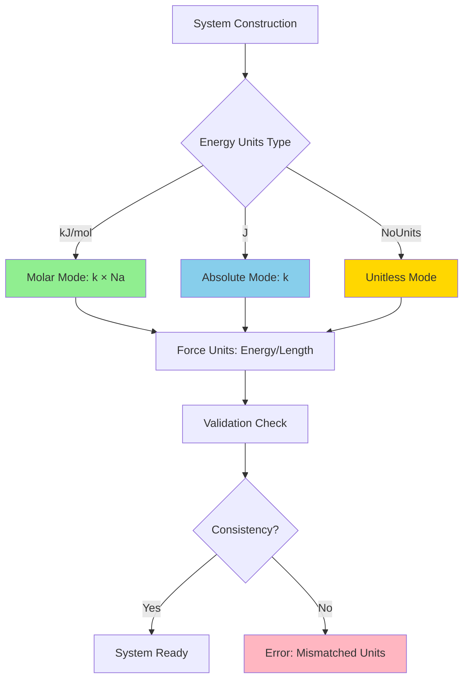
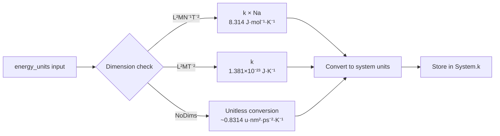

This page explains how Molly.jl integrates with Unitful.jl to provide comprehensive physical unit handling, ensuring dimensional consistency and preventing common unit conversion errors in molecular dynamics simulations. The unit system supports both molecular-scale units (nm, ps, kJ/mol) and SI units, with strict validation to catch inconsistencies early in simulation setup.

## Unit System Architecture

Molly's unit architecture centers around three core concepts: **unit consistency validation**, **molar vs. non-molar unit distinction**, and **default unit conventions**. The system automatically validates all physical quantities during System construction, ensuring that coordinates, velocities, masses, energies, and forces all use compatible units.

The System struct stores explicit unit fields for energies and forces, which propagate through all calculations. The Boltzmann constant `k` is automatically selected based on energy units (using `k * Na` for molar units, `k` for absolute units), making temperature-dependent calculations seamless across unit conventions.



## Supported Unit Dimensions

Molly validates physical quantities against specific dimensional requirements. Each category has allowed dimension types:

| Quantity Type | Valid Dimensions | Examples |
|---------------|------------------|----------|
| **Coordinates** | Length (L) or NoDims | `1.0u"nm"`, `2.0u"Å"`, `3.0` (unitless) |
| **Velocities** | Length×Time⁻¹ or NoDims | `0.1u"nm/ps"`, `100u"m/s"`, `1.5` |
| **Masses** | Mass (M) or Mass/Mole (MN⁻¹) or NoDims | `12.0u"u"`, `18.0u"g/mol"`, `1.0` |
| **Energy** | L²MT⁻², L²MN⁻¹T⁻², or NoDims | `1.0u"kJ/mol"`, `4.18u"J"`, `10.0` |
| **Force** | LMT⁻², LMN⁻¹T⁻², or NoDims | `100u"kJ/mol/nm"`, `1.0u"N"`, `5.0` |

Sources: [src/units.jl](src/units.jl#L75-L120)

### Molar vs. Non-Molar Unit Consistency

The system enforces a critical consistency rule: **all energy-related quantities must use the same molar convention**. You cannot mix molar and non-molar units within a single system.

```julia
# Valid: All molar units
System(atoms, coords, boundary,
       energy_units=u"kJ * mol^-1",
       force_units=u"kJ * mol^-1 * nm^-1")

# Valid: All non-molar units
System(atoms, coords, boundary,
       energy_units=u"J",
       force_units=u"N")

# Invalid: Mixed molar/non-molar
System(atoms, coords, boundary,
       energy_units=u"kJ * mol^-1",  # Molar
       force_units=u"N")              # Non-molar → Error!
```

This validation occurs in the `check_system_units` function, which detects inconsistencies and throws descriptive error messages early in the simulation setup process.

Sources: [src/units.jl](src/units.jl#L25-L58)

## Default Unit Conventions

Molly establishes sensible defaults aligned with molecular simulation practice:

- **Length units**: `nm` (nanometers)
- **Energy units**: `kJ * mol^-1` (kilojoules per mole)
- **Force units**: `kJ * mol^-1 * nm^-1` (kilojoules per mole per nanometer)
- **Time units**: `ps` (picoseconds) - used internally for velocity conversions
- **Temperature units**: `K` (Kelvin)

These defaults are applied automatically when constructing a System unless explicitly overridden. The force units are derived from energy units divided by length units, ensuring dimensional consistency.

Sources: [src/types.jl](src/types.jl#L500-L550)

## Atom and Interaction Parameters

Atoms store physical parameters with units, particularly the Lennard-Jones parameters `σ` (distance parameter) and `ϵ` (energy parameter):

```julia
Atom(index=1,
     atom_type="C",
     mass=12.011u"u",           # Unified atomic mass units
     σ=0.34u"nm",               # Lennard-Jones distance
     ϵ=0.36u"kJ * mol^-1")      # Lennard-Jones energy
```

The `check_other_units` function validates that atom parameter units match the system's coordinate and energy units. This prevents mismatches such as using Ångstroms for coordinates while specifying `σ` in nanometers.

Sources: [src/units.jl](src/units.jl#L60-L100)

## Boltzmann Constant Handling

The Boltzmann constant `k` is automatically converted to appropriate units based on the system's energy units:



The `default_k` and `convert_k_units` functions handle this conversion automatically, ensuring temperature-dependent calculations (thermostats, kinetic energy calculations) use dimensionally consistent constants. When `energy_units=NoUnits`, the Boltzmann constant is stripped of units and converted to a numerical value consistent with the unitless convention.

Sources: [src/units.jl](src/units.jl#L115-L150)

## Unitless Mode

Molly supports a completely unitless mode for performance-critical applications or when working with reduced units:

```julia
# Unitless system - all values are dimensionless numbers
System(atoms,
       coords,                # Pure numbers
       boundary,
       energy_units=NoUnits,  # Explicitly unitless
       force_units=NoUnits)
```

In unitless mode, all unit validation still applies: you must consistently use `NoUnits` everywhere. The system will reject mixing unitless and unitful quantities. This mode can improve performance by avoiding unit arithmetic overhead, but requires careful manual tracking of physical scales.

Sources: [src/units.jl](src/units.jl#L30-L45)

## Unit Stripping for Performance

For GPU computation and performance optimization, Molly provides `ustrip_vec` for efficiently stripping units from arrays:

```julia
coords_units = [SVector(1.0u"nm", 2.0u"nm", 3.0u"nm") for _ in 1:1000]
coords_stripped = ustrip_vec.(coords_units)  # Broadcasted unit removal
```

The boundary types also support unit conversion:

```julia
boundary = CubicBoundary(4.0u"nm", 4.0u"nm", 4.0u"nm")
boundary_nm = ustrip(boundary)           # Remove units entirely
boundary_angstrom = ustrip(u"Å", boundary) # Convert to Angstroms
```

These utilities allow you to work with unitful quantities during setup and analysis, then strip units for the performance-critical simulation loop.

Sources: [src/units.jl](src/units.jl#L9-L14), [test/basic.jl](test/basic.jl#L40-L50)

> [!TIP]
> **Performance Consideration**: Unitless mode eliminates unit arithmetic overhead (~5-10% performance gain) but sacrifices compile-time dimension checking. For production simulations, start with full units and profile before switching to unitless mode only if performance is critical.

## Common Unit Conversion Patterns

When integrating with external tools or data, you'll frequently convert between unit conventions:

| From | To | Conversion Pattern |
|------|-----|-------------------|
| `u"kJ/mol"` | `u"J"` | `uconvert(u"J", value) / Unitful.Na` |
| `u"nm"` | `u"Å"` | `uconvert(u"Å", value)` |
| `u"ps"` | `u"fs"` | `uconvert(u"fs", value)` |
| `u"u"` (mass) | `u"g/mol"` | `uconvert(u"g/mol", value)` |

Velocity initialization from Maxwell-Boltzmann distribution automatically handles unit conversions:

```julia
# All three produce identical velocity distributions
velocities1 = [maxwell_boltzmann(12.0u"u", 300.0u"K") for _ in 1:100]
velocities2 = [maxwell_boltzmann(12.0u"g/mol", 300.0u"K") for _ in 1:100]
velocities3 = [maxwell_boltzmann(12.0, 300.0) for _ in 1:100]  # Unitless
```

Sources: [test/basic.jl](test/basic.jl#L25-L35)

## Error Detection and Debugging

The unit system provides detailed error messages for common configuration mistakes:

```julia
# Example error scenarios:
# 1. Mixed coordinate units
# Error: "coordinates have mixed units"

# 2. Energy/force dimension mismatch  
# Error: "force_units was specified as N, but that is different from energy_units divided by length"

# 3. Inconsistent molar conventions
# Error: "System was constructed with inconsistent energy, force and mass units. 
#        All must be molar, non-molar or unitless"
```

These errors occur at System construction time, preventing runtime failures. The validation functions (`validate_coords`, `validate_velocities`, `validate_masses`, `validate_energy_units`) check consistency across all array elements and between different physical quantities.

> [!TIP]
> **Debugging Tip**: When encountering unit errors, explicitly extract the units using `unit(x)` to see what the system expects. Compare this against your input units using `dimension(x)` to identify the mismatch type.

## Integration with Simulators and Interactions

All simulators and interactions respect the system's unit conventions without additional configuration:

```julia
# Simulators automatically use system.k for temperature calculations
thermostat = VelocityRescaleThermostat(300.0u"K")  # Units work with any energy mode

# Interactions inherit units from atom parameters and boundary
LennardJones(cutoff=1.0u"nm")  # Distance in system length units
HarmonicBond(k=1000.0u"kJ/mol/nm^2", r0=0.154u"nm")  # Force constant uses system energy/length
```

The coupling and interaction layers are designed to work seamlessly with whichever unit convention the System uses, with all unit conversions handled transparently by the core unit infrastructure.

Sources: [src/interactions/lennard_jones.jl](src/interactions/lennard_jones.jl#L1-L30), [src/interactions/harmonic_bond.jl](src/interactions/harmonic_bond.jl#L1-L30), [src/coupling.jl](src/coupling.jl#L30-L60)

## Next Steps

Understanding Molly's unit system is essential for correct simulation setup. For practical application, proceed to:

- **[Pairwise Interactions: Lennard-Jones and Coulomb](10-pairwise-interactions-lennard-jones-and-coulomb)** - See how units apply in specific force calculations
- **[Integration Methods: Verlet, Velocity Verlet, and Langevin](15-integration-methods-verlet-velocity-verlet-and-langevin)** - Understand how units propagate through time integration
- **[Thermostats: Andersen, Berendsen, and Velocity Rescaling](16-thermostats-andersen-berendsen-and-velocity-rescaling)** - Learn about temperature control with proper unit handling
