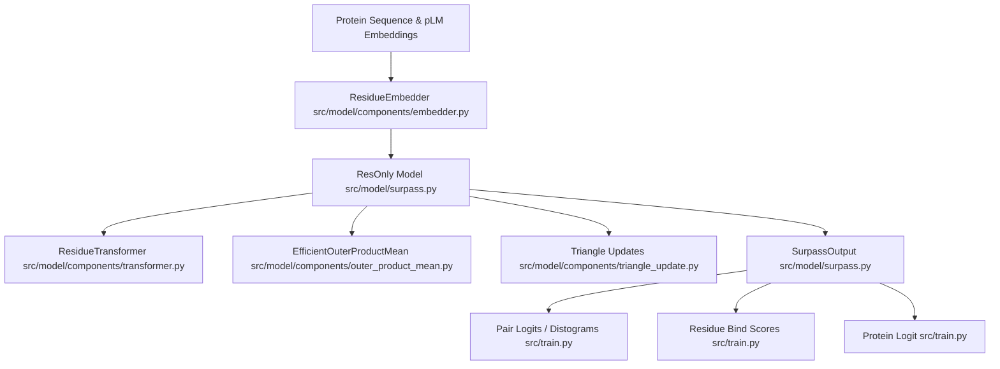

# Overview

Relevant source files

The following files were used as context for generating this wiki page:

- [src/__init__.py](src/__init__.py)
- [src/model/surpass.py](src/model/surpass.py)
- [src/train.py](src/train.py)

SurPass is a deep learning framework designed for protein-protein interaction (PPI) and inter-chain contact prediction [src/train.py:1-35](). It leverages protein language model (pLM) embeddings combined with sequence features to model residue and pair representations through an iterative transformer and geometric update architecture [src/model/surpass.py:28-192]().

The core model architecture, `ResOnly` [src/model/surpass.py:28](), processes residue tokens and pair representations through stacked residue transformers [src/model/surpass.py:75](), outer product mean modules [src/model/surpass.py:90](), and triangle update layers [src/model/surpass.py:98-110](). It produces outputs structured in `SurpassOutput` [src/model/surpass.py:20-26](), which include pair distogram logits, residue-level binding scores, and whole-protein interaction logits [src/model/surpass.py:187-191]().

Sources: `src/model/surpass.py:20-192]`, `src/train.py:1-35`

## 1.1 Getting Started & Environment

The repository provides automated installation procedures and structured entry points for running training pipelines, inference jobs, and diagnostic previews. The environment setup relies on configuration files that manage dependencies across compute hardware, including distributed training support.

For details on setting up the environment, repository layout, and launching entry points, see [Getting Started & Environment](#1.1).

Sources: `src/train.py:1-45`

## 1.2 Configuration System (Hydra)

SurPass utilizes Hydra to manage configurations for training and inference workflows. Configuration schemas are split into modular blocks covering data loaders, network architecture parameters, loss weighting schemes, optimizers, and experiment tracking via Weights & Biases (`wandb`).

For details on config schemas and parameter mapping, see [Configuration System (Hydra)](#1.2).

Sources: `src/train.py:6-10`, `src/model/surpass.py:28-46`

---