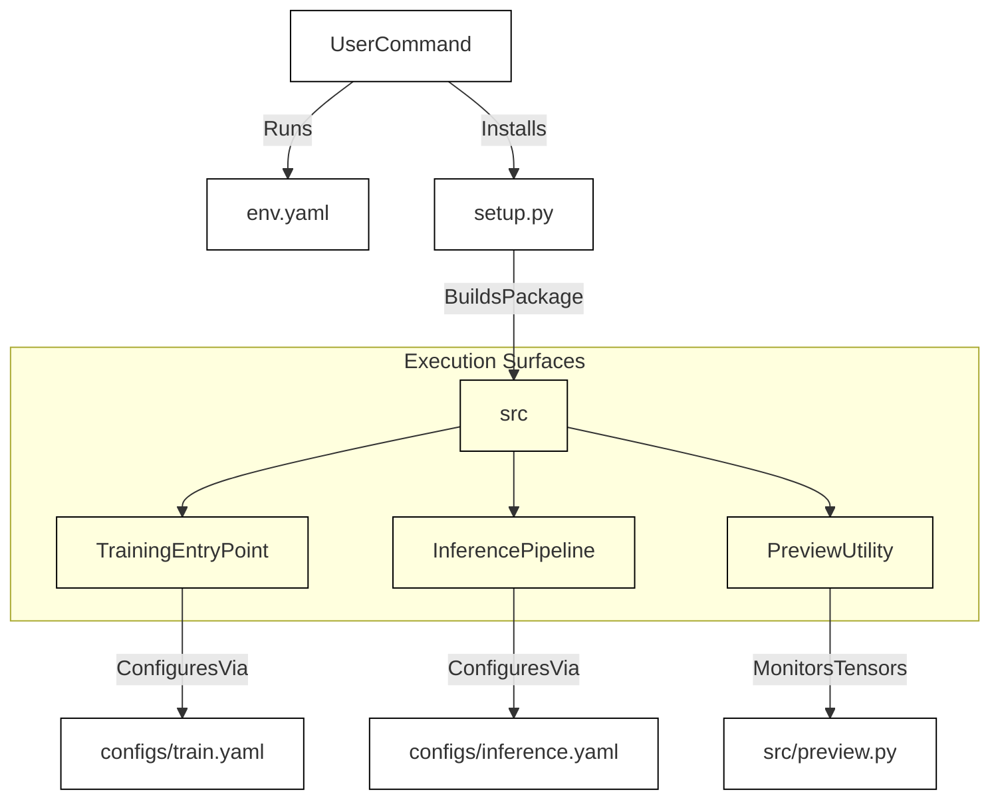
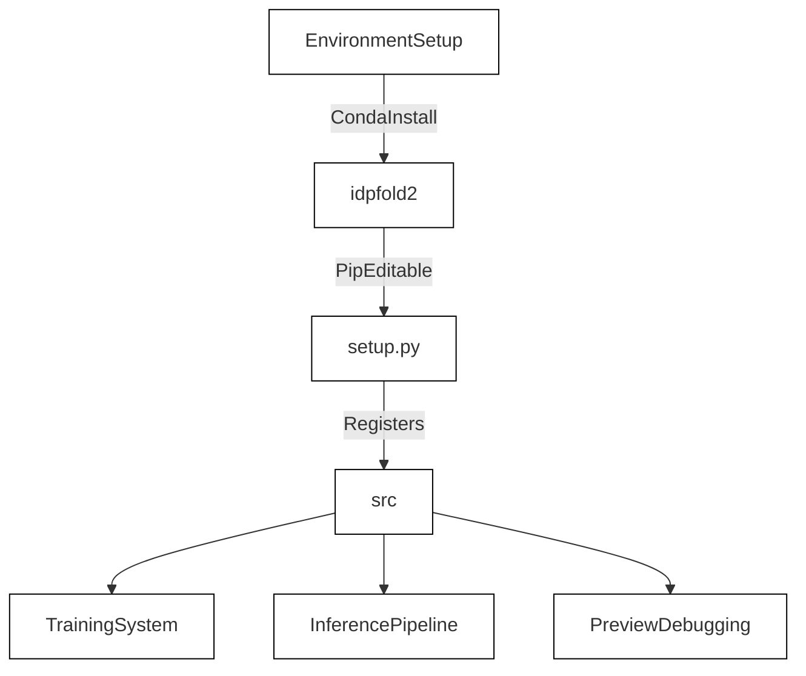

# Getting Started & Environment

<details>
<summary>Relevant source files</summary>

The following files were used as context for generating this wiki page:

- [.gitignore](.gitignore)
- [env.yaml](env.yaml)
- [setup.py](setup.py)
- [src/__init__.py](src/__init__.py)

</details>


## Purpose and Scope
This page outlines the technical setup, environment configuration, repository organization, and execution entrypoints for the SurPass codebase. SurPass relies on PyTorch and Hydra for flexible configuration and distributed training. Here we detail how to set up the runtime environment using `env.yaml` and `setup.py`, understand the directory layout, and launch core execution pipelines.

Sources: [src/__init__.py:1-1](), [env.yaml:1-25](), [setup.py:1-14]()

---

## Environment Installation
SurPass manages its dependencies via Conda and pip. The environment specification is provided in `env.yaml`, which sets up Python 3.11 alongside deep learning libraries (`torch==2.6.0`, `torch-geometric`) and data processing utilities (`biopython`, `biopandas`, `hydra-core`, `wandb`) [env.yaml:1-25]().

### Installation Steps
1. Create and activate the Conda environment named `idpfold2` using the specification file [env.yaml:1-1]():
   ```bash
   conda env create -f env.yaml
   conda activate idpfold2
   ```
2. Install the local package in editable mode using `setup.py`:
   ```bash
   pip install -e .
   ```

### Dependency Stack Summary
| Category | Packages / Tools | Source Reference |
| :--- | :--- | :--- |
| **Core Runtime** | `python=3.11`, `torch==2.6.0`, `torch-geometric`, `numpy==1.26.0` | [env.yaml:5-16]() |
| **Configuration & Logging** | `hydra-core==1.3.1`, `wandb`, `loguru==0.7.2`, `rootutils` | [env.yaml:11-25]() |
| **Protein Processing** | `biopython`, `biopandas==0.5.1`, `biotite`, `cpdb-protein` | [env.yaml:19-22]() |
| **Utilities** | `einops==0.6`, `dm-tree==0.1.8`, `pandas==1.5.3`, `scikit-learn>=1.3` | [env.yaml:9-24]() |

Sources: [env.yaml:1-25](), [setup.py:1-14]()

---

## Repository Layout & Build Configuration
The repository is structured around a modular Python package rooted in `src/`, with configuration files and helper scripts organized cleanly. Build metadata is defined in `setup.py` [setup.py:4-14](), which automatically discovers internal packages.

```
SurPass/
├── env.yaml            # Conda environment specification
├── setup.py            # Package installation script
├── .gitignore          # Git exclusion patterns
├── src/                # Core source code package
│   ├── __init__.py     # Package marker
│   ├── common/         # Shared constants and utilities
│   ├── data/           # Dataset pipelines, cropping, and collation
│   ├── models/         # ResOnly neural network architecture
│   └── utils/          # DDP, tensor, and windowing utilities
└── configs/            # Hydra configuration yaml files
```

### Git Ignores
Transient directories such as local logs, generated outputs, python cache files, and test artifacts are excluded from version control via `.gitignore` [-.gitignore:1-8]().

Sources: [.gitignore:1-8](), [setup.py:1-14](), [src/__init__.py:1-1]()

---

## Execution Entrypoints & Workflows
SurPass operates through distinct entrypoints managed by Hydra configuration blocks. The training system, inference pipeline, and visualization tools are invoked from command-line interfaces driven by configuration YAML files.

### 1. Training Entrypoint
Training is driven by distributed data parallel (DDP) execution models, orchestrating dataset multi-source balancing, loss calculation, and optimization.

### 2. Inference Pipeline
Inference execution evaluates trained checkpoints against FASTA and embedding inputs, utilizing long-sequence windowing algorithms for complex protein structures.

### 3. Preview Utilities
Debugging and preview scripts allow direct spatial visualization of distance maps and NaN monitoring during development.


*Figure 1.1.1: Environment installation and execution workflow bridging setup artifacts to entrypoints.*

Sources: [env.yaml:1-25](), [setup.py:1-14]()


*Figure 1.1.2: Mapping natural language initialization concepts to code package structures.*

Sources: [env.yaml:1-25](), [setup.py:1-14](), [src/__init__.py:1-1]()

---