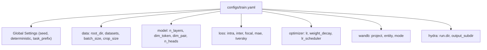
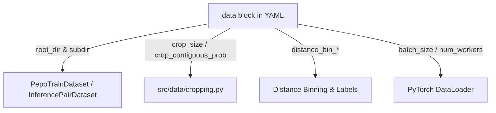
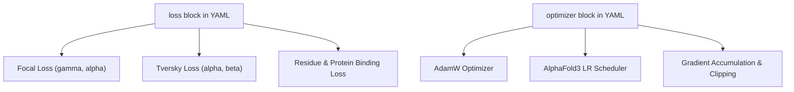
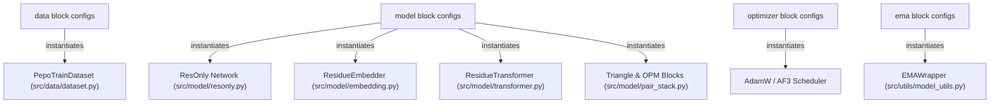

# Configuration System (Hydra)

Relevant source files

The following files were used as context for generating this wiki page:

- [configs/inference.yaml](configs/inference.yaml)
- [configs/train.yaml](configs/train.yaml)

## Purpose and Scope
This page details the configuration schema and management system used in SurPass, driven by Facebook Hydra. It covers the structural schemas of `configs/train.yaml` and `configs/inference.yaml`, detailing how configuration blocks (`data`, `model`, `loss`, `optimizer`, `wandb`, `hydra`, and `performance`) map directly to python code structures, dataset loaders, neural network modules, and training/inference execution routines.

Sources: `configs/train.yaml:1-127` [configs/train.yaml:1-126](), `configs/inference.yaml:1-53` [configs/inference.yaml:1-52]()

---

## Configuration Architecture and YAML Schemas

SurPass uses Hydra to manage hyper-parameters, data paths, model dimensions, and optimization details. Configuration files are split into training (`configs/train.yaml`) and inference (`configs/inference.yaml`) profiles. 

### Global Runtime Settings
* `task_prefix`: A string prefix used for logging and run identification (`configs/train.yaml:1-1` [], `configs/inference.yaml:1-1` []).
* `seed`: Random seed for reproducibility across runs (`configs/train.yaml:3-3` [], `configs/inference.yaml:3-3` []).
* `deterministic`: Boolean flag to enforce deterministic algorithms in PyTorch (`configs/train.yaml:4-4` [], `configs/inference.yaml:4-4` []).
* `ckpt_dir`: Path to checkpoint directories for resuming training or loading weights for inference (`configs/train.yaml:7-7` [], `configs/inference.yaml:5-5` []).

*Sources: `configs/train.yaml:1-123` [configs/train.yaml:1-123]()*

---

## Data Block Schema

The `data` block configures dataset paths, multiprocessing parameters, negative sampling ratios, distance binning, and spatial cropping.

### Training Data Configuration (`configs/train.yaml`)
* `root_dir`: Base directory containing all training datasets (`configs/train.yaml:16-16` []).
* `epoch_size`: Number of samples per training epoch (`configs/train.yaml:17-17` []).
* `datasets`: A multi-source dataset list specifying `pdb_ppi`, `afdb_pos`, and `afdb_neg` subdirectories, cluster TSV files, assembly flags, and sampling weights (`configs/train.yaml:18-35` []).
* `batch_size` & `num_workers`: DataLoader batch configuration (`configs/train.yaml:36-37` []).
* `negative_ratio`: Ratio of negative to positive pairs during negative assembly (`configs/train.yaml:40-40` []).
* `distance_bin_start`, `distance_bin_end`, `distance_bin_count`: Parameters defining the distogram discretization range (2.0Å to 22.0Å over 64 bins) (`configs/train.yaml:41-43` []).
* `crop_size` & `crop_contiguous_prob`: Spatial and contiguous cropping parameters for residue pair matrices (`configs/train.yaml:45-46` []).

### Inference Data Configuration (`configs/inference.yaml`)
* `test_set_tsv` & `fasta_path`: Paths to evaluation tabular data and input FASTA sequences (`configs/inference.yaml:9-10` []).
* `embedding_dir`: Directory containing precomputed protein language model (pLM) embeddings (`configs/inference.yaml:11-11` []).
* `max_full_length`: Maximum sequence length supported in full-length inference before windowing (`configs/inference.yaml:15-15` []).
* `ppi_score_threshold`: Threshold used to call predicted inter-chain contacts or interfaces (`configs/inference.yaml:20-20` []).

*Sources: `configs/train.yaml:15-47` [configs/train.yaml:15-47](), `configs/inference.yaml:7-21` [configs/inference.yaml:7-21]()*

---

## Model Block Schema

The `model` block configures the architecture dimensions, network depth, and attention mechanisms of the `ResOnly` network.

* `n_layers`: Number of stacked transformer layers (`configs/train.yaml:49-49` [], `configs/inference.yaml:26-26` []).
* `dim_token`: Dimensionality of the residue/token stream (`configs/train.yaml:50-50` [], `configs/inference.yaml:27-27` []).
* `dim_pair`: Dimensionality of the pair representation stream (`configs/train.yaml:51-51` [], `configs/inference.yaml:28-28` []).
* `n_heads`: Number of attention heads in multi-head attention blocks (`configs/train.yaml:52-52` [], `configs/inference.yaml:29-29` []).
* `use_attn_pair_bias` & `use_qkln`: Flags enabling pair-wise attention biases and Query-Key Layer Normalization (`configs/train.yaml:55-56` [], `configs/inference.yaml:32-33` []).
* `plm_in_dim` & `plm_out_dim`: Input and projected dimensions for pLM embeddings (`configs/train.yaml:59-60` [], `configs/inference.yaml:36-37` []).
* `r_max`: Maximum residue separation distance considered for relative positional encodings (`configs/train.yaml:61-61` [], `configs/inference.yaml:38-38` []).
* `dim_opm_inner` & `dim_triangle_hidden`: Inner dimensions for Outer Product Mean and Triangle update modules (`configs/train.yaml:65-66` [], `configs/inference.yaml:42-43` []).
* `num_classes`: Number of discrete distance bins for output prediction heads (`configs/train.yaml:67-67` [], `configs/inference.yaml:44-44` []).

Sources: `configs/train.yaml:48-68` [configs/train.yaml:48-68](), `configs/inference.yaml:25-45` [configs/inference.yaml:25-45]()

---

## Loss, Optimizer, and Training Execution Blocks

Training-specific blocks control objective functions, optimization schedules, EMA, and experiment tracking.

### Loss Configuration (`configs/train.yaml`)
* `intra` & `inter`: Weighting factors for intra-chain versus inter-chain pairs (`configs/train.yaml:70-71` []).
* `focal`: Focal loss sub-block containing `weight`, `gamma`, and `alpha` (`configs/train.yaml:73-76` []).
* `mae` & `tversky`: Supplementary loss configurations (`configs/train.yaml:77-82` []).
* `residue_bind` & `protein`: Interface binding classification objectives (`configs/train.yaml:83-88` []).
* `consistency`: Geometric/structural consistency loss term (`configs/train.yaml:89-90` []).

### Optimizer & EMA Configuration (`configs/train.yaml`)
* `optimizer`: Configures `lr` (0.0005), `weight_decay` (1e-6), Adam parameters, `lr_scheduler` (`af3`), warmup steps, gradient accumulation steps (`grad_accum_steps: 4`), and gradient clipping (`max_grad_norm: 1.0`) (`configs/train.yaml:92-103` []).
* `ema`: Exponential Moving Average settings including `decay` (0.999) and mutable parameter keywords (`configs/train.yaml:11-13` []).
* `wandb`: Weights & Biases integration parameters (`enabled`, `project`, `entity`, `mode`, `tags`) (`configs/train.yaml:108-117` []).

*Sources: `configs/train.yaml:11-14` [configs/train.yaml:11-14](), `configs/train.yaml:69-117` [configs/train.yaml:69-117]()*

---

## Natural Language to Code Entity Mapping

The configuration system acts as the blueprint for instantiating python classes across the codebase. The following diagram maps high-level configuration declarations directly to their corresponding python modules and class implementations.

*Sources: `configs/train.yaml:15-68` [configs/train.yaml:15-68](), `configs/train.yaml:92-103` [configs/train.yaml:92-103]()*

---