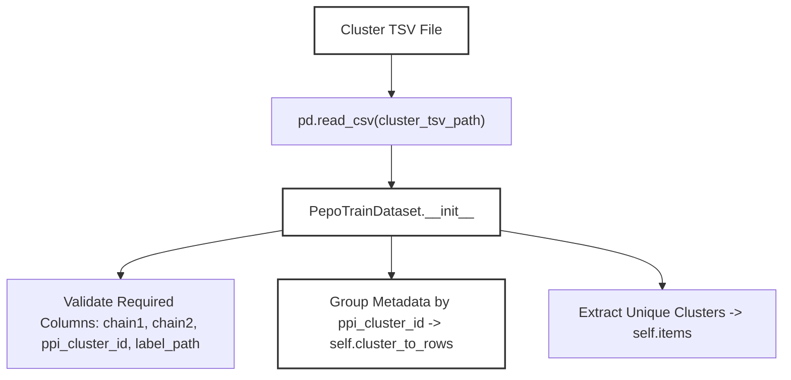
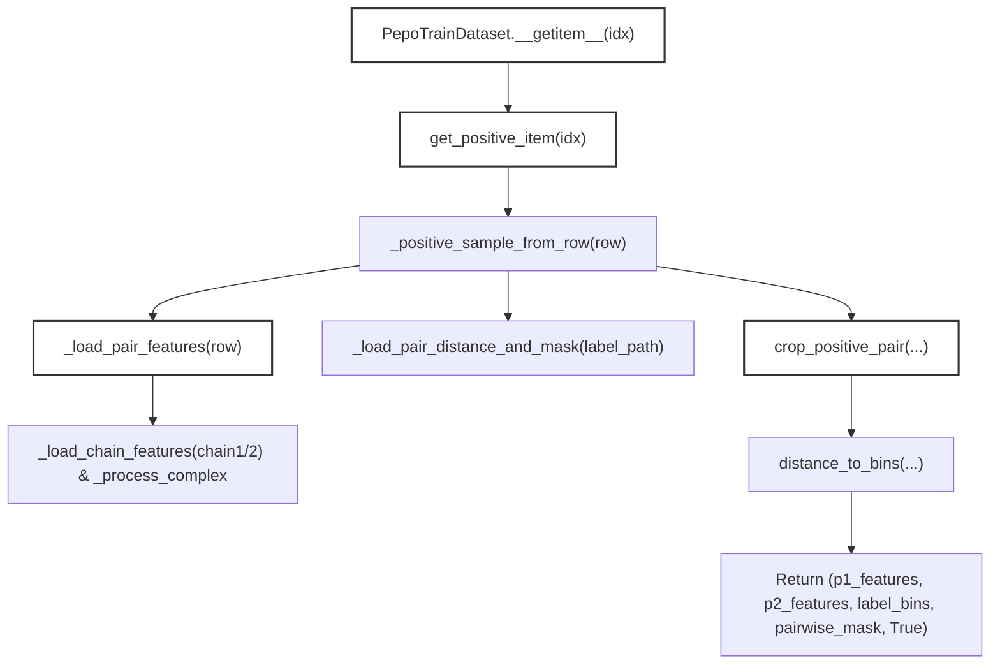

# PepoTrainDataset and Feature Loading

Relevant source files

The following files were used as context for generating this wiki page:

- [src/data/dataset.py](src/data/dataset.py)
- [src/data/preprocess.py](src/data/preprocess.py)

## Purpose and Scope
This page details the implementation of `PepoTrainDataset` and the associated feature loading pipeline in the SurPass codebase. The dataset handles protein-protein interaction (PPI) clusters, executes positive and negative sampling strategies, loads precomputed chain feature PyTorch tensors (`.pt`), processes distance labels from pickled files, and normalizes tensors via complex processing methods.

---

## 1. PepoTrainDataset Initialization and Cluster Organization

The `PepoTrainDataset` class inherits from `torch.utils.data.Dataset` and is designed to load protein-protein interaction pairs grouped by structural similarity clusters (`ppi_cluster_id`) [src/data/dataset.py:26-40]().

During initialization, the dataset reads a metadata TSV file (`cluster_tsv_path`) containing cluster assignments and file paths [src/data/dataset.py:62-63](). It validates the presence of required columns (`chain1`, `chain2`, `ppi_cluster_id`, and optionally `label_path`) [src/data/dataset.py:63-70](). The dataset indexes unique PPI clusters to balance sampling across distinct structural families rather than individual complex instances [src/data/dataset.py:72-76]().

*Diagram 1: Initialization flow of `PepoTrainDataset` mapping TSV metadata into cluster groupings.*

Sources: `[src/data/dataset.py:26-76]()`

---

## 2. Positive Sampling and Chain Feature Loading

When indexing the dataset via `__getitem__`, it delegates to `get_positive_item(idx)` [src/data/dataset.py:81-82](). This method selects a random row from the specified PPI cluster, shuffling available structural representatives until a valid positive pair containing an inter-chain contact is found [src/data/dataset.py:94-106]().

The chain features are loaded via `_load_pair_features`, which retrieves chain features and normalizes them through `_process_complex` [src/data/dataset.py:89-92](). Pairwise distances and masks are loaded from label paths, after which `crop_positive_pair` is invoked to extract spatial or contiguous sub-crops [src/data/dataset.py:108-123](). Finally, continuous distance matrices are converted into discrete distance bins using `distance_to_bins` [src/data/dataset.py:127-132]().

*Diagram 2: Positive sampling and feature loading pipeline execution paths.*

Sources: `[src/data/dataset.py:81-134]()`

---

## 3. Negative Sampling Pipeline

To support contrastive or non-interacting pair training, `PepoTrainDataset` provides negative sampling methods (`get_negative_item` and `get_static_negative_item`) [src/data/dataset.py:135-149](). 

Negative sampling ensures that paired chains originate from different PPI clusters (`self.items[p1_idx] != self.items[p2_idx]`) [src/data/dataset.py:136-137](). Features for both chains are processed independently and passed to `crop_negative_pair` [src/data/dataset.py:139-155](). Labels and validity masks for negative pairs are dynamically generated using `build_negative_pair_labels` based on residue positions and sequence masks, returning a binary interaction flag of `False` [src/data/dataset.py:156-167]().

Sources: `[src/data/dataset.py:135-167]()`

---

## 4. Tensor Normalization and Distance Binning

Feature processing relies heavily on tensor transformations within `_process_complex` and labeling utilities in `src/data/labels.py`. 

- **Chain Feature Files**: Chain-level `.pt` files provide precomputed residue coordinates, sequence masks, residue positions, and pre-trained language model (pLM) embeddings.
- **Tensor Normalization**: `_process_complex` standardizes shapes, applies dtype casting, and ensures mask alignment across variable-length protein chains [src/data/dataset.py:90-91]().
- **Distance Bins**: Continuous spatial distances are discretized into configurable bins defined by `distance_bin_start`, `distance_bin_end`, and `distance_bin_count` [src/data/dataset.py:32-37, 127-132]().

Sources: `[src/data/dataset.py:32-37]`, `[src/data/dataset.py:90-132]()`, `[src/data/labels.py:1-23]()`

---