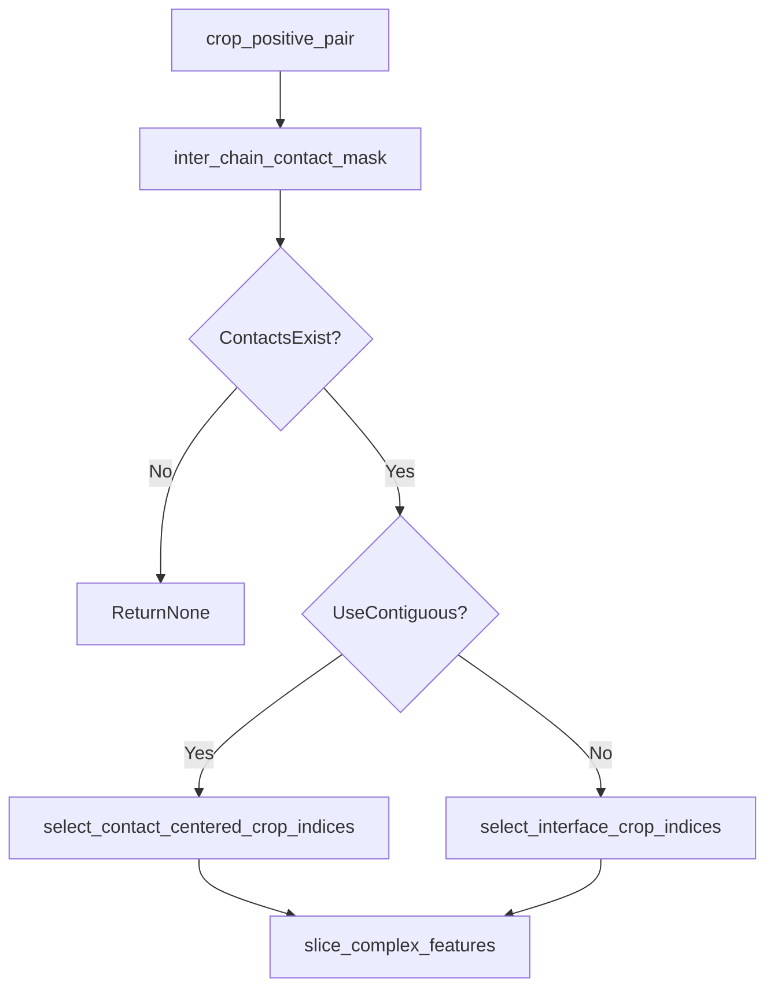
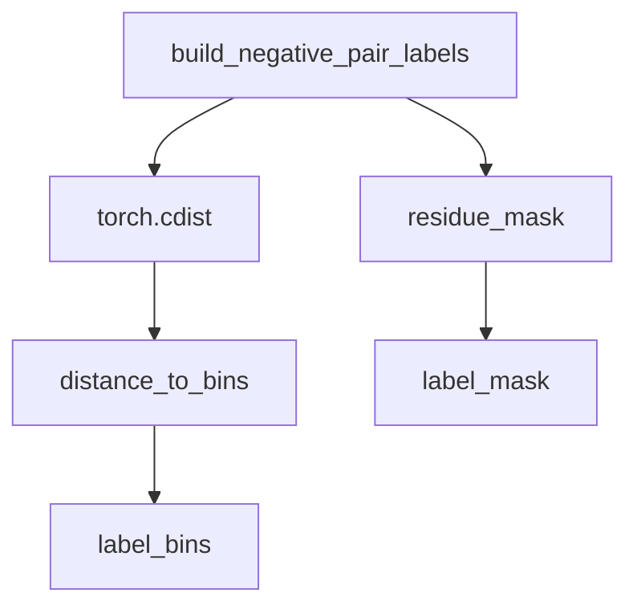
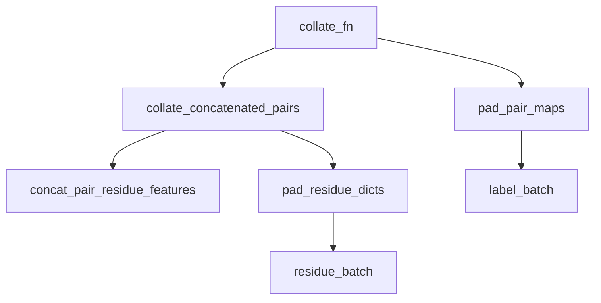

# Cropping, Labels and Collation

Relevant source files

The following files were used as context for generating this wiki page:

- [src/data/collate.py](src/data/collate.py)
- [src/data/cropping.py](src/data/cropping.py)
- [src/data/labels.py](src/data/labels.py)

This page documents the spatial cropping algorithms, distance-based label engineering, and dynamic padding/collation routines used to prepare protein-protein interaction (PPI) data for training and evaluation in SurPass.

---

## 1. Spatial and Contiguous Cropping (`src/data/cropping.py`)

When protein complexes exceed memory limits or configured maximum crop sizes (default `DEFAULT_CROP_SIZE = 256`), `src/data/cropping.py` applies deterministic or stochastic cropping strategies [src/data/cropping.py:1-7].

### Key Cropping Functions

*   `select_contiguous_crop_indices(length, crop_size, start)`: Returns a contiguous slice of length `crop_size` from a sequence of length `length` [src/data/cropping.py:13-25]. If `length <= crop_size`, returns the full range [src/data/cropping.py:18-19].
*   `select_centered_contiguous_crop_indices(length, crop_size, center)`: Centers a contiguous crop around a specific residue index `center` [src/data/cropping.py:28-36].
*   `select_interface_crop_indices(contacts, n1, n2, crop_size, neighborhood_size)`: Gathers interface-centric sparse residue indices from interacting pairs using local spatial neighborhood windows (`DEFAULT_CROP_NEIGHBORHOOD_SIZE = 10`) and fills remaining slots if needed [src/data/cropping.py:97-122, src/data/cropping.py:61-94].
*   `select_contact_centered_crop_indices(contacts, n1, n2, crop_size)`: Selects a random inter-chain contact seed and builds centered contiguous crops for both interacting chains [src/data/cropping.py:125-135].
*   `crop_positive_pair(...)`: Orchestrates cropping for positive interacting pairs based on `crop_contiguous_probability` (default `0.3`) and distance thresholds (`DEFAULT_CONTACT_THRESHOLD_A = 8.0`) [src/data/cropping.py:7-11, src/data/cropping.py:166-205].

Sources: `src/data/cropping.py:1-205`, `src/data/labels.py:111-122`

---

## 2. Distance Binning and Label Generation (`src/data/labels.py`)

Ground truth pairwise distances are discretized into classification bins to facilitate distogram prediction objectives [src/data/labels.py:1-24].

### Distance Binning Parameters

*   `DISTANCE_BIN_START_A = 2.0` [src/data/labels.py:3]
*   `DISTANCE_BIN_END_A = 22.0` [src/data/labels.py:4]
*   `DISTANCE_BIN_WIDTH_A = 0.5` [src/data/labels.py:5]
*   `DISTANCE_BIN_NUM = 64` [src/data/labels.py:6]

### Key Label Functions

*   `distance_to_bins(distance, bin_start, bin_end, bin_count)`: Converts continuous distance tensors into discrete integer class bins via `torch.bucketize` [src/data/labels.py:11-23].
*   `inter_chain_pair_mask(p1_length, p2_length, device, total_length)`: Generates boolean masks indicating inter-chain pairs versus intra-chain pairs within a concatenated complex representation [src/data/labels.py:26-73].
*   `build_negative_pair_labels(p1_positions, p1_mask, p2_positions, p2_mask, bin_start, bin_end, bin_count)`: Computes pairwise distance matrices for non-interacting or negative protein pairs, assigning out-of-range distance bins (`bin_end + 1.0`) to unmasked residue pairs [src/data/labels.py:76-108].
*   `inter_chain_contact_mask(pairwise_dist, pairwise_mask, p1_length, contact_threshold)`: Extracts cross-chain distance sub-matrices and filters by contact threshold [src/data/labels.py:111-121].

Sources: `src/data/labels.py:1-137`

---

## 3. Batching and Collation (`src/data/collate.py`)

The collation system in `src/data/collate.py` aggregates variable-length protein-peptide pairs into uniform padded mini-batches [src/data/collate.py:1-113].

### Collation Pipeline

1.  `concat_pair_residue_features(p1, p2)`: Concatenates protein (`p1`) and peptide (`p2`) residue features along the sequence dimension. Offsets `chain_index` for the second chain (`p2_chain = p2_value.long() + p1_chain.amax() + 1`) [src/data/collate.py:24-37].
2.  `pad_first_dim(tensors)`: Pads a list of tensors along dimension 0 to match the maximum sequence length in the batch (`max_n`), using type-specific fill values (`False` for boolean, `0.0` for floats, `0` for integers) [src/data/collate.py:5-21].
3.  `collate_concatenated_pairs(proteins, peptides)`: Merges protein and peptide feature dictionaries and tracks individual chain lengths (`p1_length`, `p2_length`) [src/data/collate.py:62-72].
4.  `collate_fn(batch)`: Unpacks dataset tuples, delegates sequence collation to `collate_concatenated_pairs`, and pads 2D pair maps via `pad_pair_maps` [src/data/collate.py:75-90].
5.  `get_dataloader(...)`: Instantiates a standard PyTorch `DataLoader` with custom `collate_fn` and worker configurations [src/data/collate.py:93-112].

Sources: `src/data/collate.py:1-113`

---