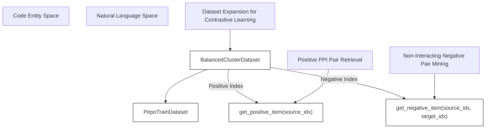
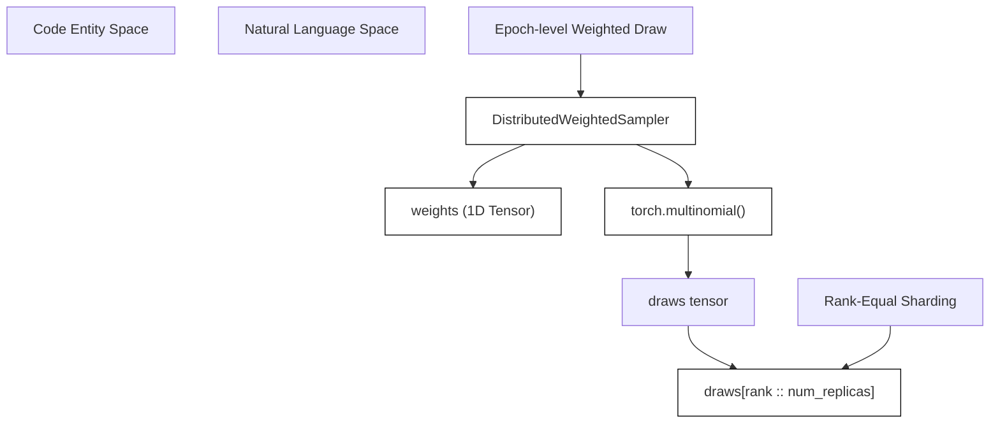

# Multi-Source Balancing and Splits

<details>
<summary>Relevant source files</summary>

The following files were used as context for generating this wiki page:

- [src/data/__init__.py](src/data/__init__.py)
- [src/data/balancing.py](src/data/balancing.py)
- [src/train.py](src/train.py)

</details>


## Purpose and Scope

This page covers the data balancing, negative sampling, dataset splitting, and distributed weighted sampling mechanisms implemented in the `SurPass` data pipeline. These components ensure that protein-protein interaction (PPI) training data from multiple biological sources are properly partitioned, balanced with negative interacting pairs, and distributed evenly across multi-GPU environments during distributed data parallel (DDP) training.

Sources: `[src/data/balancing.py:1-186]`, `[src/data/__init__.py:1-25]()`

---

## Dataset Splitting

The pipeline partitions raw dataset instances into training and testing splits deterministically using a fixed random seed. The `split_dataset` function accepts a PyTorch `Dataset` and a `test_fraction`, returning a random split of subsets [src/data/balancing.py:13-30]().

```python
def split_dataset(
    dataset: Dataset,
    test_fraction: float = 0.2,
    seed: int = 42,
) -> tuple[Dataset, Dataset]:
```

- **Validation Checks**: Verifies that `test_fraction` is strictly between `0.0` and `1.0`, and that the dataset is non-empty [src/data/balancing.py:18-21]().
- **Size Computation**: Computes test length as `max(1, int(round(len(dataset) * test_fraction)))` and guarantees a non-empty training length [src/data/balancing.py:25-28]().
- **Generator**: Uses a seeded `torch.Generator` for reproducibility across runs [src/data/balancing.py:29-30]().

Sources: `[src/data/balancing.py:13-30]()`

---

## Balanced Cluster Datasets and Negative Sampling

To prevent model bias toward always predicting positive interacting interfaces, `SurPass` incorporates negative sampling via `BalancedClusterDataset` [src/data/balancing.py:33-65]() and `StaticClusterDataset` [src/data/balancing.py:108-129]().

### BalancedClusterDataset

`BalancedClusterDataset` wraps a `PepoTrainDataset` to dynamically generate negative pairs alongside positive pairs during training [src/data/balancing.py:33-40]().


Sources: `[src/data/balancing.py:33-65]`, `[src/data/balancing.py:67-91]()`

- **Length Expansion**: The dataset length is scaled by the negative ratio: `len(self.indices) * (1 + self.negative_ratio)` [src/data/balancing.py:50-51]().
- **Item Access (`__getitem__`)**:
  - Indices below `len(self.indices)` return positive items via `self.dataset.get_positive_item(source_idx)` [src/data/balancing.py:55-57]().
  - Indices beyond positive count sample a random *different* PPI cluster (`target_idx != source_idx`) to form a negative pair via `self.dataset.get_negative_item(source_idx, target_idx)` [src/data/balancing.py:59-64]().

### Helper Functions

- `_as_balanced_cluster_dataset`: Inspects the dataset type (e.g., `Subset` or `PepoTrainDataset`) and wraps it in a `BalancedClusterDataset` if `negative_ratio > 0` [src/data/balancing.py:67-91]().
- `create_balanced_split_datasets`: Combines `split_dataset` and `_as_balanced_cluster_dataset` to produce balanced train and test sets [src/data/balancing.py:94-105]().

Sources: `[src/data/balancing.py:33-105]()`

---

## Distributed Weighted Sampling

When training across multiple GPUs via Distributed Data Parallel (DDP), `DistributedWeightedSampler` controls weighted sampling with replacement [src/data/balancing.py:131-182]().


Sources: `[src/data/balancing.py:131-182]()`

### Key Properties and Parameters

- **Arguments**: Takes `weights` (1D tensor of sampling weights), `num_samples`, `num_replicas`, `rank`, `seed`, and `replacement` [src/data/balancing.py:134-142]().
- **Validation**: Ensures weights are non-negative, non-empty, have a positive sum, and that `rank` lies within `[0, num_replicas)` [src/data/balancing.py:151-155]().
- **Sizing**: Rounds `total_size` up to be evenly divisible by `num_replicas` (`math.ceil(num_samples / num_replicas) * num_replicas`), yielding `num_samples_per_rank = total_size // num_replicas` [src/data/balancing.py:163-164]().

### Epoch Iteration

- `set_epoch(epoch)`: Updates the internal epoch counter used for seed offsetting [src/data/balancing.py:166-167]().
- `__iter__()`: 
  1. Instantiates a local `torch.Generator` seeded with `self.seed + self.epoch` [src/data/balancing.py:173-174]().
  2. Draws indices using `torch.multinomial(self.weights, self.total_size, replacement=self.replacement, generator=generator)` [src/data/balancing.py:175-180]().
  3. Slices the drawn indices for the current process rank: `draws[self.rank :: self.num_replicas].tolist()` [src/data/balancing.py:181]().

Sources: `[src/data/balancing.py:131-182]()`

---