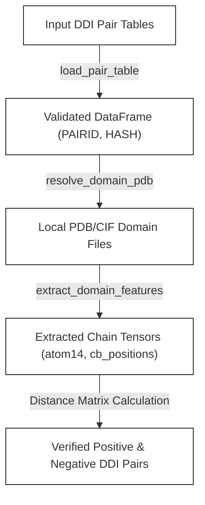

# Dataset Preparation Scripts

<details>
<summary>Relevant source files</summary>

The following files were used as context for generating this wiki page:

- [scripts/prepare_afdb_entries.py](scripts/prepare_afdb_entries.py)
- [scripts/prepare_inference_embeddings.py](scripts/prepare_inference_embeddings.py)
- [scripts/prepare_pdb_entries.py](scripts/prepare_pdb_entries.py)
- [scripts/prepare_plm_embeddings.py](scripts/prepare_plm_embeddings.py)
- [scripts/uniprot_sequence.py](scripts/uniprot_sequence.py)
- [scripts/uniprot_sprot.fasta.gz](scripts/uniprot_sprot.fasta.gz)

</details>


### Purpose and Scope

The `scripts/` directory houses the standalone pipelines responsible for raw data ingestion, structural feature extraction, sequence similarity filtering, protein language model (pLM) embedding generation, and external database retrieval. These scripts transform raw public databases (such as RCSB PDB, AFDB, and UniProt) into preprocessed, tensorized datasets optimized for efficient training and inference within SurPass.

---

### 1. PDB Entry Preparation Pipeline

The PDB preparation pipeline downloads structural metadata, parses sequence databases, filters out redundancies against external test sets using MMSeqs2, and identifies interacting protein-protein interfaces (PPI).

The ingestion and retrieval process is managed by `DataRetriever` [scripts/prepare_pdb_entries.py:49-107], which downloads metadata like sequence sets, resolution indices, source maps, and SIFTS cross-references [scripts/prepare_pdb_entries.py:57-88]. Unzipping and parsing operations are handled via helper methods such as `download_metadata()` [scripts/prepare_pdb_entries.py:90-97] and `_read_fasta_records()` [scripts/prepare_pdb_entries.py:135-155].

```mermaid
graph TD
    A["Raw PDB Metadata Sources"] -->|DataRetriever.download_metadata| B["Compressed Files in root_dir"]
    B -->|DataRetriever.unzip_metadata| C["Unzipped FASTA & TSV Index Files"]
    C -->|PDBDataSelector._read_fasta_records| D["Parsed PDB Chains"]
    D -->|MMSeqs2 Filter (30% Identity)| E["Filtered Non-Redundant Chains"]
    E -->|Atom Distance < 4.5A| F["Verified Interacting PPI Pairs"]

    classDef default fill:#fff,stroke:#000,stroke-width:1px;
```
*Sources: [scripts/prepare_pdb_entries.py:49-155]*

---

### 2. AFDB Domain Verification and DDI Processing

For AlphaFold Database (AFDB) domain-domain interactions (DDI), `scripts/prepare_afdb_entries.py` processes local domain structures without web downloads, verifying domain integrity and computing pairwise distance labels.

Pair metadata tables are loaded and validated via `load_pair_table()` [scripts/prepare_afdb_entries.py:95-118], which checks for required columns (`PAIRID`, `HASH`, `CLUSTER`, `LEN`) and handles malformed entries. Domain structures are resolved from sharded directories using `resolve_domain_pdb()` [scripts/prepare_afdb_entries.py:157-163], and structural features are extracted via `extract_domain_features()` [scripts/prepare_afdb_entries.py:166-192].


*Sources: [scripts/prepare_afdb_entries.py:95-192]*

---

### 3. MMSeqs2 Clustering and Similarity Filtering

Both PDB and AFDB preparation pipelines integrate MMSeqs2 to enforce strict sequence separation between training datasets and test sets. 

Sequences are clustered or searched against benchmark sets at a 30% sequence identity threshold. The pipeline groups homodimers and heterodimers separately, removing any training chains that share high similarity with evaluation benchmarks to prevent data leakage. Cluster outputs and duplicate mappings are subsequently serialized into `.tsv` files for downstream balancing scripts.

*Sources: [scripts/prepare_pdb_entries.py:1-46], [scripts/prepare_afdb_entries.py:30-41]*

---

### 4. Protein Language Model (pLM) Embedding Generation

SurPass utilizes pre-computed residue embeddings derived from the ESMC-6B model (`biohub/ESMC-6B`) [scripts/prepare_plm_embeddings.py:32]. The codebase provides two embedding generators: `scripts/prepare_plm_embeddings.py` for training dataset features and `scripts/prepare_inference_embeddings.py` for inference FASTA files.

```mermaid
graph TD
    A["FASTA Records / PDB Pickles"] -->|_embed_on_devices / embed_sequences| B["load_esmc (ESMC-6B Model & Tokenizer)"]
    B -->|Forward Pass in Inference Mode| C["Hidden States Extraction"]
    C -->|Token Filtering (Remove BOS/EOS/Pad)| D["Residue Matrix [length, hidden]"]
    D -->|save_embedding / tensorize_feature_dict| E["Saved PyTorch Tensor File (.pt)"]

    classDef default fill:#fff,stroke:#000,stroke-width:1px;
```
*Sources: [scripts/prepare_plm_embeddings.py:84-124], [scripts/prepare_inference_embeddings.py:86-98]*

#### Core Embedding Functions
* `load_esmc(model_name, device)`: Instantiates `EsmcForMaskedLM` and `EsmcTokenizer` in evaluation mode [scripts/prepare_plm_embeddings.py:84-89].
* `embed_sequences(model, tokenizer, sequences)`: Tokenizes input sequences, executes model inference, strips special tokens (`BOS`, `EOS`, and padding), and returns a list of CPU float tensors of shape `[length, hidden]` [scripts/prepare_plm_embeddings.py:92-115].
* `_embed_shard(...)`: Manages multi-GPU parallelization by splitting pending records into contiguous shards assigned to distinct CUDA devices [scripts/prepare_plm_embeddings.py:165-203].

*Sources: [scripts/prepare_plm_embeddings.py:84-203], [scripts/prepare_inference_embeddings.py:1-163]*

---

### 5. UniProt Sequence Fetching Utility

`scripts/uniprot_sequence.py` is a standalone utility that queries the UniProt REST API (`https://rest.uniprot.org`) to fetch protein records and extract amino-acid sequences [scripts/uniprot_sequence.py:17-59].

* `fetch_entry(accession, output_dir, dataset, timeout)`: Downloads JSON entries for specific UniProt accessions using `wget` [scripts/prepare_inference_embeddings.py:21-38].
* `extract_sequence(entry)`: Parses the JSON payload to retrieve the sequence string [scripts/prepare_inference_embeddings.py:50-59].
* `format_fasta(label, sequence, width)`: Formats sequences into standard FASTA format with configurable line width wrapping [scripts/prepare_inference_embeddings.py:71-78].

*Sources: [scripts/uniprot_sequence.py:1-79]*

---