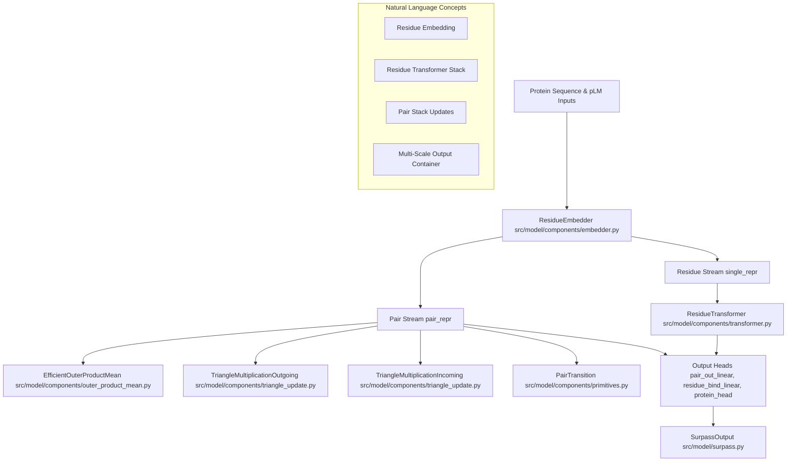
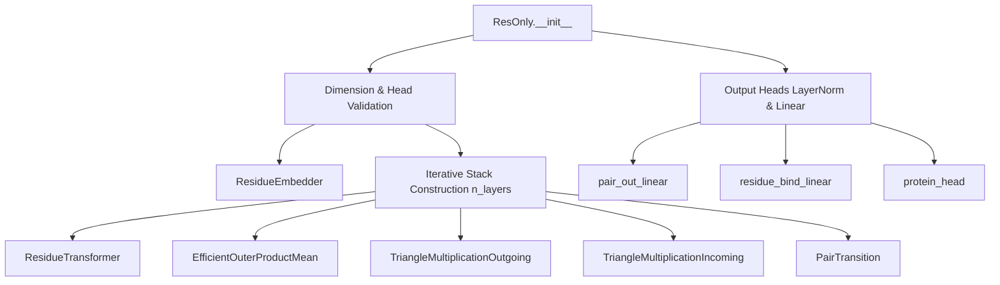
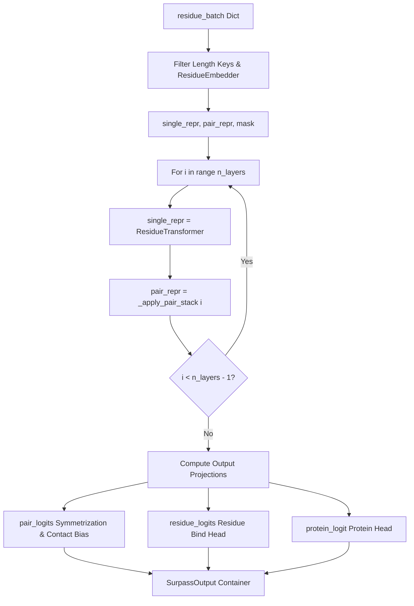

# ResOnly Model and SurpassOutput

Relevant source files

The following files were used as context for generating this wiki page:

- [src/model/surpass.py](src/model/surpass.py)

### Purpose and Scope
This section details the primary network architecture of the codebase, centered around the `ResOnly` module and its associated output container, `SurpassOutput`. The `ResOnly` model integrates residue-level sequence embeddings with pair-level representations through an alternating stack of residue transformers and pair-updating modules (outer product mean, triangle updates, and pair transitions). It produces multi-level predictions including distograms, residue binding logits, and protein-level interaction scores.

Sources: `[src/model/surpass.py:1-194]()`

---

## 1. Output Container: `SurpassOutput`

The `SurpassOutput` dataclass encapsulates the multi-scale predictions generated during the forward pass of the `ResOnly` network.

*   `pair_logits` (`torch.Tensor`): Logits representing pairwise distances or contact distributions between residues.
*   `residue_logits` (`torch.Tensor`): Logits indicating residue-level binding or interface propensity.
*   `protein_logit` (`torch.Tensor`): A global logit representing the protein-protein interaction likelihood for the complex.
*   `pair_mask` (`torch.Tensor`): Boolean mask indicating valid pairs of residues.

Sources: `[src/model/surpass.py:20-27]()`

---

## 2. Natural Language Space to Code Entity Space: Architecture Mapping

The following diagram maps high-level architectural concepts to their precise classes and modules defined in the codebase.

Sources: `[src/model/surpass.py:8-15]`, `[src/model/surpass.py:20-27]`, `[src/model/surpass.py:68-129]()`

---

## 3. Model Initialization and Hyperparameters

The `ResOnly` class initializes dimensions, attention heads, and module lists for the multi-layer network.

Sources: `[src/model/surpass.py:28-132]()`

### Parameter Validation & Configuration
During `__init__`, `ResOnly` enforces several structural rules:
*   `dim_token` must be cleanly divisible by `n_heads` (`[src/model/surpass.py:48-51]()`).
*   `num_classes` must match `xt_pair_dist_dim` (`[src/model/surpass.py:52-58]()`).
*   `contact_bins` must be within the range `1..num_classes` (`[src/model/surpass.py:59-62]()`).

Component modules are instantiated across `n_layers`:
*   `self.residue_blocks`: A `nn.ModuleList` of `ResidueTransformer` instances (`[src/model/surpass.py:75-88]()`).
*   `self.outer_product_mean`: A `nn.ModuleList` of `EfficientOuterProductMean` instances (`[src/model/surpass.py:90-96]()`).
*   `self.triangle_multiplication_outgoing`: A `nn.ModuleList` of `TriangleMultiplicationOutgoing` instances (`[src/model/surpass.py:98-104]()`).
*   `self.triangle_multiplication_incoming`: A `nn.ModuleList` of `TriangleMultiplicationIncoming` instances (`[src/model/surpass.py:105-111]()`).
*   `self.pair_blocks`: A `nn.ModuleList` of `PairTransition` instances (`[src/model/surpass.py:112-118]()`).

Parameters for OPM and pair transition linear layers are zero-initialized via `reset_parameters()` (`[src/model/surpass.py:133-142]()`).

Sources: `[src/model/surpass.py:28-142]()`

---

## 4. Forward Pass Execution Flow

The forward pass processes a residue batch dictionary, executes the alternating residue-pair block stack, and computes final outputs.

Sources: `[src/model/surpass.py:143-192]()`

### Step-by-Step Data Flow
1.  **Embedding Extraction**: Length keys (`p1_length`, `p2_length`) are filtered out of the residue batch before passing inputs to `residue_embedder` (`[src/model/surpass.py:147-152]()`).
2.  **Mask Generation**: The returned mask is converted to a boolean tensor, and a pairwise mask (`pair_mask`) is derived via outer boolean conjunction (`[src/model/surpass.py:153-155]()`).
3.  **Iterative Layer Stack**: For each layer up to `n_layers`:
    *   `single_repr` is updated through `ResidueTransformer` (`[src/model/surpass.py:158-163]()`).
    *   `pair_repr` is updated through the pair stack via `_apply_pair_stack` (`[src/model/surpass.py:164-170]()`).
4.  **Pair Logits Projection**: Pair representations are normalized using `pair_out_layernorm`, projected via `pair_out_linear`, symmetrized, and adjusted with contact bin biases (`[src/model/surpass.py:172-180]()`).
5.  **Residue Logits Projection**: Single representations are normalized via `residue_bind_norm` and projected through `residue_bind_linear` to produce residue-level logits, masked out for invalid positions (`[src/model/surpass.py:175-178]()`).
6.  **Protein Logit Computation**: Global protein-level interaction scores are computed by `_protein_logit` using concatenated representations and sequence lengths (`[src/model/surpass.py:181-186]()`).

Sources: `[src/model/surpass.py:143-192]()`

---

## 5. Output Heads and Post-Processing

*   **Pair Symmetrization**: Raw pair logits are symmetrized by averaging with their transposed counterpart:
    $$\text{logits} = \frac{\text{logits} + \text{logits}^T}{2}$$
    `[src/model/surpass.py:173-174]()`
*   **Protein Head**: Implemented as a sequential network consisting of a `LayerNorm` (operating on `dim_token * 3`), a `Linear` projection to `dim_token`, a `GELU` activation, and a final `Linear` projection to `1` (`[src/model/surpass.py:124-129]()`).

Sources: `[src/model/surpass.py:124-129]`, `[src/model/surpass.py:172-192]()`

---