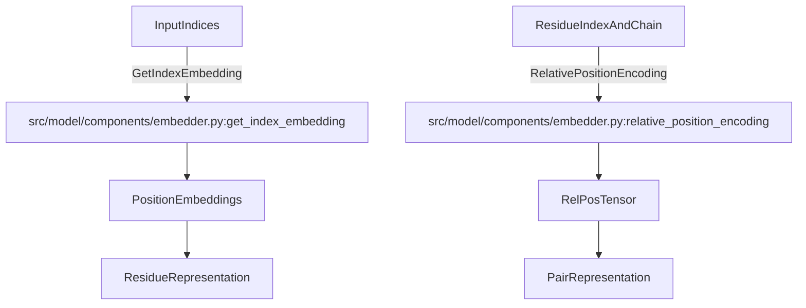
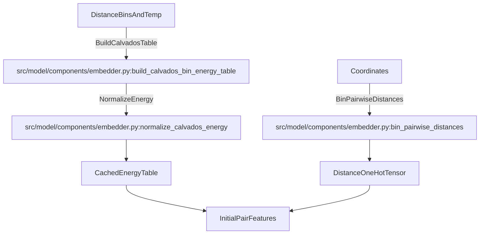

# Embedding Layer

<details>
<summary>Relevant source files</summary>

The following files were used as context for generating this wiki page:

- [src/model/components/embedder.py](src/model/components/embedder.py)
- [src/model/components/rotary.py](src/model/components/rotary.py)

</details>


## Purpose and Scope
The embedding layer constructs initial representations for residues and residue pairs in the SurPass architecture. It processes protein language model (pLM) embeddings, categorical residue types, absolute indices, chain identifiers, and biophysical energy calculations (via CALVADOS) to produce rich starting tensors for downstream transformer and pair-stack modules.

Sources: `src/model/components/embedder.py:1-203`

---

## Positional and Index Embeddings

Positional information is integrated via sine/cosine index embeddings and relative position encodings that account for chain boundaries and sequence separations up to a maximum distance parameter `r_max`.

### Absolute Index Embeddings
The function `get_index_embedding` computes standard sinusoidal positional encodings for a given set of integer indices:
- Takes `indices` of shape `[n]` or `[b, n]`.
- Computes sinusoidal frequencies across dimension `edim`.
- Returns positional embeddings of shape `[n, edim]` or `[b, n, edim]`.

```python
def get_index_embedding(indices, edim, max_len=2056):
    ...
```
*Implementation reference:* `src/model/components/embedder.py:120-149`

### Relative Position Encoding
The function `relative_position_encoding` constructs pairwise relative representations combining token distance, residue index offsets, and chain identity flags:
- `same_chain_mask`: Binary indicator of whether two residues belong to the same chain (`src/model/components/embedder.py:162`).
- `d_residue`: Clipped residue index difference bounded by `r_max` (`src/model/components/embedder.py:166-169`).
- `d_token`: Global position encoding offset (`src/model/components/embedder.py:175-178`).
- Outputs a concatenated one-hot feature tensor `rel_pos` of shape `[b, n, n, 2 + 4 * (r_max + 1)]` masked by valid pair masks (`src/model/components/embedder.py:183-184`).

Sources: `src/model/components/embedder.py:120-185`

---

## Biophysical Potential Integration (CALVADOS)

To incorporate physical priors into pairwise representations, the embedding module computes residue-residue interaction energies using the CALVADOS model (Ashbaugh-Hatch hydrophobic interactions and Yukawa electrostatic potentials).

- `normalize_calvados_energy`: Applies $\text{arcsinh}(E/kT)$ compression to maintain linear behavior in attractive wells while compressing Lennard-Jones walls (`src/model/components/embedder.py:30-32`).
- `build_calvados_bin_energy_table`: Generates a cached `[20, 20, dim]` tensor of pairwise energy values mapped across distance bins (`src/model/components/embedder.py:94-116`).
- `_cached_calvados_bin_energy_table`: Uses `lru_cache` to avoid redundant physics re-computations (`src/model/components/embedder.py:84-91`).

Sources: `src/model/components/embedder.py:30-117`

---

## Pairwise Distance Binning

Pairwise Euclidean distances computed from residue coordinates are discretized into one-hot histograms using linear binning limits:
- `bin_pairwise_distances`: Calculates pairwise distance matrices of shape `[b, n, n]` from coordinate tensors `[b, n, 3]` and maps them to one-hot bin representations (`src/model/components/embedder.py:187-203`).

Sources: `src/model/components/embedder.py:187-203`

---

## System-to-Code Mapping Diagrams

### Diagram 1: Positional and Relative Encoding Flow

Sources: `src/model/components/embedder.py:120-185`

### Diagram 2: Biophysical Energy and Distance Binning Pipeline

Sources: `src/model/components/embedder.py:30-117, src/model/components/embedder.py:187-203`

---