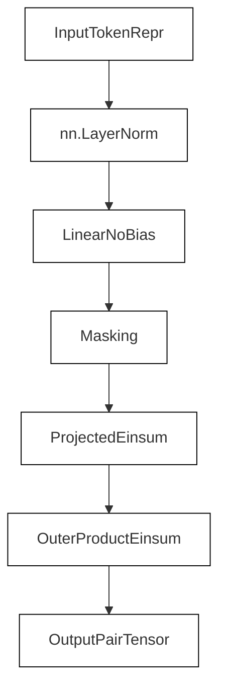
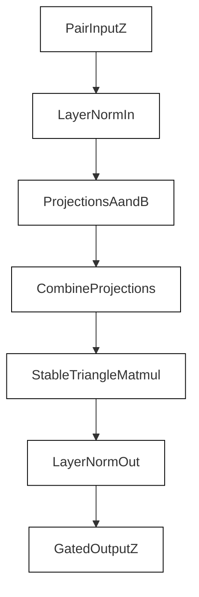

# Pair Stack: Outer Product Mean and Triangle Updates

<details>
<summary>Relevant source files</summary>

The following files were used as context for generating this wiki page:

- [src/model/components/outer_product_mean.py](src/model/components/outer_product_mean.py)
- [src/model/components/triangle_update.py](src/model/components/triangle_update.py)
- [src/model/optimizer.py](src/model/optimizer.py)
- [src/utils/model_utils.py](src/utils/model_utils.py)
- [src/utils/nan_monitor.py](src/utils/nan_monitor.py)

</details>


This section details the components responsible for updating the pair representation tensor ($Z$) within the SurPass architecture. Specifically, it covers the memory-efficient outer product mean (`EfficientOuterProductMean`), triangle multiplicative updates for outgoing and incoming paths (`TriangleMultiplicationOutgoing` and `TriangleMultiplicationIncoming`), numerical stabilization via `_stable_triangle_matmul`, and their coordination within the model's pair stack.

---

## 1. Efficient Outer Product Mean (`EfficientOuterProductMean`)

The outer product mean translates token-level (residue stream) representations into pair-level updates without materializing the massive intermediate $[N_{res}, N_{res}, C_{hidden}, C_{hidden}]$ tensor required by traditional implementations. 

`EfficientOuterProductMean` normalizes the input token representation, projects it to a hidden channel dimension without bias, and computes the outer product using batched Einstein summation (`torch.einsum`) [src/model/components/outer_product_mean.py:25-47]().


*Diagram 1: Data flow in `EfficientOuterProductMean` mapping conceptual steps to tensor operations.*

Sources: `src/model/components/outer_product_mean.py:25-47`

---

## 2. Triangle Multiplicative Updates

Triangle updates propagate structural information across graph edges (pairs) by enforcing triangular inequalities. SurPass implements both outgoing and incoming variants derived from AlphaFold architectures [src/model/components/triangle_update.py:24-121]().

### Base Class: `TriangleMultiplicativeUpdate`
The base module performs LayerNorm on the input pair tensor $z$, computes two separate linear projections $a$ and $b$ modulated by gating sigmoid networks, combines them, applies another LayerNorm and output projection, and gates the final residual output [src/model/components/triangle_update.py:24-90]().

### Outgoing Update (`TriangleMultiplicationOutgoing`)
Implements the outgoing triangle multiplicative update by overriding `_combine_projections` using `_stable_triangle_matmul` on permuted final dimensions [src/model/components/triangle_update.py:92-106]().

### Incoming Update (`TriangleMultiplicationIncoming`)
Implements the incoming triangle multiplicative update by modifying the transposition permutation order prior to contractive multiplication [src/model/components/triangle_update.py:108-121]().


*Diagram 2: Processing pipeline for `TriangleMultiplicativeUpdate` subclasses.*

Sources: `src/model/components/triangle_update.py:24-122`

---

## 3. Stable Triangle Matrix Multiplication

To prevent numerical overflow or `Inf` propagation through LayerNorm layers during matrix contraction over the hidden dimension $K$, `_stable_triangle_matmul` executes the contraction in single-precision (`fp32`) and scales the output by $\frac{1}{\sqrt{K}}$ [src/model/components/triangle_update.py:15-22]().

```python
def _stable_triangle_matmul(a: torch.Tensor, b: torch.Tensor) -> torch.Tensor:
    k = int(a.shape[-1])
    out = torch.matmul(a.float(), b.float())
    if k > 0:
        out = out * (float(k) ** -0.5)
    return out
```

Sources: `src/model/components/triangle_update.py:15-22`

---

## 4. Code Entity Mapping & Integration

The following mapping associates the natural language concepts of pair stack operations with their concrete classes and helper functions in the codebase.

| Conceptual Operation / Component | Code Entity (Class / Function) | File Path |
| :--- | :--- | :--- |
| Memory-Efficient OPM | `EfficientOuterProductMean` | `src/model/components/outer_product_mean.py:25` |
| Standard Chunked OPM | `OuterProductMean` | `src/model/components/outer_product_mean.py:49` |
| Stable Triangle Matmul | `_stable_triangle_matmul` | `src/model/components/triangle_update.py:15` |
| Triangle Outgoing Update | `TriangleMultiplicationOutgoing` | `src/model/components/triangle_update.py:92` |
| Triangle Incoming Update | `TriangleMultiplicationIncoming` | `src/model/components/triangle_update.py:108` |
| Tensor Dimension Permutation | `permute_final_dims` | `src/model/components/triangle_update.py:9` |

Sources: `src/model/components/outer_product_mean.py:25-75`, `src/model/components/triangle_update.py:9-122`

---