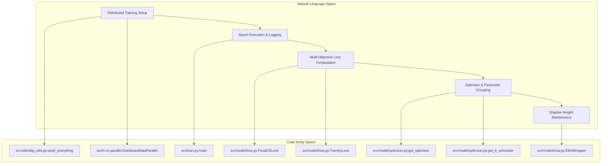
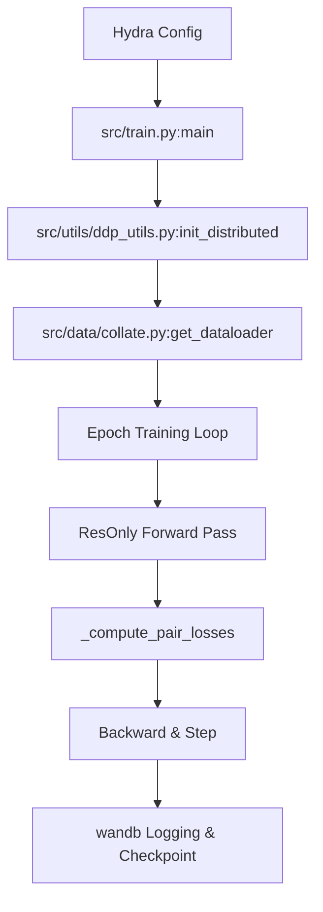
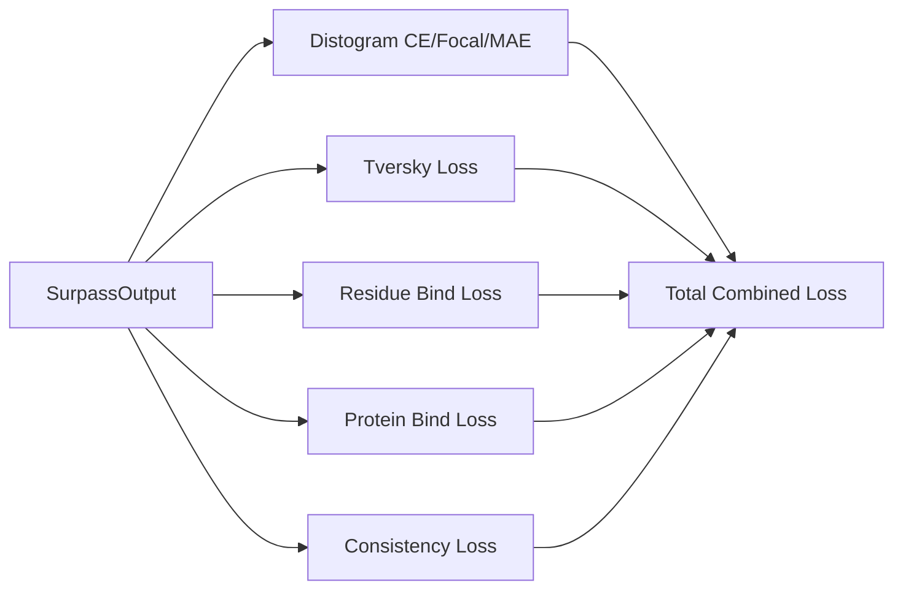
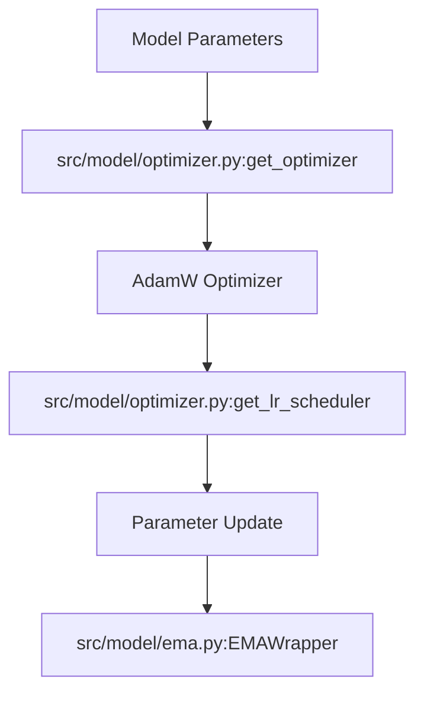

# Training System

Relevant source files

The following files were used as context for generating this wiki page:

- [src/train.py](src/train.py)

## Purpose and Scope

The Training System of SurPass orchestrates end-to-end model optimization, coordinating distributed data parallelism, multi-objective loss computation, specialized parameter grouping, learning rate scheduling, and Exponential Moving Average (EMA) weight tracking [src/train.py:1-36](). It binds dataset pipelines to the `ResOnly` architecture [src/train.py:35](), supervising both residue-level and inter-chain pairwise representations [src/train.py:168-182]().

This page provides a high-level overview of the training infrastructure. For detailed technical specifications, implementation routines, and mathematical formulations, refer to the child pages:
- [Training Loop and Distributed Execution](#4.1)
- [Loss Functions and Objectives](#4.2)
- [Optimizer, LR Schedules and EMA](#4.3)

---

## Architecture to Code Mapping

The following diagram illustrates how conceptual training operations map directly to codebase entities within `src/train.py`, `src/model/loss.py`, `src/model/optimizer.py`, and `src/model/ema.py`.

*Sources: [src/train.py:1-36](), [src/model/loss.py:1-50](), [src/model/optimizer.py:1-50](), [src/model/ema.py:1-40]()*

---

## 4.1 Training Loop and Distributed Execution

The training entrypoint is anchored in `src/train.py`, managing distributed execution across multiple ranks using PyTorch DDP (`DistributedDataParallel`) [src/train.py:11](). It initializes environment seeds [src/train.py:36](), constructs distributed dataloaders with `DistributedWeightedSampler` [src/train.py:20](), executes training and evaluation epochs, handles gradient accumulation, and logs metrics (such as AUROC and AUPRC via scikit-learn [src/train.py:7-112]()) to Weights & Biases (`wandb`) [src/train.py:15-18]().

For detailed coverage of the training loop, DDP configuration, epoch cycles, checkpoint management, and metrics evaluation, see [Training Loop and Distributed Execution](#4.1).

*Sources: [src/train.py:6-36](), [src/data/collate.py:21-25]() *

---

## 4.2 Loss Functions and Objectives

SurPass optimizes complex protein-protein interactions using a composite loss formulation defined in `src/model/loss.py`. The objective suite combines distogram supervision via Cross-Entropy, Focal loss, and Mean Absolute Error (MAE) [src/train.py:23-32](), along with Tversky loss [src/train.py:29]() to handle class imbalance in contact maps. Specialized binding losses (`ResidueBindLoss`, `ProteinBindLoss`) [src/train.py:27-28]() and consistency regularizers [src/train.py:24]() supervise inter-chain and intra-chain spatial relationships.

For a thorough breakdown of target generation, distance binning, masking strategies, and loss equations, see [Loss Functions and Objectives](#4.2).

*Sources: [src/train.py:23-32](), [src/model/loss.py:1-100]()*

---

## 4.3 Optimizer, LR Schedules and EMA

Optimization and hyperparameter scheduling are modularized in `src/model/optimizer.py` and `src/model/ema.py`. The `get_optimizer` function constructs an `AdamW` optimizer with customized parameter grouping (e.g., separating weight decay for normalization layers or biases) [src/train.py:34](). Learning rate scheduling supports AlphaFold3-style warmups and cosine decay schedules via `get_lr_scheduler` [src/train.py:34](). Furthermore, `EMAWrapper` maintains shadow copies of model weights to stabilize evaluation and inference performance [src/train.py:33]().

For full details on parameter filtering, optimizer configuration, schedule curves, and EMA weight updating rules, see [Optimizer, LR Schedules and EMA](#4.3).

*Sources: [src/train.py:33-34](), [src/model/optimizer.py:1-60](), [src/model/ema.py:1-49]()*

---