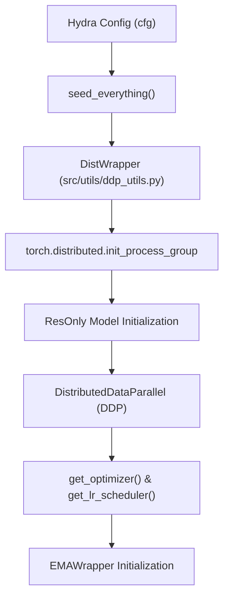
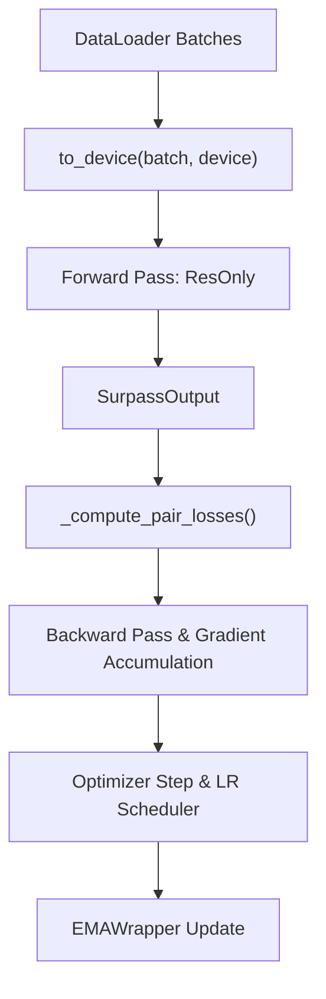
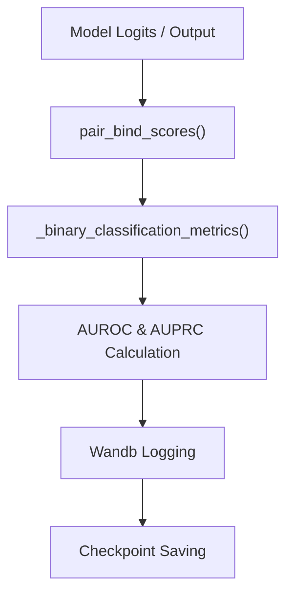

# Training Loop and Distributed Execution

Relevant source files

The following files were used as context for generating this wiki page:

- [src/train.py](src/train.py)
- [src/utils/ddp_utils.py](src/utils/ddp_utils.py)

This page documents the training system entry point, distributed data parallel (DDP) initialization, epoch execution routines (`train_epoch` and `evaluate_epoch`), gradient accumulation, checkpoint management, Weights & Biases (`wandb`) integration, and performance metric computation.

---

## 1. Initialization and Distributed Execution Setup

The training pipeline is initiated via the Hydra-configured entry point function `main()` in `src/train.py`. The setup process configures deterministic random seeding, detects and initializes distributed training environments, wraps models with PyTorch's `DistributedDataParallel` (DDP), and instantiates optimizers, learning rate schedulers, and exponential moving average (EMA) wrappers.

Distributed execution metadata is managed by the `DistWrapper` class [src/utils/ddp_utils.py:12-34](), which inspects environment variables like `RANK`, `LOCAL_RANK`, `WORLD_SIZE`, and `LOCAL_WORLD_SIZE`.

*Sources: [src/train.py:1-50](), [src/utils/ddp_utils.py:1-49]()*

The function `seed_everything(seed, deterministic)` sets random seeds across `random`, `numpy`, and `torch`, and configures CuDNN determinism when requested [src/utils/ddp_utils.py:37-49](). Log messages are filtered by rank via `log_info(message)` to ensure only rank 0 writes to standard output [src/train.py:47-50]().

---

## 2. Epoch Execution: Training and Evaluation Loops

Data loading leverages distributed sampling (`DistributedWeightedSampler`) combined with `get_dataloader` [src/train.py:20-21](). Tensors are moved to the target hardware accelerator device using `to_device(obj, device)` [src/train.py:60-74](), supporting nested dictionaries and individual tensors.

*Sources: [src/train.py:60-193]()*

During the training epoch:
1. Batches are fetched from the distributed data loader.
2. Inputs are transferred to the accelerator device using `to_device` [src/train.py:60-74]().
3. The forward pass computes residue and pair representations through the `ResOnly` model, returning a `SurpassOutput` container [src/train.py:35]().
4. Losses are computed via helper routines like `_compute_pair_losses` [src/train.py:168-193](), which evaluates specific loss terms (such as distogram cross-entropy, focal loss, Tversky loss, and binding objectives).
5. Gradient accumulation and optimizer stepping update model weights, followed by EMA shadow weight updates via `EMAWrapper` [src/train.py:33]().

---

## 3. Metrics, Logging, and Checkpointing

Evaluation routines assess model performance on validation sets without updating model weights. Key validation tasks include binary classification metrics calculation and residue/protein-level contact scoring.

*Sources: [src/train.py:77-113](), [src/train.py:140-165]()`

### Key Evaluation Functions
* `_binary_classification_metrics(scores, target, positive_weight)`: Computes Receiver Operating Characteristic Area Under Curve (AUROC) and Precision-Recall Area Under Curve (AUPRC) using scikit-learn (`roc_curve`, `auc`, `average_precision_score`), supporting optional positive class weighting [src/train.py:92-113]().
* `pair_bind_scores(logits, pair_mask, p1_length, contact_bins, ppi_score_threshold, p2_length)`: Converts distogram logits into contact probabilities via softmax, applies inter-chain masks via `inter_chain_pair_mask` [src/train.py:22](), and extracts maximum binding probabilities (`p_bind`) and contact counts (`n_contacts`) [src/train.py:140-165]().
* `_region_masks(pair_mask, label_mask, p1_length, p2_length)`: Separates contact and pair maps into intra-chain and inter-chain regions to isolate protein-protein interaction (PPI) supervision signals [src/train.py:115-137]().

Logging is integrated with `wandb` (Weights & Biases) when available [src/train.py:15-18](), tracking training loss components, learning rates, and validation metrics across distributed ranks. Checkpoints capture model weights, optimizer states, scheduler states, and EMA parameters.

*Sources: [src/train.py:1-193](), [src/utils/ddp_utils.py:1-49]()*

---