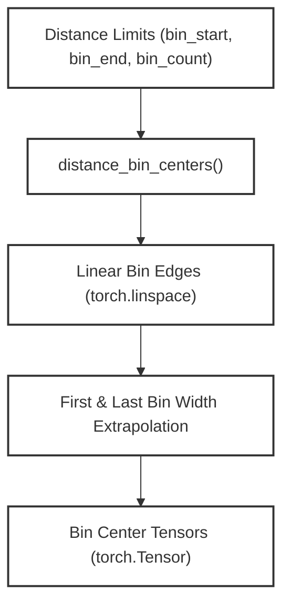
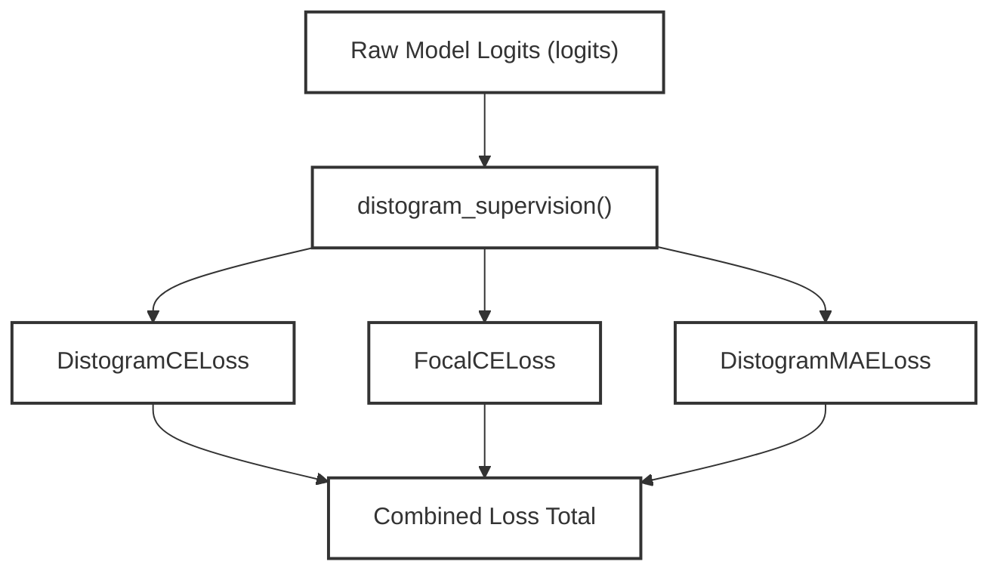

# Loss Functions and Objectives

<details>
<summary>Relevant source files</summary>

The following files were used as context for generating this wiki page:

- [configs/train.yaml](configs/train.yaml)
- [src/model/loss.py](src/model/loss.py)

</details>


## Purpose and Scope

This page documents the loss functions, target generation schemes, masking strategies, and supervision objectives implemented in SurPass for training protein-protein interaction (PPI) and inter-chain contact prediction models. The loss architecture balances local intra-chain geometry with global inter-chain contacts using a combination of distogram cross-entropy, focal cross-entropy, mean absolute error (MAE) on expected distances, Tversky similarity for contact maps, residue-level and protein-level binding heads, and consistency regularizers.

Sources: [`configs/train.yaml:69-91](), [`src/model/loss.py:1-197]()

---

## Loss Configuration & Hyperparameters

The loss configuration is defined in `configs/train.yaml` under the `loss` block. These hyperparameters dictate the relative weighting of intra-chain versus inter-chain components, focal modulation parameters, and specialized binding objectives.

```yaml
loss:
  intra: 0.3
  inter: 0.7
  inter_neg_per_pos: 10.0
  focal:
    weight: 1.0
    gamma: 1.5
    alpha: 5.0
  mae:
    weight: 0.2
  tversky:
    weight: 1.0
    alpha: 0.7
    beta: 0.3
  residue_bind:
    weight: 1.0
    neg_per_pos: 0.0
    negative_pair_weight: 0.25
  protein:
    weight: 1.0
  consistency:
    weight: 0.1
```

Sources: [`configs/train.yaml:69-91]()

---

## Target Generation and Distance Binning

Pairwise distances are discretized into bins to formulate classification and regression targets. The function `distance_bin_centers()` computes the center of each distance bin given linear spacing limits.


*Figure 1: Natural Language to Code Entity Space mapping for distance binning.*

The distance bin centers and supervision flags are initialized in `src/model/loss.py`:
- `distance_bin_centers()` [src/model/loss.py:6-26]: Constructs bin centers for regression and evaluation.
- `distogram_supervision()` [src/model/loss.py:78-92]: Derives contact indicators (`is_contact`), softmax probabilities (`pair_probs`), and contact probabilities (`contact_probability`) from raw network logits.

Sources: [`src/model/loss.py:6-92]()

---

## Distance and Contact Loss Modules

SurPass employs several loss modules operating on pairwise logits and target bins, partitioned by intra-chain and inter-chain masks.

### 1. Distogram Cross-Entropy (`DistogramCELoss`)
Calculates masked cross-entropy over pairwise distance bins across the predicted logit tensor and target bins [src/model/loss.py:113-129].

```python
class DistogramCELoss(nn.Module):
    def forward(self, logits, target_bins, mask):
        loss = F.cross_entropy(
            logits.permute(0, 3, 1, 2),
            target_bins.long(),
            reduction="none",
        )
        return _masked_mean(loss, mask)
```

### 2. Focal Cross-Entropy (`FocalCELoss`)
Applies modulating factors to address class imbalance between contact and non-contact pairs, scaling losses by a contact-bin `alpha` factor and modulating by `(1 - p_t)^gamma` [src/model/loss.py:131-172]. It returns separate intra-chain and inter-chain losses.

### 3. Distogram Mean Absolute Error (`DistogramMAELoss`)
Computes the L1 error between the expected distance (calculated via softmax probabilities over `bin_centers`) and the target bin center, masked appropriately [src/model/loss.py:174-197].


*Figure 2: Loss computation data flow through supervision and individual loss modules.*

Sources: [`src/model/loss.py:113-197]()

---

## Masking and Partitioning

Loss calculations are strictly governed by masks to isolate intra-chain contacts from inter-chain interactions:
- **Intra-chain Mask (`intra_mask`)**: Restricts loss evaluation to residue pairs belonging to the same protein chain.
- **Inter-chain Mask (`inter_mask`)**: Restricts loss evaluation to residue pairs spanning different interacting chains.
- **Masked Mean (`_masked_mean`)**: Normalizes loss sums by the count of valid unmasked elements, clamping the denominator to a minimum of `1.0` to avoid division by zero [src/model/loss.py:29-32].

Sources: [`src/model/loss.py:29-32](), [`src/model/loss.py:131-197]()

---