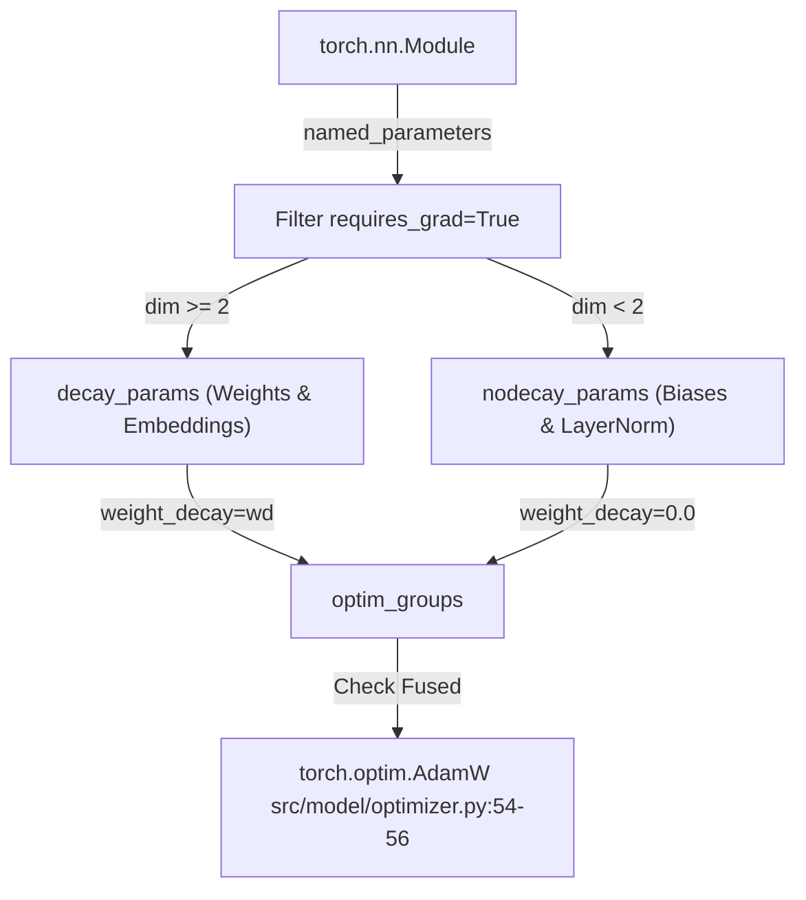
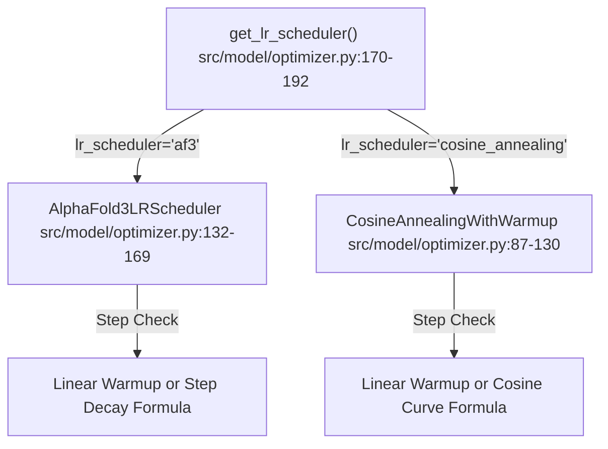

# Optimizer, LR Schedules and EMA

<details>
<summary>Relevant source files</summary>

The following files were used as context for generating this wiki page:

- [src/model/components/triangle_update.py](src/model/components/triangle_update.py)
- [src/model/ema.py](src/model/ema.py)
- [src/model/optimizer.py](src/model/optimizer.py)
- [src/utils/model_utils.py](src/utils/model_utils.py)

</details>


## Purpose and Scope

This page documents the training optimization infrastructure in SurPass, located in `src/model/optimizer.py` and `src/model/ema.py`. It covers parameter grouping strategies for weight decay in `get_adamw`, standard and fused optimizer initialization (`get_optimizer`), learning rate schedules (`AlphaFold3LRScheduler` and `CosineAnnealingWithWarmup`), and shadow weight management via `EMAWrapper`.

---

## 1. Optimizer Configuration and Parameter Grouping

The optimization setup distinguishes between weights that benefit from L2 regularization (weight decay) and those that do not (biases and layer normalization parameters). 

### Parameter Grouping in `get_adamw`
The function `get_adamw()` inspects model parameters that require gradients (`[src/model/optimizer.py:30-33]()`). It separates them into two distinct groups based on tensor dimensionality (`[src/model/optimizer.py:34-41]()`):
- **Decay Parameters**: Tensors with dimensionality $\ge 2$ (such as weight matrices in matrix multiplications and embedding layers) receive the specified `weight_decay`.
- **Non-Decay Parameters**: Tensors with dimensionality $< 2$ (such as biases and LayerNorm parameters) have their `weight_decay` set explicitly to `0.0`.

Additionally, `get_adamw()` checks for CUDA availability and fused optimizer support in `torch.optim.AdamW`, enabling fused execution (`fused=True`) when possible (`[src/model/optimizer.py:50-57]()`).


*Sources: [src/model/optimizer.py:10-59]()*, *[src/model/optimizer.py:62-84]()*

---

## 2. Learning Rate Schedulers

SurPass provides a factory function `get_lr_scheduler()` (`[src/model/optimizer.py:170-192]()`) that instantiates learning rate schedulers compatible with PyTorch's `LRScheduler` interface.

### AlphaFold3 Learning Rate Scheduler
`AlphaFold3LRScheduler` implements the training schedule described in AlphaFold 3 (`[src/model/optimizer.py:132-141]()`). It features:
- A linear warmup phase during the initial `warmup_steps` (`[src/model/optimizer.py:151-152]()`).
- Periodic step-wise decays every `decay_every_n_steps`, scaling the learning rate by `decay_factor` (`[src/model/optimizer.py:154-155]()`).

### Cosine Annealing with Warmup
`CosineAnnealingWithWarmup` provides a smooth decay profile (`[src/model/optimizer.py:87-114]()`):
- Linear warmup up to `warmup_steps` (`[src/model/optimizer.py:104-105]()`).
- Cosine decay curve down to `min_lr` across `decay_steps` (`[src/model/optimizer.py:109-114]()`).


*Sources: [src/model/optimizer.py:87-192]()*

---

## 3. Exponential Moving Average (EMA) Wrapper

To stabilize model evaluation and improve generalization, `EMAWrapper` (`[src/model/ema.py:4-50]`) maintains an exponential moving average of model weights.

### Lifecycle and Operations
1. **Registration**: `register()` clones the initial parameters of the model into a `self.shadow` dictionary (`[src/model/ema.py:23-26]()`).
2. **Update**: `update()` computes the exponential average at each step:
   $$\theta_{\text{shadow}} = (1 - \text{decay}) \cdot \theta_{\text{param}} + \text{decay} \cdot \theta_{\text{shadow}}$$
   Parameters can be selectively filtered using `mutable_param_keywords` (`[src/model/ema.py:27-38]()`).
3. **Shadow Application**: `apply_shadow()` backs up current model weights to `self.backup` and swaps them with `self.shadow` weights for evaluation (`[src/model/ema.py:39-44]()`).
4. **Restoration**: `restore()` puts the backed-up training weights back into the model (`[src/model/ema.py:45-49]()`).

```mermaid
graph TD
    Init["EMAWrapper.__init__() src/model/ema.py:4-14"] -->|register()| Reg["Clone weights to self.shadow src/model/ema.py:23-26"]
    Reg -->|Training Step| Upd["EMAWrapper.update() src/model/ema.py:27-38"]
    Upd -->|Evaluate Model| Apply["EMAWrapper.apply_shadow() src/model/ema.py:39-44"]
    Apply -->|Resume Training| Rest["EMAWrapper.restore() src/model/ema.py:45-50"]
```
*Sources: [src/model/ema.py:4-49]()*

---