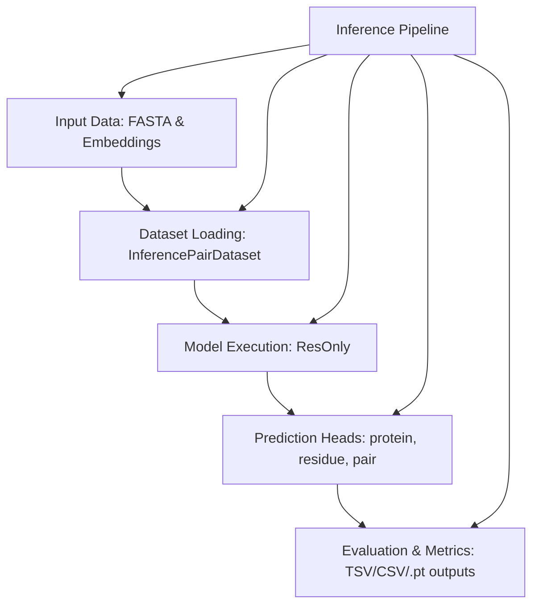
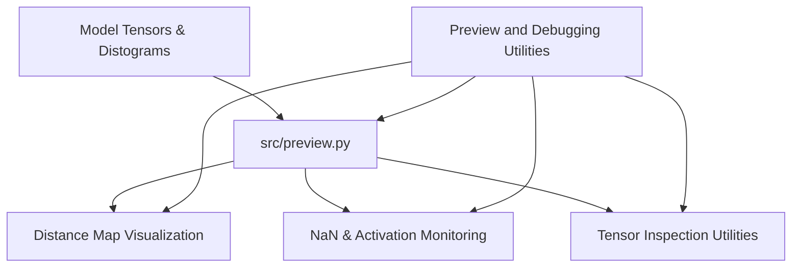

# Inference and Evaluation

Relevant source files

The following files were used as context for generating this wiki page:

- [src/inference.py](src/inference.py)

## Purpose and Scope

Section 5 covers the execution of trained SurPass models on new or benchmark protein pairs, producing protein-, residue-, and pair-level interaction predictions. This workflow handles raw input data ingestion from FASTA files and precomputed protein language model (pLM) embeddings, supports long-sequence tiling via windowing strategies, and provides diagnostic utilities for monitoring tensors and visualizing distance maps.

As a parent page, this section provides a high-level overview of the inference ecosystem. For in-depth technical details, refer to the following child pages:
- [Inference Pipeline](#5.1) — Details on `InferencePairDataset`, dataset loading, prediction heads, and evaluation outputs (`[src/inference.py:157-192]()`).
- [Long-Sequence Windowing](#5.2) — Details on `src/utils/ppi_windows.py` and sequence tiling (`[src/utils/ppi_windows.py:1-50]()`).
- [Preview and Debugging Utilities](#5.3) — Details on `src/preview.py` for distance map visualization and debugging (`[src/preview.py:1-50]()`).

*Figure 5.1: High-level overview of the inference and evaluation pipeline bridging input data files to model prediction outputs.*

Sources: `[src/inference.py:1-192]()`

---

## 5.1. Inference Pipeline

The inference pipeline ingests test set manifests (TSVs) specifying protein pairs, matches them with FASTA sequence records, and loads precomputed pLM embeddings from disk `[src/inference.py:157-192]()`. The `InferencePairDataset` class structures these components into paired inputs suitable for batching via `inference_collate_fn` and `collate_concatenated_pairs` `[src/inference.py:151-192]()`.

Model predictions are evaluated across multiple interaction heads (`protein`, `residue`, and `pair`) defined in `PPI_HEADS` `[src/inference.py:33-46]`. Binary classification metrics and scores are logged and exported to structured formats such as TSV, CSV, or PyTorch tensors.

For comprehensive details on data loading, prediction heads, and evaluation metrics, see [Inference Pipeline](#5.1).

Sources: `[src/inference.py:33-192]()`

---

## 5.2. Long-Sequence Windowing

Protein complexes that exceed standard memory or sequence length limits cannot be processed in a single pass without severe GPU memory constraints. To resolve this, SurPass implements a windowing utility module in `src/utils/ppi_windows.py`.

The function `plan_ppi_windows` computes sliding-window partitions across long chain pairs, enabling localized feature extraction and model inference. The resulting sub-window predictions are subsequently aggregated back to the full sequence length using max-pooled strategies.

For detailed algorithms on tiling schedules, overlapping window management, and aggregation logic, see [Long-Sequence Windowing](#5.2).

Sources: `[src/utils/ppi_windows.py:1-60]()`

---

## 5.3. Preview and Debugging Utilities

SurPass provides dedicated diagnostic utilities in `src/preview.py` to inspect intermediate model states during inference and training. These utilities include distance map generation and visualization helpers, automated NaN and anomaly monitoring for model activations, and tensor utility functions.

These tools allow developers to debug spatial predictions, inspect distogram outputs, and verify tensor shape transformations across network layers.

*Figure 5.2: Diagnostic tooling architecture centering around `src/preview.py` for visualization and tensor inspection.*

For code-level documentation on visualization functions and tensor monitoring routines, see [Preview and Debugging Utilities](#5.3).

Sources: `[src/preview.py:1-50]()`

---