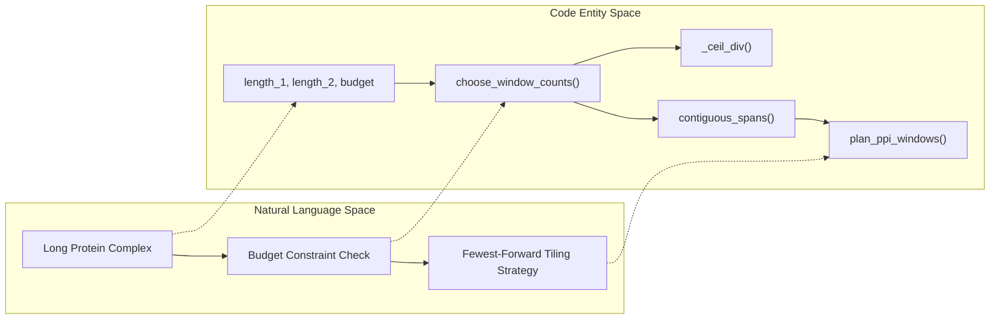

# Long-Sequence Windowing

<details>
<summary>Relevant source files</summary>

The following files were used as context for generating this wiki page:

- [src/inference.py](src/inference.py)
- [src/utils/ppi_windows.py](src/utils/ppi_windows.py)

</details>


## Purpose and Scope

Protein complexes that exceed the maximum inference length budget (`budget`) cannot be processed in a single forward pass without running out of memory or violating model dimension constraints. The module `src/utils/ppi_windows.py` implements a sequence tiling strategy (`plan_ppi_windows`) that divides long protein complexes into smaller, non-overlapping contiguous spatial windows (`contiguous_spans`) while minimizing the total number of model evaluations (forward passes). 

This page details the mathematical and algorithmic design of window planning, chunk generation, and optimization heuristics used during long-sequence inference.

Sources: [src/utils/ppi_windows.py:1-7]()

---

## Window Planning and Tiling Architecture (`src/utils/ppi_windows.py`)

When a protein complex consisting of two chains with lengths `length_1` and `length_2` exceeds the allowed `budget` (defined as the maximum concatenated length of one forward pass), the system must partition the chains. Cutting both chains indiscriminately multiplies the number of required model evaluations (`k1 * k2`). The planner therefore searches for optimal window counts (`count_1`, `count_2`) that satisfy the budget constraint while preferring single-chain splitting over dual-chain splitting.

### Helper Functions: Ceiling Division and Spans

The module relies on basic partitioning primitives:
- `_ceil_div(numerator, denominator)`: Computes the ceiling division integer `(numerator + denominator - 1) // denominator` [src/utils/ppi_windows.py:12-14]().
- `contiguous_spans(length, count)`: Splits an interval `[0, length)` into `count` non-overlapping contiguous spans where span lengths differ by at most one, placing longer spans first [src/utils/ppi_windows.py:16-38]().

```python
# Conceptual view of span generation
def contiguous_spans(length: int, count: int) -> list[tuple[int, int]]:
    ...
```

Sources: [src/utils/ppi_windows.py:12-38]()

### Optimization Strategy: `choose_window_counts`

The core optimization routine `choose_window_counts(length_1, length_2, budget)` iterates over possible window partition counts to find the minimum number of rounds (`k1 * k2`) [src/utils/ppi_windows.py:41-86](). 

Feasibility is determined by the condition:
$$\lceil \text{length\_1} / k_1 \rceil + \lceil \text{length\_2} / k_2 \rceil \le \text{budget}$$

Tie-breaking rules prioritize:
1. Minimizing total forward rounds (`rounds = count_1 * count_2`).
2. Minimizing the rank of single-chain splits (`min(count_1, count_2)`), preferring to cut only one chain rather than both.
3. Cutting the longer chain when applicable [src/utils/ppi_windows.py:71-78]().

Sources: [src/utils/ppi_windows.py:41-86]()

### Window Generation: `plan_ppi_windows`

The public entrypoint `plan_ppi_windows(length_1, length_2, budget)` integrates span creation and window counts [src/utils/ppi_windows.py:89-121](). If `budget` is `None` or the sum of lengths is within the budget, a single window covering both chains `((0, length_1), (0, length_2))` is returned [src/utils/ppi_windows.py:107-108](). Otherwise, it invokes `choose_window_counts` and generates a list of paired intervals `((start_1, end_1), (start_2, end_2))` [src/utils/ppi_windows.py:111-114]().

Sources: [src/utils/ppi_windows.py:89-121]()

---

## Natural Language Space to Code Entity Space Mappings

To bridge high-level descriptions of windowing operations with actual codebase symbols, the following diagrams map domain concepts to their specific Python functions and data structures.

### Diagram 1: Window Planning Control Flow

```mermaid
graph TD
    A["InputComplexLengths"] --> B["plan_ppi_windows"]
    B --> C{LengthSum <= Budget?}
    C -- "Yes" --> D["SingleWindow [0,L1) x [0,L2)"]
    C -- "No" --> E["choose_window_counts"]
    E --> F["contiguous_spans Chain 1"]
    E --> G["contiguous_spans Chain 2"]
    F --> H["CartesianProduct of Spans"]
    G --> H
    H --> I["ValidatedWindowList"]

    sub: "Code Entities"
    style B fill:none,stroke:#000,stroke-width:1px
    style E fill:none,stroke:#000,stroke-width:1px
    style F fill:none,stroke:#000,stroke-width:1px
    style G fill:none,stroke:#000,stroke-width:1px
    style H fill:none,stroke:#000,stroke-width:1px
```

Sources: [src/utils/ppi_windows.py:41-121]()

### Diagram 2: Long Complex Tiling and Budget Constraints



Sources: [src/utils/ppi_windows.py:12-121]()

---