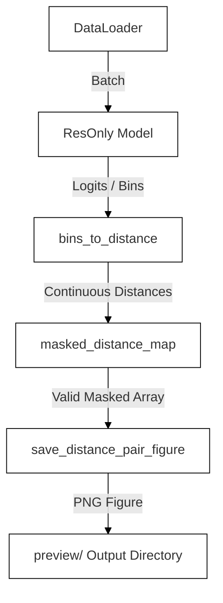
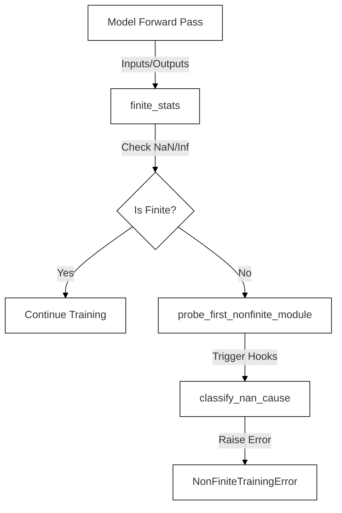

# Preview and Debugging Utilities

Relevant source files

The following files were used as context for generating this wiki page:

- [src/model/components/outer_product_mean.py](src/model/components/outer_product_mean.py)
- [src/preview.py](src/preview.py)
- [src/utils/__init__.py](src/utils/__init__.py)
- [src/utils/nan_monitor.py](src/utils/nan_monitor.py)

## Purpose and Scope
Section 5.3 covers the diagnostic and visualization utilities implemented in `src/preview.py` and `src/utils/nan_monitor.py`. These tools provide insight into model predictions by converting categorical distogram bins into continuous physical distance maps, rendering side-by-side comparison figures with chain boundaries, and monitoring training stability through deep tensor scanning, forward hook probing, and automated non-finite (NaN/Inf) root-cause classification.

Sources: `[src/preview.py:1-196]()`, `[src/utils/nan_monitor.py:1-217]()`

---

## Distance Map Visualization and Binned Utilities (`src/preview.py`)

The preview module (`src/preview.py`) loads checkpoints, runs inference on a subset of validation or training examples, and saves visual representations of true distance labels versus predicted distance maps.

### Key Functions
- **`distance_bin_centers(bin_start: float, bin_end: float, bin_count: int) -> torch.Tensor`**: Computes the physical distance boundaries and center points corresponding to discrete distogram classification bins `[src/preview.py:28-48]()`.
- **`bins_to_distance(bins: torch.Tensor, centers: torch.Tensor) -> torch.Tensor`**: Maps discrete bin index predictions back to continuous physical distance values using precomputed `centers` `[src/preview.py:51-53]()`.
- **`masked_distance_map(bins: torch.Tensor, centers: torch.Tensor, valid_mask: torch.Tensor) -> torch.Tensor`**: Applies `valid_mask` to distance matrices, setting invalid or masked pairs to `NaN` for visualization purposes `[src/preview.py:55-62]()`.
- **`save_distance_pair_figure(label_map, pred_map, output_path, p1_length)`**: Generates a side-by-side matplotlib figure comparing ground truth and prediction matrices using a `viridis` colormap where invalid/NaN entries are rendered in light gray. It invokes `_draw_chain_margin` to delineate multi-chain interfaces `[src/preview.py:64-110]()`.
- **`summarize_prediction(pred_bins, valid_mask, last_bin) -> str`**: Computes diagnostic string metrics including valid pair counts, unique predicted bins, and the fraction of pairs falling into the furthest distance bin (`far_bin_frac`) `[src/preview.py:112-126]()`.

*Figure 1: Data flow in `src/preview.py` from raw model output to saved distance map figures.*

Sources: `[src/preview.py:28-126]()`

---

## NaN Monitoring and Numerical Diagnostics (`src/utils/nan_monitor.py`)

To prevent training instability or gradient poisoning from propagating through `AdamW`, `src/utils/nan_monitor.py` provides tensor inspection utilities, forward hook probing, and root-cause classification.

### Key Components & Functions
- **`NonFiniteTrainingError`**: A custom `RuntimeError` raised immediately upon detecting non-finite losses or gradients `[src/utils/nan_monitor.py:28-30]()`.
- **`finite_stats(name: str, value: Any) -> dict[str, Any]`**: Recursively traverses nested pytrees of tensors (`_as_tensors`), calculating total element counts, counts of `NaN` and `Inf` entries, and the absolute maximum value (`abs_max`) across floating-point elements `[src/utils/nan_monitor.py:32-80]()`.
- **`probe_first_nonfinite_module(model: nn.Module, residue_batch: dict) -> list[dict]`**: Attaches temporary forward hooks to watched submodules (`residue_embedder`, `outer_product_mean`, `pair_blocks`, etc.) to isolate the exact layer producing non-finite outputs from finite inputs (`true_risk`) `[src/utils/nan_monitor.py:122-166]()`.
- **`classify_nan_cause(report: dict[str, Any]) -> str`**: Analyzes a diagnostic report dictionary to categorize failure modes into clean categories: `dirty_input`, `empty_residue_mask`, `forward` layer overflows, `loss` term explosions, or `backward` gradient anomalies `[src/utils/nan_monitor.py:169-217]()`.

*Figure 2: Execution flow of numerical debugging and exception handling in `src/utils/nan_monitor.py`.*

Sources: `[src/utils/nan_monitor.py:32-217]()`

---

## Code Entity Reference

| Natural Language Concept | Code Symbol / Entity | File Location |
| :--- | :--- | :--- |
| Physical Bin Center Calculation | `distance_bin_centers()` | `[src/preview.py:28-48]()` |
| Distance Map Figure Generation | `save_distance_pair_figure()` | `[src/preview.py:64-100]()` |
| Multi-Chain Boundary Line Drafter | `_draw_chain_margin()` | `[src/preview.py:102-110]()` |
| Non-Finite Training Exception | `NonFiniteTrainingError` | `[src/utils/nan_monitor.py:28-30]()` |
| Tensor Tree Statistics Scanne | `finite_stats()` | `[src/utils/nan_monitor.py:32-80]()` |
| Forward Hook Module Prober | `probe_first_nonfinite_module()` | `[src/utils/nan_monitor.py:122-166]()` |
| Automated Failure Categorization | `classify_nan_cause()` | `[src/utils/nan_monitor.py:169-217]()` |

Sources: `[src/preview.py:28-110]`, `[src/utils/nan_monitor.py:28-217]`

---