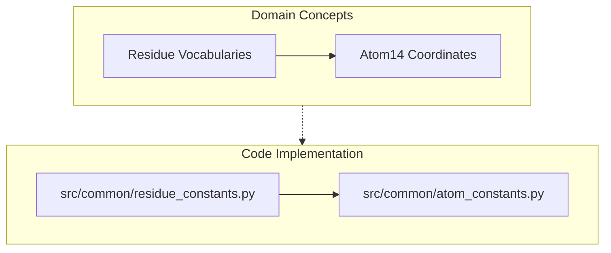
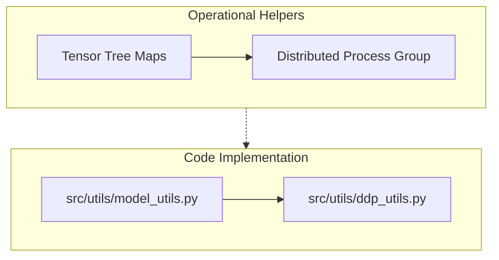

# Shared Concepts and Utilities

Relevant source files

The following files were used as context for generating this wiki page:

- [src/common/__init__.py](src/common/__init__.py)
- [src/utils/__init__.py](src/utils/__init__.py)

This page provides a high-level overview of the shared structural constants in `src/common` and general utility helpers in `src/utils` within the SurPass codebase. These modules supply foundational definitions for protein residue vocabularies, atom representations, tensor tree manipulations, and distributed execution primitives used across data pipelines, models, and training loops.

For deeper technical details, refer to the child pages:
- [Residue and Atom Constants](#6.1)
- [Tensor and DDP Utilities](#6.2)

---

## Constants and Utilities Architecture

The shared infrastructure supports the core architecture by centralizing biological domain knowledge (residue types, atom configurations) and operational helpers (tensor tree transformations, DDP state handling) into decoupled modules.

Diagram: Constants Namespace Mapping

*Sources: [src/common/__init__.py:1-1]()*

Diagram: Utilities Namespace Mapping

*Sources: [src/utils/__init__.py:1-1]()*

---

## 6.1 Residue and Atom Constants

The `src/common` package houses domain-specific constants that define how amino acids, backbone atoms, and sidechains are encoded within tensors. These definitions establish standard amino acid indexing, one-letter/three-letter conversions, and the `atom14` atomic representation scheme commonly adopted in structural biology pipelines.

For detailed specifications on atom coordinate structures, atom indices, and residue vocabularies, see [Residue and Atom Constants](#6.1).

*Sources: [src/common/__init__.py:1-1]()*

---

## 6.2 Tensor and DDP Utilities

The `src/utils` package contains general-purpose helpers for handling complex nested data structures and orchestrating distributed training. This includes tensor tree traversal utilities (`model_utils`) for nested dictionaries/tuples of tensors, shape validation helpers, and distributed data parallel (`ddp_utils`) initialization and synchronization primitives.

For detailed implementations of tree mapping functions, shape assertions, and DDP wrappers, see [Tensor and DDP Utilities](#6.2).

*Sources: [src/utils/__init__.py:1-1]()*

---