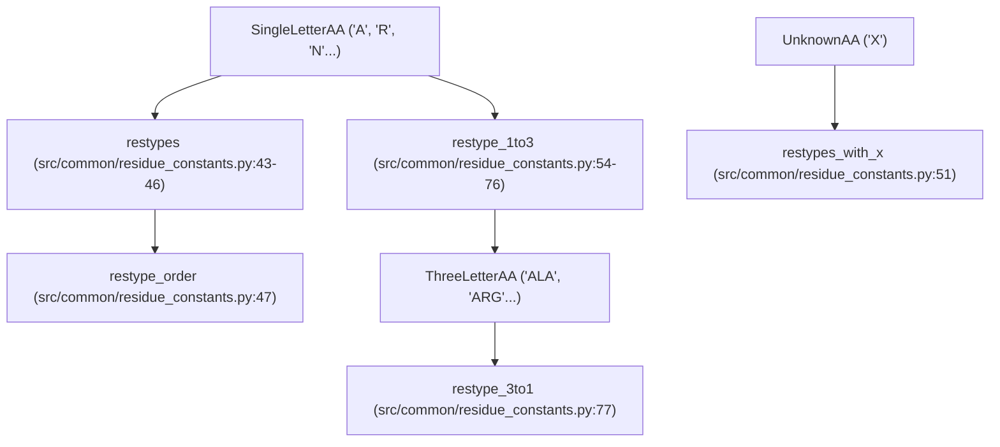
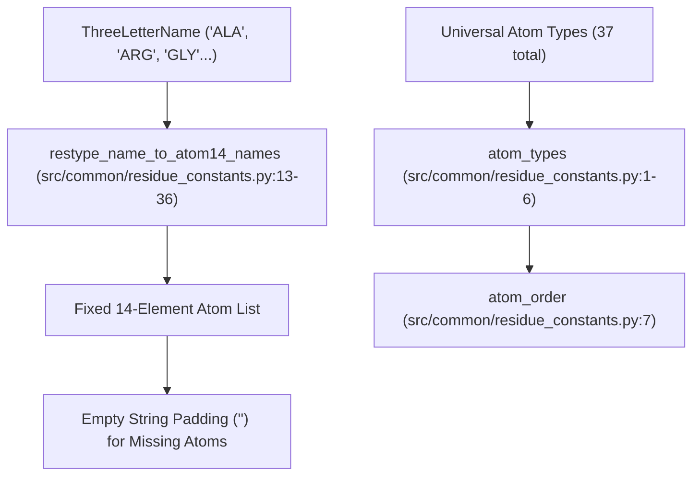

# Residue and Atom Constants

Relevant source files

The following files were used as context for generating this wiki page:

- [src/common/atom_constants.py](src/common/atom_constants.py)
- [src/common/residue_constants.py](src/common/residue_constants.py)

### Purpose and Scope
This page documents the foundational chemical, atomic, and residue-level constants defined in `src/common/residue_constants.py` and `src/common/atom_constants.py`. These modules establish the fundamental vocabulary, amino acid dictionaries, atom type universes, the AlphaFold-style `atom14` coordinate padding representation, and chemical/hydrogen-bonding parameters adapted from MaSIF. They are consumed across data loading, geometric cropping, structural feature extraction, and evaluation pipelines within SurPass.

---

## 1. Residue Vocabularies and Mappings

The codebase defines standard representations for the 20 canonical amino acids, alongside handling for unknown or padding residues (`'X'` / `'UNK'`). These mappings provide bidirectional lookups between single-letter codes, three-letter codes, and integer indices.

* **Standard Residues (`restypes`)**: An alphabetically sorted list of the 20 standard single-letter amino acid codes [src/common/residue_constants.py:43-46]().
* **Integer Encodings**: `restype_order` maps single-letter codes to contiguous integers `0` through `19` [src/common/residue_constants.py:47](). An extended vocabulary `restypes_with_x` appends `'X'` for unknown residues at index `20` (`unk_restype_index`) [src/common/residue_constants.py:49-51]().
* **Code Converters**: Dictionaries `restype_1to3` and `restype_3to1` facilitate conversion between single-letter codes and three-letter residue names (e.g., `'A'` to `'ALA'`, `'X'` to `'UNK'`) [src/common/residue_constants.py:54-77]().

*Sources: [src/common/residue_constants.py:43-77]()*

---

## 2. Atom Types and the `atom14` Representation

To handle variable numbers of side-chain atoms across different amino acid types while maintaining fixed-size tensor shapes (common in AlphaFold-derived architectures), SurPass utilizes a universal atom registry and a compact 14-atom per residue layout (`atom14`).

* **Universal Atom Universe (`atom_types`)**: A complete list of 37 unique heavy and polar hydrogen atom names encountered across standard amino acids, ranging from backbone atoms (`'N'`, `'CA'`, `'C'`, `'O'`, `'OXT'`) to specialized side-chain atoms (`'CG1'`, `'OG'`, `'SD'`, `'CZ2'`, etc.) [src/common/residue_constants.py:1-6]().
* **Atom Ordering**: `atom_order` maps each atom name string to its integer index in `atom_types` [src/common/residue_constants.py:7]().
* **`atom14` Encoding (`restype_name_to_atom14_names`)**: A dictionary mapping 3-letter residue names to a fixed-length list of 14 atom names [src/common/residue_constants.py:13-36](). Amino acids with fewer than 14 atoms (such as Glycine or Alanine) have their remaining slots padded with empty strings `''`.

*Sources: [src/common/residue_constants.py:1-38]()*

---

## 3. Chemical and Hydrogen Bonding Constants

Physical and chemical parameters used for surface analysis, atomic radii assignment, and hydrogen bond geometry are defined in `atom_constants.py` (adapted from MaSIF) [src/common/atom_constants.py:1-151]().

* **Atomic Radii (`radii`)**: Dictionary mapping element symbols (`'N'`, `'O'`, `'C'`, `'H'`, `'S'`, `'P'`), pseudo-atoms (`'Z'`), and disembodied points (`'X'`) to floating-point radius values [src/common/atom_constants.py:7-17]().
* **Polar Hydrogens (`polarHydrogens`)**: Maps 3-letter residue codes to lists of polar hydrogen atom names recognized by reduction programs (e.g., SER maps to `['H', 'HG']`, PRO maps to `[]`) [src/common/atom_constants.py:19-39]().
* **Hydrogen Bond Geometry**: 
  * `hbond_std_dev`: Standard deviation for angular distributions ($\pi / 3$) [src/common/atom_constants.py:41]().
  * `acceptorAngleAtom`: Maps acceptor atoms to their directly bonded reference atoms for angle calculations [src/common/atom_constants.py:45-51]().
  * `acceptorPlaneAtom`: Maps acceptor atoms to third reference atoms for plane determination [src/common/atom_constants.py:53-54]().
  * `donorAtom`: Maps hydrogen/donor atoms to their parent donor groups (e.g., `'HH11'` maps to `'NH1'`) [src/common/atom_constants.py:56-151]().

*Sources: [src/common/atom_constants.py:1-151]()*

---