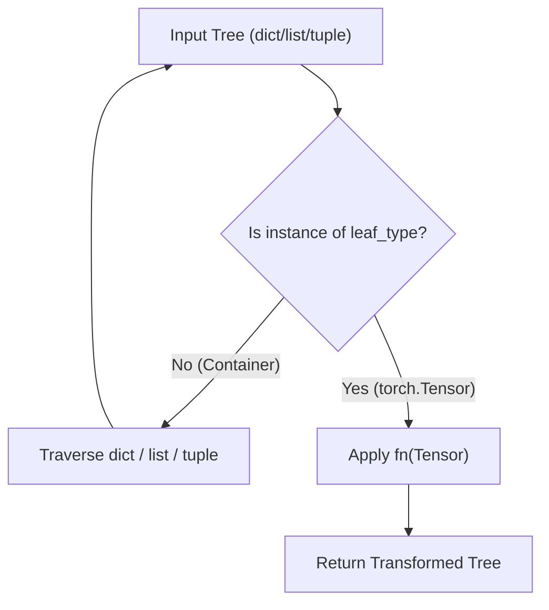
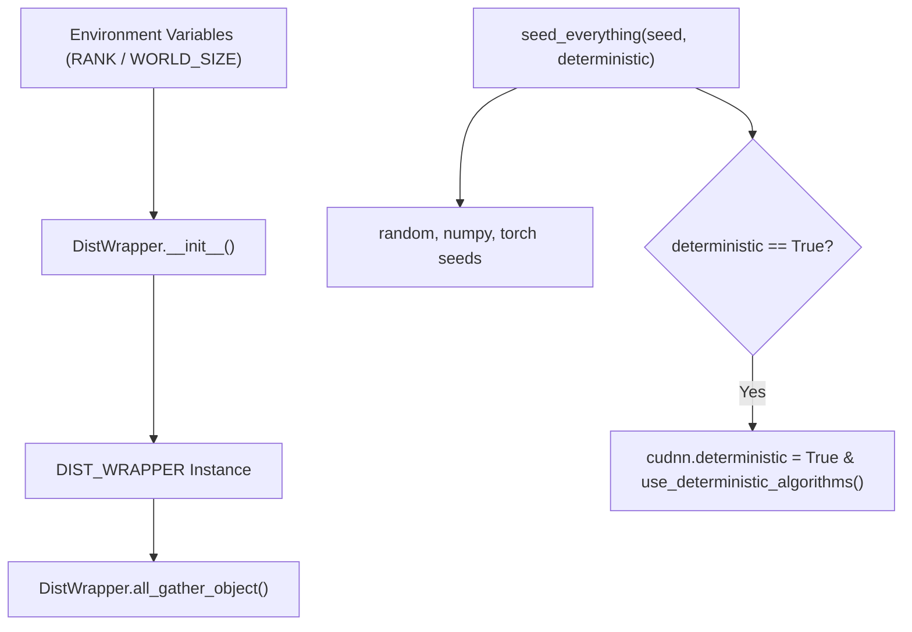

# Tensor and DDP Utilities

Relevant source files

The following files were used as context for generating this wiki page:

- [src/model/components/triangle_update.py](src/model/components/triangle_update.py)
- [src/model/optimizer.py](src/model/optimizer.py)
- [src/utils/ddp_utils.py](src/utils/ddp_utils.py)
- [src/utils/model_utils.py](src/utils/model_utils.py)

## Purpose and Scope
This page details the shared utility functions and classes located in `src/utils/model_utils.py` and `src/utils/ddp_utils.py`. These modules provide core tensor manipulation primitives, recursive tensor tree mapping utilities for complex nested data structures, distributed multi-process state management wrappers, and global reproducibility seeding routines.

---

## Model Tensor Utilities (`src/utils/model_utils.py`)

The `src/utils/model_utils.py` module defines tensor reshaping, expansion, padding, dimension movement functions, and recursive tree mapping operations used throughout the model architecture.

### Shape Manipulation Helpers

- **`expand_at_dim(x, dim, n)`**: Expands a tensor `x` along a specified `dim` by repeating it `n` times using `unsqueeze` and `expand` [src/utils/model_utils.py:8-25]().
- **`pad_at_dim(x, dim, pad_length, value)`**: Pads a tensor along dimension `dim` with left and right padding amounts defined by `pad_length` [src/utils/model_utils.py:27-54]().
- **`reshape_at_dim(x, dim, target_shape)`**: Reshapes a specific dimension `dim` of a tensor into `target_shape` while preserving all surrounding dimensions [src/utils/model_utils.py:57-79]().
- **`move_final_dim_to_dim(x, dim)`**: Permutes a tensor to relocate its final dimension to an arbitrary target dimension `dim` [src/utils/model_utils.py:81-106]().

Sources: `src/utils/model_utils.py`

### Recursive Tensor Tree Mapping

To facilitate operations on arbitrarily nested structures (such as dictionaries, lists, and tuples containing PyTorch tensors), `src/utils/model_utils.py` provides recursive tree traversal functions:

- **`dict_map(fn, dic, leaf_type)`**: Recursively traverses a dictionary, applying `tree_map` to non-dictionary leaf nodes and recursing into sub-dictionaries [src/utils/model_utils.py:108-116]().
- **`tree_map(fn, tree, leaf_type)`**: Inspects the type of `tree`. If it is a `dict`, `list`, or `tuple`, it recurses over its elements; if it matches `leaf_type`, it applies `fn(tree)` [src/utils/model_utils.py:119-130]().
- **`tensor_tree_map`**: A pre-configured `partial` application of `tree_map` where `leaf_type` is fixed to `torch.Tensor` [src/utils/model_utils.py:132-132]().

*Figure 1: Recursive execution flow of `tree_map` and `tensor_tree_map` over nested data structures.*

Sources: `src/utils/model_utils.py`

---

## Distributed Data Processing Utilities (`src/utils/ddp_utils.py`)

The `src/utils/ddp_utils.py` module handles distributed environment initialization checks, process rank resolution, object gathering across distributed nodes, and deterministic random seeding.

### Distributed State and `DistWrapper`

- **`distributed_available()`**: Returns `True` if `torch.distributed` is both available and initialized [src/utils/ddp_utils.py:8-10]().
- **`DistWrapper`**: A class that inspects environment variables (`RANK`, `LOCAL_RANK`, `LOCAL_WORLD_SIZE`, `WORLD_SIZE`) to compute process topology parameters including global rank, local rank, world size, number of nodes, and node rank [src/utils/ddp_utils.py:12-20]().
- **`DIST_WRAPPER`**: A module-level singleton instance of `DistWrapper` [src/utils/ddp_utils.py:34-34]().
- **`DistWrapper.all_gather_object(obj, group)`**: Gathers arbitrary Python objects across all processes in the world using `torch.distributed.all_gather_object` when distributed training is active, or returns a single-item list containing `obj` otherwise [src/utils/ddp_utils.py:21-32]().

Sources: `src/utils/ddp_utils.py`

### Reproducibility and Seeding

- **`seed_everything(seed, deterministic)`**: Seeds `random`, `numpy`, `torch`, and `torch.cuda`. When `deterministic=True`, it disables `cudnn.benchmark`, sets `cudnn.deterministic = True`, enforces `torch.use_deterministic_algorithms(True)`, and configures `CUBLAS_WORKSPACE_CONFIG` to ensure reproducible execution on CUDA devices [src/utils/ddp_utils.py:37-49]().

*Figure 2: Distributed environment configuration via `DistWrapper` and global reproducibility control via `seed_everything`.*

Sources: `src/utils/ddp_utils.py`

---