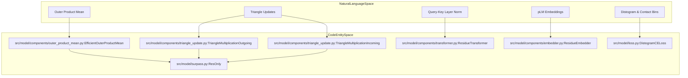
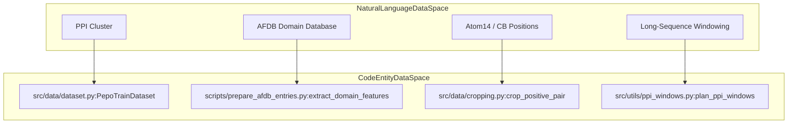

# Glossary

Relevant source files

The following files were used as context for generating this wiki page:

- [scripts/prepare_afdb_entries.py](scripts/prepare_afdb_entries.py)
- [scripts/prepare_inference_embeddings.py](scripts/prepare_inference_embeddings.py)
- [scripts/uniprot_sprot.fasta.gz](scripts/uniprot_sprot.fasta.gz)
- [src/data/dataset.py](src/data/dataset.py)
- [src/model/loss.py](src/model/loss.py)
- [src/model/surpass.py](src/model/surpass.py)

## Purpose and Scope

This page provides formal definitions of domain-specific concepts, structural biology terminology, and codebase jargon used across the `SurPass` repository. Each entry links directly to the underlying classes, functions, and configuration parameters in the source code.

---

## 1. Architectural and Modeling Jargon

### Distogram
A **distogram** is a two-dimensional matrix of probability distributions over discrete pairwise distance bins for all residue pairs in a protein complex [src/model/loss.py:113-128](). In `SurPass`, the distogram output logits are generated by projecting the pair representation tensor through a linear layer and layer normalization [src/model/surpass.py:120-121]() and are supervised via cross-entropy [src/model/loss.py:123-128]() or focal loss [src/model/loss.py:131-171]().

### Contact Bins
**Contact bins** define the contiguous subset of distance bins at the lower end of the distogram (e.g., distances $< 8.0\,\text{Å}$) that denote physical inter-residue contacts [src/model/loss.py:84-92](). The integer parameter `contact_bins` specifies the cutoff index separating contacting pairs from non-contacting pairs [src/model/surpass.py:44-45]().

### Intra / Inter Mask
* **`intra_mask`**: A Boolean tensor indicating residue pairs belonging to the same protein chain [src/model/loss.py:151]().
* **`inter_mask`**: A Boolean tensor indicating residue pairs spanning two different interacting chains [src/model/loss.py:152]().
These masks decouple intra-chain folding supervision from inter-chain protein-protein interaction (PPI) supervision during multi-objective loss computation [src/model/loss.py:171]().

### QKLN (Query-Key Layer Normalization)
**QKLN** refers to Query-Key Layer Normalization applied directly to query and key projections within multi-head attention mechanisms (`use_qkln=True`) [src/model/surpass.py:38,84]() to stabilize training dynamics and prevent attention logit explosion in deep transformer stacks.

### $r_{\max}$ (Maximum Relative Position Encoding)
$r_{\max}$ defines the maximum clipping distance or relative sequence separation window used by the `ResidueEmbedder` when constructing relative positional encodings between residues [src/model/components/embedder.py]().

### Outer Product Mean (OPM)
The **Outer Product Mean** (`EfficientOuterProductMean`) is a module that bridges the single residue stream ($\mathbf{m}$) and the pair stream ($\mathbf{z}$) by computing outer products of single representations across channel dimensions, updating pair features at each layer [src/model/surpass.py:90-96]() [src/model/components/outer_product_mean.py]().

### Triangle Updates (Incoming / Outgoing)
**Triangle updates** (`TriangleMultiplicationOutgoing` and `TriangleMultiplicationIncoming`) update the pair representation $\mathbf{z}$ using triangular relational reasoning along incoming and outgoing edges of the residue pair graph [src/model/surpass.py:98-110]() [src/model/components/triangle_update.py]().

### EMA (Exponential Moving Average)
**EMA** maintains a shadow copy of model parameters updated as an exponential moving average of training weights, stabilizing evaluation and inference checkpoints [4.3]().

---

## 2. Biological and Data Pipeline Jargon

### PPI Cluster
A **PPI cluster** is a group of protein-protein interaction pairs clustered by sequence and interface similarity (via MMSeqs2) to prevent data leakage between training, validation, and test splits [src/data/dataset.py:30,62-76](). The dataset loads samples indexed by `ppi_cluster_id` [src/data/dataset.py:63,72]().

### AFDB (AlphaFold Database)
**AFDB** refers to local collections of AlphaFold Database domain structures utilized to extract experimental and predicted structural features for training complexes [scripts/prepare_afdb_entries.py:2-13]().

### pLM / ESMC (Protein Language Model)
**pLM / ESMC** refers to Evolutionary Scale Modeling protein language model embeddings (`plm_emb`) extracted from amino acid sequences, providing rich evolutionary and biochemical context as inputs to the `ResidueEmbedder` [scripts/prepare_inference_embeddings.py:1-4]() [src/model/components/embedder.py]().

### Atom14 Representation
**Atom14** is a fixed 14-atom coordinate and mask schema per residue used internally for structural feature extraction and geometric validation [scripts/prepare_afdb_entries.py:44-46]().

### CB Positions ($C_\beta$)
**$C_\beta$ positions** (`cb_positions`, `cb_mask`) denote the 3D coordinates and validity masks of carbon-beta atoms (or carbon-alpha for Glycine) utilized for inter-residue distance calculations and ground-truth label generation [scripts/prepare_afdb_entries.py:50-51]().

### Tversky Loss
**Tversky loss** is an asymmetric generalization of the Dice coefficient used to handle severe class imbalance between positive contact pairs and negative non-contact pairs [src/model/loss.py]().

### Noisy-OR
**Noisy-OR** is a probabilistic aggregation function used to combine multi-residue or windowed predictions into global protein-level interaction scores.

### Long-Sequence Windowing
**Windowing** (`plan_ppi_windows`) is a spatial tiling strategy that divides exceptionally long protein complexes into manageable sub-windows to fit within GPU memory constraints during inference [5.2]().

---

## 3. System Architecture Mapping

The following diagram bridges natural language domain concepts to their exact code entity implementations across the codebase:

*Sources: [src/model/surpass.py:90-110](), [src/model/components/outer_product_mean.py](), [src/model/components/triangle_update.py](), [src/model/components/transformer.py](), [src/model/components/embedder.py](), [src/model/loss.py:113-128]()*

---

## 4. Data Pipeline Jargon Mapping

*Sources: [src/data/dataset.py:26-76](), [scripts/prepare_afdb_entries.py:166-192](), [src/data/cropping.py](), [src/utils/ppi_windows.py]()*