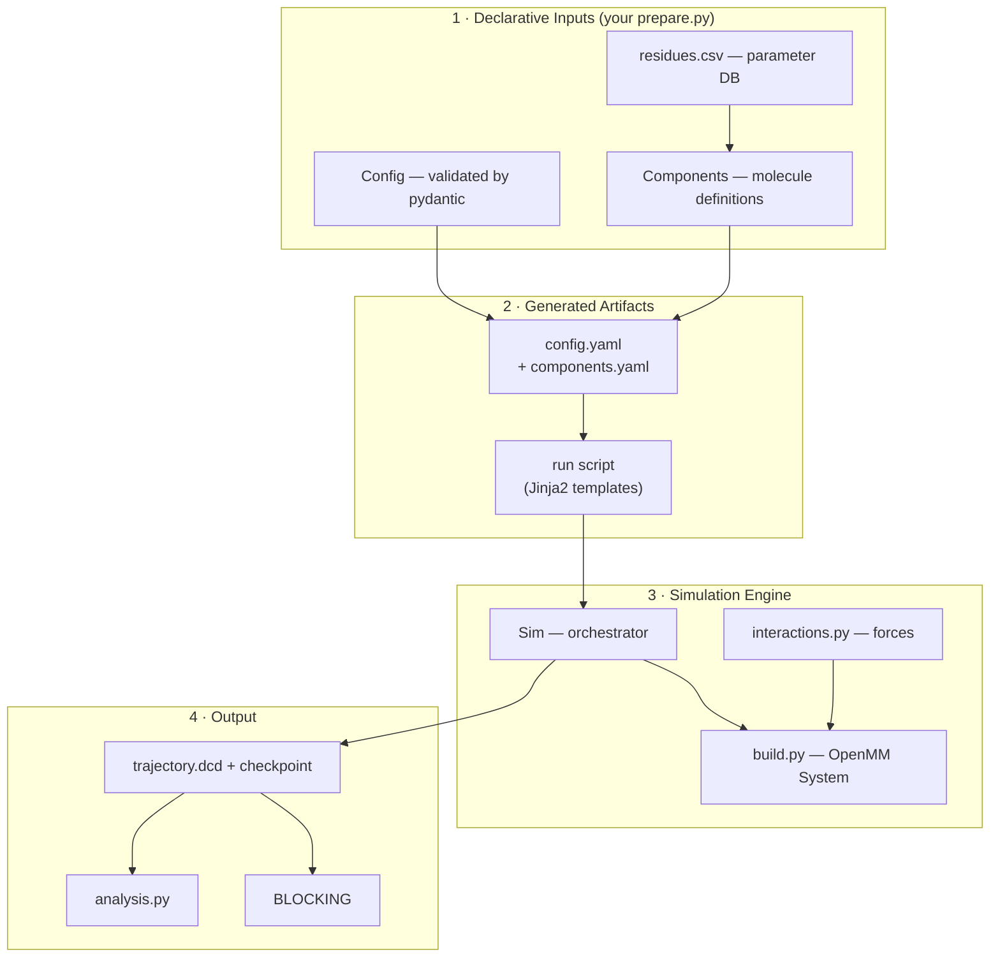

This page introduces **CALVADOS** — a Python package for coarse-grained, implicit-solvent molecular dynamics simulations of biomolecules — and maps its repository, architecture, and workflow at a level suitable for first-time developers. By the end you will understand what the package does, how its modules fit together, and where to go next in this documentation. Deeper treatment of each subsystem is delegated to the pages referenced along the way; this page stays at the boundary between *what it is* and *how it works*.

Sources: [README.md](README.md#L1-L13), [pyproject.toml](pyproject.toml#L5-L7)

## What Is CALVADOS?

CALVADOS describes itself precisely: *"Coarse-grained implicit-solvent simulations of biomolecules in the OpenMM framework."* Each amino acid (or nucleotide) is represented by a **single bead**, which reduces a protein that would need tens of thousands of atoms in an all-atom model to a chain of a few hundred particles. This makes it possible to simulate slow, collective processes — such as the **liquid-liquid phase separation (LLPS)** of intrinsically disordered proteins (IDPs) — that are out of reach for all-atom force fields. The package was developed at the KULL-Centre (University of Copenhagen) and is distributed under GPL-3.0, supporting Python 3.11–3.13 on Linux.

The scientific credentials come from a peer-reviewed lineage: the CALVADOS model was introduced and refined in PNAS (2021), Open Research Europe (2022), and Protein Science (2024), with the software architecture itself documented in an arXiv paper (2025). If you use the package, these are the citations to include.

Sources: [README.md](README.md#L6-L27), [pyproject.toml](pyproject.toml#L4-L33)

## The Core Idea: One Bead, One Residue

The entire package revolves around a **residue parameter database** — `residues.csv` — which assigns each residue type its physical identity:

| Column | Meaning |
|---|---|
| `three` / `one` | Amino acid identifier (3-letter and 1-letter codes) |
| `MW` | Molecular weight |
| `lambdas` | Hydrophobicity scale used by the Ashbaugh-Hatch interaction |
| `sigmas` | Bead size for Lennard-Jones-type interactions |
| `q` | Formal charge (drives electrostatics) |
| `bondlength` | Distance between consecutive bonded beads |

For example, arginine (ARG/R) carries charge `+1` with hydrophobicity `λ ≈ 0.73`, while glutamic acid (GLU/E) carries `-1` with `λ ≈ 0.0007`. Because this database is a **CSV file rather than hard-coded values**, you can supply custom parameter sets — the `single_RNA` example ships its own `residues_C2RNA.csv` for RNA coarse-graining. The physics that consumes these parameters (Ashbaugh-Hatch hydrophobic attraction, Debye-Hückel electrostatics) is covered in [Ashbaugh-Hatch Hydrophobic Interactions](6-ashbaugh-hatch-hydrophobic-interactions) and [Debye-Hückel Electrostatics](7-debye-huckel-electrostatics); the database itself in [Residue Parameter Database](8-residue-parameter-database).

Sources: [calvados/data/residues.csv](calvados/data/residues.csv#L1-L8), [examples/single_RNA/residues_C2RNA.csv](examples/single_RNA/residues_C2RNA.csv#L1)

## Repository at a Glance

The repository separates the installable package (`calvados/`), runnable demonstrations (`examples/`), and the test suite (`tests/`):

```
CALVADOS/
├── calvados/                  ← the Python package
│   ├── cfg.py                 ← declarative, validated configuration
│   ├── components.py          ← molecule abstraction + registry
│   ├── sequence.py            ← FASTA/PDB parsing, charge assignment
│   ├── interactions.py        ← force field physics (AH + DH)
│   ├── build.py               ← OpenMM system construction
│   ├── sim.py                 ← simulation engine (Sim class)
│   ├── analysis.py            ← trajectory analysis toolkit
│   ├── utilities.py           ← shared helpers
│   ├── BLOCKING/              ← blocking error estimation
│   └── data/
│       ├── residues.csv       ← residue parameter database
│       └── templates/         ← Jinja2 cluster-script templates
├── examples/                  ← 17 end-to-end use cases (see table below)
├── tests/                     ← pytest suite incl. energy validation
└── residues.csv               ← top-level residue database copy
```

Note the symmetry: nearly every module name maps to a documentation page in the **Deep Dive** section of this catalog. The public API is deliberately flat — the package `__init__.py` simply re-exports all eight core modules (`analysis`, `build`, `cfg`, `components`, `interactions`, `sequence`, `sim`, `utilities`), so `from calvados.cfg import Config` is the canonical import style.

Sources: [calvados/__init__.py](calvados/__init__.py#L1-L19), [calvados/data/templates/computerome.jinja](calvados/data/templates/computerome.jinja#L1)

## Architecture: The Build → Simulate → Analyze Pipeline

CALVADOS follows a classic three-stage MD pipeline, but with a distinctive **declarative front end**. You never construct OpenMM objects directly; instead you describe *what* to simulate in validated configuration objects, and the package generates *how* to run it. The diagram below shows how data flows from your inputs to analyzed trajectories:



The key architectural insight is the split between **configuration** and **execution**. `Config` (in `cfg.py`) validates every simulation parameter through a pydantic model (`SimulationInput`) and, when written, produces two artifacts: a `config.yaml` and a companion Python run script — the templates in `data/templates/` even generate cluster-submission wrappers for specific HPC facilities (Computerome, DEIC). On the execution side, the `Sim` class (in `sim.py`) re-validates those YAML inputs, constructs the OpenMM system via `build.py`, applies forces from `interactions.py`, and runs or resumes the trajectory.

> [!TIP]
> This two-file pattern separates *what to simulate* (editable, version-controllable YAML) from *how to run it* (a generated script). When debugging, always check whether the problem lies in your YAML inputs or in the generated script's runtime settings — they evolve independently.

Sources: [calvados/cfg.py](calvados/cfg.py#L28-L60), [calvados/sim.py](calvados/sim.py#L35-L61), [calvados/data/templates/computerome.jinja](calvados/data/templates/computerome.jinja#L1)

### Module Responsibility Map

| Module | Responsibility | Key Public Interface |
|---|---|---|
| `cfg` | Declarative configuration, validation, script generation | `Config`, `Components`, `Job` |
| `components` | Molecule abstraction and type registry | `Component`, `Protein`, `RNA`, `Lipid`, … |
| `sequence` | FASTA/PDB reading, charge and termini patching | `read_fasta`, `seq_from_pdb`, `get_qs` |
| `interactions` | Force field physics — AH and DH parameters, custom forces | `genParamsDH`, force builders |
| `build` | OpenMM `System`, topology, and placement | consumed via `Sim` |
| `sim` | Simulation lifecycle: build → run → resume | `Sim` |
| `analysis` | Trajectory observables and property tables | `save_conf_prop`, `self_distances` |
| `BLOCKING` | Statistical error estimation for correlated time series | blocking analysis tools |
| `utilities` | Shared low-level helpers | — |

Sources: [calvados/cfg.py](calvados/cfg.py#L28-L43), [calvados/components.py](calvados/components.py#L24-L40), [calvados/sim.py](calvados/sim.py#L35-L44), [calvados/interactions.py](calvados/interactions.py#L17-L23)

## The Component System: Eight Molecule Types

Everything simulated is a `Component`. A single registry — `COMPONENT_REGISTRY` — maps string keys to classes, and your `components.yaml` selects from it via `molecule_type`. This design means adding a new biomolecule class requires only subclassing `Component` and registering it, not modifying the simulation engine.

| Registry Key | Class | Purpose |
|---|---|---|
| `protein` | `Protein` | Standard IDP / multi-domain chains |
| `ptm_protein` | `PTMProtein` | Protein with post-translational modifications grafted as branches |
| `rna` | `RNA` | RNA molecules |
| `lipid` / `cooke_lipid` | `Lipid` | Membrane lipids (two parameterizations) |
| `crowder` | `Crowder` | Crowding agents (e.g., globular proteins) |
| `cyclic` | `Cyclic` | Chains with cyclic backbone topology |
| `seastar` | `Seastar` | Star-branched topology (hub + arms) |

Each component subclass customizes how its *sequence* is computed and which beads are *bonded* — for instance, `PTMProtein` overrides both `calc_comp_seq` (appending PTM bead sequences) and `bond_check` (creating protein-to-PTM bonds at configured locations). The component machinery is detailed in [Component Registry & Molecule Types](9-component-registry-and-molecule-types), with sequence and charge handling in [Sequence Handling & Charge Assignment](10-sequence-handling-and-charge-assignment).

Sources: [calvados/components.py](calvados/components.py#L1002-L1015), [calvados/components.py](calvados/components.py#L956-L999)

## A Simulation in Practice: The Two-File Workflow

The shortest path to understanding CALVADOS is to read one example. Every example in `examples/` follows the same skeleton — a `prepare.py` script that (1) declares a `Config`, (2) declares `Components`, and (3) writes both to disk. From `examples/single_IDR/prepare.py`:

```python
config = Config(
  sysname = sysname,
  box = [L, L, L],        # nm
  temp = 293.15,          # K
  ionic = 0.19,           # M
  pH = 7.5,
  wfreq = N_save,         # trajectory writing interval
  steps = N_frames*N_save,
  platform = 'CPU',       # or CUDA
)

components = Components(
  molecule_type = 'protein',
  nmol = 1,
  fresidues = residues_file,
  ffasta = f'{cwd}/input/idr.fasta',
)
```

Calling `config.write(path, analyses=...)` produces `config.yaml` **plus** a run script whose analysis section is embedded verbatim — here, a call to `calvados.analysis.save_conf_prop` that computes conformational properties after the trajectory completes. Running that generated script invokes `Sim`, which builds the OpenMM system and executes the dynamics. This embed-the-analysis pattern means each simulation folder is self-contained and reproducible.

> [!TIP]
> Mind the units: configuration values follow kcal/mol conventions (e.g., `eps_lj`), but CALVADOS converts them internally to OpenMM's kJ/mol (`self.eps_lj = float(self.config.eps_lj) * 4.184` in `sim.py`). Never mix unit systems when supplying custom parameters.

Sources: [examples/single_IDR/prepare.py](examples/single_IDR/prepare.py#L26-L72), [calvados/sim.py](calvados/sim.py#L53-L54)

## The Examples Gallery: A Map of Capabilities

The seventeen examples double as a capability catalog. They are grouped below by what they demonstrate — each has a `README.md` and a self-contained `prepare.py`:

| Category | Examples | Demonstrates |
|---|---|---|
| Single chain | `single_IDR`, `single_pIDR` | Basic box simulation; phosphorylated (pIDR) variant |
| Structure guidance | `single_AF_CALVADOS`, `custom_restraints` | AlphaFold-guided restraints; user-defined forces |
| Multi-chain | `two_IDR`, `ten_IDR_cyl`, `single_MDP`, `two_IDR_MDP` | Inter-molecular contacts; cylindrical confinement; crowders |
| Phase separation | `slab_IDR`, `slab_IDR_MDP`, `slab_IDR_PEG`, `slab_mixed` | Slab geometry for coexisting dilute/dense phases |
| Geometry equilibration | `single_IDR_box_eq` | Box-size equilibration protocol |
| Nucleic acids | `single_RNA`, `single_dsRNA` | RNA with custom residue parameters; double-stranded RNA |

The slab examples are the entry point to LLPS studies — the scientific core of CALVADOS — and ship with Jupyter analysis notebooks (`example_slab_analysis.ipynb`). Browse them interactively in [Example Gallery](4-example-gallery), and follow the full lifecycle in [Simulation Workflow Primer](3-simulation-workflow-primer).

Sources: [examples/single_IDR/prepare.py](examples/single_IDR/prepare.py#L1-L73), [examples/slab_IDR/example_slab_analysis.ipynb](examples/slab_IDR/example_slab_analysis.ipynb#L1)

## Verification Culture: Tests That Check Physics

The test suite goes beyond API smoke tests — it validates **energy correctness**. The flagship test, `test_potentials`, simulates two free amino acids, recomputes potential energies from the saved trajectory, and compares them against OpenMM's own log output; other tests verify RNA bond order and custom restraint application. Run everything with `python -m pytest`. This matters for extension developers: when you add a custom force (see [Extension & Custom Forces](18-extension-and-custom-forces)), energy-conservation tests are the safety net that catches unit and factor errors before they corrupt your science.

Sources: [README.md](README.md#L45-L57), [tests/test_potentials.py](tests/test_potentials.py#L1)

## Installation in One Breath

The supported path is conda + pip: create a Python 3.13 environment, install `openmm` (≥ 8.2, < 8.5) with `cudatoolkit` if using CUDA GPUs — or without it for CPU/OpenCL — plus `mdanalysis` and `mdtraj`, then `pip install .` from a clone of this repository. Core dependencies include numpy, pandas, biopython, pydantic (configuration validation), Jinja2 (script templates), numba, scipy, and statsmodels (blocking statistics). Full platform details, including GPU selection and performance tuning, are covered in [Hardware Platforms & Performance](20-hardware-platforms-and-performance).

Sources: [README.md](README.md#L29-L43), [pyproject.toml](pyproject.toml#L20-L33)

## Suggested Reading Path

This documentation is organized so each page builds on the previous. For a **hands-on start**, proceed in this order:

1. [Quick Start](2-quick-start) — install and run your first simulation end-to-end.
2. [Simulation Workflow Primer](3-simulation-workflow-primer) — the prepare → simulate → analyze lifecycle in depth.
3. [Example Gallery](4-example-gallery) — pick the example closest to your scientific question.

For a **systems understanding**, branch into:

4. [Architecture Overview](5-architecture-overview) — module boundaries and data flow.
5. *Force Field Physics* — [Ashbaugh-Hatch Hydrophobic Interactions](6-ashbaugh-hatch-hydrophobic-interactions), [Debye-Hückel Electrostatics](7-debye-huckel-electrostatics), [Residue Parameter Database](8-residue-parameter-database).
6. *Component System* — [Component Registry & Molecule Types](9-component-registry-and-molecule-types) through [Structure-Based Restraints & AlphaFold Guidance](11-structure-based-restraints-and-alphafold-guidance).
7. *Configuration & Simulation* — [Declarative Configuration & Validation](12-declarative-configuration-and-validation), [System Building & Geometry](13-system-building-and-geometry), [Simulation Engine & Checkpointing](14-simulation-engine-and-checkpointing).
8. *Analysis Stack* — [Trajectory Analysis Toolkit](15-trajectory-analysis-toolkit), [Slab Phase-Separation Analysis](16-slab-phase-separation-analysis), [Blocking Error Estimation](17-blocking-error-estimation).

Advanced topics — custom forces, energy validation, and hardware — conclude the catalog in [Extension & Custom Forces](18-extension-and-custom-forces), [Testing & Energy Validation](19-testing-and-energy-validation), and [Hardware Platforms & Performance](20-hardware-platforms-and-performance).
