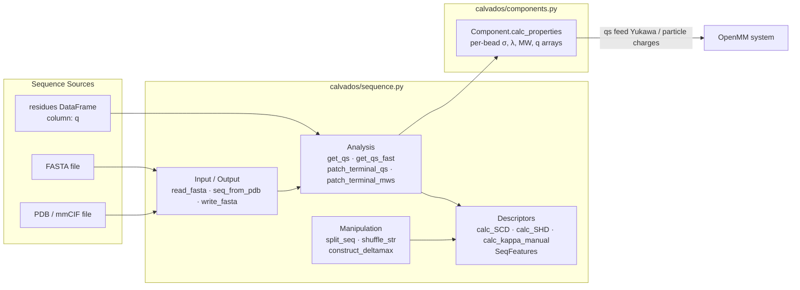
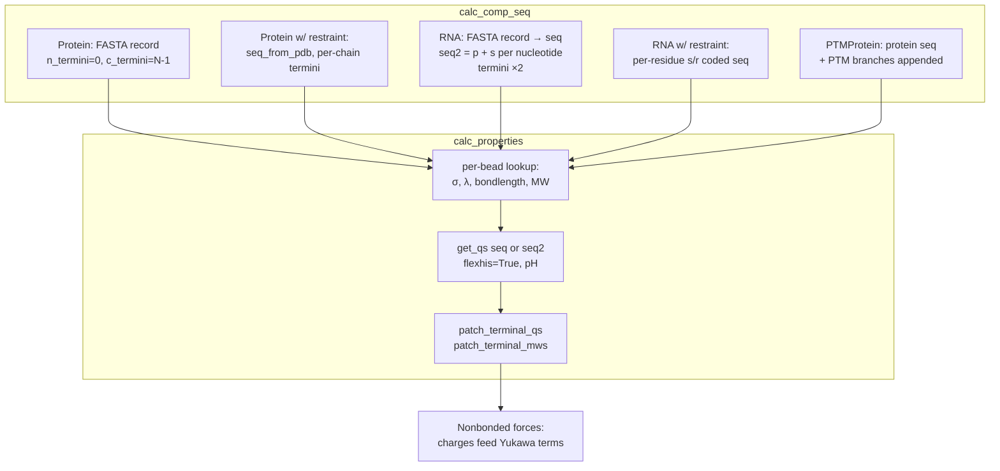

In a one-bead-per-residue force field, the sequence *is* the molecular model: bead identities, hydrophobicity parameters, and electrostatic charges are all derived from the letter string itself. This page documents how CALVADOS acquires sequences (from FASTA records or PDB/mmCIF structures), how per-residue charges are assigned (including pH-dependent histidine and phosphorylation semantics), how terminal chemistry is patched onto chains, and how the component layer consumes these primitives to build simulation-ready molecules. The logic concentrates in a single module, `calvados/sequence.py`, with a thin consumption layer in `calvados/components.py`.

Sources: [sequence.py](calvados/sequence.py#L1-L34), [components.py](calvados/components.py#L19-L25)

## Module Architecture at a Glance

`sequence.py` is organized into four labeled internal sections — input/output, analysis, manipulation, and fast kappa — plus a feature-aggregation class. The module is deliberately free of OpenMM dependencies for its core charge math (numba-jitted, nopython), which keeps charge computation vectorizable and testable in isolation; OpenMM is imported only for structure parsing in `seq_from_pdb` and for the Ashbaugh-Hatch integral helpers used by descriptor calculation.

Sources: [sequence.py](calvados/sequence.py#L28-L94), [sequence.py](calvados/sequence.py#L242-L339), [sequence.py](calvados/sequence.py#L502-L587)

The following diagram shows how raw sequence sources flow through the module's four sections into the component layer. Prerequisite reading: `residues` refers to a pandas `DataFrame` indexed by one-letter code (see [Residue Parameter Database](8-residue-parameter-database)); `qs` refers to the per-residue charge array produced by the functions covered in the next section.

Sources: [sequence.py](calvados/sequence.py#L28-L34), [components.py](calvados/components.py#L53-L100), [components.py](calvados/components.py#L365-L374)

## Sequence Ingestion: FASTA and Structure-Derived Sources

A component acquires its sequence through exactly two routes, chosen by whether structure-based restraints are enabled. When `params.restraint` is set, `Component.calc_comp_seq` prefers a `.cif` file over `.pdb` in the configured `pdb_folder` and derives the sequence from the structure; otherwise it reads the FASTA record whose ID matches the component name and assigns a single N-/C-terminal pair spanning the whole chain. This design couples sequence extraction to the restraint workflow so the modeled chain always matches the structural template residue-for-residue.

Sources: [components.py](calvados/components.py#L53-L68), [sequence.py](calvados/sequence.py#L29-L34)

| Function | Input | Returns | Key behavior |
|---|---|---|---|
| `read_fasta` | FASTA path | `dict[str, SeqRecord]` keyed by record ID | Biopython `SeqIO` passthrough; components look themselves up by `name` |
| `seq_from_pdb` | PDB/CIF path, `fmt` | sequence (`string`/`list`), `n_termini`, `c_termini` | Converts 3-letter codes via MDAnalysis `convert_aa_code`; unknown codes map to `X` |
| `write_fasta` | records, output path | `None` | Creates file, or appends only records whose ID is not already present |
| `record_from_seq` | sequence, name | `SeqRecord` | Minimal annotation for writing new records |

Sources: [sequence.py](calvados/sequence.py#L29-L34), [sequence.py](calvados/sequence.py#L37-L72), [sequence.py](calvados/sequence.py#L75-L89)

The multi-chain handling in `seq_from_pdb` is the foundation of correct charge assignment for assemblies. The parser explicitly does *not* assume residues are numbered from 1; instead it computes each segment's chain boundaries positionally — `n_termini` starts at `0`, each subsequent segment's N-terminus is `previous C-terminus + 1`, and C-termini accumulate segment lengths. A three-letter code that `convert_aa_code` cannot translate (returning `""`) is defensively replaced with the generic `X`. The test suite pins this contract with a hand-written two-chain PDB: a four-residue `AKDE` extract yields `n_termini == [0, 2]` and `c_termini == [1, 3]`.

Sources: [sequence.py](calvados/sequence.py#L37-L72), [test_sequence.py](tests/test_sequence.py#L44-L68)

## The Charge Assignment Core

Charge assignment is dual-path. `get_qs` is the dispatcher: if a residue parameter table is supplied, each residue's charge is looked up as `residues.loc[s].q`; if no table is passed (`residues=None`), control transfers to the numba-jitted `get_qs_fast`, which encodes the CALVADOS standard charge alphabet directly. Both paths return a `(qs, qs_abs)` tuple — signed and absolute charge arrays — because downstream descriptors such as the center of charge operate on magnitudes only.

Sources: [sequence.py](calvados/sequence.py#L95-L134)

| Aspect | `get_qs` (table-driven) | `get_qs_fast` (jitted fast path) |
|---|---|---|
| Charge source | `residues.loc[s].q` column | Hardcoded: `R`,`K` → +1; `E`,`D` → −1 |
| Phosphosite `p` | Whatever the table defines | −1 only when `phos_negative=True` (default) |
| Histidine | Table value unless `flexhis` overrides | Fractional only when `flexhis=True` |
| All other residues | Table values (e.g., neutral in `residues.csv`) | 0.0 |
| Dependency | pandas `DataFrame` | None (pure numba, no Python objects) |
| Primary consumers | `Component.calc_properties`, `SeqFeatures` | Kappa machinery, `check_dmax` |

Sources: [sequence.py](calvados/sequence.py#L95-L113), [sequence.py](calvados/sequence.py#L116-L134), [residues.csv](residues.csv#L1-L21)

The pH-dependent histidine ("flexible histidine") mechanism applies a Henderson–Hasselbalch fractional charge with an implicit pKa of 6: `q = 1 / (1 + 10 ** (pH - 6))`. At pH 6 the histidine carries exactly +0.5; at neutral pH 7 it decays to +0.0909. The identical formula appears in both code paths, keeping fast and table-driven modes physically consistent. The tests verify the full default alphabet on the string `"KRHDEpA"` (histidine neutral, phosphosite `p` −1) and confirm the fractional result at pH 6 via the table-driven path.

Sources: [sequence.py](calvados/sequence.py#L107-L108), [sequence.py](calvados/sequence.py#L130-L133), [test_sequence.py](tests/test_sequence.py#L16-L41)

> [!TIP]
> Component-level calls hardcode `flexhis=True` — `Component.calc_properties` invokes `get_qs(..., flexhis=True, pH=pH, ...)` — so simulated histidines *always* receive fractional pH-dependent charges, whereas kappa analysis internally uses `get_qs_fast` with integer-only charges. The same sequence string therefore yields two different charge representations depending on which consumer asks.

Sources: [components.py](calvados/components.py#L98), [sequence.py](calvados/sequence.py#L439-L455)

## Terminal Chemistry: Patching Charges and Masses

Free chain termini carry real chemistry that a residue lookup cannot supply: an extra proton on the N-terminus and an extra hydroxyl oxygen on the C-terminus. `patch_terminal_qs` adds +1.0 to every index listed in `n_termini` and −1.0 to every index in `c_termini`, gated by the `loc` switch (`"none"`, `"N"`, `"C"`, `"both"`). Its mass counterpart `patch_terminal_mws` adds +2 Da (two hydrogens) at N-termini and +16 Da (one oxygen) at C-termini, keeping molecular-weight reporting consistent with the charge model. Both functions copy-then-mutate, so the input arrays are never aliased.

Sources: [sequence.py](calvados/sequence.py#L137-L165)

| `loc` value | N-terminal charge/mass patch | C-terminal charge/mass patch |
|---|---|---|
| `"none"` | none | none |
| `"N"` | `qs += 1`, `mws += 2` | none |
| `"C"` | none | `qs -= 1`, `mws += 16` |
| `"both"` (default) | `qs += 1`, `mws += 2` | `qs -= 1`, `mws += 16` |

Sources: [sequence.py](calvados/sequence.py#L137-L165)

The multi-chain case is where positional termini bookkeeping pays off: `Protein.calc_properties` patches *all* chain ends of an assembly in one call, using the `n_termini`/`c_termini` lists produced by `seq_from_pdb`, and the `loc` value is user-configurable per component (see [Configuration Touchpoints](#configuration-touchpoints)). The regression test demonstrates exactly this: zero-filled charges patched across both chains of the `AKDE` extract produce `[1.0, -1.0, 1.0, -1.0]`.

Sources: [components.py](calvados/components.py#L246-L257), [test_sequence.py](tests/test_sequence.py#L61-L68)

## Charge-Derived Descriptors and SeqFeatures

`SeqFeatures` is the aggregation layer that converts a charge array into the physicochemical vocabulary of the IDP literature. Charge-based attributes are computed unconditionally; hydropathy, mass, and Ashbaugh-Hatch attributes are added only when a residue table is supplied; and the scaling-exponent prediction runs only when a serialized `nu_file` model path is provided.

Sources: [sequence.py](calvados/sequence.py#L502-L524)

```mermaid
classDiagram
    class SeqFeatures {
        +str seq
        +FloatArray qs
        +FloatArray qs_abs
        +float charge
        +float fcr
        +float ncpr
        +float scd
        +float shd
        +float mw
        +float ah_ij
        +float kappa
        +float nu_svr
        +__init__(seq, residues, charge_termini, nu_file, ...)
    }
    class get_qs {
        <<dispatch>>
    }
    class patch_terminal_qs {
        charge_termini gate
    }
    class frac_charges {
        fpos / fneg
    }
    class calc_SCD {
        Sawle-Ghosh SCD
    }
    class calc_SHD {
        Zheng et al. SHD
    }
    class calc_kappa_manual {
        delta / delta_max
    }
    SeqFeatures --> get_qs : qs, qs_abs
    SeqFeatures --> patch_terminal_qs : if charge_termini
    SeqFeatures --> frac_charges : fpos, fneg
    SeqFeatures --> calc_SCD : scd
    SeqFeatures --> calc_SHD : shd (needs lambda_map)
    SeqFeatures --> calc_kappa_manual : if nu_file
    get_qs ..> make_ah_intgrl_map : ah_ij (pair integral map)
```

*Reading guide*: solid arrows denote direct calls inside `SeqFeatures.__init__`; `shd`, `mw`, and `ah_ij` exist only when `residues` is provided, while `kappa` and `nu_svr` exist only when `nu_file` is provided — the class degrades gracefully by feature tier.

Sources: [sequence.py](calvados/sequence.py#L526-L561), [sequence.py](calvados/sequence.py#L294-L336)

The attribute semantics are best understood as three tiers. The test suite exercises all three tiers on the sequence `"KAFD"` and asserts exact reference values, including `scd == -√3/4` and `shd == 13/24`, which makes the descriptor definitions verifiable from first principles.

| Attribute | Tier | Definition in code |
|---|---|---|
| `charge`, `qs`, `qs_abs` | always | Sum of `qs`; optionally termini-patched first |
| `fpos`, `fneg`, `fcr`, `ncpr` | always | `frac_charges` counts only unit charges (≥1 / ≤−1); `ncpr = charge / N` |
| `scd` | always | Sawle–Ghosh sequence charge decoration, `Σ qᵢqⱼ √(j−i) / N` |
| `rY`, `rF`, `rW`, `faro` | always | Aromatic fractions |
| `mean_lambda`, `shd`, `mw`, `ah_ij` | requires `residues` | Mean hydropathy; pair-weighted SHD (`beta=-1`); table MW; integrated AH energy |
| `kappa`, `nu_svr` | requires `nu_file` | Das–Pappu κ via deltamax search; SVR prediction from `[scd_noflex, shd, kappa, fcr, mean_lambda]` |

Sources: [sequence.py](calvados/sequence.py#L191-L199), [sequence.py](calvados/sequence.py#L202-L239), [sequence.py](calvados/sequence.py#L477-L499), [sequence.py](calvados/sequence.py#L544-L586), [test_sequence.py](tests/test_sequence.py#L71-L103)

The kappa computation is a small optimization landmark of the module. κ is defined as the observed charge asymmetry Δ divided by the maximum achievable asymmetry Δ_max for the same composition. `split_seq` partitions the sequence into positive, negative, and neutral groups; `construct_deltamax` then dispatches to one of four numba-jitted case routines depending on composition (missing charge sign, no neutrals, ≥18 neutrals — an approximation — or <18 neutrals — exhaustive block placement), and `calc_delta` averages asymmetry over 5- and 6-residue sliding windows, following the original definition. When a sequence carries no charges, `calc_kappa_manual` returns a `-1` sentinel, which `SeqFeatures` normalizes to `0.0`.

Sources: [sequence.py](calvados/sequence.py#L339-L455), [sequence.py](calvados/sequence.py#L563-L566)

> [!TIP]
> `calc_kappa_manual` deliberately calls `get_qs_fast(seq, phos_negative=False)`, excluding phosphosite `p` residues from κ. This means κ describes the *unmodified* sequence's charge patterning even when the sequence string contains phosphorylation marks — a semantic subtlety when comparing `kappa` against `qs`-based descriptors such as `scd` in the same `SeqFeatures` instance.

Sources: [sequence.py](calvados/sequence.py#L439-L455)

## From Sequence to Component: Integration Paths

Each registered molecule type reinterprets the same sequence primitives through its own coarse-graining scheme. The base `Component` performs the canonical one-bead-per-residue translation — arrays of `sigmas`, `lambdas`, `bondlengths`, `mws` pulled row-wise from the residue table, then `get_qs` for charges — while subclasses override `calc_comp_seq` or `calc_properties` to reshape the sequence before translation.

Sources: [components.py](calvados/components.py#L70-L100), [components.py](calvados/components.py#L1005-L1014)

Sources: [components.py](calvados/components.py#L53-L100), [components.py](calvados/components.py#L236-L257), [components.py](calvados/components.py#L511-L539), [components.py](calvados/components.py#L965-L983)

| Molecule type | Sequence domain | Charge assignment domain | Termini handling |
|---|---|---|---|
| `Protein` / `Crowder` / `Lipid` | one bead per residue | per residue, table `q` | patch via `charge_termini` (Protein only) |
| `RNA` | `seq` (one per nucleotide) + `seq2` (`p`+base, two beads) | per bead of `seq2`, table `q` | termini indices doubled; patch skipped (phosphate bead chemistry lives in the table) |
| `PTMProtein` | protein seq + PTM branch seq(s) appended | per appended bead, table `q` | single terminal pair spanning full extended sequence |
| `Cyclic` / `Seastar` | Protein sequence, topology changed | identical to Protein | inherits `charge_termini` patching |

Sources: [components.py](calvados/components.py#L236-L257), [components.py](calvados/components.py#L455-L539), [components.py](calvados/components.py#L965-L983), [components.py](calvados/components.py#L898-L956)

Two integration details deserve attention. First, the **RNA two-bead encoding**: `calc_comp_seq` builds `self.seq2 = "".join(f"p{s}" for s in self.seq)`, so every nucleotide expands into a phosphate bead (`p`) followed by a base bead; `nbeads` is `len(seq2)` (twice the nucleotide count), all property lookups index `seq2`, and each chain's termini map to two bead indices (`2i, 2i+1`). Under restraints, the per-residue letters are instead replaced by `s` (structured) or `r` (unstructured) before expansion, coupling bead identity to the domain map. Phosphate–phosphate and phosphate–base bonding is then derived positionally (`i % 2 == 0`) rather than from the string itself.

Sources: [components.py](calvados/components.py#L511-L539), [components.py](calvados/components.py#L455-L475), [components.py](calvados/components.py#L597-L607)

Second, **PTMProtein branch composition**: the component reads two records from the same FASTA — the protein under its own `name` and the modification under `ptm_name` — and appends one copy of the PTM sequence per entry in `ptm_locations` (1-based). Its `bond_check` then rebuilds the connectivity: intra-protein `i → i+1` bonds stop one bead early, each PTM branch connects from `ptm_loc - 1` to the position `nbeads_protein + idx * len(ptm_seq)`, and intra-PTM bonds run consecutively except across branch roots. Charges follow automatically because the appended beads are translated by the same residue-table lookup.

Sources: [components.py](calvados/components.py#L965-L1003)

Once assigned, the `qs` array flows directly into the interaction layer — for example, in Go-restraint mode, pairs with a nonzero charge product `qs[i] * qs[j]` receive scaled Yukawa terms via `interactions.add_scaled_yu(self.qs, ...)` — and into the general electrostatics described in [Debye-Hückel Electrostatics](7-debye-huckel-electrostatics). The chain-topology consequences of termini bookkeeping (bonding never crosses a chain boundary) are covered in [Structure-Based Restraints & AlphaFold Guidance](11-structure-based-restraints-and-alphafold-guidance).

Sources: [components.py](calvados/components.py#L365-L374), [components.py](calvados/components.py#L298-L303)

## Configuration Touchpoints

Sequence and charge behavior is steered by two user-facing knobs declared in the pydantic input model. `charge_termini` accepts exactly `"none"`, `"N"`, `"C"`, or `"both"` (default `"both"`) and is forwarded verbatim as the `loc` argument to `patch_terminal_qs`/`patch_terminal_mws`. The simulation-level `pH` field (non-negative float) is threaded into every `get_qs` call, governing fractional histidine charge. Input validation enforces sequence availability up front: a component without restraints *must* provide `ffasta`, and `ptm_protein` components must always provide it — a misdeclared component fails at configuration time, not at build time.

Sources: [inputmodels.py](calvados/inputmodels.py#L39-L98), [components.py](calvados/components.py#L246-L257)

For a worked example of these settings in a real `prepare.py` script, see [Quick Start](2-quick-start); how these validated inputs flow into system assembly is detailed in [Declarative Configuration & Validation](12-declarative-configuration-and-validation) and [System Building & Geometry](13-system-building-and-geometry). To go deeper on where the `q`, `lambdas`, and `sigmas` columns come from, continue to [Residue Parameter Database](8-residue-parameter-database), and for how the assigned charges enter the nonbonded force field, see [Debye-Hückel Electrostatics](7-debye-huckel-electrostatics).