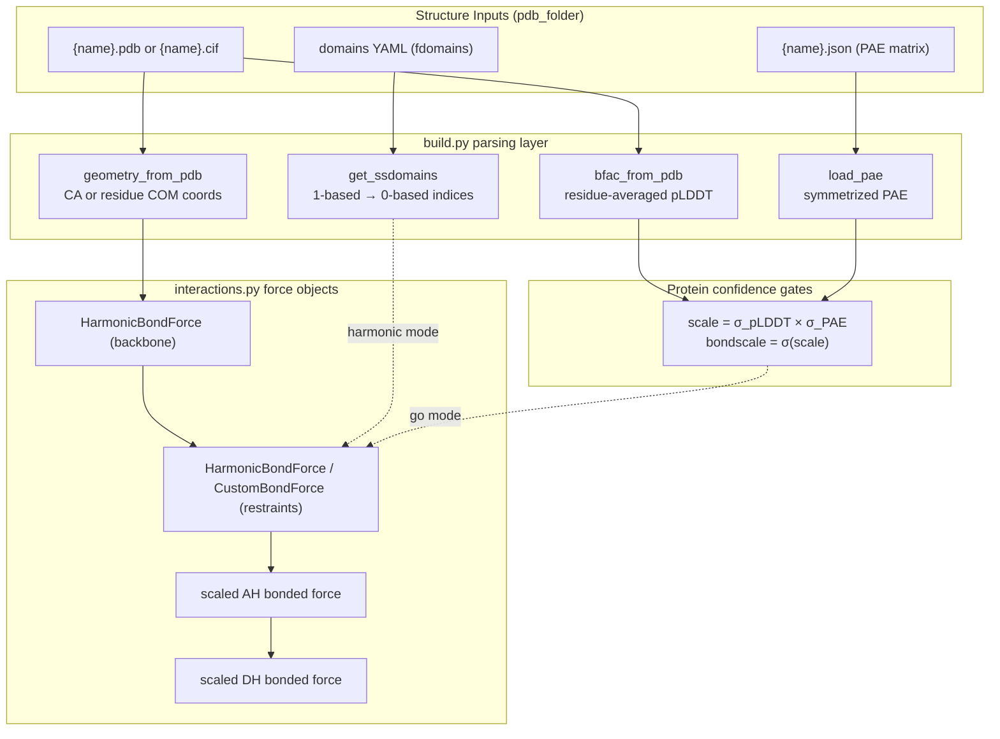
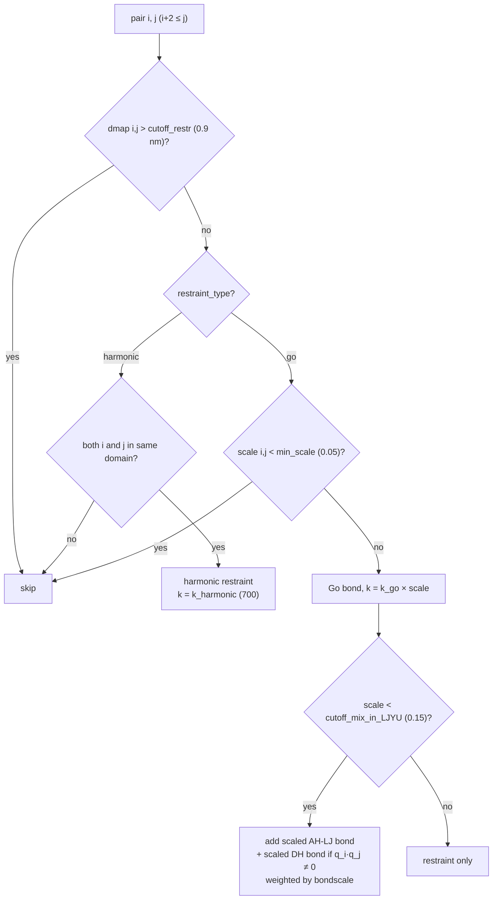

CALVADOS treats intrinsically disordered regions (IDRs) as flexible beads, but many biologically relevant systems contain folded domains whose shape must persist during coarse-grained simulation. This page explains how the framework converts a PDB/mmCIF structure — typically an AlphaFold prediction — into covalent topology adjustments and long-range restraints. Two restraint philosophies are supported: **domain-based harmonic restraints** for single-chain IDP+folded-domain hybrids, and **Go-type restraints gated by AlphaFold confidence signals** (pLDDT and PAE). The logic lives in three modules: `inputmodels.py` (validation), `build.py` (structure parsing), and `components.py` (restraint assembly).

Sources: [components.py](/calvados/components.py#L198-L234), [build.py](/calvados/build.py#L398-L490), [inputmodels.py](/calvados/inputmodels.py#L39-L119)

## Design Rationale: One Structure, Two Restraint Modes

The restraint system is a deliberate split of responsibilities. A single `restraint: bool` switch on `ComponentInput` changes the entire construction path of a `Protein`: instead of growing coordinates from geometric templates (`compact`, `spiral`, `linear`), the builder reads atomic coordinates, derives the amino-acid sequence from the structure itself, computes an intramolecular distance map, and uses that map to set both bond equilibrium lengths and non-bonded pair restraints. This design means a folded component never needs a FASTA file — the structure is the single source of truth.

Sources: [components.py](/calvados/components.py#L63-L76), [components.py](/calvados/components.py#L236-L267), [inputmodels.py](/calvados/inputmodels.py#L91-L98)

Sources: [build.py](/calvados/build.py#L310-L334), [components.py](/calvados/components.py#L216-L234)

## Configuration Surface

Restraint behavior is controlled entirely through `ComponentInput` fields validated by Pydantic. The validators enforce the dependency graph between inputs: `pdb_folder` is mandatory whenever `restraint=True`, and `fdomains` is additionally required for the harmonic mode. Lipids and crowders reject restraints outright, and RNA accepts only harmonic mode. If `restraint=False`, the validator flips the requirement — a FASTA file becomes mandatory.

| Field | Default | Role |
|---|---|---|
| `restraint` | `False` | Master switch: structure-derived build path |
| `restraint_type` | `"harmonic"` | `"harmonic"` or `"go"` |
| `pdb_folder` | `None` | Directory holding `{name}.pdb`/`.cif` (+ PAE JSON for Go) |
| `fdomains` | `None` | Domain definition file (harmonic mode) |
| `cutoff_restr` | `0.9` nm | Max native distance for a restraint pair |
| `k_harmonic` | `700.0` | Harmonic restraint force constant (kJ/mol/nm²) |
| `k_go` | `15.0` | Base Go restraint force constant |
| `use_com` | `True` | Bead = residue center of mass instead of Cα |
| `colabfold` | `0` | PAE JSON dialect selector (0, 1, 2) |
| `bfac_shift` / `bfac_width` | `0.8` / `50.0` | pLDDT sigmoid gate center and steepness |
| `pae_shift` / `pae_width` | `0.3` nm / `15.0` | PAE sigmoid gate center and steepness |

Sources: [inputmodels.py](/calvados/inputmodels.py#L29-L29), [inputmodels.py](/calvados/inputmodels.py#L60-L76), [inputmodels.py](/calvados/inputmodels.py#L100-L117)

> [!TIP]
> Because `ComponentInput` uses `extra="forbid"`, a misspelled key such as `restraints=True` fails validation at parse time rather than silently disabling restraints — always spell restraint parameters exactly as in the table above.

## Structural Input Resolution

The builder locates structure files through `Component.get_input_structure_file`, which prefers **mmCIF over PDB** when both exist in `pdb_folder`, and raises `FileNotFoundError` when neither is present. The same CIF-priority rule is duplicated independently in `Component.calc_comp_seq` and `RNA.calc_x_from_pdb`, so every consumer of the structure resolves files identically. Coordinates are extracted by `geometry_from_pdb`: the whole structure is centered on its center of mass, each bead is either the Cα position or the residue center of mass (per `use_com`), and all positions are converted from Ångström to nanometers. If the file contains periodic cell dimensions, they are returned alongside positions and later feed the periodic distance map via `calc_dmap`.

Sources: [components.py](/calvados/components.py#L191-L208), [build.py](/calvados/build.py#L310-L334), [components.py](/calvados/components.py#L141-L147)

Sequence derivation bypasses FASTA entirely in restraint mode. `seq_from_pdb` reads residue names through MDAnalysis, converts three-letter codes to one-letter (unknown codes become `X`), and — critically — does **not** assume residues are numbered from 1. Instead it walks atom segments and records zero-based terminal indices per chain, which `Protein.calc_properties` later uses to patch terminal charges and masses (`patch_terminal_qs`, `patch_terminal_mws`). This is what makes multi-segment AlphaFold constructs (e.g., multimers in one file) charge-correct without extra configuration.

Sources: [sequence.py](/calvados/sequence.py#L37-L72), [components.py](/calvados/components.py#L63-L76), [components.py](/calvados/components.py#L246-L257)

## Harmonic Domain Restraints

The harmonic mode is driven by a domain file (`fdomains`) parsed by `build.get_ssdomains`. The default format is YAML: a top-level mapping from component name to a list of domains, each domain being a 1-based inclusive `[start, end]` range or a list of such sub-ranges (useful for discontinuous domains). An alternative DPAM tab-separated format (`uniprot`/`range` columns) is available through the `dpam` flag. All ranges are converted to zero-based residue index lists (`ssdomains`), and the conversion prints the resolved domains for auditability.

Sources: [build.py](/calvados/build.py#L448-L476), [components.py](/calvados/components.py#L210-L214)

Harmonic restraints apply at two structural levels with asymmetric membership tests:

1. **Backbone bonds** (`Protein.calc_bondlength`): consecutive pairs where *either* residue lies in any domain (`check_ssdomain(..., req_both=False)`) adopt their native distance `dmap[i,j]` as equilibrium bond length instead of the default residue-geometry value; inter-domain linkers keep the flexible default. This prevents domain-boundary bonds from stretching a rigid fold.
2. **Long-range restraint pairs** (`Protein.add_restraints`): all pairs with separation ≥ 2, native distance ≤ `cutoff_restr`, and *both* residues inside the *same* domain (`req_both=True`) receive an independent harmonic restraint with constant `k_harmonic`. IDR–IDR and IDR–domain contacts receive no long-range restraint at all.

Sources: [components.py](/calvados/components.py#L269-L303), [build.py](/calvados/build.py#L479-L490), [components.py](/calvados/components.py#L328-L387)

Sources: [components.py](/calvados/components.py#L328-L387)

## Go-Type Restraints with AlphaFold Confidence Gating

The Go mode replaces the binary domain logic with a **continuous confidence weighting** composed from two AlphaFold quality signals. First, residue-averaged B-factors (which AlphaFold populates with pLDDT values) are extracted per residue; values above a `confidence` threshold survive, others are zeroed, and the array is normalized to [0,1]. Second, the predicted aligned error (PAE) matrix is loaded from the companion JSON and converted to nanometers. Each signal is passed through a logistic sigmoid (`expit`) whose center and steepness are the `*_shift`/`*_width` parameters: `bfac_sigm` rises with local pLDDT, `pae_sigm` falls with pair PAE. Their element-wise product — using `np.minimum.outer(bfac, bfac)` so a pair's pLDDT score is limited by its worst residue — yields the pairwise restraint scale.

Sources: [build.py](/calvados/build.py#L398-L410), [components.py](/calvados/components.py#L216-L234)

A third, sharper sigmoid of the scale itself produces `bondscale`, which weights the *hybrid* bonded interactions for low-confidence pairs. The two regimes connect at the cutoffs visible in the decision flow above: pairs with `scale < min_scale` (0.05) are left fully flexible; pairs with `scale ≥ cutoff_mix_in_LJYU` (0.15) are treated as pure Go contacts; the band between receives a Go restraint **plus** scaled Ashbaugh-Hatch and Debye-Hückel *bonded* copies whose weights decay with `bondscale`. This hybrid smooths the transition from folded to disordered character instead of imposing a hard boundary.

| Signal | Source | Gate | Meaning at 1 |
|---|---|---|---|
| pLDDT (B-factor) | `{name}.pdb`/`.cif` tempfactors | rising sigmoid at `bfac_shift=0.8` | locally well-resolved |
| PAE | `{name}.json` | falling sigmoid at `pae_shift=0.3` nm | pair placement reliable |
| `scale` | product of gates | Go spring scaling `k_go × scale` | confident native contact |
| `bondscale` | σ(scale − 0.1, width 80) | weights scaled LJ/YU bonds | compensating native attraction |

Sources: [components.py](/calvados/components.py#L216-L234), [components.py](/calvados/components.py#L349-L374)

> [!TIP]
> In Go mode, `calc_go_scale` calls `bfac_from_pdb` with `confidence=0.0`, deliberately disabling the default 70-point hard filter — all soft thresholding is delegated to the sigmoid gates. If you write custom gating logic, do not assume B-factors below 70 have been zeroed.

The PAE JSON dialect must match its producer, selected via `colabfold`: `0` expects the AlphaFold database/EBI layout (`data[0]["predicted_aligned_error"]`), `1` the ColabFold key without list nesting, and `2` the modern `"pae"` key. The loader symmetrizes the matrix (`0.5 × (P + Pᵀ)`), so asymmetric input is tolerated. A related helper, `load_pae_inv`, returns a thresholded inverse PAE for other analyses but is not part of the restraint path.

Sources: [build.py](/calvados/build.py#L413-L445), [components.py](/calvados/components.py#L227-L231)

## Force Internals and Bookkeeping

Both restraint modes terminate in dedicated per-component force objects initialized by `interactions.init_restraints`. Harmonic mode reuses OpenMM's `HarmonicBondForce` with equilibrium distance `dmap[i,j]` and constant `k_harmonic`. Go mode constructs a `CustomBondForce` with the classic 10–12 potential `k*(5(s/r)^12 − 6(s/r)^10)`, storing per-bond parameters `s` (native distance) and `k` (scaled force constant). Every added restraint and bond is recorded in one-based pair lists (`restr_pairlist`, `bond_pairlist`) — one-based because that matches residue numbering in output files and user-facing tools.

Sources: [interactions.py](/calvados/interactions.py#L161-L176), [interactions.py](/calvados/interactions.py#L237-L258), [components.py](/calvados/components.py#L305-L313)

`Protein.add_restraints` returns an `exclusion_map` of restrained/bonded pairs. Because these pairs now carry explicit bonded interactions, they must be **excluded** from the global Ashbaugh-Hatch and Yukawa `CustomNonbondedForce` objects (commented in source as "for ah, yu etc.") during system assembly — `interactions.add_exclusion` is the corresponding utility, and the assembly orchestration itself is covered in [System Building & Geometry](13-system-building-and-geometry) and [Simulation Engine & Checkpointing](14-simulation-engine-and-checkpointing). `Protein.get_forces` finally aggregates the bonded force plus, for Go mode, the two scaled-bond forces into the component's force inventory.

Sources: [components.py](/calvados/components.py#L328-L336), [components.py](/calvados/components.py#L407-L413), [interactions.py](/calvados/interactions.py#L292-L297)

Every restraint run leaves auditable artifacts next to the simulation inputs, which makes energy validation and restraint inspection possible without re-running the build:

| Artifact | Contents | Mode |
|---|---|---|
| `bonds_{name}.txt` | pair, bond-force index, d₀ [nm], k | always (structure-derived in restraint mode) |
| `restr_{name}.txt` | pair, d₀ [nm], force constant | harmonic & go |
| `scaled_LJ_{name}.txt` | pair, σ, λ, `bondscale[i,j]` | go only |
| `scaled_YU_{name}.txt` | pair, `bondscale[i,j]` | go only |

Sources: [components.py](/calvados/components.py#L150-L158), [components.py](/calvados/components.py#L389-L405)

## RNA Extension: Two-Bead Domain Mapping

RNA components carry two beads per residue (phosphate `p` + nucleobase), so domain logic needs a translation layer. `RNA.calc_ssdomains` expands each zero-based residue index `s` into bead indices `2s` and `2s+1`. Beyond bonds, three RNA structural properties are swapped to structure-derived values inside domains (`req_both=False`): bond equilibrium lengths come from `dmap`, the neighboring-base σ is derived as `dmap/(2^(1/6))`, and backbone angles are computed geometrically by `calc_angmap` from the input coordinates. When restraint mode is on, `RNA.calc_comp_seq` even derives a synthetic one-bead sequence typing each residue as `s` (structured) or `r` (RNA/disordered) based on domain membership — demonstrating that the restraint subsystem can override the entire input model, not just coordinates.

Sources: [components.py](/calvados/components.py#L416-L453), [components.py](/calvados/components.py#L511-L565), [components.py](/calvados/components.py#L567-L595)

## Worked Example: `single_AF_CALVADOS`

The reference Go-mode workflow in `examples/single_AF_CALVADOS` shows the minimal configuration surface. The example simulates AF-P00698 (HEWL) as a single copy in a 50 nm cubic box: the component is declared with `restraint = True`, `restraint_type = 'go'`, `pdb_folder` pointing at `input/`, `colabfold = 0` (EBI AlphaFold PAE dialect), `k_go = 15.0`, and `use_com = True`. The `input/` folder ships the PAE JSON (`AF-P00698.json`); the PDB/mmCIF named after the component must sit in the same folder, since `components.add(name=...)` triggers file resolution and sequence extraction at build time. For the harmonic-mode counterpart — full-length A1 with folded-domain residue ranges — see `examples/custom_restraints`, and note that its *simulation-level* `custom_restraints` feature (user-supplied restraint files on `SimulationInput`) is a separate mechanism documented in [Extension & Custom Forces](18-extension-and-custom-forces).

Sources: [examples/single_AF_CALVADOS/prepare.py](/examples/single_AF_CALVADOS/prepare.py#L30-L68), [examples/single_AF_CALVADOS/README.md](/examples/single_AF_CALVADOS/README.md#L1-L9), [examples/custom_restraints/README.md](/examples/custom_restraints/README.md#L1-L9)

## Relation to the Wider System

Structure-based restraints sit at the intersection of several other subsystems: the `kb` backbone spring and residue `bondlength` values it modifies are defined in the residue database covered by [Residue Parameter Database](8-residue-parameter-database); the scaled AH and DH forces it instantiates are bonded replicas of the potentials described in [Ashbaugh-Hatch Hydrophobic Interactions](6-ashbaugh-hatch-hydrophobic-interactions) and [Debye-Hückel Electrostatics](7-debye-huckel-electrostatics); and `Protein` is one member of the molecule-type hierarchy introduced in [Component Registry & Molecule Types](9-component-registry-and-molecule-types). To observe the resulting restraint geometry in a simulation, proceed to [System Building & Geometry](13-system-building-and-geometry), and to validate that restrained structures keep their native distances during dynamics, see [Trajectory Analysis Toolkit](15-trajectory-analysis-toolkit).
