CALVADOS separates *what* a simulation is from *how* it runs. Instead of hand-editing fragile scripts, you declare simulation settings, molecular components, and cluster job parameters as keyword arguments in a `prepare.py` script; the library validates them against strict Pydantic schemas and serializes them to portable YAML artifacts. This page explains that declarative pipeline end-to-end: the facade classes in `calvados/cfg.py`, the validation models in `calvados/inputmodels.py`, the cross-field consistency rules, and how the same schemas re-validate YAML at execution time inside `calvados/sim.py`. It covers the configuration contract only — how validated settings drive OpenMM system construction is deferred to [System Building & Geometry](13-system-building-and-geometry).

## The Three-Layer Validation Architecture

The configuration system follows a deliberate three-layer design. Layer one is the **authoring facade** (`cfg.py`), which accepts keyword arguments and delegates all validation. Layer two is the **schema layer** (`inputmodels.py`), where three Pydantic models — `SimulationInput`, `ComponentInput`, and `JobInput` — define every permitted field, its type, its default, and the cross-field invariants. Layer three is **runtime re-validation**: the generated `run.py` script calls `sim.run()`, which reloads the YAML files from disk and passes them through `validate_inputs()` before any OpenMM object is constructed. The consequence is that a simulation can never start from unvalidated state, whether the YAML was produced by the facade or edited by hand.

```mermaid
flowchart LR
    subgraph L1["Layer 1 · Authoring facade (cfg.py)"]
        C["Config&#40;**params&#41;"]
        CO["Components&#40;**defaults&#41;<br/>.add&#40;name, **overrides&#41;"]
        J["Job&#40;**settings&#41;"]
    end
    subgraph L2["Layer 2 · Schemas (inputmodels.py)"]
        SI["SimulationInput"]
        CI["ComponentInput"]
        JI["JobInput"]
    end
    subgraph L3["Layer 3 · Runtime (sim.py)"]
        VI["validate_inputs&#40;&#41;"]
        S["Sim → OpenMM"]
    end
    C --> SI
    CO --> CI
    J --> JI
    SI -->|"config.yaml"| Y[(YAML artifacts)]
    CI -->|"components.yaml"| Y
    JI -->|"Jinja render"| RS["run.py + job.sh"]
    Y --> R["run.py → sim.run&#40;&#41;"]
    RS --> R
    R --> VI
    VI --> S
```

Each facade constructor performs validation *immediately* in `__init__` — there is no deferred or lazy checking. `Config.__init__` calls `SimulationInput.model_validate(params)` and stores the JSON-mode dump (`cfg.py` L45–48); `Job.__init__` does the same with `JobInput` (`cfg.py` L146–151); `Components` validates eagerly per-component inside `add()` (`cfg.py` L107–118). At execution time, `Sim.__init__` invokes the exact same schemas through `validate_inputs` (`sim.py` L51), closing the loop.

Sources: [cfg.py](calvados/cfg.py#L37-L61), [cfg.py](calvados/cfg.py#L88-L134), [cfg.py](calvados/cfg.py#L138-L182), [inputmodels.py](calvados/inputmodels.py#L270-L328), [sim.py](calvados/sim.py#L41-L82)

## The Facade Trio: Config, Components, Job

The public API surface for configuration is intentionally small — three classes, each paired with one schema, each producing one artifact. `Config` writes `config.yaml` plus a generated `run.py` runner; `Components` writes `components.yaml` describing the molecular contents; `Job` renders a cluster submission script from packaged Jinja templates. A typical `prepare.py` (as in every example under `examples/`) instantiates all three, calls `write()` on each, and the resulting directory is self-contained and reproducible.

| Facade class | Backing schema | Primary artifact | Companion output | Reference |
|---|---|---|---|---|
| `Config` | `SimulationInput` | `config.yaml` | `run.py` (runner + optional analysis code) | [cfg.py](calvados/cfg.py#L37-L84) |
| `Components` | `ComponentInput` | `components.yaml` | — | [cfg.py](calvados/cfg.py#L88-L134) |
| `Job` | `JobInput` | `job.sh` (Jinja-rendered) | submission via `sbatch`/`qsub` | [cfg.py](calvados/cfg.py#L138-L182) |

The generated `run.py` deserves attention because it is the *contract* between preparation and execution: a static script that parses `--path`, `--config`, and `--components` arguments and calls `sim.run(path=..., fconfig=..., fcomponents=...)` (`cfg.py` L63–84). Crucially, `Config.write(path, name, analyses=...)` appends arbitrary Python code after the runner body (`cfg.py` L83–84), which is how examples such as `single_IDR` inject trajectory-analysis calls that execute automatically after the simulation finishes. This mechanism connects the configuration page to the analysis stack documented in [Trajectory Analysis Toolkit](15-trajectory-analysis-toolkit).

Sources: [cfg.py](calvados/cfg.py#L63-L84), [single_IDR/prepare.py](examples/single_IDR/prepare.py#L26-L73), [slab_IDR/prepare.py](examples/slab_IDR/prepare.py#L50-L65)

## Typed Field Discipline in the Input Models

The schemas enforce correctness through Pydantic's constrained types and module-level type aliases, all defined at the top of `inputmodels.py`. Four aliases act as closed vocabularies: `MoleculeType` enumerates the eight supported component classes, `RestraintChoices` restricts restraints to `harmonic` or `go`, and `TopolType` restricts initial placement to six geometry presets. Because `molecule_type` is later used as a dispatch key into `COMPONENT_REGISTRY` (`sim.py` L90), the `Literal` alias guarantees the registry lookup can never fail on a misspelled type at configuration time.

| Type alias | Accepted values | Downstream consumer |
|---|---|---|
| `MoleculeType` | `protein`, `rna`, `lipid`, `cooke_lipid`, `crowder`, `cyclic`, `seastar`, `ptm_protein` | `COMPONENT_REGISTRY` dispatch | 
| `RestraintChoices` | `harmonic`, `go` | restraint force construction |
| `TopolType` | `single`, `slab`, `grid`, `center`, `shift_ref_bead`, `random` | box placement (`build.py`) |
| `InputPath` | `PathLike[str] \| str` | file-path fields throughout both schemas |

Field-level constraints catch physical impossibilities before any code runs: box lengths and temperatures must be `PositiveFloat`, molecule counts `NonNegativeInt`, ionic strength `NonNegativeFloat` (`inputmodels.py` L133–136). Both `SimulationInput` and `ComponentInput` set `model_config = ConfigDict(extra="forbid")` (`inputmodels.py` L48, L131) — unknown keys are hard errors, not silently ignored kwargs. `SimulationInput` marks exactly four fields as required (`box`, `temp`, `ionic`, `pH`); every other field carries a default matching CALVADOS 2 physics parameters, so a minimal declaration of four values yields a fully specified simulation.

> [!TIP]
> `extra="forbid"` converts the most common configuration bug — a typo such as `tempp` instead of `temp` — into an immediate `ValidationError` at declaration time, rather than a silently ignored key discovered hours into a cluster job. The test suite pins this behavior explicitly: `test_config_rejects_unknown_fields` asserts that `tempp=300` raises (`test_cfg.py` L22–30).

Sources: [inputmodels.py](calvados/inputmodels.py#L17-L37), [inputmodels.py](calvados/inputmodels.py#L39-L89), [inputmodels.py](calvados/inputmodels.py#L122-L179), [sim.py](calvados/sim.py#L89-L91), [test_cfg.py](tests/test_cfg.py#L22-L30)

## Component Configuration: Defaults and Shadow Overrides

`Components` implements an inheritance-by-override pattern modeled directly on the YAML file shape it produces. The constructor captures shared defaults (`cfg.py` L95–101); `add(name, **overrides)` merges defaults with overrides into a *complete* raw dict, validates it as a full `ComponentInput`, then stores **only the override keys** under the component name (`cfg.py` L112–124). The written `components.yaml` therefore contains a `defaults` section plus per-component diffs — the same structure `validate_inputs` reconstructs at runtime by re-merging `{**defaults, **overrides, "name": name}` before validation (`inputmodels.py` L302–307). Two helper functions support this: `model_defaults` extracts declared defaults from non-required model fields (`cfg.py` L13–19), and `serialize_fields` re-validates the defaults dict field-by-field through `TypeAdapter` so the YAML output is canonical JSON-compatible Python (`cfg.py` L22–33).

```mermaid
flowchart TB
    D["self.defaults<br/>&#40;model_defaults + kwargs&#41;"] -->|"&#42;&#42;merge"| RAW["raw = defaults ⊕ overrides ⊕ name"]
    RAW --> V["ComponentInput.model_validate"]
    V --> DUMP["model_dump&#40;mode='json'&#41;"]
    D --> SER["serialize_fields → canonical defaults"]
    DUMP --> PICK["system[name] = {override keys only}"]
    SER --> W["components.yaml:<br/>defaults + per-component diffs"]
    PICK --> W
    W --> R["Runtime: validate_inputs re-merges<br/>defaults ⊕ overrides per component"]
```

The examples show how economical this makes multi-component systems. In `slab_IDR/prepare.py`, shared defaults (protein type, single molecule, no restraints, both termini charged, residues and FASTA paths) are declared once, and the entire 100-molecule condensate is a single line: `components.add(name=args.name, nmol=100)` (`slab_IDR/prepare.py` L67–79). Validation still applies per-component even under defaults: the test suite demonstrates that adding a component with `nmol=-1` raises `ValidationError` while the previously added component remains intact (`test_cfg.py` L33–49).

> [!TIP]
> The diff-based YAML means `defaults` is the single point of truth for every field not explicitly overridden. Because `validate_inputs` re-merges defaults with overrides at load time, hand-editing one line in the `defaults:` section of `components.yaml` reconfigures *all* components that don't shadow it — a powerful lever, and one to handle deliberately when editing prepared inputs.

Sources: [cfg.py](calvados/cfg.py#L13-L33), [cfg.py](calvados/cfg.py#L95-L124), [inputmodels.py](calvados/inputmodels.py#L295-L307), [slab_IDR/prepare.py](examples/slab_IDR/prepare.py#L67-L82), [test_cfg.py](tests/test_cfg.py#L33-L49)

## Cross-Field Validation Rules

Field types catch *malformed* values; `@model_validator(mode="after")` hooks catch *inconsistent* combinations. `ComponentInput` implements one composite validator with six rules governing input-source compatibility (`inputmodels.py` L91–119). `SimulationInput` implements five separate validators, each owning one physical concern (`inputmodels.py` L181–250). All rules fire at declaration time and again at load time, so hand-edited YAML cannot bypass them.

**`ComponentInput` source-compatibility rules** (validated by the parametrized test at `test_cfg.py` L134–199):

| # | Condition | Requirement | Failure message |
|---|---|---|---|
| 1 | `restraint=False` | `ffasta` must be provided | "ffasta must be provided when restraint is False" |
| 2 | `molecule_type == "ptm_protein"` | `ffasta` must be provided | "ffasta must be provided for ptm_protein components" |
| 3 | `restraint=True` | `pdb_folder` must be provided | "pdb_folder must be provided when restraint is True" |
| 4 | `restraint=True` + harmonic | `fdomains` must be provided | "fdomains must be provided for harmonic restraints" |
| 5 | `restraint=True` + lipid/cooke_lipid/crowder | forbidden entirely | "Restraints cannot be used for lipids or crowders" |
| 6 | `molecule_type == "rna"` + `restraint_type == "go"` | forbidden | "RNA restraints can only be harmonic." |

**`SimulationInput` cross-field validators**:

| Validator | Invariant enforced | Reference |
|---|---|---|
| `validate_simulation_duration` | `steps` XOR `runtime` (never both, never neither — defaults to 100,000,000 steps) | [inputmodels.py](calvados/inputmodels.py#L181-L190) |
| `validate_pressure_settings` | `box_eq` XOR `bilayer_eq`; `box_eq` needs a scalable axis; `pressure` required whenever pressure coupling or either equilibration is enabled | [inputmodels.py](calvados/inputmodels.py#L192-L208) |
| `validate_external_force_settings` | `slab_eq` and `ext_force` are mutually exclusive | [inputmodels.py](calvados/inputmodels.py#L210-L216) |
| `validate_slab_geometry` | slab mode requires `slab_width < box_z`; `slab_outer` must satisfy `slab_width/2 ≤ slab_outer < box_z/2` | [inputmodels.py](calvados/inputmodels.py#L218-L241) |
| `validate_pressure_coupling` | `pressure_coupling` requires `box_eq` or `bilayer_eq` | [inputmodels.py](calvados/inputmodels.py#L243-L250) |

The slab-geometry validator illustrates why schema-level checks matter: it compares configured slab regions against the actual box vector (`self.box[2]`), catching a physically unsound declaration — a slab wider than its box — as a `ValueError` with an actionable message rather than as corrupted trajectory output downstream. The slab example's declaration of `box=[15, 15, 150]` with `slab_width=20` satisfies these invariants (`slab_IDR/prepare.py` L21–42).

Sources: [inputmodels.py](calvados/inputmodels.py#L91-L119), [inputmodels.py](calvados/inputmodels.py#L181-L250), [test_cfg.py](tests/test_cfg.py#L134-L199), [slab_IDR/prepare.py](examples/slab_IDR/prepare.py#L21-L42)

## System-Level Consistency with validate_inputs

Some invariants span the config and components files and therefore cannot live in either single model. `validate_inputs` is the composite gate (`inputmodels.py` L270–328). It first validates the config, then structurally checks the components mapping itself — rejecting unknown top-level sections other than `defaults`/`system`, non-mapping sections, and non-string component names — before validating each resolved component individually (`inputmodels.py` L277–307). It closes with two cross-file rules: a system may not mix `lipid` and `cooke_lipid` types, and a slab system containing crowders must declare `slab_outer` (`inputmodels.py` L309–325).

```mermaid
flowchart TB
    A["config dict"] --> B["SimulationInput.model_validate"]
    B --> C{"components is Mapping?"}
    C -->|no| ERR1["TypeError"]
    C -->|yes| D{"only 'defaults'<br/>and 'system' sections?"}
    D -->|no| ERR2["ValueError: Unknown sections"]
    D -->|yes| E["merge defaults ⊕ overrides<br/>per component → ComponentInput"]
    E --> F{"lipid + cooke_lipid<br/>both present?"}
    F -->|yes| ERR3["ValueError"]
    F -->|no| G{"slab + crowders<br/>without slab_outer?"}
    G -->|yes| ERR4["ValueError"]
    G -->|no| H["&#40;SimulationInput, dict[str, ComponentInput]&#41;"]
```

This function is also the *runtime* validation entry point. `sim.run()` loads `config.yaml` and `components.yaml` with `yaml.safe_load` and passes the raw mappings straight into `Sim.__init__`, which calls `validate_inputs` as its first act (`sim.py` L871–887, L51). Schema validation and environmental validation are deliberately split: the schema confirms logical consistency, while `Sim.__init__` verifies the filesystem — resolving `frestart` to an absolute path under `path` and raising `FileNotFoundError` if a `pdb`/`cif` restart file is missing (`sim.py` L59–67). It also applies temporal context the schema cannot know, such as disabling slab/box equilibration when a checkpoint already exists (`sim.py` L69–72), and enforcing the topology cardinality rule that `single`/`center` topologies cannot host multiple molecules (`sim.py` L126–130).

Sources: [inputmodels.py](calvados/inputmodels.py#L270-L328), [sim.py](calvados/sim.py#L41-L82), [sim.py](calvados/sim.py#L871-L887), [test_cfg.py](tests/test_cfg.py#L85-L131)

## The Job Layer: Rendering Cluster Scripts

The `Job` class completes the declarative contract by handling execution logistics. Its settings are validated by `JobInput` — the smallest schema, with four fields: the Jinja template name, the environment setup file, the Conda environment name, and the batch system (`inputmodels.py` L254–267). Templates are resolved from packaged resources via `importlib.resources` into `calvados/data/templates`, which ships three variants: `robust.jinja` (the default), `computerome.jinja`, and `deic.jinja` (`cfg.py` L146–151). Rendering merges job settings with the *entire validated config dict* plus the config and components filenames, so the submission script inherits every simulation parameter without duplication (`cfg.py` L153–171).

| Setting | Default | Role |
|---|---|---|
| `template` | `"robust.jinja"` | packaged template selected for rendering |
| `fbash` | `~/.bashrc` | shell setup sourced in the job |
| `envname` | `"calvados"` | Conda environment activated |
| `batch_sys` | `SLURM` | `SLURM` or `PBS` submission command |

The test suite verifies the rendered output concretely: after writing config, components, and job into a temp directory, it asserts the resulting `job.sh` contains both `source /tmp/test.bashrc` and `conda activate calvados` (`test_cfg.py` L52–73). `Job.submit()` dispatches `sbatch` or `qsub` in a loop with a 0.5 s pause between submissions, with one asymmetry enforced in code: multi-job submission is supported only for SLURM, and PBS raises `ValueError` when `njobs > 1` (`cfg.py` L173–182).

Sources: [inputmodels.py](calvados/inputmodels.py#L254-L267), [cfg.py](calvados/cfg.py#L138-L182), [test_cfg.py](tests/test_cfg.py#L52-L82)

## Validation as a Tested Contract

The schema layer is treated as a contract under test rather than incidental plumbing. `tests/test_cfg.py` covers four behavioral axes: (1) *defaults and serialization* — a four-argument `Config` produces a fully populated dump whose YAML round-trip is byte-equal (`test_cfg.py` L11–19); (2) *fail-fast rejection* — unknown fields raise in both `Config` and `Job` (`test_cfg.py` L22–30, L76–82); (3) *shape preservation* — written `components.yaml` keeps the defaults/diff structure with canonicalized values (`test_cfg.py` L33–49); (4) *composite consistency* — `validate_inputs` resolution, malformed-section errors, and all six `ComponentInput` compatibility rules via parametrized cases (`test_cfg.py` L85–199). Together these tests document the intended failure modes as precisely as the schemas document the accepted inputs — further validation strategy, including energy-conservation checks, is covered in [Testing & Energy Validation](19-testing-and-energy-validation).

Sources: [test_cfg.py](tests/test_cfg.py#L1-L199)

## Next Steps

With the configuration contract established, the natural progression through the Deep Dive is: how `molecule_type` resolves into concrete component classes in [Component Registry & Molecule Types](9-component-registry-and-molecule-types); how the restraint-related fields validated here (`restraint`, `pdb_folder`, `fdomains`, AlphaFold options) drive structure guidance in [Structure-Based Restraints & AlphaFold Guidance](11-structure-based-restraints-and-alphafold-guidance); and how validated settings become an OpenMM system in [System Building & Geometry](13-system-building-and-geometry), then execute with checkpointing in [Simulation Engine & Checkpointing](14-simulation-engine-and-checkpointing). To see the full declarative workflow in a runnable context, the `examples/single_IDR/prepare.py` and `examples/slab_IDR/prepare.py` files are the canonical starting points.