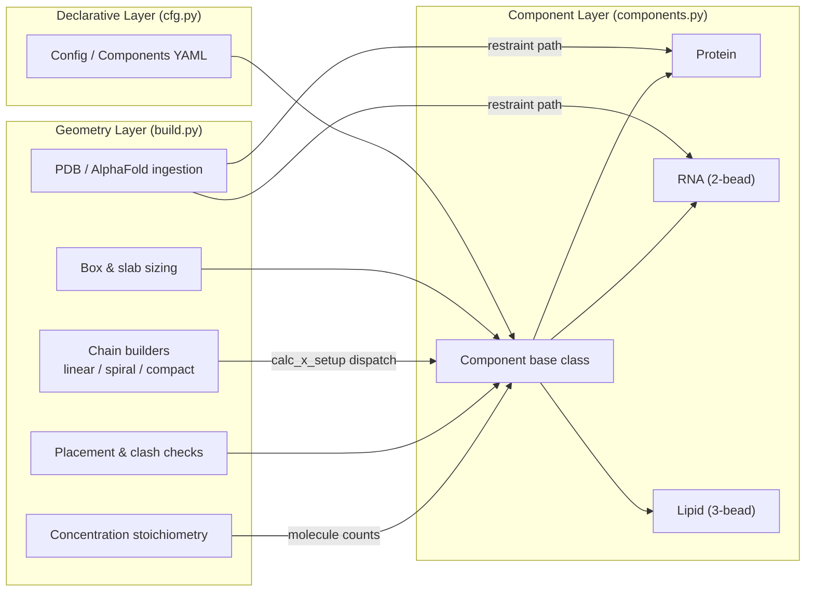
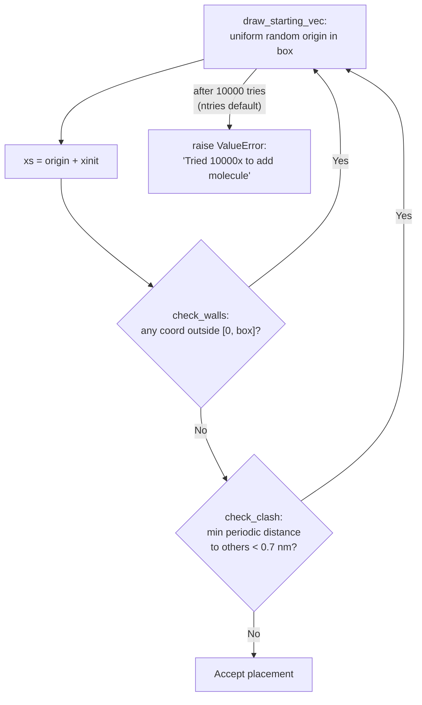
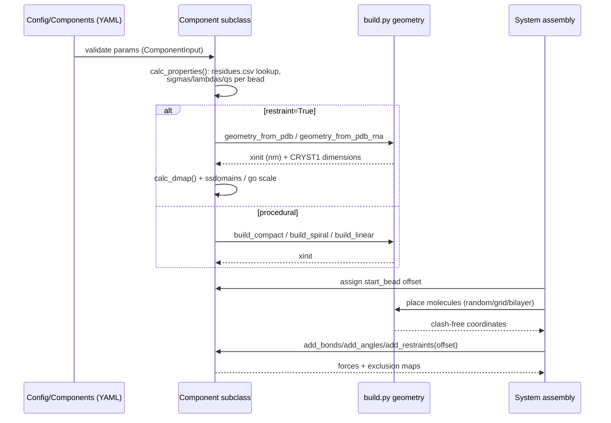

Every molecular dynamics trajectory is only as trustworthy as its first frame. In CALVADOS, the *System Building & Geometry* subsystem is responsible for producing that frame: the periodic box vectors, the initial coarse-grained conformations of every chain, their spatial placement relative to walls and to each other, and the bonded bookkeeping that the simulation engine will later consume. This page dissects the geometry toolkit in `calvados/build.py` — a library of stateless NumPy/MDAnalysis functions — and shows how the object-oriented `Component` hierarchy in `calvados/components.py` composes those primitives into a complete system. By the end, you will understand how a slab of IDRs, a membrane bilayer, a two-bead RNA model, or an AlphaFold-guided folded protein each acquire their initial geometry, and how concentration-based stoichiometry closes the loop between experiment and simulation box.

Sources: [build.py](calvados/build.py#L18-L31), [components.py](calvados/components.py#L28-L52)

## Architectural Role: The Geometry Layer

CALVADOS separates *geometry* (pure functions over NumPy arrays) from *component semantics* (classes that own molecular identity). The `build` module contains no classes and no OpenMM forces — it answers questions like "where should bead *k* of a chain sit?" and "does this molecule clash with its neighbors?" The `components` module then consumes these answers: each `Component` subclass declares a `comp_setup` strategy ("compact", "spiral", or "linear") that `calc_x_setup` dispatches to the corresponding `build` function, then overlays structure-derived coordinates when restraints are requested. This layering means geometry primitives are independently testable and reusable across protein, RNA, and lipid components.

The diagram above shows the dependency direction: declarative YAML parameters (covered in [Declarative Configuration & Validation](12-declarative-configuration-and-validation)) flow into components, which call *into* the geometry layer — never the reverse. This one-way dependency keeps the geometry layer free of component-specific knowledge.

Sources: [build.py](calvados/build.py#L15-L17), [components.py](calvados/components.py#L16-L26), [components.py](calvados/components.py#L113-L133), [cfg.py](calvados/cfg.py#L88-L101)

## Box Vectors and Periodic Geometry

The foundation of every system is the orthogonal simulation box. `build_box` converts three edge lengths in nanometers into OpenMM `unit.Quantity` vectors, deliberately zeroing the off-diagonal elements — CALVADOS constructs only orthorhombic boxes with box vectors aligned to the coordinate axes. For typical slab phase-separation setups, `calc_box` provides conservative defaults chosen by chain length: a 20×20×200 nm box for chains of 350 residues or fewer, expanded to 25×25×300 nm for longer chains. The slab geometry assumes an *area* bead density (`pbeads`, default 90 nm⁻²), so `calc_nprot_slab` computes how many chains of length *N* fill the box cross-section: `int(pbeads · Lx · Ly / N)`.

Sources: [build.py](calvados/build.py#L21-L44)

Placement correctness is enforced by two validation primitives. `check_walls` rejects any coordinate outside `[0, box]`, while `check_clash` computes the full pairwise distance array via MDAnalysis and rejects molecules whose periodic minimum distance to already-placed content falls below a 0.7 nm cutoff.

> [!TIP]
> Note the box augmentation inside `check_clash`: the three box lengths are padded with `[90, 90, 90]` before calling `distances.distance_array`. MDAnalysis expects the full six-parameter cell (three lengths plus three angles), and hard-coding 90° angles silently documents that all clash detection assumes orthorhombic periodicity — a constraint inherited from `build_box` itself.

Sources: [build.py](calvados/build.py#L47-L63), [build.py](calvados/build.py#L66-L78)

## Chain Conformation Generators

Before placement, each molecule needs an internal conformation `xinit`. CALVADOS offers three procedural generators, selected per component class via the `comp_setup` class attribute:

| Strategy | Algorithm | Bead spacing | Default user | Purpose |
|---|---|---|---|---|
| `linear` | Cumulative sum of midpoints between consecutive bond lengths along z, centered at origin | Per-residue `bondlength` from residue DB | `Lipid` (`comp_setup = "linear"`) | Extended rod for lipids |
| `compact` | Serpentine traversal of a cubic lattice sized `ceil(∛nbeads)`, with direction flips per row and per layer | Uniform `d` (0.38 nm) | `Component` base | Dense globule; keeps bonded neighbors close to avoid initial clashes |
| `spiral` | Archimedean spiral `r = b·φ` with `b = separation/(2π)`; φ advances by `arc/r` per bead | Arc step 0.38 nm, radial separation 0.7 nm | `RNA` (`comp_setup = "spiral"`) | Space-filling, low-strain start for flexible chains |

Sources: [build.py](calvados/build.py#L81-L127), [build.py](calvados/build.py#L130-L160), [components.py](calvados/components.py#L34-L34), [components.py](calvados/components.py#L422-L422), [components.py](calvados/components.py#L783-L783)

The dispatch happens in `Component.calc_x_setup`: `"spiral"` routes to `build_spiral` with the per-residue bond lengths as arc segments, `"compact"` routes to `build_compact`, and any other value falls through to `build_linear`. A defensive check then verifies that the generated coordinate array length equals the bead count. The RNA subclass overrides this method entirely: because its two-bead model interleaves phosphate and base beads (`seq2 = "p" + base` per residue, giving `nbeads = 2 × nres`), it feeds only the phosphate bond lengths (`bondlengths[1::2]`) into the spiral with `arc = 0.59` nm and `n_per_res = 2`, and explicitly forbids the compact arrangement for the two-bead model.

Sources: [components.py](calvados/components.py#L113-L133), [components.py](calvados/components.py#L511-L539), [components.py](calvados/components.py#L625-L637)

The `compact` generator deserves a closer look, since it is the default for IDRs. Rather than scattering beads randomly — which risks bonded pairs starting at unphysically short distances and exploding under the harmonic bond force — it lays beads on a regular cubic grid in a serpentine (boustrophedon) path, then scales and centers the result by `0.5·N·d`. Bonded neighbors therefore always sit exactly one lattice spacing `d` apart in the first frame.

> [!TIP]
> The spiral builder's Archimedean form `r = b·φ` guarantees constant radial spacing between successive turns (`separation`, default 0.7 nm), not constant arc length. The step size `arc` controls *along-chain* spacing while `separation` controls *between-chain* proximity in the coiled state — so these two parameters tune different physical constraints and should not be confused when adjusting initial conformations.

Sources: [build.py](calvados/build.py#L108-L127), [build.py](calvados/build.py#L144-L160)

## Molecule Placement Strategies

With conformations in hand, molecules must be positioned in the box. CALVADOS implements four placement strategies, each returning a translated copy of `xinit`:

| Function | Geometry | Clash handling | Typical scenario |
|---|---|---|---|
| `random_placement` | Uniform random origin anywhere in the box | Wall check + 0.7 nm clash cutoff, up to 10000 attempts | Bulk/dilute-phase boxes |
| `build_xybilayer` | Centered at `z = box[2]/2 − 1.5` nm; `upward=True` flips the chain and shifts +3 nm | Tighter 0.5 nm cutoff; returns `inserted` flag instead of raising | Lipid bilayers, membrane-interacting slabs |
| `build_xygrid` | 2D lattice at fixed z, `nx = ny = ceil(√N) + padding` cells dividing Lx and Ly | None (deterministic spacing) | Slab interfaces with ordered rows |
| `build_xyzgrid` | Staggered 3D lattice; per-axis cell counts allocated proportionally to box aspect ratio, with half-cell offsets between adjacent planes | None (deterministic spacing) | Dense multi-chain bulk fills |

Sources: [build.py](calvados/build.py#L163-L179), [build.py](calvados/build.py#L182-L205), [build.py](calvados/build.py#L208-L234), [build.py](calvados/build.py#L237-L306)

The stochastic path is the one worth tracing, because its failure mode is diagnostic:

Three properties of this loop matter operationally. First, `draw_starting_vec` uses `np.random.random(size=3) * box` — placement reproducibility therefore depends on the caller seeding NumPy's global RNG. Second, the clash check is *incremental*: `xs_others` accumulates all previously accepted positions, so later molecules see earlier ones. Third, exhausting 10000 attempts raises rather than silently degrading — which means a `ValueError` from `random_placement` is almost always a signal that the box is too small for the requested number of chains, not a transient numerical issue.

Sources: [build.py](calvados/build.py#L163-L179), [build.py](calvados/build.py#L66-L78)

The deterministic builders encode domain-specific geometry. `build_xybilayer` is notable for its asymmetric leaflet handling: it re-centers the molecule's z-coordinates on bead index 1 (an anchor bead for the lipid geometry), shifts to the bilayer plane at `box[2]/2 − 1.5` nm, and when `upward=True` reverses the bead order and adds a 3 nm offset to produce the opposing leaflet. `build_xyzgrid` performs a nontrivial allocation: it computes `r = box/sum(box)`, solves `a = ∛(N/∏r)` for a proportional grid, floors it, then repairs the product of cell counts upward on the axis with the largest relative deviation until the lattice can hold all `N` molecules — ensuring the grid respects the box's shape rather than forcing a cube.

Sources: [build.py](calvados/build.py#L182-L205), [build.py](calvados/build.py#L237-L252)

## Structure-Guided Initial Geometry

When a component carries structural restraints, procedural conformations are replaced by real coordinates parsed from PDB or mmCIF files. `geometry_from_pdb` centers the structure on its center of mass, then extracts either the Cα atom positions or — with `use_com=True` — per-residue center-of-mass positions, converting Ångströms to nanometers (`/10.0`) throughout. It also reads the CRYST1 box dimensions when present, returning them so periodic distance maps can be computed. The RNA variant implements the two-bead mapping geometrically: without `use_com`, each residue contributes a phosphate bead (atom `P`) plus a base bead (`N1` for pyrimidines U/C/T, `N9` for purines A/G — an invalid resname raises immediately); with `use_com`, it averages 19 named backbone atoms and the remaining atoms separately.

Sources: [build.py](calvados/build.py#L310-L334), [build.py](calvados/build.py#L337-L395), [components.py](calvados/components.py#L424-L440)

The restraint path in `Protein.calc_properties` orchestrates the full geometry extraction: load PDB coordinates via `calc_x_from_pdb`, compute the intramolecular distance map `dmap` (respecting periodic dimensions if the input structure declared a cell), then either load structured domains (`calc_ssdomains`) for harmonic restraints or build the AlphaFold confidence scaling (`calc_go_scale`). The latter combines two per-residue quality signals — residue-averaged pLDDT from B-factors (`bfac_from_pdb`, thresholded and normalized to [0,1]) and the PAE matrix from JSON (supporting three AlphaFold/ColabFold JSON layouts, symmetrized, converted to nm) — through logistic sigmoid filters into a pairwise `scale`, from which `bondscale` is derived. Components without restraints simply fall through to `calc_x_setup`.

Sources: [components.py](calvados/components.py#L236-L267), [components.py](calvados/components.py#L102-L111), [components.py](calvados/components.py#L216-L234), [build.py](calvados/build.py#L398-L445)

Structure knowledge even reshapes *bonded geometry*. The base `Component.calc_bondlength` returns the mean of the two residues' tabulated bond lengths, but `Protein.calc_bondlength` replaces this with the true PDB distance `dmap[i,j]` when either residue lies inside a structured domain (harmonic mode), or blends the tabulated and true distances weighted by `bondscale[i,j]` in the Go-like regime between `min_scale = 0.05` and `cutoff_mix_in_LJYU = 0.15`. The force definitions consuming these lengths are documented in [Structure-Based Restraints & AlphaFold Guidance](11-structure-based-restraints-and-alphafold-guidagement) — here we only note that geometry and force fields are co-designed at build time.

Sources: [components.py](calvados/components.py#L139-L142), [components.py](calvados/components.py#L269-L296), [build.py](calvados/build.py#L448-L490)

## Coordinate Assembly Pipeline

The final step is turning per-component geometry into one global system. CALVADOS uses an **offset-based bead allocation** scheme: each component carries a `start_bead` index, and every `add_bonds` / `add_angles` / `add_restraints` method receives an `offset` parameter to shift its local 0-based indices into the global system numbering. RNA adds a compositional wrinkle — bonds, angles, and neighboring-base terms each return their own exclusion lists so the nonbonded forces (Ashbaugh-Hatch, Yukawa) can omit interactions already covered by bonded terms. `restraint_check` in the RNA class explicitly excludes bead pairs that are already bonded, angled, or neighbor-base-restrained, preventing double-counting of interactions at build time.

Sources: [components.py](calvados/components.py#L44-L44), [components.py](calvados/components.py#L149-L166), [components.py](calvados/components.py#L597-L623), [components.py](calvados/components.py#L711-L723)

> [!TIP]
> Watch the index base carefully when reading the output artifacts: OpenMM force indices are 0-based, but `bond_pairlist` and `restr_pairlist` records are written **1-based** (the code comments `# 1-based` at `add_bonds`), because they target human-readable audit files like `bonds_{name}.txt`. Off-by-one confusion between these two representations is the most common mistake when programmatically cross-checking written bonds against a generated topology.

Sources: [components.py](calvados/components.py#L162-L165), [components.py](calvados/components.py#L172-L177), [components.py](calvados/components.py#L754-L767)

The complete build-time flow, from declarative input to a fully indexed system, looks like this:

Note that the sequence ends at *forces and exclusions* — handing the OpenMM system to the simulation driver is the next stage, covered in [Simulation Engine & Checkpointing](14-simulation-engine-and-checkpointing).

Sources: [components.py](calvados/components.py#L70-L100), [components.py](calvados/components.py#L407-L413), [components.py](calvados/components.py#L505-L509)

## Stoichiometry: From Concentration to Chain Count

Geometry fixes *where* molecules go; stoichiometry fixes *how many* go there. CALVADOS converts experimental mass concentrations into integer molecule counts using Avogadro's number and the nm³-to-liter factor: `n = p · 10⁻²⁴ · c · V · N_A / MW`, where `p` is the species' mass fraction, `c` the total concentration in g/L, `V` the box volume in nm³, and `MW` the sequence-derived molecular weight. The pair variant (`calc_pair_n_in_box`) rounds both counts to integers and then *recomputes* the realized mass fraction and concentration from the rounded counts — so the YAML parameters you requested are not exactly what the box contains, and the corrected values are returned for reporting. The N-species variant (`calc_mixture_n_in_box`) generalizes this, returning per-species counts, rounded mass fractions, and the realized total concentration.

| Function | Inputs | Returns | Rounding behavior |
|---|---|---|---|
| `conc_to_n` | fraction `p`, concentration, volume, MW | molecule count (float) | none |
| `n_to_conc` | count, volume, MW | g/L concentration | none |
| `calc_pair_n_in_box` | concentration, `pB`, box, two sequences | `nA`, `nB`, corrected `pB`, corrected `c` | rounds counts, back-computes |
| `calc_mixture_n_in_box` | concentration, fraction list, box, sequence list | count list, fraction array, total `c` | rounds counts, back-computes |

This "round-then-report" convention matters for reproducibility: mixing ratios in a simulation of 50 chains can only be approximated, and CALVADOS makes the *actual* composition explicit rather than letting consumers assume the requested one.

Sources: [build.py](calvados/build.py#L493-L505), [build.py](calvados/build.py#L508-L525), [build.py](calvados/build.py#L528-L553), [sequence.py](calvados/sequence.py#L16-L16)

## Key Takeaways

Three patterns define this subsystem. First, **geometry as pure functions**: `build.py` holds no state, making every sizing, placement, and parsing decision independently verifiable against its ~550 lines. Second, **strategy dispatch over inheritance**: `comp_setup` strings select chain builders, while restraint flags select structure-guided paths — one mechanism, no class explosion. Third, **validated assembly**: wall checks, periodic clash detection, exclusion maps, and back-computed stoichiometry all encode the invariant that the first frame must be physically sane before the integrator ever runs. To extend CALVADOS with a new molecule type or geometry, you now know precisely which layer to touch: a new generator function in `build.py`, a new `comp_setup` branch, or a new `Component` subclass.

For the surrounding context, continue with these pages: the force-field parameters that give these beads their physics start at [Residue Parameter Database](8-residue-parameter-database); the charge and terminus patching invoked during `calc_properties` is detailed in [Sequence Handling & Charge Assignment](10-sequence-handling-and-charge-assignment); how these geometry parameters are declared in YAML is covered in [Declarative Configuration & Validation](12-declarative-configuration-and-validation); and the trajectory produced from this first frame is consumed by [Simulation Engine & Checkpointing](14-simulation-engine-and-checkpointing).
