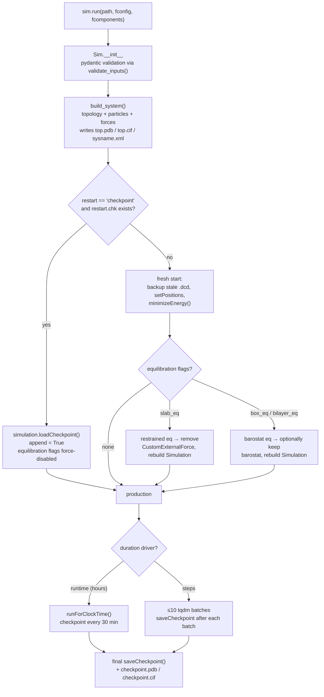
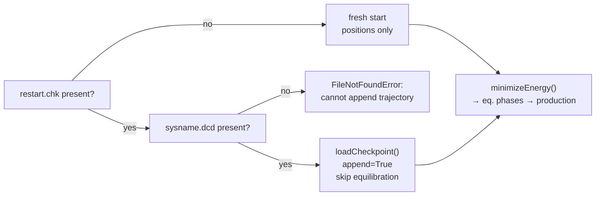

This page explains how CALVADOS executes a coarse-grained molecular dynamics simulation: the `Sim` driver class in `calvados/sim.py`, the staged pipeline it drives (build → equilibration → production), the OpenMM integration details, and — most importantly for long-running HPC jobs — the checkpoint and resume semantics. It is the execution counterpart to [System Building & Geometry](13-system-building-and-geometry) (what gets built) and [Declarative Configuration & Validation](12-declarative-configuration-and-validation) (what gets configured); here we focus on how the validated inputs become a running trajectory that can survive preemption and wall-clock limits.

Sources: [sim.py](calvados/sim.py#L31-L39), [cfg.py](calvados/cfg.py#L63-L84)

## Architectural Role of the `Sim` Driver

The engine is organized around a single driver class, `Sim`, whose lifecycle is deliberately split into two public phases: `build_system()` (assemble the OpenMM `System`, MDTraj topology, particle positions, and force fields) and `simulate()` (attach an integrator, run equilibration phases, and run production). A module-level convenience function `run()` closes the loop for batch operation: it loads `config.yaml` and `components.yaml` with `yaml.safe_load`, instantiates `Sim`, and invokes both phases in sequence. This is exactly the script emitted by `Config.write_runfile()`, so every prepared example directory contains a runnable `run.py` that ends in `sim.run(path=..., fconfig=..., fcomponents=...)`.

Sources: [sim.py](calvados/sim.py#L41-L57), [sim.py](calvados/sim.py#L871-L886), [cfg.py](calvados/cfg.py#L63-L84)



Sources: [sim.py](calvados/sim.py#L157-L304), [sim.py](calvados/sim.py#L646-L869)

## The Validation Gate: Mutability Discipline in `__init__`

`Sim.__init__` runs everything through `validate_inputs()`, which converts the raw YAML mappings into two pydantic models — `SimulationInput` for global settings and one `ComponentInput` per named component — before any OpenMM object exists. This means every invalid duration/pressure/restart combination fails at construction time, not mid-trajectory. Notably, options that can *change during* a simulation (`box`, `eps_lj`, the three equilibration flags, the restart path) are copied out of the immutable model into plain attributes: `eps_lj` is converted from kcal/mol to kJ/mol (× 4.184) at this point, and a relative `frestart` is resolved against the simulation directory.

Sources: [sim.py](calvados/sim.py#L41-L62), [inputmodels.py](calvados/inputmodels.py#L270-L327), [cfg.py](calvados/cfg.py#L10)

Two `__init__`-time checks directly shape runtime behavior. A `pdb`/`cif` restart without an existing file is a hard `FileNotFoundError`, whereas a `checkpoint` restart is *lenient*: if the checkpoint file is absent the run silently degrades to a fresh start. Conversely, if a checkpoint file **is** present, all three equilibration flags (`slab_eq`, `bilayer_eq`, `box_eq`) are forced to `False` — a resumed run skips straight to production, appending to the existing trajectory. The model also enforces that `steps` and `runtime` are mutually exclusive, defaulting to 100,000,000 steps (1 µs at the fixed 10 fs timestep) when neither is supplied.

Sources: [sim.py](calvados/sim.py#L55-L72), [inputmodels.py](calvados/inputmodels.py#L146-L190)

| Engine-relevant key | Default | Role at runtime |
|---|---|---|
| `restart` | `"checkpoint"` | Input mode: `checkpoint`, `pdb`, `cif`, or `None` |
| `frestart` | `"restart.chk"` | Checkpoint file path (relative to sim dir) |
| `steps` / `runtime` | `100_000_000` / `None` | Exactly one must be set; steps-based runs batch-checkpoint |
| `wfreq` | `100000` | DCD frame interval (1 step = 10 fs) |
| `logfreq` | `1000000` | Log-file reporting interval |
| `platform` | `"CPU"` | `"CPU"` or `"CUDA"` |
| `threads` / `gpu_id` | `1` / `0` | CPU thread pool / CUDA DeviceIndex fallback |
| `friction_coeff` | `0.01` | Langevin friction in 1/ps |
| `random_number_seed` | `None` | Applied to every integrator instance |
| `pressure_coupling` | `False` | Keep the barostat into production (NPT) |

Sources: [inputmodels.py](calvados/inputmodels.py#L146-L179), [sim.py](calvados/sim.py#L53-L59)

## Phase 1 — `build_system()`: Assembling a Resumable System

`build_system()` materializes the physical system: an empty OpenMM `System` receives default periodic box vectors from `build.build_box()`, Debye-Hückel parameters are computed from temperature and ionic strength, components are instantiated from the registry, and solutes are reordered ahead of lipids and crowders to stabilize bead indexing. Each molecule is then placed according to `topol` (slab/grid/center/shift_ref_bead/random) and wired into the shared Ashbaugh-Hatch (`ah`) and Yukawa/Debye-Hückel (`yu`) force objects, plus lipid `cos`/`cn` forces when present.

Sources: [sim.py](calvados/sim.py#L157-L204), [sim.py](calvados/sim.py#L265-L293)

The method ends with an artifact handoff that matters for restarts: a single MDTraj `Trajectory` covering all placed particles is written as `top.pdb` and `top.cif` — *unless* the run will restart from a user-supplied `pdb`/`cif`, in which case those files are preserved and the restart file's topology is used instead. `print_system_summary()` then serializes the complete `System` (all forces, exclusions, barostats) to `{sysname}.xml` via `openmm.XmlSerializer`, providing a platform-independent, human-inspectable record of exactly what was built. `add_forces_to_system()` attaches barostats conditionally: a `MonteCarloAnisotropicBarostat` (frequency 1000) for `box_eq` honoring per-axis `boxscaling_xyz`, and a `MonteCarloMembraneBarostat` (frequency 10000, XY-isotropic, Z-fixed) for `bilayer_eq`.

Sources: [sim.py](calvados/sim.py#L295-L304), [sim.py](calvados/sim.py#L306-L366), [sim.py](calvados/sim.py#L368-L393)

## Phase 2 — `simulate()`: Integrator Setup and Platform Binding

`simulate()` opens by selecting the coordinate source — `app.PDBFile`/`app.PDBxFile` for coordinate restarts, else the freshly written `top.cif` — and constructs a `LangevinMiddleIntegrator` at temperature `temp`, friction `friction_coeff / picosecond`, and a **hard-coded 0.01 ps (10 fs) timestep**. The timestep is intentionally not configurable; only friction and the optional random seed are. The seed is re-applied to every integrator instance created in the method, so slab- and pressure-equilibration rebuilds inherit the same stochastic policy.

Sources: [sim.py](calvados/sim.py#L646-L666), [sim.py](calvados/sim.py#L739-L745), [sim.py](calvados/sim.py#L798-L804)

Platform binding is explicit: `Platform.getPlatformByName(config.platform)`, with the CPU platform receiving a `{"Threads": str(threads)}` property dictionary. For non-CPU platforms, the engine sets the `DeviceIndex` platform *default* from `gpu_id` — but only if `CUDA_VISIBLE_DEVICES` is absent from the environment, deferring to cluster-level device masking when present. This is the layer where HPC portability is handled; deeper performance analysis is covered in [Hardware Platforms & Performance](20-hardware-platforms-and-performance).

Sources: [sim.py](calvados/sim.py#L668-L687)

### The Phase-Rebuild Pattern for Equilibration

Equilibration is implemented as a chain of scoped phases, each following the same pattern: run `steps_eq` steps with a special force active, dump the final state to `equilibration_final.pdb/.cif`, surgically remove the special force from the `System`, then **rebuild the `Simulation` object from scratch** with a plain `LangevinIntegrator` and re-minimize. `slab_eq` runs under a `CustomExternalForce` harmonic restraint toward the slab plane and removes the first `CustomExternalForce` it finds afterward; `box_eq`/`bilayer_eq` run under their barostats and keep them into production only when `pressure_coupling` is enabled (NPT) — otherwise the barostat is popped from the force list and production proceeds at constant volume with the equilibrated box vectors restored via `setPeriodicBoxVectors`.

Sources: [sim.py](calvados/sim.py#L717-L763), [sim.py](calvados/sim.py#L765-L821)

> [!TIP]
> The integrator deliberately changes across phases: the initial `Simulation` uses `LangevinMiddleIntegrator`, while every post-equilibration rebuild switches to plain `LangevinIntegrator`. Since these split integrators differ in velocity half-step handling, trajectories resumed across a phase boundary are not bitwise-identical to uninterrupted runs — expected for a stochastic Langevin scheme, but worth knowing when reproducing results.

| Equilibration phase | Force used | Reporter target | Post-phase action |
|---|---|---|---|
| `slab_eq` | `CustomExternalForce` (spring `k_eq`, axis-selectable) | `equilibration_{sysname}.dcd` | Remove restraint force, rebuild Simulation, re-minimize |
| `box_eq` | `MonteCarloAnisotropicBarostat` | `equilibration_{sysname}.dcd` | Drop barostat unless `pressure_coupling`; restore box vectors |
| `bilayer_eq` | `MonteCarloMembraneBarostat` (XYIsotropic, ZFixed) | `equilibration_{sysname}.dcd` | Drop barostat unless `pressure_coupling` |

Sources: [sim.py](calvados/sim.py#L330-L366), [sim.py](calvados/sim.py#L717-L821), [inputmodels.py](calvados/inputmodels.py#L193-L250)

## Checkpointing & Resume Semantics

CALVADOS offers three restart input modes with distinct fidelity guarantees, selected by the `restart` key. The **checkpoint** mode is the highest-fidelity path: OpenMM's binary `saveCheckpoint`/`loadCheckpoint` round-trips positions, velocities, box vectors, and integrator/RNG state, so a resumed trajectory is a genuine continuation. The `pdb`/`cif` modes restart from coordinates only — velocities are re-drawn and energy is re-minimized, which is why they are treated as fresh starts that may re-run equilibration phases.

Sources: [sim.py](calvados/sim.py#L646-L703), [inputmodels.py](calvados/inputmodels.py#L151-L152)

| Restart mode | State restored | Equilibration re-run? | Trajectory handling | Failure behavior |
|---|---|---|---|---|
| `None` | Positions from freshly built system | Yes, if flags set | New file (old one backed up) | — |
| `pdb` / `cif` | Positions only, from external file | Yes, if flags set | New file (old one backed up) | `FileNotFoundError` at `__init__` if file missing |
| `checkpoint` | Full state (positions, velocities, RNG) | **No — flags force-disabled** | Appends to existing `.dcd` and `.log` | Graceful fresh start if `.chk` missing; `FileNotFoundError` if `.dcd` missing |

Sources: [sim.py](calvados/sim.py#L64-L72), [sim.py](calvados/sim.py#L689-L715)

The resume contract is strict about consistency: when `restart == "checkpoint"` and the file exists, `simulate()` demands that `{sysname}.dcd` already exist (raising `FileNotFoundError` if not), sets `append=True` on all reporters, and calls `simulation.loadCheckpoint()`. This guarantees the appended frames continue the same trajectory rather than opening a parallel one. In the fresh-start branch the engine is correspondingly defensive about overwriting: a stale `{sysname}.dcd` is renamed to `backup_{sysname}_{timestamp}.dcd` before `setPositions` and `minimizeEnergy()` run.

Sources: [sim.py](calvados/sim.py#L689-L715)



Sources: [sim.py](calvados/sim.py#L689-L715)

> [!TIP]
> Because a valid checkpoint disables all equilibration flags in `__init__` (lines 69–72 of `sim.py`), deleting `restart.chk` is the *only* way to re-run equilibration on a system that has already been equilibrated once. When you intentionally want a re-equilibration, also expect the production `.dcd` to be backed up and restarted, since `append` remains `False` in that branch.

## Duration Control: Wall-Clock Time vs. Batched Steps

Production is governed by exactly one of two mutually exclusive drivers. When `runtime` (hours) is set, the engine calls OpenMM's `runForClockTime(runtime*hour, checkpointFile=..., checkpointInterval=30*minute)` — the framework itself writes a checkpoint every 30 minutes regardless of crash timing, which is the natural mode for queue-limited HPC jobs (see [Architecture Overview](5-architecture-overview) for how `Job` templates wrap this). When `steps` is set, the total is decomposed by `_split_steps()` into at most 10 nonempty batches (`divmod` distribution of the remainder), each executed with a `tqdm` progress bar and followed by an explicit `simulation.saveCheckpoint(restart_path)` — so a killed run loses at most one batch of work, not the whole trajectory.

Sources: [sim.py](calvados/sim.py#L24-L28), [sim.py](calvados/sim.py#L844-L855), [cfg.py](calvados/cfg.py#L138-L183)

| Aspect | `runtime` mode | `steps` mode |
|---|---|---|
| Termination | Wall clock (`runForClockTime`) | Exact step count |
| Checkpoint cadence | Every 30 min (OpenMM-managed) | After each of ≤10 batches |
| Progress visibility | None from engine | `tqdm` batch progress bar |
| Deterministic length | No (hardware-dependent) | Yes |
| Post-loop safety | Final `saveCheckpoint` still executed | Final `saveCheckpoint` still executed |

Sources: [sim.py](calvados/sim.py#L845-L857), [tests/test_sim.py](tests/test_sim.py#L9-L15)

`_split_steps()` is a pure function with a dedicated unit test asserting that batch sizes sum exactly to the requested step count, never exceed 10 batches, and contain no empty batches. The barostat-selection logic in `add_forces_to_system()` is likewise parametrized-tested against all four `box_eq`/`bilayer_eq`/`pressure_coupling` combinations, confirming that anisotropic vs. membrane barostats are attached per configuration. These tests are good anchors when extending the engine; the validation suite is described further in [Testing & Energy Validation](19-testing-and-energy-validation).

Sources: [tests/test_sim.py](tests/test_sim.py#L9-L65)

## Production Reporters and the Output Artifact Inventory

Once in production, two reporters are attached with `append` reflecting the resume state: a `DCDReporter` writing `{sysname}.dcd` every `wfreq` steps, and a `StateDataReporter` writing `{sysname}.log` every `logfreq` steps with tab separators, step number, speed, and elapsed time (potential energy only when `report_potential_energy` is enabled). After the run terminates — by clock, by steps, or by crash-and-resume — the engine performs a final `saveCheckpoint` and writes human-readable `checkpoint.pdb`/`checkpoint.cif` snapshots of the final, wrapped positions, which serve as lightweight inspection points without loading the binary checkpoint into OpenMM.

Sources: [sim.py](calvados/sim.py#L823-L842), [sim.py](calvados/sim.py#L857-L869)

| Artifact | Producer | Purpose |
|---|---|---|
| `top.pdb` / `top.cif` | `build_system()` | Initial topology/coordinates (skipped for `pdb`/`cif` restarts) |
| `{sysname}.xml` | `print_system_summary()` | Full serialized OpenMM System incl. forces & barostats |
| `equilibration_{sysname}.dcd` | Equilibration phases | Frames from restrained/barostatted phase |
| `equilibration_final.pdb/.cif` | Equilibration phases | Handoff state between phases |
| `{sysname}.dcd` | Production `DCDReporter` | Trajectory (appended on checkpoint resume) |
| `{sysname}.log` | Production `StateDataReporter` | Step/speed/energy time series |
| `restart.chk` (default name) | Per-batch / 30-min / final saves | Binary full-state checkpoint |
| `checkpoint.pdb` / `checkpoint.cif` | Post-run | Final wrapped configuration snapshot |
| `backup_{sysname}_{timestamp}.dcd` | Fresh start on stale `.dcd` | Collision-safe trajectory preservation |

Sources: [sim.py](calvados/sim.py#L295-L304), [sim.py](calvados/sim.py#L707-L712), [sim.py](calvados/sim.py#L857-L869)

## Operational Recipe: Configure, Run, Resume

A typical workflow (as in `examples/single_IDR`) ties the knobs together: choose `wfreq` as the frames-per-trajectory-unit (`1 = 10 fs`), express total length as `steps = N_frames * N_save`, select `platform = 'CPU'` or `'CUDA'`, and leave `restart = 'checkpoint'` with `frestart = 'restart.chk'`. Running the generated `run.py` produces the full artifact set above; if the job is preempted, re-running the identical command detects the checkpoint, loads full state, and appends frames — no manual intervention required.

```python
config = Config(
  sysname = sysname,
  box = [L, L, L], temp = 293.15, ionic = 0.19, pH = 7.5,
  topol = 'center',
  wfreq = N_save,              # dcd writing interval, 1 = 10 fs
  steps = N_frames*N_save,     # number of simulation steps
  platform = 'CPU',            # or CUDA
  restart = 'checkpoint',
  frestart = 'restart.chk',
  verbose = True,
)
```

Sources: [examples/single_IDR/prepare.py](examples/single_IDR/prepare.py#L26-L42), [cfg.py](calvados/cfg.py#L45-L61)

For trajectory post-processing of the resulting `.dcd`, continue with [Trajectory Analysis Toolkit](15-trajectory-analysis-toolkit); for slab-specific phase behavior pipelines, see [Slab Phase-Separation Analysis](16-slab-phase-separation-analysis); for error estimation on the produced time series, see [Blocking Error Estimation](17-blocking-error-estimation).
