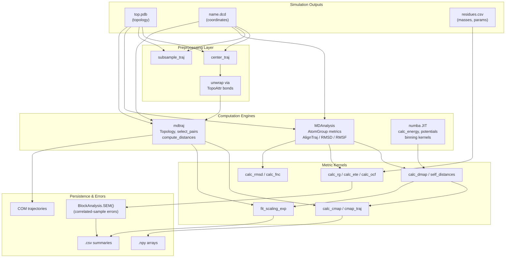
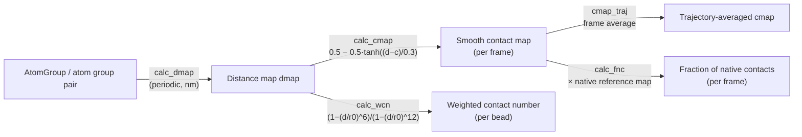

The `calvados.analysis` module is the post-processing workhorse of the CALVADOS pipeline: it converts raw MD trajectory files (PDB topology + DCD coordinate frames) produced by the simulation engine into physically meaningful observables — radii of gyration, end-to-end distances, contact maps, scaling exponents, chain center-of-mass trajectories, and pairwise energies. This page explains the module's architecture, its dual-engine design (MDAnalysis + mdtraj), its unit conventions, and how every observable integrates with the blocking-error machinery for statistically honest error bars.

The module is organized as four layers: **trajectory preprocessing**, **per-frame metric kernels**, **composite drivers** that persist results to disk, and **multi-chain topology tools** that reason about components rather than atoms. A single `SlabAnalysis` class also lives in this module, but its phase-separation workflow is documented separately in [Slab Phase-Separation Analysis](16-slab-phase-separation-analysis) — this page covers only the general trajectory toolkit.

Sources: [analysis.py](/calvados/analysis.py#L1-L29), [analysis.py](/calvados/analysis.py#L541-L550)

## Architecture: One Module, Three Engines

The toolkit's defining architectural decision is that it does **not** commit to a single trajectory library. Instead, each layer picks the engine whose topology model fits the task best, and `numba` JIT compilation is applied to the hot numeric kernels that would otherwise be Python-loop-bound.



Three external dependencies shape the module's boundaries. `BlockAnalysis` is imported from `calvados/BLOCKING/main.py` and supplies every error estimate; `get_ssdomains` is pulled from `calvados.build` so contact-number analysis can respect secondary-structure domains; and `InputPath` from `calvados.inputmodels` provides a path type alias that the functions normalize with `os.fspath` at entry.

Sources: [analysis.py](/calvados/analysis.py#L1-L29), [main.py](/calvados/BLOCKING/main.py#L10-L31)

## Unit Convention: Å Inside, nm Outside

The toolkit maintains a strict but implicit unit contract that you must understand before interpreting any returned array. MDAnalysis reads coordinates in **ångströms**, and the internal histogramming machinery (notably inside `SlabAnalysis`) works in Å. However, the *public* observables returned by the metric kernels — distance maps, Rg, end-to-end distances, OCF coordinates, scaling fits — are all converted to **nanometers** by an explicit `/10.` at the point of computation.

| Quantity | Internal unit | Public output | Conversion site |
|---|---|---|---|
| Pairwise distance map (`calc_dmap`) | Å | nm | `distance_array(...) / 10.` |
| Rg (`calc_rg`) | Å | nm | `(ag.positions - com) / 10.` |
| End-to-end (`calc_ete`) | Å | nm | `np.linalg.norm(...) / 10.` |
| OCF bond vectors (`calc_ocf`) | Å | nm | `ag.positions / 10.` |
| Contact-map cutoff (`calc_cmap`) | nm | nm | taken as nm directly |
| Z-profile bins (`SlabAnalysis`) | Å bins | nm coordinates | `edges / 10` |

This convention means a cutoff of `1.0` in `calc_cmap` means 1 nm, while `rc_yu=4.0` in `calc_energy` means 4 nm. When writing new kernels, follow the same pattern: divide by 10 exactly once, at the metric boundary, and document the result's unit in the docstring.

Sources: [analysis.py](/calvados/analysis.py#L132-L146), [analysis.py](/calvados/analysis.py#L348-L367)

## Trajectory Preprocessing

Before any metric is computed, trajectories typically need two corrections: recentring in the periodic box and (optionally) frame subsampling. The module provides file-to-file utilities for both, each writing a sibling DCD next to the input so downstream tools can pick the corrected file up without argument changes.

`center_traj` builds an `mda.Universe` from the PDB/DCD pair and, for each frame in the `start:stop:step` slice, translates all atoms so the center of geometry sits at the box center (`0.5 * dimensions[:3]`), then streams frames into `<traj>_c.dcd`. `subsample_traj` is the same slicing pattern without translation, writing `<traj>_sub.dcd` — useful for decimating densely-written trajectories before expensive analyses. Both accept `InputPath` (str or `Path`) and normalize it immediately, so callers can pass either form.

Sources: [analysis.py](/calvados/analysis.py#L32-L66)

## The Contact Map Family

Contact analysis is the conceptual core of the toolkit, and it rests on one mathematical primitive reused everywhere: the **smooth switching function** `0.5 − 0.5·tanh((d − cutoff)/0.3)`. Instead of a binary "contact / no contact" step, this tanh kernel produces continuous weights between 0 and 1 that decay over roughly ±0.9 nm around the cutoff, which stabilizes trajectory averages against thermal noise at the cutoff boundary.



The four members of the family divide the work as follows:

- **`calc_cmap`** — the per-frame primitive: smooth contact map between two MDAnalysis atom groups with a 1.0 nm default cutoff.
- **`cmap_traj`** — the time integrator: iterates `u.trajectory[start:end:step]`, accumulates per-frame maps, and normalizes by the frame count. Its frame slicing is the subject of a dedicated unit test that monkeypatches `calc_cmap` and asserts exact normalization over `start=1, end=9, step=2`.
- **`calc_fnc`** — fraction of native contacts: computes a reference contact map from a reference universe, strips the `kmax` diagonals closest to the chain backbone (trivial bonded contacts), optionally applies a B-factor sigmoid weighting (`exp(width·(bfac−sig_shift))` logistic), and reports `Σ(c·c_ref) / Σc_ref` per frame.
- **`calc_wcn`** — weighted contact number per bead, using a distinct Lennard-Jones-like weight `(1−(d/r0)⁶)/(1−(d/r0)¹²)`. When `ssonly=True` it consults `get_ssdomains` from the build module and counts only bead pairs sharing a secondary-structure domain.

> [!TIP]
> The smooth `0.5 − 0.5·tanh((d − cutoff)/0.3)` kernel is duplicated verbatim in both `calc_cmap` (MDAnalysis path) and `calc_contact_map` (mdtraj path, operating on Å distances with the same nm cutoff). If you ever retune the switching width `0.3`, both sites must change together or component-level and chain-level contact maps become inconsistent.

Sources: [analysis.py](/calvados/analysis.py#L171-L246), [analysis.py](/calvados/analysis.py#L248-L288), [analysis.py](/calvados/analysis.py#L1437-L1447), [test_analysis.py](/tests/test_analysis.py#L12-L33)

## Energy Re-evaluation from Distance Maps

A distinctive capability of the toolkit is that it can **recompute pairwise potential energies after the simulation**, purely from a distance map. `calc_energy` takes a distance matrix plus per-pair `sig`, `lam`, and `q` arrays and evaluates both the Ashbaugh-Hatch and Yukawa pair potentials with `numba` `nopython` JIT, returning two arrays shaped like the input distance map.

This closes a verification loop with the force field: the potentials implemented here (`ah_potential`, `lj_potential`, `yukawa_potential`) are analytic mirrors of the OpenMM custom forces used during simulation. Comparing trajectory-averaged recomputed energies against the simulation's energy log validates that the custom-force implementation and the analysis-layer reference agree. The kernels implement the shifted, cut-off forms exactly as documented in the force field pages:

- `ah_potential(r, sig, eps, lam, rc)` — below `2^(1/6)·σ` it is the full Lennard-Jones plus the constant `eps·(1−λ)` offset; between there and `rc` it is `λ·(LJ(r) − LJ(rc))`; zero beyond `rc`.
- `yukawa_potential(r, q, kappa_yu, rc_yu)` — the shifted form `q·(exp(−κr)/r − exp(−κ·rc)/rc)`, truncated to zero past the cutoff.
- The `same_domain` flag (with the `abs(i−j) <= 1` exclusion) allows skipping bonded-neighbor pairs when the distance map comes from a single structured domain.

For the physics behind these functional forms, see [Ashbaugh-Hatch Hydrophobic Interactions](6-ashbaugh-hatch-hydrophobic-interactions) and [Debye-Hückel Electrostatics](7-debye-huckel-electrostatics).

Sources: [analysis.py](/calvados/analysis.py#L68-L130)

## Single-Chain Observables and the Polymer Scaling Fit

The single-chain layer answers the classical IDP characterization questions with four trajectory-wise kernels plus a fitting routine. All of them share the same slicing signature (`start`, `stop`, `step`) so they can be pointed at equilibrated subsets of a trajectory without copying files.

| Function | Observable | Returns | Mass weighting |
|---|---|---|---|
| `calc_rg` | Radius of gyration per frame | `(n_frames,)` array, nm | residue masses from `residues.csv` if `seq` given, else uniform |
| `calc_ete` | End-to-end distance per frame | array + mean + SEM, nm | none (first/last bead) |
| `calc_ocf` | Bond orientational correlation vs separation | mean + SEM arrays | none |
| `calc_rmsd` | RMSD to reference & to mean structure + RMSF | three tuple entries, Å | alignment via `AlignTraj` |
| `calc_fnc` | Fraction of native contacts per frame | `(n_frames,)` array | optional B-factor sigmoid |

Two implementation details deserve attention. First, mass handling in `calc_rg` is sequence-aware: `get_masses` looks up `MW` from the residues DataFrame indexed by three-letter codes, then applies terminal corrections of **+2 Da at the N-terminus** and **+16 Da at the C-terminus** to account for the charged termini. Second, `calc_rmsd` performs a **two-pass alignment**: it first aligns to the supplied reference structure, computes an iterated mean structure, then re-aligns to that mean and computes a second RMSD curve plus per-atom RMSF — the standard protocol for separating global drift from intrinsic fluctuation, with an optional mean-structure PDB export.

The scaling layer then turns internal distances into the Flory exponent. `fit_scaling_exp` builds the trajectory-averaged RMS internal-distance matrix, buckets distances by sequence separation `|i−j|`, and fits `⟨d⟩ = r0·n^ν` over separations beyond `ij0=5` using `scipy.curve_fit`. Pass `r0=None` to fit both parameters (getting `ν` with covariance-derived error), or fix `r0` to fit `ν` alone. The returned `ν ≈ 0.588` indicates a self-avoiding chain; `ν ≈ 0.33` indicates collapse — the single most cited diagnostic in IDP phase-separation studies.

Sources: [analysis.py](/calvados/analysis.py#L290-L367), [analysis.py](/calvados/analysis.py#L369-L424), [analysis.py](/calvados/analysis.py#L428-L492), [analysis.py](/calvados/analysis.py#L329-L338)

## Composite Drivers: `save_conf_prop` and the Error Discipline

Hand-calling kernels is fine for exploration, but the module also ships a **batch driver** that runs the standard single-chain characterization protocol and persists everything to disk. `save_conf_prop(path, name, residues_file, output_path, ...)` loads `top.pdb` + `<name>.dcd` in-memory and produces a complete characterization bundle:

| Output file | Content |
|---|---|
| `rgs.npy` | per-frame radius of gyration |
| `rees.npy` | per-frame end-to-end distance |
| `conf_prop.csv` | value/error table for `Rg`, `Ree`, and (for IDRs) `nu` |
| `internal_distances.npy` | `[ij, dij]` arrays from the scaling fit |
| `cmap.npy` | trajectory-averaged contact map, `kmax` diagonals stripped |

Notice the error-handling pattern: **every** time series is wrapped in `BlockAnalysis` and its `SEM()` method is invoked before the value is written to `conf_prop.csv`. This is not optional decoration — MD observables are strongly time-correlated, so naive `scipy.stats.sem` would understate errors by orders of magnitude. `BlockAnalysis.SEM()` computes blocking statistics at construction and then selects a converged plateau block size, exposing `.bs` and `.sem`. The full algorithm — plateau detection, replica concatenation, weighted reanalysis — is the subject of [Blocking Error Estimation](17-blocking-error-estimation); here it suffices to know that the toolkit treats `BlockAnalysis` as its single source of statistical truth.

> [!TIP]
> `save_conf_prop` distinguishes IDRs from folded domains via the `is_idr` flag: only with `is_idr=True` does it fit the scaling exponent and emit `internal_distances.npy`. For multi-domain constructs, run it once per chain segment rather than once globally, or the scaling fit will average folded and disordered regimes into a meaningless single `ν`.

Sources: [analysis.py](/calvados/analysis.py#L494-L539), [main.py](/calvados/BLOCKING/main.py#L59-L78)

## Multi-Chain Toolkit: COM Trajectories and Component Contact Maps

For condensate and mixture simulations, analysis must reason in terms of **components and chains**, not atoms. The toolkit addresses chains through a uniform convention encoded in the `ChainIds` type alias: a component may be named by a single chain index (`int`), an inclusive `(start, end)` range tuple, or an explicit integer array. A `chainid_dict` maps component names to these selectors, and every multi-chain driver accepts it with the same semantics — an empty dict means "all chains belong to `sysname`".

`calc_com_traj(path, sysname, output_path, residues_file, chainid_dict, ...)` is the workhorse for coarse-graining chains to single particles. Its pipeline is instructive:

1. If `traj.dcd` does not yet exist, it constructs a **bond topology attribute** by chaining consecutive atom indices within each MDAnalysis segment, then applies `transformations.unwrap` so molecules broken across periodic boundaries become whole, writing the result to `traj.dcd` — an idempotent caching layer that later drivers silently reuse.
2. It loads that file with **mdtraj** (chosen here for its chain-level topology queries), re-centres coordinates to the box center, and reads `MW` values from the residues CSV — again applying the +2/+16 Da terminal corrections.
3. For every chain it computes the mass-weighted center of mass per frame, accumulates an `(n_frames, n_chains)` Rg array in nm, and assembles a synthetic mdtraj trajectory containing one COM "atom" per chain.

Outputs are written per component: `<sysname>_<component>_rg.npy` arrays, plus `<sysname>_com_top.pdb` / `<sysname>_com_traj.dcd` containing the COM trajectory — which downstream consumers (including `SlabAnalysis` and the slab notebooks) treat as a first-class input.

`calc_contact_map(path, sysname, output_path, chainid_dict, is_slab, ...)` produces residue-resolution contact maps **between component chain sets**. With one component it builds a homotypic map by duplicating the chain set under a `<name>_homotypic` alias; with two it builds heterotypic maps. Per chain, it uses mdtraj's `select_pairs` against all surrounding chains and applies the same smooth tanh kernel seen in `calc_cmap`, accumulating over frames and normalizing at the end. In slab mode (`is_slab=True`) it additionally partitions Rg samples and contact contributions into dense and dilute phase subsets using the interface cutoffs previously stored by the slab workflow — which is why it raises an informative `ValueError` if `SlabAnalysis` outputs are missing. That slab-specific path is detailed in [Slab Phase-Separation Analysis](16-slab-phase-separation-analysis).

Sources: [analysis.py](/calvados/analysis.py#L1246-L1340), [analysis.py](/calvados/analysis.py#L1342-L1447)

## Boundary with SlabAnalysis and Usage Pattern

The `SlabAnalysis` class occupies roughly half of the module's lines but is deliberately excluded from this page's scope: its constructor, centering, concentration profiling, interface fitting, and transfer-free-energy computation form the slab workflow documented in [Slab Phase-Separation Analysis](16-slab-phase-separation-analysis). From this page's perspective it matters as a **consumer** of the toolkit's conventions — it accepts the same PDB/DCD inputs, uses the same `BlockAnalysis` errors, and depends on `calc_com_traj` output for its dense/dilute partitioning.

The example notebook illustrates the canonical call pattern: instantiate with named paths, then invoke methods with explicit frame slicing.

```python
import calvados as cal

system, repl = 'hnRNPA1LCD', 0
name = f'{system}_{repl:d}'

slab = cal.analysis.SlabAnalysis(
    name=name,
    input_path=name,
    output_path='slab_output',
    ref_name=system,
    verbose=True,
)
slab.center(start=600, step=10, center_target='all')
```

The same constructor-then-slice pattern applies to the free functions: load once, slice deliberately, persist deterministically.

Sources: [analysis.py](/calvados/analysis.py#L541-L599), [example_slab_analysis.ipynb](/examples/slab_IDR/example_slab_analysis.ipynb#L26-L52)

## Verification Patterns in the Test Suite

The analysis toolkit is tested at two distinct levels, and understanding them helps you extend the module safely. The first level is **logic isolation with monkeypatching**: `test_cmap_traj_normalizes_selected_frames` replaces `calc_cmap` with a constant-returning stub and feeds a `SimpleNamespace` fake universe, asserting that `cmap_traj` performs the correct frame slicing and divides by exactly the number of visited frames. This verifies orchestration logic without any trajectory I/O.

The second level is **synthetic-fixture integration**: `test_calc_com_traj_uses_configured_input_and_step` constructs a real mdtraj topology and a 5-frame trajectory in `tmp_path`, writes PDB/DCD files and a minimal residues CSV, then runs `SlabAnalysis.calc_com_traj` with `step=2` and asserts the COM output DCD contains exactly 3 frames. This proves the idempotent `traj.dcd` caching path, the configured-input plumbing, and the subsampling arithmetic end-to-end. The slab-adjacent `test_calc_zpatch_includes_patch_at_final_bin` checks an edge case of the histogram patch finder — patches that extend to the final bin. Broader energy-level verification of the force-field kernels lives in the test suite covered by [Testing & Energy Validation](19-testing-and-energy-validation).

Sources: [test_analysis.py](/tests/test_analysis.py#L12-L43), [test_analysis.py](/tests/test_analysis.py#L46-L83)

## Key Takeaways and Reading Progression

Three architectural principles summarize the toolkit. First, **engine pluralism with a shared math layer**: MDAnalysis handles atom-group ergonomics, mdtraj handles chain topology, numba handles hot kernels — but the smooth tanh contact kernel and the nm-at-the-boundary unit rule are universal. Second, **errors are never optional**: every persisted observable passes through `BlockAnalysis.SEM()` because correlated MD samples demand block statistics. Third, **drivers are idempotent and file-driven**: caching intermediates like `traj.dcd` and writing `.npy`/`.csv` artifacts makes the analysis pipeline resumable and notebook-friendly.

To continue through the Analysis Stack, the recommended progression is [Slab Phase-Separation Analysis](16-slab-phase-separation-analysis) next, since it builds directly on `calc_com_traj` and the contact-map machinery described here, followed by [Blocking Error Estimation](17-blocking-error-estimation) for the mathematics behind every `.sem` value in this page. For the potentials that `calc_energy` re-evaluates, return to [Ashbaugh-Hatch Hydrophobic Interactions](6-ashbaugh-hatch-hydrophobic-interactions) and [Debye-Hückel Electrostatics](7-debye-huckel-electrostatics), and for how the trajectories analyzed here are produced, see [Simulation Engine & Checkpointing](14-simulation-engine-and-checkpointing).
