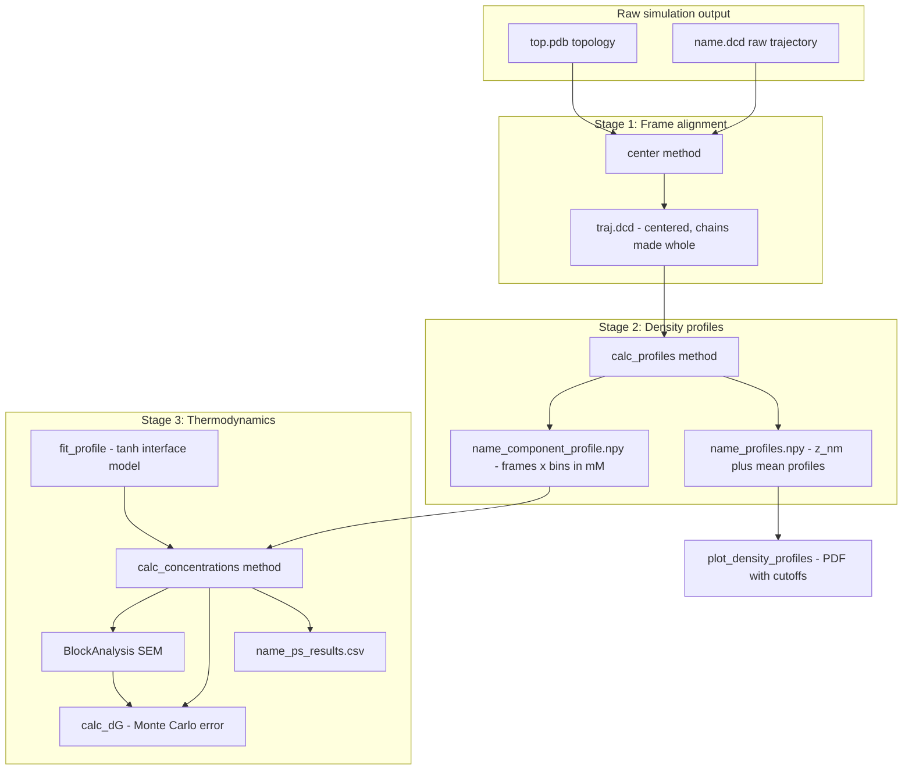
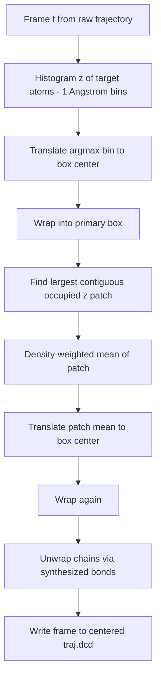
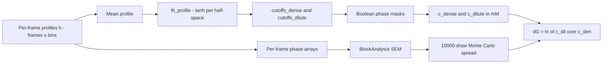
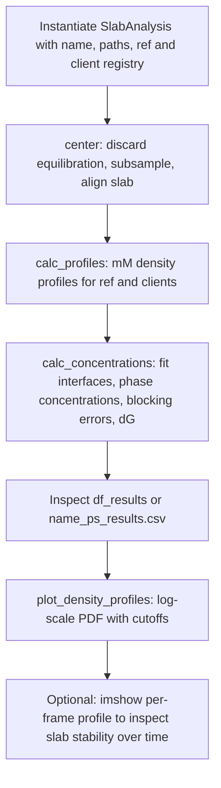

Slab simulations are CALVADOS's workhorse for computing liquid–liquid phase separation (LLPS) thermodynamics: a dense condensate slab coexists with a dilute gas inside a single periodic box, and the analysis pipeline extracts coexisting concentrations, partitioning coefficients, and transfer free energies directly from the trajectory. This page dissects the `SlabAnalysis` class in `calvados/analysis.py` — its centering algorithm, density profile construction, interface fitting, concentration/free-energy computation, and the auxiliary structural profilers — and walks through the reference notebooks that demonstrate both single-component and mixed-system workflows.

## Why Slab Geometry? The Direct-Coexistence Concept

The core idea is thermodynamic self-assembly: prepare ~100 copies of an IDP in an elongated periodic box and let the system spontaneously demix into a dense slab (centered along z, the box normal) surrounded by a dilute phase. Because both phases coexist in one simulation, their equilibrium concentrations can be read off a density profile without umbrella sampling or reweighting. The slab example README prescribes exactly this setup — direct coexistence simulations of 100 copies of a single IDR — and recommends independent replicas for sampling-error estimation.

The class-level contract is explicit in the `SlabAnalysis` docstring: the workflow centers a trajectory, builds reference and optional client concentration profiles along z, identifies dense and dilute regions, and writes concentrations, blocking errors, and transfer free energies. A critical units convention runs through the entire class — **histogramming happens internally in Ångströms, while all public profile coordinates are in nm and concentrations in mM**.

Sources: [analysis.py](calvados/analysis.py#L541-L550), [README.md](examples/slab_IDR/README.md#L1-L9)

## Pipeline Architecture

`SlabAnalysis` is an orchestrator with a strict three-stage main pipeline plus a family of optional structural profilers. Each stage consumes the previous stage's on-disk artifacts, which means stages can be re-run independently (e.g., re-fit concentrations after extending a trajectory without re-centering):



Beyond the main pipeline, five auxiliary methods compute structural and compositional observables along the slab normal (`calc_orientations`, `calc_rgs`, `calc_aa_bins`, `calc_resid_bins`, `calc_com_traj`), all reusing the same centered-trajectory infrastructure. The blocking-error estimation inside Stage 3 delegates to `BlockAnalysis` from the `BLOCKING` package — the dedicated machinery is covered in [Blocking Error Estimation](17-blocking-error-estimation), while the general trajectory toolkit (`calc_rg`, `calc_ete`, contact maps) that shares this module lives in [Trajectory Analysis Toolkit](15-trajectory-analysis-toolkit).

Sources: [analysis.py](calvados/analysis.py#L541-L550), [analysis.py](calvados/analysis.py#L21-L21)

## Constructing SlabAnalysis: Geometry and Component Registry

The constructor resolves file paths, establishes the **component registry** (one reference species plus zero or more client species), and pre-computes the z-binning geometry from the topology's box dimensions. Two binning systems are built at construction time: an absolute (origin at z = 0) 1-Å bin set used during histogramming, and a centered nm-coordinate bin set used for reporting, both derived from `u.dimensions[2]`.

| Parameter | Default | Role |
|---|---|---|
| `name` | — | System label; prefixes every output artifact and defaults the input DCD to `{name}.dcd` |
| `input_path` / `output_path` | `"."` | Location of simulation inputs / analysis artifacts (output dir is created if missing) |
| `input_pdb` | `top.pdb` | Beaded topology; `u.dimensions[2]` fixes the slab normal length `lz` |
| `input_dcd` | `{name}.dcd` | Raw trajectory to analyze |
| `centered_dcd` | `traj.dcd` | Destination for the centered trajectory |
| `ref_chains` | `None` → `(0, n_segments−1)` | **Inclusive, 0-based** segment range defining the condensate-forming species |
| `ref_name` | `None` → `"ref"` | Label for the reference component |
| `client_chain_list` | `()` | Sequence of inclusive `(first, last)` segment ranges for co-solutes / partner species |
| `client_names` | `()` → `client_{idx}` | Labels for client components |
| `verbose` | `False` | Progress logging switch |

The reference/client split is the architectural heart of multi-component analysis: the **reference species defines the phase boundaries**, and every client species is measured against those same boundaries. In the mixed FUSR-GG3/polyU40 example, chains 0–199 form the reference condensate while chains 200–259 (60 polyU40 chains) are registered as a client whose partitioning into the protein-dense phase is quantified.

Sources: [analysis.py](calvados/analysis.py#L552-L594), [analysis.py](calvados/analysis.py#L1093-L1109), [example_slab_analysis.ipynb](examples/slab_mixed/example_slab_analysis.ipynb#L26-L42)

## Centering: The Two-Pass Density Alignment Algorithm

Centering is the most algorithmically subtle stage. Over a long simulation the slab drifts along z and chains cross periodic boundaries, so every frame must be re-aligned before histogramming. `center()` performs a **two-pass density alignment per frame**, followed by chain unwrapping:

1. **Pass 1 — max-density anchoring.** Histogram the z positions of the target atoms (reference chains by default, or all atoms with `center_target='all'`) into the precomputed 1-Å bins, find the argmax bin, and translate the system so that bin sits at the box center, then wrap into the primary box.
2. **Pass 2 — patch-weighted refinement.** Locate the *largest contiguous occupied z patch* (`calc_zpatch` scans the histogram for the longest run of non-empty bins), compute the density-weighted mean z of that patch, and translate it to the box center, wrapping again.
3. **Unwrapping.** Covalent bonds are synthesized from segment adjacency (`add_TopologyAttr('bonds', ...)`) so MDAnalysis can reconstruct whole chains (`transformations.unwrap`) before the frame is written to `centered_dcd`.



Frame selection parameters (`start`, `end`, `step`) are applied here, which is how the reference notebooks discard equilibration and thin the trajectory — e.g., `slab.center(start=600, step=10, center_target='all')` for the hnRNPA1LCD system.

> [!TIP]
> Pass 1 uses only the single densest bin, which is sensitive to fluctuations; Pass 2's largest-patch weighting is the drift-correcting step. The patch approach matters because the wrap in Pass 1 can split the slab across the periodic boundary — the longest *contiguous* occupied run identifies the true slab body even when its tail has wrapped past z = 0.

For simple cases outside slab analysis, the module also exposes standalone `center_traj` and `subsample_traj` helpers that recenter frames on the global center of geometry or slice frame ranges, but the slab workflow always uses `SlabAnalysis.center` because of the density-based alignment.

Sources: [analysis.py](calvados/analysis.py#L596-L653), [analysis.py](calvados/analysis.py#L1111-L1139), [analysis.py](calvados/analysis.py#L32-L66), [example_slab_analysis.ipynb](examples/slab_IDR/example_slab_analysis.ipynb#L51-L51)

## Density Profiles: From Bead Counts to Millimolar

`calc_profiles()` loads the centered trajectory **in memory** and histograms z positions frame-by-frame for the reference species and each client. Two details deserve attention. First, the bin width is fixed at 1 Å (`binwidth = 1`, i.e., 0.1 nm), and the slice volume is `Lx · Ly · binwidth / 1e3` in nm³. Second, raw bead counts are converted to millimolar via

```
conv = 10 / 6.02214 / nbeads / volume * 1e3
```

which is the factor 10³/6.02214·10²³ ≈ 1660 that converts "beads per nm³" to mM, divided by the beads-per-chain count so the profile reports *chain* concentration regardless of chain length.

The outputs are deliberately redundant for downstream flexibility: per-frame profile arrays of shape `(n_frames, n_bins)` in mM are saved as `<name>_<component>_profile.npy` (these are what the notebook visualizes with `imshow` as a time-vs-z heatmap), while `<name>_profiles.npy` bundles the z-coordinates in its first row followed by the trajectory-averaged profiles of the reference and all clients — the single file that `plot_density_profiles()` consumes.

Sources: [analysis.py](calvados/analysis.py#L655-L716), [analysis.py](calvados/analysis.py#L808-L819), [example_slab_analysis.ipynb](examples/slab_IDR/example_slab_analysis.ipynb#L101-L107)

## Interface Fitting: The Hyperbolic-Tangent Model

Phase boundaries are never hand-drawn. `fit_profile()` fits the trajectory-averaged reference profile to a **symmetric hyperbolic-tangent interface model** on each half of the box separately:

```
profile(x) = ½(a + b) + ½(b − a) · tanh((|x| − c) / d)
```

where `c` is the interface position, `d` the interface width, `b` the dense plateau, and `a` the dilute plateau. Fitting `z > 0` and `z < 0` independently (via `scipy.optimize.least_squares` with all parameters bounded to `[0, 100]`) lets the two interfaces of a finite slab relax to slightly different positions. From each fitted half, the phase cutoffs follow from the width parameter:

- **Dense cutoffs** = interface position − `pden` · width (defaults `pden = 2.0`): placed *two widths inside* the interface so only plateau bins contribute to the dense concentration.
- **Dilute cutoffs** = interface position + `pdil` · width (defaults `pdil = 8.0`): placed *eight widths outside* so interfacial tails cannot contaminate the dilute concentration.

The `pden`/`pdil` offsets embody a bias–variance tradeoff — deeper cuts reduce interfacial bias but shrink the sampling region. As a safeguard, the method computes the magnitude ratio of the left/right dilute cutoffs and emits a `RuntimeWarning` ("The fitted slab interfaces are strongly asymmetric") when it falls outside `[0.5, 2.0]`, which typically signals insufficient sampling or a broken slab.

> [!TIP]
> Cutoffs are fitted **once, from the reference profile only** (inside `calc_single_conc` when `ref=True`) and then frozen on the instance. Client species never re-fit interfaces — `calc_single_conc` for clients reuses `self.cutoffs_dense`/`self.cutoffs_dilute` directly. This guarantees every component is partitioned against an identical, protein-defined phase boundary, making concentration ratios across components directly comparable.

Sources: [analysis.py](calvados/analysis.py#L1187-L1226), [analysis.py](calvados/analysis.py#L718-L724), [analysis.py](calvados/analysis.py#L767-L781)

## Phase Concentrations, Errors, and Transfer Free Energy

`calc_concentrations()` drives the thermodynamic stage: it re-derives `ref_chains` from the topology if needed, processes the reference, then iterates clients, collecting everything into `df_results` and finally `<name>_ps_results.csv`. The per-component workhorse `calc_single_conc()` builds two boolean masks over the centered nm z-grid — *dense* bins strictly between the two dense cutoffs, *dilute* bins strictly outside the two dilute cutoffs — and averages the mean profile within each mask to yield `c_dense` and `c_dilute` in mM. It also projects the masks onto each individual frame (`apply_along_axis`) to produce per-frame concentration time series.

Error estimation then proceeds in two layers. Per-frame dense/dilute arrays are fed to `BlockAnalysis(...).SEM()`, whose blocked standard error accounts for the correlation time of the concentration signal (methodology in [Blocking Error Estimation](17-blocking-error-estimation)). Those errors propagate into the **transfer free energy** ΔG = ln(c_dil/c_den) in units of kT via a Monte Carlo scheme: 10,000 draws from normal distributions centered on each concentration with its blocked error, with the standard deviation of valid `ln(dil/den)` draws reported as `dG_err`:



Degenerate phase scenarios are handled explicitly rather than crashing:

| Condition | Reported ΔG | ΔG error | Console diagnostic |
|---|---|---|---|
| NaN in either concentration | NaN | NaN | "Not converged" |
| c_dilute = 0, c_dense > 0 | `dGmin` (−10) | NaN | "No dilute phase" |
| c_dense = 0, c_dilute > 0 | `−dGmin` (+10) | NaN | "No dense phase" |
| Both zero | NaN | NaN | "No dense or dilute phase" |
| Both positive | ln(c_dil/c_den) | MC std | — |
| ΔG below `dGmin` | Clipped to `dGmin` | 0 | "dG extremely small" |

The clipping thresholds are controllable through `calc_concentrations(dGmin=...)`. Scalars (cutoffs, concentrations ± errors, ΔG ± error, chain ranges) land in `df_results`/CSV, while the raw per-frame arrays are written as `<component>_dense_array.npy` / `<component>_dilute_array.npy` when `write_conc_arrays=True`.

Sources: [analysis.py](calvados/analysis.py#L718-L754), [analysis.py](calvados/analysis.py#L767-L806), [analysis.py](calvados/analysis.py#L1141-L1185), [analysis.py](calvados/analysis.py#L1229-L1244)

## Structural and Compositional Profiles Along the Slab Normal

Beyond thermodynamics, `SlabAnalysis` resolves how chain-level properties vary from the condensate interior to the dilute phase. All of these profilers reuse the centered trajectory and per-chain atom groups cached by `load_traj`/`load_ref`, and all bin into 1-Å-wide periodic bins along z with a shared numba-compiled accumulator (`distribute_monomers`) that wraps bead positions into `[0, lz)` before counting:

| Method | Observable | Aggregation per bin | Output |
|---|---|---|---|
| `calc_orientations` | Nematic order S = (3cos²θ − 1)/2 of each chain's principal axis vs. z | Mean over all sampled beads | `<name>_sz.npy` (empty bins → 0) |
| `calc_rgs` | Radius of gyration (nm) | Root-mean-square: √(mean Rg²) | `<name>_rg.npy` (empty bins → NaN) |
| `calc_aa_bins` | Counts of each of the 20 amino-acid types, mapped via one-/three-letter residue names | Raw counts | `<name>_aa_bins.npy`, shape `(n_bins, 20)` |
| `calc_resid_bins` | Counts per residue *index* along the sequence | Raw counts | `<name>_resid_bins.npy`, shape `(n_bins, n_residues)` |
| `calc_com_traj` | Mass-weighted center-of-mass trajectory (termini corrections +2/+16 Da applied) | One COM bead per reference chain | `<name>_com_top.pdb` + `<name>_com_traj.dcd` |

The amino-acid and residue-index histograms enable spatially resolved composition analysis — for instance, detecting whether aromatic residues are enriched at the slab interface. The COM trajectory artifact is a standard mdtraj-format output suitable for feeding into downstream clustering or radial-distribution analyses.

Sources: [analysis.py](calvados/analysis.py#L832-L910), [analysis.py](calvados/analysis.py#L1004-L1078), [analysis.py](calvados/analysis.py#L938-L1002)

## Output Artifact Map

Every stage writes versioned, self-describing files under `output_path`, all prefixed with the system `name`:

| Artifact | Producer | Content |
|---|---|---|
| `traj.dcd` (in `input_path`) | `center()` | Centered, unwrapped, frame-subsampled trajectory |
| `<name>_<component>_profile.npy` | `calc_profiles()` | Per-frame profiles, `(n_frames, n_bins)`, mM |
| `<name>_profiles.npy` | `calc_profiles()` | Row 0: z coordinates (nm); rows 1+: mean profiles (ref first, then clients) |
| `<component>_dense_array.npy` / `_dilute_array.npy` | `save_conc_results()` | Per-frame phase concentrations for error analysis |
| `<name>_ps_results.csv` | `calc_concentrations()` | One row per component: cutoffs, c_dense/c_dilute ± errors, ΔG ± error, chain ranges |
| `<name>_profiles.pdf` | `plot_density_profiles()` | Log-scale mean profiles with dashed (dense) and dotted (dilute) cutoff lines |
| `<name>_sz.npy`, `<name>_rg.npy` | Structural profilers | Order-parameter and Rg profiles per 1-Å bin |
| `<name>_aa_bins.npy`, `<name>_resid_bins.npy` | Composition profilers | Spatially resolved composition counts |
| `<name>_com_top.pdb`, `<name>_com_traj.dcd` | `calc_com_traj()` | COM-bead topology and trajectory |

Sources: [analysis.py](calvados/analysis.py#L684-L716), [analysis.py](calvados/analysis.py#L754-L765), [analysis.py](calvados/analysis.py#L912-L936)

## Worked Example: Single-Component and Mixed Systems

The repository ships two reference notebooks that exercise the identical five-call pipeline. In the single-component hnRNPA1LCD case, all 200 chains form the reference condensate and the analysis begins at frame 600 with every 10th frame retained. In the mixed FUSR-GG3/polyU40 system, the reference is chains 0–199 and a single client range `(200, 259)` registers 60 RNA chains, with equilibration discarded from frame 250 onward:

| Aspect | `slab_IDR` notebook | `slab_mixed` notebook |
|---|---|---|
| System | hnRNPA1LCD, replica 0 | FUSR-GG3 + polyU40 |
| `ref_chains` | Default (all chains) | Explicit `(0, 199)` |
| `client_chain_list` | Commented out | `[(200, 259)]`, named `polyU40` |
| `center()` call | `start=600, step=10, center_target='all'` | `start=250, step=1, center_target='all'` |
| Extra output | 2D `(n_frames, n_bins)` heatmap via `imshow` | Same heatmap under `data/` |

The complete driver sequence, as executed in both notebooks, is:



Note that `calc_concentrations` requires the per-frame `.npy` profiles written by `calc_profiles` (it reloads them from disk), so the call order is mandatory — skipping the profile stage yields a file-not-found rather than silent recomputation.

Sources: [example_slab_analysis.ipynb](examples/slab_IDR/example_slab_analysis.ipynb#L26-L107), [example_slab_analysis.ipynb](examples/slab_mixed/example_slab_analysis.ipynb#L26-L107)

## Position in the Analysis Stack

The slab module sits at the top of CALVADOS's analysis stack: it consumes trajectories produced by the simulation engine ([Simulation Engine & Checkpointing](14-simulation-engine-and-checkpointing)) of slab-geometry systems prepared during system building ([System Building & Geometry](13-system-building-and-geometry)), reuses generic observables from the trajectory toolkit ([Trajectory Analysis Toolkit](15-trajectory-analysis-toolkit)), and delegates all error quantification to the blocking machinery ([Blocking Error Estimation](17-blocking-error-estimation)). To see slab systems in the context of the wider example suite — droplet, cylindrical, and MDP co-solvent variants — continue to the [Example Gallery](4-example-gallery).
