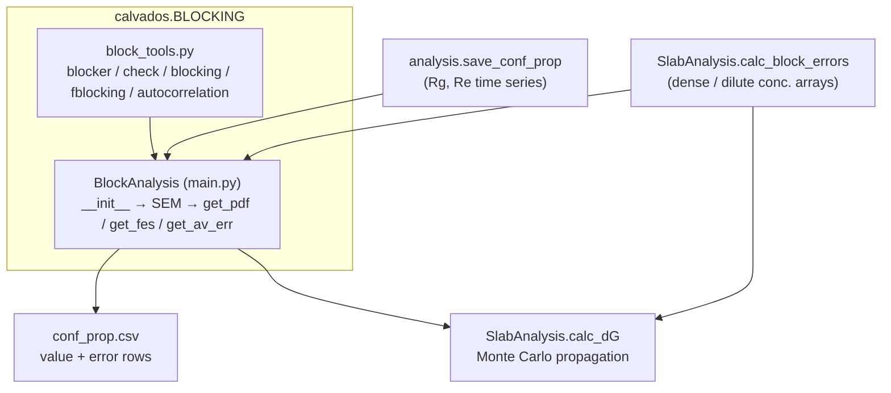
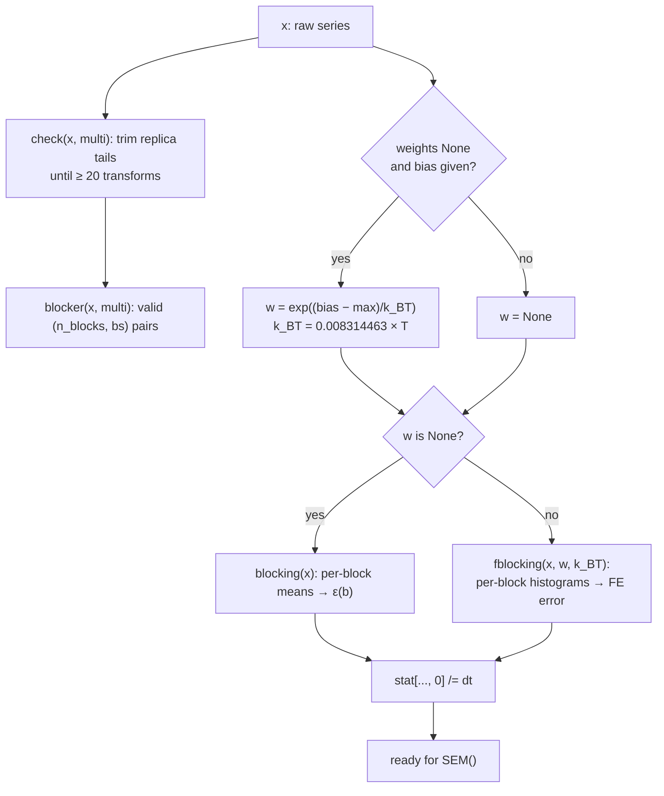
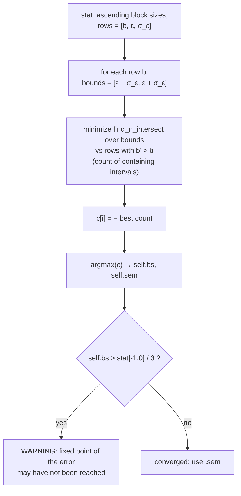

Every observable extracted from a CALVADOS trajectory — radius of gyration, end-to-end distance, dense-phase concentration — is a *time-correlated* series, not a set of independent samples. The naive standard error `std/√N` therefore systematically underestimates uncertainty. The `calvados.BLOCKING` package solves this with **block averaging**: it partitions a correlated series into blocks of increasing size, measures how the standard error grows toward its asymptotic (uncorrelated) plateau, and selects the converged value. This page documents the package's two layers — the stateless estimators in `block_tools.py` and the `BlockAnalysis` facade in `main.py` — and their integration points in the analysis stack. It covers unweighted and reweighted (bias-corrected) estimators, the fixed-point error-selection algorithm, and the downstream consumers in `analysis.py`.

Sources: [main.py](calvados/BLOCKING/main.py#L10-L18), [block_tools.py](calvados/BLOCKING/block_tools.py#L52-L79)

## Why Blocking: The Statistical Problem

MD frames are autocorrelated: consecutive configurations share memory, so treating every frame as an independent sample inflates the effective sample count and shrinks the apparent error. The `autocorrelation` utility exposes this directly — it computes the normalized autocorrelation `r(τ)` at every nonnegative lag via `np.correlate`, normalized by `variance × (n − τ)` so that `r(0) = 1`. The decay of this function defines the correlation time that naive error formulas ignore.

Sources: [block_tools.py](calvados/BLOCKING/block_tools.py#L122-L129)

Block averaging attacks the problem from the measurement side rather than the model side. The series is split into `N_b` contiguous blocks of size `b`, each block is reduced to its mean `B_k`, and the **standard error of the block means** is computed as:

```
ε(b) = sqrt( Σ_k (B_k − x̄)² / (N_b (N_b − 1)) )
```

with the statistical uncertainty of that error given by `σ_ε = ε / √(2(N_b − 1))`. As `b` grows, correlations *within* blocks stop contributing to between-block variance and `ε(b)` rises to a plateau equal to the true asymptotic error. Both formulas are implemented verbatim in `blocking()`, which returns an `(n, 3)` array of `[block size, standard error, uncertainty of that error]` ordered from largest to smallest block size before flipping (see below).

Sources: [block_tools.py](calvados/BLOCKING/block_tools.py#L52-L79)

## Module Architecture

The package separates **pure numerical kernels** from **stateful orchestration**. `block_tools.py` holds five dependency-light NumPy functions with full type aliases (`FloatArray`, `IntArray`); `main.py` holds the single `BlockAnalysis` class that sequences those kernels, applies reweighting, and derives final observables. Nothing in the package imports trajectory machinery — it operates on plain float arrays, which makes it independently testable and reusable outside CALVADOS.



The two consumers shown on the left live in `calvados/analysis.py`, which imports the facade at module scope. Each arrow is a verified call site: `save_conf_prop` blocks Rg and end-to-end series; `SlabAnalysis.calc_block_errors` blocks per-frame dense and dilute concentrations before Monte Carlo propagation of the transfer free energy.

Sources: [block_tools.py](calvados/BLOCKING/block_tools.py#L1-L9), [main.py](calvados/BLOCKING/main.py#L7), [analysis.py](calvados/analysis.py#L21), [analysis.py](calvados/analysis.py#L518-L528), [analysis.py](calvados/analysis.py#L1229-L1244)

### Kernel Function Reference

| Function | Signature core | Responsibility |
|---|---|---|
| `blocker` | `(array, multi) → (N, n_blocks, block_sizes)` | Enumerate block counts `n` for which the split is exactly divisible both globally (`N % n == 0`) and per replica (`(N/multi) % bs == 0`) |
| `check` | `(array, multi) → trimmed array` | Iteratively strip `c` trailing frames from *each* replica until ≥ 20 valid blocking transforms exist |
| `blocking` | `(array, multi) → (n, 3) stats` | Unweighted block-error scan over all valid block sizes |
| `fblocking` | `(cv, w, kbt, multi, interval) → (n, 3) stats` | Weighted free-energy-profile error scan over 50 histogram bins |
| `autocorrelation` | `(x) → r(τ)` | Normalized autocorrelation at all lags for correlation diagnostics |

Sources: [block_tools.py](calvados/BLOCKING/block_tools.py#L11-L25), [block_tools.py](calvados/BLOCKING/block_tools.py#L28-L48), [block_tools.py](calvados/BLOCKING/block_tools.py#L82-L119), [block_tools.py](calvados/BLOCKING/block_tools.py#L122-L129)

## Block Schedule and Replica Hygiene

The scan does not test arbitrary block sizes. `blocker` builds candidate block counts `n ∈ [2, N]` (starting at `multi` when replicas are present) and keeps only those satisfying two divisibility constraints: the total length must divide evenly into `n` blocks, and the block size `bs = N/n` must evenly tile each replica of length `N/multi`. This second constraint is what makes **multi-replica blocking safe** — a block never straddles a replica boundary unevenly, so block means are never contaminated by mixing independent replicas mid-block.

Sources: [block_tools.py](calvados/BLOCKING/block_tools.py#L11-L25)

> [!TIP]
> The `check` function enforces a hidden floor: a blocking scan needs **at least 20 valid transforms** to resolve a plateau. If the raw array supports fewer, it removes 1, 2, 3, … trailing frames from *every* replica (up to 101 iterations) until the constraint is satisfied, then returns the trimmed concatenation. Practically, this means `BlockAnalysis` may silently shorten the tail of your series — do not assume the output length equals the input length.

Sources: [block_tools.py](calvados/BLOCKING/block_tools.py#L28-L48)

## The `BlockAnalysis` Facade

The class constructor is the single entry point for both weighted and unweighted analysis. It accepts the observable series `x`, a replica count `multi`, optional `weights` **or** a `bias` array at temperature `T` for reweighting, optional histogram `interval_low`/`interval_up` bounds, and a time step `dt` for the block-size axis.

| Parameter | Default | Semantics |
|---|---|---|
| `x` | required | Time series (possibly concatenated replicas) of the observable |
| `multi` | `1` | Number of concatenated independent replicas; activates replica-aware divisibility and trimming |
| `weights` | `None` | Per-frame statistical weights; normalized to sum 1 when supplied |
| `bias` | `None` | Bias potential per frame; converted to weights `w = exp((bias − max bias)/k_BT)` when no weights given |
| `T` | `None` | Temperature (K); `k_BT = 0.008314463 × T` (R in kJ·mol⁻¹·K⁻¹), required for bias reweighting and any free-energy output |
| `interval_low` / `interval_up` | `None` | Clip bounds for the histogram/PDF range: each replaces the data bound only when the data overshoot it |
| `dt` | `1` | Divisor applied to the block-size column, converting frame counts to physical time units |

Sources: [main.py](calvados/BLOCKING/main.py#L20-L57)

Initialization runs a fixed decision sequence, summarized below. The output is always `self.stat`, an `(n, 3)` matrix whose columns are `[block size, error, uncertainty of error]`, with the block-size column subsequently scaled by `1/dt`.



Note the flip performed by the kernels: candidate counts run from many blocks (small `b`) to few (large `b`), and both `blocking` and `fblocking` reverse the row order, so `self.stat[0]` corresponds to block size ≈ 1 and `self.stat[-1]` to the largest testable block. This ordering matters for interpreting the `SEM` warning condition discussed next.

Sources: [main.py](calvados/BLOCKING/main.py#L31-L57), [block_tools.py](calvados/BLOCKING/block_tools.py#L79), [block_tools.py](calvados/BLOCKING/block_tools.py#L119)

## Fixed-Point Error Selection: `SEM()`

The blocking scan produces an error *curve*; `SEM()` extracts the single converged number. Its criterion is an **interval-intersection count**: for each row `b` of `self.stat`, it searches within that row's error interval `[b[1]−b[2], b[1]+b[2]]` for the value `x` that lies inside the error intervals of the maximum number of *other* rows with strictly larger block size. The inner scorer `find_n_intersect` counts containment and returns its negation so that `scipy.optimize.minimize` performs a maximization; the block size and error of the row whose interval wins are stored as `self.bs` and `self.sem`. Intuitively, the plateau is the region where many consecutive error estimates mutually agree within their own uncertainties.

Sources: [main.py](calvados/BLOCKING/main.py#L59-L78)



> [!TIP]
> The guard at the end of `SEM()` is the honest failure signal of the whole method: because `stat` rows ascend by block size, `stat[-1, 0]` is the *largest* testable block. If the selected block size exceeds one third of that maximum, the error plateau could only be reached by blocking beyond what the data support — typically meaning the simulation is too short relative to its correlation time. Treat this warning as a prompt to extend sampling rather than a rounding detail.

Sources: [main.py](calvados/BLOCKING/main.py#L59-L81)

## Weighted Observables and Free-Energy Estimators

When weights are present — either supplied directly or derived from a bias via the Maxwell-reweighting transform `w = exp((bias − max bias)/k_BT)` — the constructor routes through `fblocking` instead of `blocking`. The weighted scan histograms the collective variable `cv` into 50 bins over the clipped interval, deletes zero-count bins and their edges, normalizes by the total frame count, and then, for each block size, accumulates squared deviations of *per-block* histograms from the full-sample histogram. The per-bin relative error is `k_BT · e_bin / u` (fluctuation-to-free-energy propagation), averaged over surviving bins; the error-of-error column again uses `ε/√(2(N_b − 1))`.

Sources: [main.py](calvados/BLOCKING/main.py#L42-L55), [block_tools.py](calvados/BLOCKING/block_tools.py#L82-L119)

The same machinery then powers three derived estimators, all built on a Silverman-bandwidth Gaussian KDE of the (weighted) series:

| Method | Returns | Error construction |
|---|---|---|
| `get_pdf(cv=None)` | `(x_grid, density, σ_density)` | Per-block KDEs at the chosen `self.bs`; error `√(Σ_k w_k (P_k − P)² / (N_b (W − S/W)))` with `W = Σw`, `S = Σw²` — the Kish effective-sample-size correction |
| `get_fes(maxkj=25, cv=None)` | `(x, F, σ_F)` | `F = −k_BT ln P`, propagated as `σ_F = k_BT σ_P / P`; output cropped to `F < maxkj` and shifted so `min(F) = 0` |
| `get_av_err(cv=None)` | `(average, σ_average)` | Density-weighted mean over the KDE grid; error accumulated as `√(Σ x² σ_P²)` after normalization |

Sources: [main.py](calvados/BLOCKING/main.py#L83-L130), [main.py](calvados/BLOCKING/main.py#L132-L146), [main.py](calvados/BLOCKING/main.py#L148-L158)

The `cv` argument on each method is notable: it allows computing the density, free energy, or average of a *different* collective variable (itself passed through `check` for replica hygiene) while inheriting the blocking error scale selected on the primary series. This couples the error estimate and the observable deliberately, which is why the class docstring describes `SEM()` as the pivot between "selecting a converged error" and "constructing densities, surfaces, or weighted averages."

Sources: [main.py](calvados/BLOCKING/main.py#L13-L17), [main.py](calvados/BLOCKING/main.py#L91-L96)

## Integration with the Analysis Stack

Two verified call sites consume the facade, and they illustrate the two canonical usage patterns.

### Single-chain conformational properties

`save_conf_prop` computes per-frame Rg and end-to-end arrays from a trajectory, then wraps each in the minimal pattern `BlockAnalysis(series)` + `.SEM()`. The resulting `block_rg.sem` and `block_ree.sem` populate the `error` column of `conf_prop.csv` alongside the plain means — so every published Rg/Re pair from this pipeline already carries a blocking-corrected uncertainty.

Sources: [analysis.py](calvados/analysis.py#L494-L539)

### Slab phase-equilibrium concentrations

`SlabAnalysis.calc_single_conc` reduces the `(n_frames × n_bins)` density profile to per-frame dense and dilute concentration arrays (using the hyperbolic-tangent interface fit cutoffs), then delegates uncertainty to the static helper `calc_block_errors`, which runs the same instantiate-then-`SEM()` pattern on both arrays.

```mermaid
sequenceDiagram
    participant U as calc_concentrations
    participant C as calc_single_conc
    participant E as calc_block_errors
    participant B as BlockAnalysis
    participant G as calc_dG
    U->>C: profile h (n_frames × n_bins, mM)
    C->>C: interface fit → dense/dilute masks,<br/>cden, cdil, per-frame arrays
    C->>E: denarray, dilarray
    E->>B: BlockAnalysis(arr); SEM()
    B-->>E: .sem for each phase
    E-->>C: eden, edil (mM)
    C->>G: cdil, edil, cden, eden
    G->>G: 10 000 normal draws per phase,<br/>std of log(dil/den) over valid draws
    G-->>C: dG, dG_err (kT) → ps_results.csv
```

Sources: [analysis.py](calvados/analysis.py#L767-L806), [analysis.py](calvados/analysis.py#L1229-L1244)

The final hop is worth noting architecturally: `calc_dG` does not do analytic propagation of `dG = log(c_dil/c_den)`. Instead it draws 10 000 normal samples per phase around `(c, σ)` from the blocking analysis, takes the standard deviation of the log-ratios over draws where both concentrations remain positive, and handles degenerate regimes (NaN or zero concentrations) with explicit clipping to `dGmin`. The blocking error is thus the *seed* of a Monte Carlo propagation, not the final word.

Sources: [analysis.py](calvados/analysis.py#L1141-L1185)

## Standard Usage Pattern

For direct use outside the built-in pipelines, the pattern is deliberately two-step: construct (which computes the full blocking scan) and select (which fixes the plateau). The minimal unweighted case needs only the series; reweighting adds `bias`, `T`, and optionally explicit histogram bounds:

```python
from calvados.BLOCKING.main import BlockAnalysis

# Unweighted: Rg series from N frames (optionally nrep concatenated replicas)
block = BlockAnalysis(rgs, multi=nrep, dt=output_frequency)
block.SEM()
print(block.bs, block.sem)   # converged block size (time units) and standard error

# Reweighted: bias in kJ/mol at temperature T, density over [0, 1]
block = BlockAnalysis(cv, bias=bias_array, T=300, interval_low=0.0, interval_up=1.0)
block.SEM()
x, pdf, pdf_err = block.get_pdf()      # density with blocking errors
x, F, F_err  = block.get_fes(maxkj=25) # free energy surface in kJ/mol
```

Every keyword in this snippet maps one-to-one to the constructor semantics table above; the `dt` argument is what converts the reported block size from frame counts into physical time, because `stat[..., 0]` is divided by `dt` at the end of initialization.

Sources: [main.py](calvados/BLOCKING/main.py#L20-L57)

## Summary and Position in the Catalog

The blocking stack follows a clean layering: **kernels** (`blocker`, `check`, `blocking`, `fblocking`) do divisibility-constrained scheduling and error scanning; the **facade** (`BlockAnalysis`) adds replica hygiene, bias reweighting, fixed-point selection, and derived density/free-energy estimators; and the **analysis stack** treats it as a black box that turns a correlated series into `(value, error)` pairs — both in `save_conf_prop` and in the slab concentration workflow whose errors seed the `dG` Monte Carlo. The two failure modes to watch in practice are the silent tail-trimming in `check` and the plateau warning in `SEM` — both are documented behaviors, not bugs, and both signal something about your sampling rather than the estimator.

Sources: [block_tools.py](calvados/BLOCKING/block_tools.py#L11-L129), [main.py](calvados/BLOCKING/main.py#L10-L159), [analysis.py](calvados/analysis.py#L494-L539), [analysis.py](calvados/analysis.py#L1229-L1244)

For where blocking errors are consumed downstream, continue with [Slab Phase-Separation Analysis](16-slab-phase-separation-analysis); for the observables that feed it (Rg, Re, contact maps), see [Trajectory Analysis Toolkit](15-trajectory-analysis-toolkit); to understand how the trajectories themselves and their sampling length are produced, see [Simulation Engine & Checkpointing](14-simulation-engine-and-checkpointing).